# 数据结构与算法 Data Structures and Algorithms

## 引言

数据结构决定信息如何组织，算法决定如何利用这些信息完成计算。两者共同影响程序的正确性、运行时间和空间需求。求解一个问题，首先需要明确输入、输出与约束，再选择合适的表示方法，设计计算步骤，并证明这些步骤能够得到所需结果。

从链表、栈、队列和树出发，可以理解数据组织与基本操作之间的关系；渐进分析进一步提供了比较算法效率的工具。哈希表、字符串匹配和 Trie 展示了不同查询需求如何导向不同的数据结构。分治、回溯、贪心与动态规划提供了设计算法的基本思路，而最短路径、拓扑排序、最小生成树和最大流则把这些思路应用到网络与依赖关系中。

理解一个算法，需要同时回答四个问题：它解决什么问题，依赖什么条件，为什么正确，以及需要多少资源。复杂度结论也应与具体实现和计算模型一起理解。

## 目录

- [1. 问题建模与算法基础](#1-问题建模与算法基础)
  - [1.1 问题、实例与模型](#11-问题实例与模型)
  - [1.2 算法与程序](#12-算法与程序)
  - [1.3 伪代码与求和例题](#13-伪代码与求和例题)
  - [1.4 正确性、终止性与通用性](#14-正确性终止性与通用性)
- [2. 基本数据结构](#2-基本数据结构)
  - [2.1 抽象数据类型与实现](#21-抽象数据类型与实现)
  - [2.2 单链表](#22-单链表)
  - [2.3 动态数组与双向链表](#23-动态数组与双向链表)
  - [2.4 栈](#24-栈)
  - [2.5 队列](#25-队列)
  - [2.6 树的术语与性质](#26-树的术语与性质)
  - [2.7 树的遍历](#27-树的遍历)
- [3. 效率与渐进复杂度](#3-效率与渐进复杂度)
  - [3.1 成本模型与输入规模](#31-成本模型与输入规模)
  - [3.2 大 O、大 Omega 与大 Theta](#32-大-o大-omega-与大-theta)
  - [3.3 极限判定及其适用范围](#33-极限判定及其适用范围)
  - [3.4 常用性质与增长顺序](#34-常用性质与增长顺序)
  - [3.5 循环复杂度的分析](#35-循环复杂度的分析)
  - [3.6 最坏、期望与摊还分析](#36-最坏期望与摊还分析)
- [4. 哈希表](#4-哈希表)
  - [4.1 直接寻址与哈希](#41-直接寻址与哈希)
  - [4.2 哈希函数的要求与例子](#42-哈希函数的要求与例子)
  - [4.3 生日悖论与碰撞概率](#43-生日悖论与碰撞概率)
  - [4.4 分离链接法](#44-分离链接法)
  - [4.5 开放寻址与探测序列](#45-开放寻址与探测序列)
  - [4.6 删除与墓碑标记](#46-删除与墓碑标记)
  - [4.7 扩容、重新散列与实现比较](#47-扩容重新散列与实现比较)
- [5. 字符串匹配](#5-字符串匹配)
  - [5.1 问题与记号](#51-问题与记号)
  - [5.2 朴素匹配](#52-朴素匹配)
  - [5.3 Boyer–Moore 的坏字符规则](#53-boyermoore-的坏字符规则)
  - [5.4 Boyer–Moore–Horspool 算法](#54-boyermoorehorspool-算法)
  - [5.5 KMP 的前缀函数](#55-kmp-的前缀函数)
  - [5.6 KMP 的实现与例题](#56-kmp-的实现与例题)
  - [5.7 匹配算法比较](#57-匹配算法比较)
- [6. Trie 与文本索引](#6-trie-与文本索引)
  - [6.1 Trie 的结构](#61-trie-的结构)
  - [6.2 插入、查询与删除](#62-插入查询与删除)
  - [6.3 复杂度与孩子表示](#63-复杂度与孩子表示)
  - [6.4 从文本构建词索引](#64-从文本构建词索引)
  - [6.5 左孩子右兄弟表示](#65-左孩子右兄弟表示)
  - [6.6 压缩 Trie 与 Patricia](#66-压缩-trie-与-patricia)
- [7. 算法设计范式](#7-算法设计范式)
  - [7.1 分治](#71-分治)
  - [7.2 穷举搜索](#72-穷举搜索)
  - [7.3 回溯与剪枝](#73-回溯与剪枝)
  - [7.4 N 皇后](#74-n-皇后)
  - [7.5 贪心与最优性](#75-贪心与最优性)
  - [7.6 0/1 背包与贪心反例](#76-01-背包与贪心反例)
  - [7.7 动态规划与背包递推](#77-动态规划与背包递推)
  - [7.8 设计范式比较](#78-设计范式比较)
- [8. 文本压缩与 Huffman 编码](#8-文本压缩与-huffman-编码)
  - [8.1 固定长度编码与可变长度编码](#81-固定长度编码与可变长度编码)
  - [8.2 前缀码与解码](#82-前缀码与解码)
  - [8.3 编码成本与满二叉树](#83-编码成本与满二叉树)
  - [8.4 Huffman 算法](#84-huffman-算法)
  - [8.5 最优性与适用范围](#85-最优性与适用范围)
- [9. 图、遍历与最短路径](#9-图遍历与最短路径)
  - [9.1 图的定义](#91-图的定义)
  - [9.2 邻接、度与连通性](#92-邻接度与连通性)
  - [9.3 游走、路径、环与权重](#93-游走路径环与权重)
  - [9.4 图的存储表示](#94-图的存储表示)
  - [9.5 BFS 与 DFS](#95-bfs-与-dfs)
  - [9.6 最短路径与松弛](#96-最短路径与松弛)
  - [9.7 Dijkstra 算法](#97-dijkstra-算法)
  - [9.8 双向 Dijkstra](#98-双向-dijkstra)
  - [9.9 A* 搜索](#99-a-搜索)
  - [9.10 Bellman–Ford 与负权边](#910-bellmanford-与负权边)
  - [9.11 Floyd–Warshall 的动态规划](#911-floydwarshall-的动态规划)
  - [9.12 Floyd–Warshall 的矩阵例题](#912-floydwarshall-的矩阵例题)
  - [9.13 路径恢复与负环检测](#913-路径恢复与负环检测)
- [10. 偏序与拓扑排序](#10-偏序与拓扑排序)
  - [10.1 偏序与全序](#101-偏序与全序)
  - [10.2 拓扑排序的定义](#102-拓扑排序的定义)
  - [10.3 基于 DFS 的拓扑排序](#103-基于-dfs-的拓扑排序)
  - [10.4 Kahn 算法](#104-kahn-算法)
  - [10.5 依赖调度与环检测](#105-依赖调度与环检测)
- [11. 最小生成树与并查集](#11-最小生成树与并查集)
  - [11.1 生成树与最小生成树](#111-生成树与最小生成树)
  - [11.2 割性质与安全边](#112-割性质与安全边)
  - [11.3 Prim 算法](#113-prim-算法)
  - [11.4 Prim 的例题](#114-prim-的例题)
  - [11.5 Kruskal 算法](#115-kruskal-算法)
  - [11.6 并查集](#116-并查集)
  - [11.7 路径压缩与复杂度](#117-路径压缩与复杂度)
- [12. 网络流、最大流与最小割](#12-网络流最大流与最小割)
  - [12.1 流网络与可行流](#121-流网络与可行流)
  - [12.2 流值与线性规划](#122-流值与线性规划)
  - [12.3 残量网络](#123-残量网络)
  - [12.4 残量更新的简单例题](#124-残量更新的简单例题)
  - [12.5 Ford–Fulkerson 方法](#125-fordfulkerson-方法)
  - [12.6 最大流例题与反向边的作用](#126-最大流例题与反向边的作用)
  - [12.7 终止性与 Edmonds–Karp](#127-终止性与-edmondskarp)
  - [12.8 割与割容量](#128-割与割容量)
  - [12.9 最大流最小割定理](#129-最大流最小割定理)
  - [12.10 路径瓶颈与整个网络的瓶颈](#1210-路径瓶颈与整个网络的瓶颈)
  - [12.11 二分图匹配与最大流](#1211-二分图匹配与最大流)

## 1. 问题建模与算法基础

### 1.1 问题、实例与模型

计算问题（computational problem）描述一类任务，包括合法输入以及每个输入所允许的输出。问题本身不规定求解方法。问题实例（instance）则为输入提供了具体取值。

例如，“如何前往 Emory Student Center”还不是完整的计算问题，需要进一步确定起点、交通方式、可通行道路和优化目标。若目标只是找到一条可行路线，求解的是可达性与路径构造问题；若目标是让步行距离最短，求解的才是最短路径问题。

将校园路线建模为图时，可以作如下定义：

| 模型要素 | 具体含义 |
| --- | --- |
| 顶点 | 建筑入口、路口或其他位置 |
| 边 | 可以通行的路段 |
| 边权 | 距离、时间或其他代价 |
| 输入 | 图、起点、终点和通行限制 |
| 输出 | 满足约束的路线，或不存在路线的说明 |

“从 Math & Science Center 步行到 Student Center”给出了起终点和交通方式，但仍需明确是否要求最短路线，以及使用哪张路网。模型中的优化目标不同，得到的最优路线也可能不同。

#### 1.1.1 从现实问题到输入与输出

把“如何到达 Student Center”转为计算任务，可以依次完成以下步骤。

1. 确定问题：要寻找一条可通行路线，还是距离或时间最小的路线。
2. 确定输入：校园地图、当前或指定起点、终点、交通方式及不可通行区域。
3. 确定输出：一条满足约束的路线；若要求最短，还要给出对应最小代价。
4. 建立模型：用顶点、边和权重表示这些信息，明确何种输出才算正确。

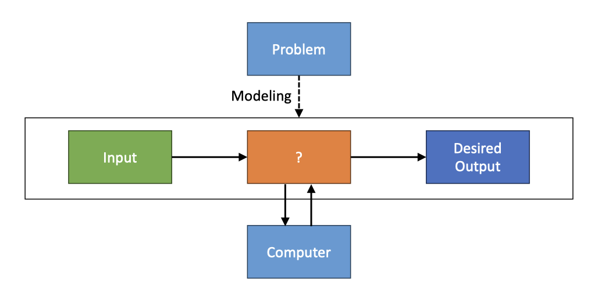

图中的 `Input` 是已知信息，`Desired Output` 是目标结果，中间的问号表示尚未设计的计算过程。建模把自然语言中的需求转成可操作、可检查的输入输出关系。

### 1.2 算法与程序

算法（algorithm）是由有限描述给出的、明确且可执行的计算步骤。对于需要返回答案的普通计算任务，算法还应在规定的输入范围内终止。

- **明确性**：输入、输出及每一步操作都有清楚的含义。
- **有效性**：每一步能够在采用的计算模型中执行。
- **终止性**：满足前提的输入在有限步后得到结果。
- **正确性**：返回的结果满足问题要求。

有限的描述长度与有限的运行步数是两个不同要求：一个很短的程序也可能无限循环。确定性也不是所有算法都必须具有的性质，随机算法可以在执行过程中使用随机选择。

程序（program）是算法在某种编程语言和运行环境中的实现。相同算法可以有不同实现，而整数溢出、错误的边界条件或数据结构使用不当，都可能使程序偏离算法的数学含义。

#### 1.2.1 从算法到可执行程序

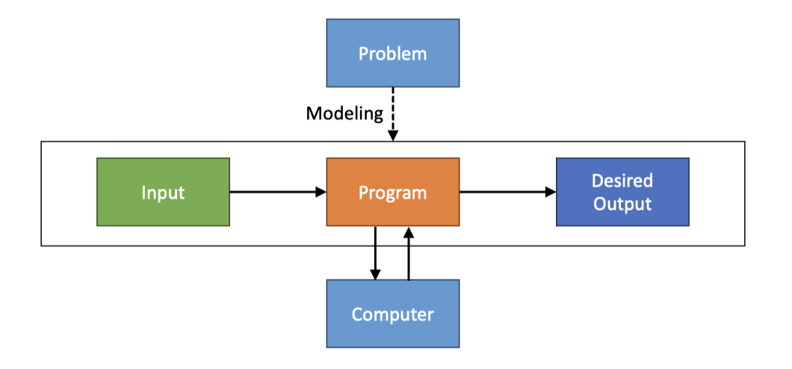

在模型明确之后，中间的问号由程序实现替代。完成这一转换需要分别处理两个核心问题：怎样表示和组织输入数据，以及怎样给出能产生正确输出的逻辑步骤。前者对应数据结构，后者对应算法。

例如路线信息可以使用邻接表保存，最短路线可以由适合边权条件的最短路径算法计算。程序还需要处理输入校验、不可达情况以及路径输出。

确定性算法对于相同输入经历相同的计算选择并得到相同输出；随机算法允许使用随机选择。评价一个实现时，需要同时检查其适用输入范围、终止行为、正确性和时间、空间成本。

### 1.3 伪代码与求和例题

伪代码（pseudocode）使用接近自然语言的写法表达控制流程，重点是逻辑、缩进和边界条件。

计算非负整数 $n$ 对应的和：

$$
S(n)=\sum_{i=1}^{n}i.
$$

```text
SUM-TO(n)
    require n is a nonnegative integer
    total ← 0
    for i ← 1 to n
        total ← total + i
    return total
```

循环不变量是：处理完 $i$ 后，`total` 等于 $1+2+\cdots+i$。循环结束时 $i=n$，因此得到正确答案；当 $n=0$ 时，循环不执行，返回空和 $0$。

也可以使用公式：

$$
S(n)=\frac{n(n+1)}{2}.
$$

在固定字长、算术操作视为常数时间的模型下，循环方法用时 $\Theta(n)$，公式方法只需常数次算术操作。若使用任意精度整数，则必须计入数值位数对算术成本的影响；固定宽度整数实现还需要考虑溢出。

#### 1.3.1 逐项求和的执行过程

用自然语言描述同一个循环算法：先把累计值设为 $0$，再依次取 $1$ 到 $n$，每次把当前数加入累计值，最后返回累计结果。

例如 $n=5$：

| 步骤 | 当前加数 | 更新前累计值 | 更新后累计值 |
| --- | ---: | ---: | ---: |
| 初始化 | — | — | 0 |
| 1 | 1 | 0 | 1 |
| 2 | 2 | 1 | 3 |
| 3 | 3 | 3 | 6 |
| 4 | 4 | 6 | 10 |
| 5 | 5 | 10 | 15 |
| 返回 | — | 15 | 15 |

伪代码兼顾自然语言的可读性与程序控制结构的精确性。它不属于 Java、Python 等特定语言，但必须清楚表示循环范围、条件、缩进和返回位置，才能可靠地翻译为程序。

### 1.4 正确性、终止性与通用性

**部分正确性（partial correctness）**指：只要计算过程终止，返回结果就满足要求。**完全正确性（total correctness）**还要求该过程在规定输入上终止。

$$
\text{完全正确性}=\text{部分正确性}+\text{终止性}.
$$

例如，“反复掷公平六面骰，直到出现 6”在前 $k$ 次内仍未停止的概率为：

$$
\Pr(\text{前 }k\text{ 次均未出现 }6)=\left(\frac56\right)^k.
$$

该概率趋近于 $0$，所以过程以概率 $1$ 终止，称为几乎必然终止（almost-sure termination）。它不存在确定的运行次数上限，不能与“每一种随机序列都在有限步内终止”混为一谈。若等待的是六面骰出现 7，则永远不会停止。

操作系统、服务器和交通信号控制器通常被设计为持续运行的交互系统，不能仅因其不退出就判定它们设计错误。

算法的通用性是指能处理问题定义中的一类输入。例如，比较排序可以处理任何支持一致比较规则的元素；计数排序则需要键属于适当的离散取值范围。通用性的范围由算法前提决定。

#### 1.4.1 数据结构与算法的主要问题

常见的数据结构与算法问题包括以下几组，相同任务可以采用不同表示和求解方法。

| 问题类别 | 主要结构或算法 | 需要关注的条件 |
| --- | --- | --- |
| 有序集合与映射 | 二叉搜索树、平衡搜索树 | 键的比较规则与树高 |
| 按优先级处理 | 优先队列、堆 | 取最小或最大元素及更新键 |
| 快速按键查询 | 哈希表 | 哈希分布、碰撞和负载 |
| 排序 | 堆排序、计数排序、桶排序、LSD 基数排序 | 比较模型、键范围与稳定性 |
| 文本处理 | 字符串匹配、Trie、文本压缩 | 查询类型、字符集与编码 |
| 动态规划 | 编辑距离、最长公共子序列、背包 | 状态、转移与子问题复用 |
| 贪心选择 | 找零、Huffman 编码 | 是否具有可证明的贪心选择性质 |
| 图与网络 | 环检测、拓扑排序、强连通分量、最短路径、MST | 图的方向、权重与连通性 |
| 流与匹配 | 最大流、最小割、二分图匹配 | 容量、守恒与整数流 |

二叉搜索树的基本操作耗时与树高有关；平衡搜索树通过维护平衡把树高控制在 $O(\log n)$。二叉堆则维护父子间的堆序，支持高效取极值，但并不把所有元素排成全序。不同结构服务于不同操作需求。

## 2. 基本数据结构

### 2.1 抽象数据类型与实现

数据结构（data structure）是存储和组织数据的具体方式。抽象数据类型（abstract data type，ADT）则描述可执行的操作及其语义，不限定底层实现。

| 层次 | 例子 | 关注点 |
| --- | --- | --- |
| 抽象数据类型 | 栈、队列、集合、映射、优先队列 | 支持哪些操作及其行为 |
| 具体实现 | 数组、链表、搜索树、哈希表、二叉堆 | 数据布局与操作成本 |

数组和链表通常表示线性序列；树表示层次关系；图表示更一般的连接关系。栈和队列既可以由数组实现，也可以由链表实现，不能仅凭名称判断其存储布局。

固定容量数组的长度不能在原地改变。动态数组通过分配更大的数组并复制元素来扩容；链式结构则可以在运行时增删节点。两者都受到可用内存、索引范围和运行时限制。

#### 2.1.1 数据与结构信息

一个节点通常同时保存实际数据（payload）和结构信息。例如，链表节点的 `value` 是数据，`next` 是组织链条的引用；树节点还需要孩子引用。

编程语言提供的 `int`、`char`、`float` 等通常称为基本类型。数组、记录、链表、树、图等则组合这些值或引用形成更复杂的结构。记录按字段组织数据，不必强行归为线性序列；集合、映射、栈和队列首先描述操作语义，其实现可以采用不同结构。

运行时动态结构适用于事先不知道数据量的情形。例如用户可能持续输入数据，此时可以按需建立新链表节点或扩大数组；删除数据时也可释放不再需要的存储。动态结构需要付出分配、引用和管理成本，因此不能仅凭“可以增长”就认定它总比固定数组更合适。

### 2.2 单链表

单链表的每个节点保存一个值和一个指向后继节点的引用。普通、非循环单链表的最后一个节点指向 `null`。

```java
class Node<E> {
    E value;
    Node<E> next;

    Node(E value) {
        this.value = value;
    }
}
```

已知非空节点 `n1`，在其后插入新节点：

```java
Node<Integer> n1 = new Node<>(1);
Node<Integer> n2 = new Node<>(2);
n2.next = n1.next;
n1.next = n2;

Node<Integer> n3 = new Node<>(3);
n3.next = n1.next;
n1.next = n3;
// 顺序为 1 → 3 → 2 → null
```

必须先让新节点保存原后继，再修改前驱的引用，否则可能丢失后续链条。已知前驱后，插入只需要常数次引用修改。

删除 `n1` 的后继节点：

```java
if (n1.next != null) {
    n1.next = n1.next.next;
}
// 顺序为 1 → 2 → null
```

若链表维护尾指针或元素计数，插入和删除时也要同步更新。删除头节点则需要修改头指针。

Java 中，一个节点只有在无法从垃圾回收根到达时才具备被回收的条件。如果变量 `n3` 仍指向被移除节点，该节点仍然可达；垃圾回收也不保证立即发生。不可达的循环引用同样可以被 Java 垃圾回收器回收。

意外形成的环会使“遍历到 `null` 为止”的实现无法停止，但环并非无法检测。Floyd 快慢指针可以在 $O(n)$ 时间、$O(1)$ 额外空间内检测环；循环链表本身也是一种合法的数据结构，只需使用相应的终止条件。

#### 2.2.1 插入节点时引用如何变化

初始只有节点 1：

```text
n1
 ↓
[1 | null]
```

**步骤 1：建立节点 2。** 此时节点 2 还未连入链表。

```text
n1 → [1 | null]       n2 → [2 | null]
```

**步骤 2：让节点 2 保存节点 1 的旧后继。** 执行 `n2.next = n1.next`，旧后继为 `null`，所以节点 2 成为新的尾节点。

**步骤 3：修改节点 1 的后继。** 执行 `n1.next = n2`：

```text
1 → 2 → null
```

**步骤 4：在节点 1 后再插入节点 3。** 先执行 `n3.next = n1.next`，使节点 3 指向节点 2；再执行 `n1.next = n3`，使节点 1 指向节点 3：

```text
1 → 3 → 2 → null
```

#### 2.2.2 删除节点与循环引用

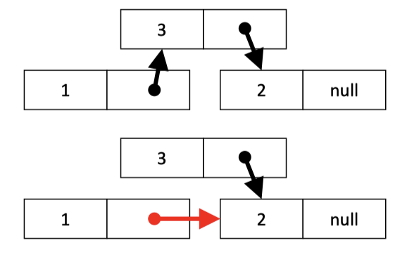

删除节点 3 时，执行 `n1.next = n1.next.next`。右侧先取得节点 3 的后继节点 2，再把节点 1 直接连到节点 2。节点 3 不再位于从表头可达的链上，但是否可以回收还要看其他变量是否继续引用它。

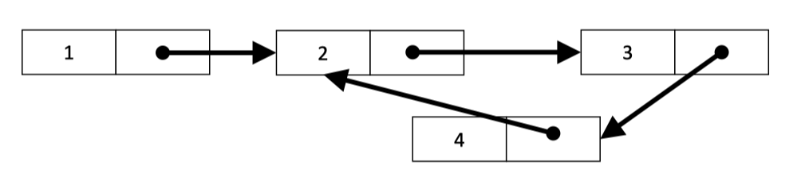

图中引用关系为 `1 → 2 → 3 → 4 → 2 → …`。普通的逐节点遍历会在 2、3、4 之间反复运行，不能按“直到遇到 `null`”的方法求长度或找到尾节点。若程序还要在尾部追加，也必须先检测并处理这个环；若设计的本来就是循环链表，则应使用回到起点等专门的终止条件。

### 2.3 动态数组与双向链表

Java 的 `ArrayList<E>` 基于动态数组，存放引用类型的值；基本类型可通过包装类使用，例如 `ArrayList<Integer>`。扩容策略是实现细节，不能把“容量总是翻倍”当成接口保证。

Java 的 `LinkedList<E>` 使用双向链表，每个节点维护前驱和后继引用。

| 操作 | 动态数组 | 双向链表 |
| --- | --- | --- |
| 按下标访问 | $O(1)$ | $O(n)$ |
| 尾部追加 | 摊还 $O(1)$；扩容时 $O(n)$ | 有尾指针时 $O(1)$ |
| 中间插入或删除 | 通常需移动元素，$O(n)$ | 已定位节点时 $O(1)$ |
| 按下标定位后再插入或删除 | 通常 $O(n)$ | 通常 $O(n)$ |
| 存储特点 | 元素槽连续，通常有较好的缓存局部性 | 节点分散，需额外引用空间 |

“链表插入删除是 $O(1)$”的前提是已经定位到合适位置，并且掌握修改所需的节点引用。单链表删除指定节点通常还需要其前驱。

### 2.4 栈

栈（stack）遵循后进先出（last in, first out，LIFO）规则：最后压入的元素最先弹出。基本操作包括 `push`、`pop`、`peek` 和 `isEmpty`。

数组实现可以令 `size` 表示元素个数和下一个可写位置：

```text
PUSH(x)
    if size = capacity
        grow array or report overflow
    array[size] ← x
    size ← size + 1

POP()
    if size = 0
        report underflow
    size ← size - 1
    x ← array[size]
    clear array[size] if it stores a reference
    return x
```

栈顶元素的下标是 `size - 1`，空栈满足 `size = 0`。固定数组满后必须拒绝插入或显式扩容；动态数组栈的压栈操作通常为摊还 $O(1)$。

链表实现把表头作为栈顶：压栈在头部插入，弹栈删除头节点，二者都是 $O(1)$。栈常用于递归调用、括号匹配和深度优先搜索。

#### 2.4.1 栈的接口与两种实现


下面是教学用的栈接口：

```java
interface Stack<E> {
    void push(E element);
    E pop();
    E peek();
    boolean isEmpty();
}
```

数组栈把连续槽位当成从底到顶的存储区。若当前 `size = 3`，有效元素位于下标 0、1、2；压栈写入下标 3，再把 `size` 改为 4；弹栈先把 `size` 减为 2，再读出原下标 2 的元素。空栈 `size = 0` 时不能弹出，固定容量栈 `size = capacity` 时不能继续写入。

链表栈则把头节点作为栈顶。压入 $x$ 时执行“新节点指向旧头，头指针改为新节点”；弹出时保存旧头的值，再把头指针改为旧头的后继。数组通常具有较好的局部性，链表无需预先确定容量，但每个节点要保存额外引用。具体快慢还需结合实现与工作负载判断。

### 2.5 队列

队列（queue）遵循先进先出（first in, first out，FIFO）规则：从队尾入队，从队首出队。

单链表实现维护 `first` 和 `last`：

```text
ENQUEUE(x)
    node ← a new node containing x
    if first = null
        first ← node
    else
        last.next ← node
    last ← node

DEQUEUE()
    if first = null
        report underflow
    x ← first.value
    first ← first.next
    if first = null
        last ← null
    return x
```

移除最后一个元素后必须同时把尾指针设为 `null`。维护头尾指针时，两种操作均为 $O(1)$。

数组队列通常使用循环数组和头尾索引，避免每次出队都整体移动元素。动态循环数组的入队通常为摊还 $O(1)$，出队为 $O(1)$。

#### 2.5.1 队列的接口与头尾状态

```java
interface Queue<E> {
    void add(E element);
    E remove();
    boolean isEmpty();
}
```

这是用于说明 FIFO 语义的简化接口。实际库的操作名和空队列处理规则可能不同，实现必须明确失败行为。

用头尾指针维护单链表队列时，连续入队和出队如下：

| 操作 | 从队首到队尾的内容 | `first` | `last` |
| --- | --- | --- | --- |
| 初始化 | 空 | `null` | `null` |
| 加入 A | A | A 节点 | A 节点 |
| 加入 B | A → B | A 节点 | B 节点 |
| 加入 C | A → B → C | A 节点 | C 节点 |
| 移除一次 | B → C，返回 A | B 节点 | C 节点 |
| 再移除一次 | C，返回 B | C 节点 | C 节点 |
| 最后移除 | 空，返回 C | `null` | `null` |

空队列第一次入队时，头尾都要指向新节点；非空入队时，先令 `last.next` 指向新节点，再移动 `last`。出队移走最后一个节点后，必须同时清空头尾，避免留下失效尾引用。

### 2.6 树的术语与性质

非空无向树是连通且无环的无向图。指定一个顶点为根后，便得到根树；除根以外，每个节点都有唯一父节点。仅仅允许一个节点指向多个其他节点，并不能保证这些引用构成树，还必须排除环和多父节点等情况。

| 术语 | 含义 |
| --- | --- |
| 根（root） | 没有父节点的节点 |
| 子节点（child） | 当前节点的直接后继 |
| 兄弟节点（sibling） | 具有同一父节点的不同节点 |
| 叶节点（leaf） | 没有子节点的节点 |
| 内部节点（internal node） | 至少有一个子节点的节点 |
| 深度（depth） | 从根到该节点的边数 |
| 高度（height） | 从该节点到其最深后代叶节点的边数 |
| 树高 | 根的高度 |

在根树语境中，节点的度常指子节点数；在无向图语境中，度指关联边数。两种用法应根据上下文区分。

二叉树（binary tree）为每个节点区分左、右两个子位置，每个位置最多有一个子节点。它可以缺少左孩子或右孩子，并不要求实际出现度为 $2$ 的节点。

对于含 $n\ge1$ 个节点的树，边数恰为 $n-1$。若非空二叉树高度为 $h$，并按边数计高，则：

$$
h+1\le n\le 2^{h+1}-1.
$$

$$
\text{叶节点数}\le 2^h,
\qquad
\text{内部节点数}\le 2^h-1.
$$

只有一个节点的树高为 $0$。满二叉树（full binary tree）要求每个内部节点恰有两个孩子；完美二叉树（perfect binary tree）还要求所有叶子深度相同；完全二叉树（complete binary tree）要求除最后一层外各层填满，最后一层从左向右连续填充。这些概念并不相同。

#### 2.6.1 多叉树与二叉树的结构

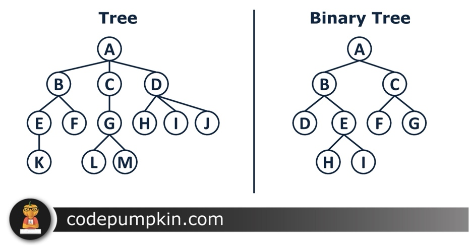

一般根树的一个节点可以有多个孩子。二叉树为每个节点保留左、右两个位置，例如：

```java
class TreeNode<E> {
    E value;
    TreeNode<E> left;
    TreeNode<E> right;
}
```

字段也可以称为 `child1`、`child2`；它们表示结构关系，不是链表中两个依次向后的 `next`。根树里每个非根节点恰有一个父节点，孩子引用不能任意接回祖先。

#### 2.6.2 在具体树上识别术语

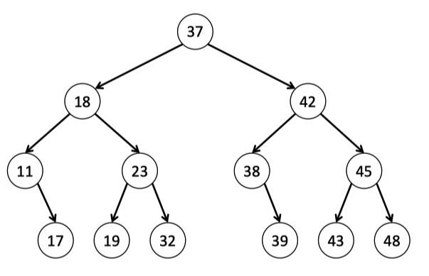

逐项观察图中的树：

1. 根节点为 37，它没有父节点。
2. 节点 18 是内部节点，是 37 的孩子，也是 11 与 23 的父节点。
3. 节点 18 和 42 具有相同父节点 37，所以互为兄弟节点。
4. 路径 `37 → 18 → 23` 经过两条边，长度为 2；节点 23 的深度也是 2。
5. 节点 42 有两个孩子 38、45，按孩子数定义的度为 2。
6. 节点 38 只有孩子 39，度为 1；节点 17 没有孩子，度为 0，是叶节点。
7. 图中最大孩子数为 2；最深叶节点在第 3 条边之后，所以树高为 3。
8. 节点总数为 13，边数为 12，满足 $\lvert E\rvert=\lvert V\rvert-1$。

树高与节点数量的界也可以逐层推出：第 0 层最多 $1$ 个节点，第 1 层最多 $2$ 个，第 $i$ 层最多 $2^i$ 个。因此总数最多为 $1+2+\cdots+2^h=2^{h+1}-1$；若每层只延伸一个孩子，最少为 $h+1$。叶子最多可达到最后一层的 $2^h$ 个，内部节点最多占据前 $h$ 层。

### 2.7 树的遍历

以表达式 $(5+7)(3-1)$ 的二叉表达式树为例，根为乘号，左右孩子分别为加号与减号。

| 遍历 | 访问次序 | 结果 |
| --- | --- | --- |
| 前序（preorder） | 根、左子树、右子树 | `* + 5 7 - 3 1` |
| 中序（inorder） | 左子树、根、右子树 | `5 + 7 * 3 - 1` |
| 后序（postorder） | 左子树、右子树、根 | `5 7 + 3 1 - *` |
| 层序（level order） | 按深度逐层访问 | `* + - 5 7 3 1` |

中序输出若省略括号，可能丢失表达式树所表达的运算次序。要完整保留含义，应输出 `(5 + 7) * (3 - 1)`。

前序、中序、后序属于深度优先遍历；层序遍历通常使用队列。访问所有节点都需要 $\Theta(n)$ 时间。递归深度优先遍历的辅助空间为 $O(h+1)$，层序遍历的队列空间与最大层宽相关，最坏为 $O(n)$。

#### 2.7.1 表达式树的逐步遍历

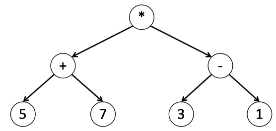

前序遍历先记录根乘号，再完整处理左加法子树，最后处理右减法子树：

```text
* → + → 5 → 7 → - → 3 → 1
```

中序遍历先处理左加法子树，再访问根乘号，再处理右减法子树：

```text
5 → + → 7 → * → 3 → - → 1
```

后序遍历先完成两个子树，最后记录根：

```text
5 → 7 → + → 3 → 1 → - → *
```

层序遍历的队列变化为：初始只有 `[*]`；取出 `*` 后加入 `[+, -]`；取出 `+` 后为 `[-, 5, 7]`；取出 `-` 后为 `[5, 7, 3, 1]`；继续依次取出四个叶节点。输出为 `* + - 5 7 3 1`。

## 3. 效率与渐进复杂度

### 3.1 成本模型与输入规模

时间复杂度描述操作成本随输入规模增长的关系；空间复杂度描述所需存储空间。分析时应说明是否只计算辅助空间。外存访问和网络通信也可以作为单独的成本指标。

实际运行时间还受硬件、缓存、编译器和实现方式影响。CPU 时钟频率是每秒的时钟周期数，不能直接等同于每秒完成的操作数。

输入规模需要明确：数组通常用元素个数 $n$，图常同时使用顶点数 $\lvert V\rvert$ 和边数 $\lvert E\rvert$，整数问题则可能用二进制位数。整数的数值 $N$ 与其编码长度 $\Theta(\log N)$ 是不同的量。

对于逐项求和，在一种简化模型中，把赋值、比较、自增、加法和返回各计一次，则初始化 `total` 和 `i` 各一次，循环比较 $n+1$ 次，自增 $n$ 次，加法与赋值各 $n$ 次，返回一次：

$$
T(n)=4n+4=\Theta(n).
$$

若把 `total += i` 视作一个基本操作，计数又会不同。渐进阶数仍为线性，但精确操作次数必须使用一致的计数规则。

#### 3.1.1 逐条统计循环成本

以下 Java 方法用于说明控制流程，假设 $n\ge0$，且不触发整数溢出：

```java
static int sumTo(int n) {
    int sum = 0;
    for (int i = 1; i <= n; i++) {
        sum += i;
    }
    return sum;
}
```

将加法和赋值分别计数时：

| 语句或操作 | 执行次数 | 成本类型 |
| --- | ---: | --- |
| `sum = 0` | 1 | 常数 |
| `i = 1` | 1 | 常数 |
| `i <= n` | $n+1$ | 线性 |
| `i++` | $n$ | 线性 |
| `sum + i` 的加法 | $n$ | 线性 |
| 把结果写回 `sum` | $n$ | 线性 |
| `return sum` | 1 | 常数 |

总成本为 $4n+4$。如果把加法和写回合并为一次操作，总成本可记为 $3n+4$，仍为 $\Theta(n)$。每次改变计数模型，都要同步改变求和，不能在相同推导中混用不同模型。

对于一般式 $T(n)=c_5n^3+c_6n^2+c_7$，若 $c_5>0$、其他系数固定且成本最终非负，则 $n$ 增大时立方项占主导，得到 $\Theta(n^3)$。常数与低阶项会影响实际用时，但不改变这个渐进阶数。

### 3.2 大 O、大 Omega 与大 Theta

设 $f(n)$ 最终非负，$g(n)$ 最终为正。渐进上界定义为：

$$
\begin{gathered}
f\in O(g)\iff\exists c>0,\ \exists n_0:\\
\forall n\ge n_0,\quad 0\le f(n)\le c g(n).
\end{gathered}
$$

渐进下界定义为：

$$
\begin{gathered}
f\in\Omega(g)\iff\exists c>0,\ \exists n_0:\\
\forall n\ge n_0,\quad 0\le c g(n)\le f(n).
\end{gathered}
$$

渐进紧界定义为：

$$
\begin{gathered}
f\in\Theta(g)\iff\exists c_1,c_2>0,\ \exists n_0:\\
\forall n\ge n_0,\\
0\le c_1g(n)\le f(n)\le c_2g(n).
\end{gathered}
$$

因此 $\Theta(g)=O(g)\cap\Omega(g)$。常见写法 $T(n)=O(g(n))$ 表示 $T\in O(g)$，不表示普通意义上的函数相等。

| 符号 | 含义 | 例子：$f(n)=n^3+2n^2+100$ |
| --- | --- | --- |
| $O(g(n))$ | 最终不超过 $g$ 的某个常数倍 | $O(n^3)$、$O(n^4)$、$O(2^n)$ |
| $\Omega(g(n))$ | 最终不小于 $g$ 的某个正常数倍 | $\Omega(n)$、$\Omega(n^2)$、$\Omega(n^3)$ |
| $\Theta(g(n))$ | 同时满足相同阶的上界和下界 | $\Theta(n^3)$ |

这些符号本身不代表“最坏”“最好”或“平均”情况。应先确定研究的是最坏时间、最好时间还是期望时间，再对该函数给出渐进界。

#### 3.2.1 用常数证明上界

证明 $f(n)=3n+2\in O(n)$ 时，可以逐步选择见证常数。

1. 目标是找到 $c>0$ 和 $n_0$，使 $3n+2\le cn$ 对全部 $n\ge n_0$ 成立。
2. 当 $n\ge1$ 时，$2\le2n$，所以 $3n+2\le5n$。
3. 因此 $c=5,n_0=1$ 是一组有效选择。
4. 也可取 $c=4,n_0=2$；见证常数不唯一。

对 $f(n)=n^2+3n+4$，当 $n\ge4$ 时，有 $n^2-3n-4=(n-4)(n+1)\ge0$，故 $n^2+3n+4\le2n^2$，可取 $c=2,n_0=4$。

$3n+2$ 同时属于 $O(n^2)$ 等更大的上界类，但 $\Theta(n)$ 更精确地描述它的增长。若要说明算法的精确阶数，应同时证明相应的下界。

### 3.3 极限判定及其适用范围

若比值极限存在，则可以用它判断增长关系：

$$
L=\lim_{n\to\infty}\frac{f(n)}{g(n)}.
$$

- 若 $0<L<\infty$，则 $f\in\Theta(g)$。
- 若 $L=0$，则 $f\in O(g)$，并且 $f\in o(g)$。
- 若 $L=+\infty$，则 $f\in\Omega(g)$，并且 $f\in\omega(g)$。

极限存在不是大 O、大 Omega 或大 Theta 的必要条件。例如：

$$
f(n)=n(2+(-1)^n)
$$

满足 $n\le f(n)\le3n$，故 $f\in\Theta(n)$，但 $f(n)/n$ 在 $1$ 和 $3$ 之间交替，没有极限。不能把上述极限判定直接当成这些符号的通用定义。

#### 3.3.1 用极限验证线性增长

对 $f(n)=3n+2$、$g(n)=n$，有：

$$
\lim_{n\to\infty}\frac{3n+2}{n}
=\lim_{n\to\infty}\left(3+\frac2n\right)=3.
$$

极限为正且有限，所以 $f\in\Theta(n)$，因而也有 $f\in O(n)$ 和 $f\in\Omega(n)$。这里是在极限确实存在时使用判定法，通用定义仍是上一节的常数不等式。

### 3.4 常用性质与增长顺序

对于最终非负的成本函数和正常数 $a$：

$$
O(ag)=O(g).
$$

若 $f_1\in O(g_1)$ 且 $f_2\in O(g_2)$，则：

$$
f_1+f_2\in O(g_1+g_2)
=O(\max\{g_1,g_2\}),
$$

$$
f_1f_2\in O(g_1g_2).
$$

对于正整数次幂的多项式，最高次项决定紧确渐进阶。例如：

$$
3n^2+5n^2=8n^2\in\Theta(n^2),
$$

$$
2n^3+7n^2+n\in\Theta(n^3).
$$

第一式当然也属于 $O(n^3)$，但它并不是立方阶增长。

常见复杂度类有严格包含关系：

$$
\begin{gathered}
O(1)\subsetneq O(\log n)\subsetneq O(n),\\
O(n)\subsetneq O(n\log n)\subsetneq O(n^2),\\
O(n^2)\subsetneq O(n^3)\subsetneq O(2^n).
\end{gathered}
$$

对固定 $a>0$ 和 $b>1$，有 $\log n=o(n^a)$、$n^a=o(b^n)$。常数底数大于 $1$ 的对数只差一个常数倍，因此通常省略底数。

多参数分析也应保留各参数含义。例如 $T(n,m)=\Theta(nm)$，不能在没有 $m$ 与 $n$ 关系的前提下随意改写成 $\Theta(n^2)$。

#### 3.4.1 常用运算性质的例子

常数函数不随输入增长，例如 $3$、$100000$、$\sqrt{42}$ 与 $\pi$ 都属于 $\Theta(1)$。

乘以固定正常数不改变阶数：$1000n\in\Theta(n)$、$23n^5\in\Theta(n^5)$。对固定常数 $a$，$2^{n+a}=2^a2^n\in\Theta(2^n)$；这里指数只增加常数，若改为 $2^{2n}$，就不能当成常数倍的 $2^n$。

相加时，较高阶项占主导，例如：

$$
2n^5+25n^3+8n^2+42n+8\in\Theta(n^5),
$$

$$
\log n+n\in\Theta(n).
$$

相乘时，可以分别分析两部分：

$$
(\log n+7n+n^2)\sqrt n
\in\Theta(n^2\sqrt n)=\Theta(n^{5/2}).
$$

多项式比较也应写明参数：若固定 $0\le a<b$，则 $O(n^a)\subsetneq O(n^b)$；$a=b$ 时两者相等，不是严格包含。

另一个例子是 $T_3(n)=n^3+n^2+n+50\in\Theta(n^3)$。准线性函数也常写成 $n(\log n)^k$，其中 $k$ 为固定常数；$k=1$ 时就是常见的 $n\log n$。

#### 3.4.2 常见增长函数的数值比较

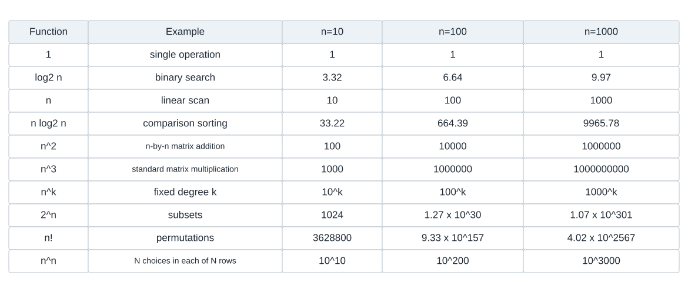

图中比较的是函数值，用来直观展示增长速度；不是某段特定程序的精确运行次数。对数采用底数 2，数值按展示精度取近似。二分查找的具体比较次数还取决于边界和实现；同一量级不意味着每个实现都恰好执行图中的次数。

### 3.5 循环复杂度的分析

判断复杂度应计算执行次数，不能只看更新表达式使用加法还是乘法。以下结论均假设循环体为 $O(1)$，并忽略固定宽度整数溢出。

| 循环形式 | 执行次数或求和 | 紧确时间阶 |
| --- | --- | --- |
| `i = 1; i <= n; i++` | $n$ | $\Theta(n)$ |
| `i = 1; i <= n; i *= 2` | $\lfloor\log_2 n\rfloor+1$ | $\Theta(\log n)$ |
| 外层 $i=1,\ldots,n$，内层 $j=1,\ldots,n$ | $n\cdot n$ | $\Theta(n^2)$ |
| 外层 $i=1,\ldots,n$，内层 $j=1,\ldots,i$ | $\sum_{i=1}^n i$ | $\Theta(n^2)$ |
| 外层 $i=1,2,4,\ldots$，内层 $j=1,\ldots,i$ | $1+2+4+\cdots$ | $\Theta(n)$ |
| 外层 $i=1,2,4,\ldots$，内层总是执行 $n$ 次 | $n(\lfloor\log_2 n\rfloor+1)$ | $\Theta(n\log n)$ |
| 两层各执行 $\Theta(\log n)$ 次 | $\Theta(\log n)\cdot\Theta(\log n)$ | $\Theta((\log n)^2)$ |

独立嵌套循环的执行次数可以相乘；内层边界依赖外层变量时，应写成求和再分析。顺序执行的两个部分则把成本相加，如 $\Theta(n)+\Theta(\log n)=\Theta(n)$。

#### 3.5.1 独立参数与嵌套循环

对两个独立规模参数，定义也需要对二者同时给出阈值。例如 $T(n,m)\in O(nm)$ 指存在 $c>0,n_0,m_0$，使：

$$
\begin{gathered}
\forall n\ge n_0,\ \forall m\ge m_0:\\
0\le T(n,m)\le cnm.
\end{gathered}
$$

如果外层循环执行 $n$ 次，内层固定执行 $m$ 次，成本就是 $\Theta(nm)$。如果内层上界是外层变量 $i$，则必须写成求和。例如外层 $i=1,2,4,\ldots,2^q\le n$，内层执行 $i$ 次，合计为 $2^{q+1}-1=\Theta(n)$；若内层无论 $i$ 是多少都执行 $n$ 次，合计则为 $\Theta(n\log n)$。

### 3.6 最坏、期望与摊还分析

最坏分析研究同一输入规模下最大的成本。期望分析需要说明随机性来自输入分布、算法随机选择还是其他假设。摊还分析则把一串操作的总成本分配到各次操作，不要求输入是随机的。

例如动态数组容量按固定比例增长时，连续追加 $n$ 次的总成本为 $O(n)$，所以每次追加摊还 $O(1)$；其中某一次扩容仍然可能耗时 $\Theta(n)$。

算法复杂度与问题的复杂度也应区分。比较排序在最坏情况下需要 $\Omega(n\log n)$ 次比较，而归并排序达到了 $O(n\log n)$ 的上界。这个下界依赖比较模型，不排除计数排序、基数排序在特定键范围内获得更好的时间界。

#### 3.6.1 同一排序任务的不同算法

冒泡排序（bubble sort）、快速排序（quicksort）和归并排序（merge sort）都可以把同一组可比较元素按相同规则排序，但它们的成本不同。普通冒泡排序的最坏时间为 $\Theta(n^2)$，归并排序为 $\Theta(n\log n)$；随机快速排序通常有 $\Theta(n\log n)$ 的期望时间，最坏仍可能达到 $\Theta(n^2)$。

这些结论描述的是具体算法；比较排序问题的 $\Omega(n\log n)$ 最坏比较下界则针对整个比较模型中的算法类别。算法复杂度是实现目标的一种成本，问题复杂度研究的是在指定模型内能否存在成本更低的方法。

## 4. 哈希表

### 4.1 直接寻址与哈希

直接寻址表（direct-address table）为键域中的每个可能键分配槽位，通过键计算数组下标。数组下标是逻辑位置，并不意味着键值就是实际内存地址。

若键域很大、实际数据很少，直接寻址会浪费空间。例如 32 位有符号整数的范围为：

$$
-2^{31}\le k\le2^{31}-1.
$$

整个键域有 $2^{32}$ 个值。若每个槽假定占 $4$ 字节，槽位本身就需要 $2^{34}$ 字节，即 $16$ GiB，还没有计入对象等额外开销。

哈希表用哈希函数把键域 $U$ 映射到 $m$ 个槽：

$$
h:U\to\{0,1,\ldots,m-1\}.
$$

不同键映射到同一槽称为碰撞（collision）。若 $\lvert U\rvert>m$，根据鸽巢原理，函数必然存在发生碰撞的键对，但当前存储的某一组键不一定碰撞。

设实际存储的元素数为 $n$，负载因子为：

$$
\alpha=\frac{n}{m}.
$$

#### 4.1.1 从大键域映射到有限槽位

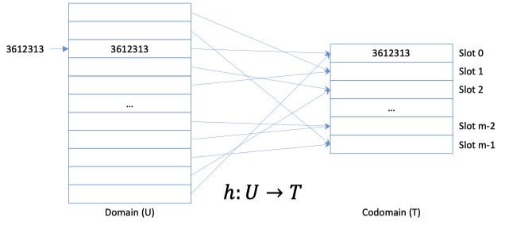

以学号 3612313 为例，直接寻址需要为所有可能学号准备位置；哈希表则先计算 $h(3612313)$，再访问该槽。图中的多条线可能汇入同一槽，正是不同键发生碰撞的情况。

32 位有符号整数共有 $2^{32}$ 个不同值，即使实际只保存很少的学号，完整直接寻址表也要为整个键域预留槽。若只考虑七位十进制编号，最多有 $10^7$ 个编号，约为全部 32 位模式数量的 $1/429$；实际学生数还可能远少于这个键域。

### 4.2 哈希函数的要求与例子

好的哈希函数应计算高效，并在实际键分布下充分分散数据。它不必是满射，也不要求相邻的键一定映射到不相邻的槽；真正需要关注的是不良分布、相关性和碰撞带来的成本。

整数取模是最简单的方法：

$$
h(k)=k\bmod m.
$$

例如 $25\bmod11=3$、$18\bmod11=7$。数学上的模取值为 $0$ 到 $m-1$；编程语言的余数运算对负数可能产生负结果，需要适当归一化。

对于字符串，若令 `A` 到 `Z` 对应 $1$ 到 $26$，简单求和哈希为：

$$
h(s)=\left(\sum_{i=0}^{\ell-1}\operatorname{code}(s[i])\right)\bmod m,
\qquad \ell=\lvert s\rvert.
$$

取 $m=17$，`JAN` 得到 $(10+1+14)\bmod17=8$。该方法不区分字符顺序，`JAN` 与 `NAJ` 必然碰撞。

多项式哈希可以纳入字符顺序：

$$
h(s)=\left(\sum_{i=0}^{\ell-1}\operatorname{code}(s[i])b^{\ell-1-i}\right)\bmod m.
$$

可以用 Horner 形式逐字符计算：`hash ← (b * hash + code(c)) mod m`。它仍可能发生碰撞，哈希值相等后通常还要比较实际键。首次计算一个长度为 $\ell$ 的字符串的哈希值通常需要 $O(\ell)$ 时间，不能无条件视作 $O(1)$。

#### 4.2.1 字符串求和哈希的逐项计算

采用字母编号 `A=1, …, Z=26`，表长为 $17$：

| 字符 | J | A | N |
| --- | ---: | ---: | ---: |
| 编号 | 10 | 1 | 14 |

先累计 $10+1=11$，再加 $14$ 得到 $25$，最后取 $25\bmod17=8$。把字符重排为 `NAJ` 时，累计和仍为 $25$，所以同样落入槽 8。这一碰撞来自忽略字符顺序，与表是否已经很满无关。

### 4.3 生日悖论与碰撞概率

假设 $n$ 个不同键的槽位相互独立，且均匀分布在 $m$ 个槽中。当 $0\le n\le m$ 时，至少一次碰撞的概率为：

$$
\begin{aligned}
\Pr(\text{碰撞})
&=1-\frac{m(m-1)\cdots(m-n+1)}{m^n}\\
&=1-\prod_{k=0}^{n-1}\left(1-\frac{k}{m}\right).
\end{aligned}
$$

当 $n>m$ 时，该概率为 $1$。当各个 $k/m$ 足够小时，可用 $\log(1-x)\approx-x$ 得到近似：

$$
\Pr(\text{碰撞})\approx1-\exp\left(-\frac{n(n-1)}{2m}\right).
$$

以一年 $365$ 天、生日独立且均匀为简化模型：

| 人数 $n$ | 至少两人同生日的概率 |
| --- | ---: |
| 10 | 0.11695 |
| 20 | 0.41144 |
| 23 | 0.50730 |
| 30 | 0.70632 |
| 40 | 0.89123 |
| 50 | 0.97037 |
| 60 | 0.99412 |

当 $n$ 达到 $\Theta(\sqrt m)$ 量级，碰撞概率就可能已经很明显。碰撞概率高不等于哈希表不能高效工作，哈希表本来就需要通过冲突处理机制支持碰撞。

#### 4.3.1 没有碰撞的概率如何相乘

第一个键可以落入任意槽，第二个键要避免第一个槽，有 $m-1$ 个选择，第三个键要避开前两个槽，有 $m-2$ 个选择，依此类推：

$$
\Pr(\text{无碰撞})
=1\cdot\frac{m-1}{m}\cdot\frac{m-2}{m}\cdots\frac{m-n+1}{m}.
$$

生日问题只是把 $m$ 设为 365。23 人时碰撞概率约为 $50.73\%$，50 人时约为 $97.04\%$。23/365 的负载仅约 $6.30\%$，但共有 $\binom{23}{2}=253$ 对人可以发生生日重复，因此“槽数远多于人数”不意味着碰撞概率很小。

### 4.4 分离链接法

分离链接法（separate chaining）让每个桶存储所有映射到该桶的元素，常见实现为链表，也可以使用其他小型容器。

在均匀散列的假设下，链表桶的期望查找时间为：

$$
\Theta(1+\alpha).
$$

如果保持 $\alpha=O(1)$，并且哈希和键比较为常数时间，查找的期望成本就是 $O(1)$。分离链接允许 $\alpha>1$，并不存在所有实现都必须使用的 $0.7$ 阈值。

若所有键集中到同一个链表桶，查找最坏可达 $\Theta(n)$。已知待删除节点及所需前驱时，断开链接只需 $O(1)$；按键删除还需计入查找成本。

#### 4.4.1 沿桶内链表查找

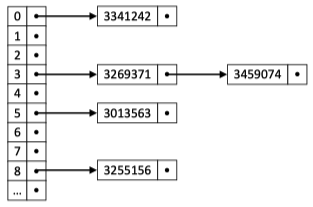

假设要查找 3459074，先计算其槽号 3；进入槽 3 的链，先与 3269371 比较，不同则继续检查后继；下一节点为 3459074，查找成功。若遍历到链尾仍没有相同键，才判定不存在。

桶的顺序和桶内元素顺序不需要与键的大小一致。分离链接把“计算槽号”和“在该桶内判等”分开，因此碰撞只会使桶内检查变长，并不会自动丢失数据。

### 4.5 开放寻址与探测序列

开放寻址（open addressing）把所有元素放在表内，每个槽最多保存一个元素，因此 $\alpha\le1$。为了继续插入并维持良好性能，通常要求 $\alpha<1$，且与 $1$ 保持一定距离。

碰撞时按照探测序列查找其他槽。插入、查找和删除必须使用一致的序列。

**线性探测**依次检查相邻槽：

$$
\begin{gathered}
h(k,i)=(h(k)+i)\bmod m,\\
i=0,1,\ldots,m-1.
\end{gathered}
$$

它容易产生主聚集（primary clustering）：连续占用区间会进一步吸收新的键。若使用固定步长 $d$，需要 $\gcd(d,m)=1$ 才能遍历全部槽。

**二次探测**使用二次偏移：

$$
h(k,i)=(h(k)+c_1i+c_2i^2)\bmod m.
$$

它缓解连续槽形成的主聚集，但具有相同初始槽的键仍使用同一探测序列，形成次聚集（secondary clustering）。参数不合适时，序列可能无法覆盖所有槽，因此即使表未满也可能无法插入。

例如 $h(k,i)=(h(k)+i^2)\bmod m$ 且 $m$ 为奇素数时，序列只覆盖约一半槽；在已占用槽少于表长一半时，可以保证找到空槽。

**双重哈希**使用第二个函数决定步长：

$$
h(k,i)=(h_1(k)+i h_2(k))\bmod m.
$$

为了覆盖整个表，必须满足：

$$
h_2(k)\ne0\pmod m,
\qquad \gcd(h_2(k),m)=1.
$$

若 $m$ 是素数，选择 $1\le h_2(k)\le m-1$ 即可满足互素条件。例如：

$$
\begin{gathered}
m=11,\qquad h_1(k)=k\bmod11,\\
h_2(k)=1+(k\bmod10).
\end{gathered}
$$

按顺序插入 $27,38,49,59$：

| 键 | 初始槽 $h_1(k)$ | 步长 $h_2(k)$ | 实际探测槽 | 插入槽 |
| --- | ---: | ---: | --- | ---: |
| 27 | 5 | 8 | 5 | 5 |
| 38 | 5 | 9 | 5、3 | 3 |
| 49 | 5 | 10 | 5、4 | 4 |
| 59 | 4 | 10 | 4、3、2 | 2 |

不同键仍可能具有相同的初始槽和步长。双重哈希可以减轻聚集，但不保证每个键的探测路径唯一；两个函数的独立性也不能用单个事件 $\Pr(h_1(k)=h_2(k))=1/m$ 来定义。

#### 4.5.1 线性探测的逐次插入

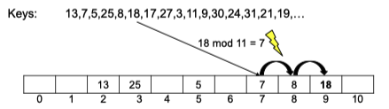

图中表长为 11，已插入键序列的开头为 13、7、5、25、8，且使用 $h(k)=k\bmod11$。插入 18 时：

1. 第一次探测 $h(18,0)=7$，槽 7 已有键 7。
2. 第二次探测 $h(18,1)=8$，槽 8 已有键 8。
3. 第三次探测 $h(18,2)=9$，槽 9 空，把 18 放入此处。
4. 此后查找 18 也要遵循 7、8、9 的同一顺序，不能只检查初始槽 7。

连续的 7、8、9 形成占用区间。新键若从这个区间内部开始探测，也可能被推到区间末尾，使主聚集继续增长。

#### 4.5.2 多项式探测与平方偏移

一般偏移可以表示为：

$$
h(k,j)=\bigl(h(k)+c_1j+c_2j^2+\cdots\bigr)\bmod m.
$$

线性探测是 $c_1=1$、其余系数为 0 的特例。固定步长为 3 时则是 $h(k,j)=(h(k)+3j)\bmod m$，仍需检查步长与表长是否互素。

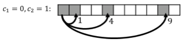

当 $c_1=0,c_2=1$ 时，依次探测偏移 $0,1,4,9,\ldots$ 对应的位置，再按表长取模。这些数表示相对初始槽的偏移，不是每一步都在上一位置上再加 $1,4,9$。

即使槽位不连续，同一初始槽的键仍共享这条序列。例如模 11 时，5、16、27、38、49、60 都从槽 5 开始；使用相同的二次偏移后，它们仍会互相竞争。

#### 4.5.3 双重哈希的计算过程

取 $h_1(k)=k\bmod11$、$h_2(k)=1+(k\bmod10)$。

1. 插入 27：$h_1(27)=5$，$h_2(27)=8$。第一次检查 $(5+0\cdot8)\bmod11=5$，槽空，插入。
2. 插入 38：$h_1(38)=5$，$h_2(38)=9$。槽 5 被占，改查 $(5+1\cdot9)\bmod11=3$，插入槽 3。
3. 插入 49：$h_1(49)=5$，$h_2(49)=10$。槽 5 被占，改查 $(5+10)\bmod11=4$，插入槽 4。
4. 插入 59：$h_1(59)=4$，$h_2(59)=10$。依次检查 4、3、2，前两槽被占，所以插入槽 2。

第二个哈希函数改变的是步长，所有探测仍然必须循环取模，不能让槽号超出数组范围。

### 4.6 删除与墓碑标记

开放寻址中，不能总把删除后的槽直接改为“从未使用的空槽”。否则查找会过早停止，漏掉探测序列后方的键。

例如某个键占用槽 $3$，另一个键因碰撞位于槽 $4$。删除前者后，查找后者仍然必须经过槽 $3$。

常见方法是使用墓碑（tombstone）区分三种状态：

| 槽状态 | 查找时的行为 | 插入时的行为 |
| --- | --- | --- |
| 有元素 | 比较键，不同则继续探测 | 检查是否已有同键 |
| 墓碑 | 继续探测 | 记录为可复用位置 |
| 从未使用的空槽 | 可以判定键不存在 | 可以完成插入 |

插入时遇到墓碑后通常仍需继续查找已有同键，确认键不存在后再复用最早的墓碑。探测还应限制在有限次内，以处理表满或全是墓碑的情况。部分实现使用后移删除等方法，可以避免墓碑，但需要相应的正确性条件。

#### 4.6.1 删除后为什么不能清空探测链

假设键 A 的初始槽为 3，先进入槽 3；键 B 也以 3 为初始槽，因为碰撞而进入槽 4。

```text
删除前：槽 3 = A，槽 4 = B
错误清空：槽 3 = EMPTY，槽 4 = B
使用墓碑：槽 3 = DELETED，槽 4 = B
```

查找 B 从槽 3 开始。遇到 `EMPTY` 会停止并错误报告不存在；遇到 `DELETED` 则继续探测槽 4，从而找到 B。墓碑保留的是“探测过程曾经过这里”的信息。

### 4.7 扩容、重新散列与实现比较

重新散列（rehashing）会建立新表，并按新表长度重新安排已有元素。缓存的原始哈希码不一定需要重算，但槽位通常需要重新计算。

创建并初始化容量为 $m'$ 的数组通常需要 $\Theta(m')$ 时间，不能仅因只有一次分配调用就计作 $O(1)$。若新旧容量均为 $\Theta(n)$，且新表中的每次插入期望为 $O(1)$，重新散列的期望总成本为 $O(n)$。病态碰撞下，简单实现可能更慢。

当容量按固定倍数增长并控制负载时，扩容成本可摊还到插入操作上。在适当的哈希假设下，通常得到期望摊还 $O(1)$ 的插入时间。过多墓碑也可能触发不扩容的表重建。

| 方面 | 分离链接 | 开放寻址 |
| --- | --- | --- |
| 容量关系 | 元素数可以超过桶数 | 元素数不超过槽数 |
| 额外空间 | 桶容器和节点可能带来引用开销 | 通常需要空余槽及状态标记 |
| 负载升高 | 平均桶长随 $\alpha$ 增长 | 接近满表时探测成本明显上升 |
| 缓存局部性 | 链式桶通常较弱 | 连续数组通常较好 |
| 删除 | 按桶结构删除 | 常需墓碑或专门的删除策略 |

具体性能取决于实现、负载、哈希质量、键比较成本和工作负载，不能仅凭表类型断言某一种实现总是更快或更省内存。

#### 4.7.1 重新散列的三个步骤

1. 建立容量为 $m'$ 的新表，并初始化槽状态，成本为 $\Theta(m')$。
2. 遍历旧表，取出所有仍有效的元素；扫描数组式旧表的成本通常为 $\Theta(m)$，不只是有效元素数 $n$。
3. 对每个有效键按新表的规则计算槽位，再执行相应冲突处理，插入新表。

若 $m,m'=\Theta(n)$，且每次插入新表的期望成本为 $O(1)$，总期望时间为 $O(n)$。重新散列无需每次插入都做，采用几何扩容后，可以把偶尔发生的整表迁移成本摊还到一系列插入上。

选择实现时，可以比较各方面的代价：链式桶便于局部删除，并允许元素数超过桶数；开放寻址通常具有较好的连续存储局部性，但需要空余槽和合适的删除策略。元素数量是否可预测、内存开销、哈希分布和查询频率都会影响选择，不能把某一使用场景当成绝对限制。

## 5. 字符串匹配

### 5.1 问题与记号

给定长度为 $n$ 的文本 $T$ 和长度为 $m$ 的模式 $P$，精确字符串匹配需要找出模式在文本中出现的所有起始位置。字符串按字符序列处理，字符比较视为常数时间。

本章使用从 $0$ 开始的下标，区间 $T[a:b]$ 包含下标 $a$，不包含下标 $b$。当 $1\le m\le n$ 时，平移量 $s$ 合法的条件是：

$$
0\le s\le n-m,
\qquad T[s:s+m]=P[0:m].
$$

例如 `T = abcabaaabc`、`P = abaa`，唯一匹配起点是 $s=3$。$s=0,1,2$ 对应的窗口分别为 `abca`、`bcab`、`caba`，均不匹配。

若 $m>n$，没有匹配。空模式 $m=0$ 的行为需要约定；一种常见约定是在文本的 $n+1$ 个边界位置全部匹配。下文伪代码针对 $m\ge1$，空模式可在入口处单独处理。

设 $\Sigma$ 为字符集，$\Sigma^*$ 表示由其中字符构成的所有有限字符串，包括空串 $\varepsilon$。对字符串 $x,y$：

$$
x\varepsilon=\varepsilon x=x,
\qquad \lvert xy\rvert=\lvert x\rvert+\lvert y\rvert.
$$

若存在字符串 $y$ 使 $x=wy$，则 $w$ 是 $x$ 的前缀；若 $x=yw$，则 $w$ 是后缀。真前缀和真后缀排除字符串自身，但可以包含空串。

例如 `abcca` 的前缀包括 $\varepsilon$、`a`、`ab`、`abc`、`abcc`、`abcca`，后缀包括 $\varepsilon$、`a`、`ca`、`cca`、`bcca`、`abcca`。空串的真前缀集合与真后缀集合均为空。

#### 5.1.1 文本、模式与窗口的对齐

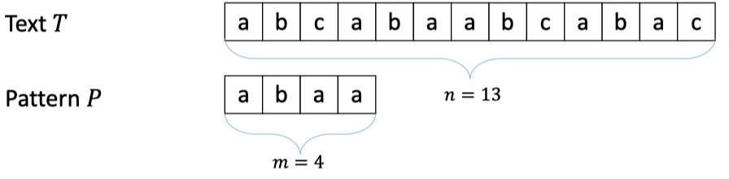

字符集可以是小写英文字母 $\Sigma=\{a,b,\ldots,z\}$，也可以是二进制符号 $\Sigma=\{0,1\}$；文本和模式使用相同字符解释。编辑器的查找操作是精确匹配的一种常见应用。

图中的文本为 `abcabaabcabac`，长度 13，模式为 `abaa`，长度 4。匹配任务是找出整个模式连续出现的位置，而不是只确认模式中的字符在文本某些位置出现过。

再看长度 10 的文本 `abcabaaabc`，从头逐次对齐：

```text
s = 0
T: abcabaaabc
P: abaa
```

先比较 `T[0]=a` 与 `P[0]=a`，再比较 `T[1]=b` 与 `P[1]=b`；第三次 `T[2]=c` 与 `P[2]=a` 不同，所以 $s=0$ 无效。

```text
s = 1
T: abcabaaabc
P:  abaa
```

第一次比较就是 `T[1]=b` 与 `P[0]=a`，立即失配。

```text
s = 2
T: abcabaaabc
P:   abaa
```

第一次比较为 `T[2]=c` 与 `P[0]=a`，仍然失配。

```text
s = 3
T: abcabaaabc
P:    abaa
```

依次比较 `a=a`、`b=b`、`a=a`、`a=a`，完整匹配，因此起点 3 有效。其余起点若要输出全部匹配，也需要按算法规则继续检查；在这个例子中没有其他匹配。

### 5.2 朴素匹配

朴素算法依次尝试每个起点，从模式开头比较；一旦失配，就改试下一个起点。

```text
NAIVE-MATCHER(T, P)
    n ← length(T)
    m ← length(P)
    require m ≥ 1
    for s ← 0 to n - m
        j ← 0
        while j < m and T[s + j] = P[j]
            j ← j + 1
        if j = m
            output s
```

例如 `T = abcde`、`P = abf`：

| 起点 $s$ | 文本窗口 | 比较过程 | 结果 |
| --- | --- | --- | --- |
| 0 | `abc` | `a=a`、`b=b`、`c≠f` | 失配 |
| 1 | `bcd` | `b≠a` | 失配 |
| 2 | `cde` | `c≠a` | 失配 |

最后一次之后再右移会使窗口越界，算法结束。

当 $1\le m\le n$ 时，最坏时间为：

$$
\Theta((n-m+1)m).
$$

$O(nm)$ 是较简略的最坏上界，但并非所有 $n,m$ 关系下都是紧界。若每个窗口的第一个字符都失配，时间为 $\Theta(n-m+1)$；当 $m$ 很接近 $n$ 时，不能将其无条件写成 $\Theta(n)$。辅助空间为 $O(1)$，不计输出。

#### 5.2.1 三次对齐的完整比较

对 `T = abcde`、`P = abf`，合法起点为 $0,1,2$，共 $n-m+1=3$ 个。

**步骤 1：起点 0。**

```text
T: abcde
P: abf
   ||×
```

第一次 `T[0]=P[0]=a`，第二次 `T[1]=P[1]=b`；第三次 `T[2]=c` 不等于 `P[2]=f`，本窗口结束。失配之后无需继续比较本窗口的其他位置。

**步骤 2：起点 1。**

```text
T: abcde
P:  abf
    ×
```

本次应比较 `T[1]=b` 与 `P[0]=a`。文本下标随窗口变化，不能继续把当前文本字符写成 `T[0]`。

**步骤 3：起点 2。**

```text
T: abcde
P:   abf
     ×
```

比较 `T[2]=c` 与 `P[0]=a`，立即失配。若再令 $s=3$，模式最后下标将超出文本，所以停止。三个窗口都失败，输出为空。

### 5.3 Boyer–Moore 的坏字符规则

Boyer–Moore 类算法通常从模式右端向左比较。坏字符规则利用失配字符在模式中的位置决定移动距离。

设当前起点为 $s$，在模式下标 $j$ 处失配：

$$
x=T[s+j]\ne P[j].
$$

令 $\operatorname{last}(x)$ 为 $x$ 在整个模式中最右出现的下标；不存在时取 $-1$。一种基本的坏字符位移为：

$$
\Delta=\max\{1,\ j-\operatorname{last}(x)\}.
$$

若使用的是“严格位于 $j$ 左侧的最右出现位置”，还可以得到不同的、可能更强的位移表。完整 Boyer–Moore 还使用好后缀规则，不能把所有变体混为同一个算法。

以 `P = ACE` 为例，若在 $j=2$ 处遇到 `C`，则 $\operatorname{last}(C)=1$，移动 $1$；若遇到模式中不存在的 `D`，则移动 $2-(-1)=3$。

下标基准必须保持一致：使用从 $1$ 开始的下标时，不存在字符的位移为当前位置 $j$；使用从 $0$ 开始的下标时，位移才是 $j+1$。

#### 5.3.1 从右端距离推出坏字符位移

使用从 0 开始的下标，令 $l=\operatorname{last}(x)$。字符 $x$ 在模式最右出现位置距离模式末端为：

$$
D(x)=m-1-l.
$$

当前失配位置 $j$ 距离模式末端为 $m-1-j$。若想让模式中的位置 $l$ 对齐文本中的失配字符，则相对移动量为：

$$
\begin{aligned}
\Delta_0&=D(x)-(m-1-j)\\
&=(m-1-l)-(m-1-j)\\
&=j-l.
\end{aligned}
$$

若这个量小于 1，至少移动 1；若字符不存在，令 $l=-1$，得到 $j+1$。这里的 $D$ 使用整个模式的最右出现位置，与 Horspool 排除最后一位后构建的位移表不是同一个定义。

#### 5.3.2 坏字符规则的两次对齐

```text
s = 0
T: ABCDEF
P: ACE
```

先从右端比较 `C` 与 `E`，在 $j=2$ 处失配。坏字符是文本中的 `C`，模式中最右位置为 $l=1$，所以移动 $2-1=1$。

```text
s = 1
T: ABCDEF
P:  ACE
```

窗口右端字符是 `D`，与 `E` 失配。`D` 不在模式中，$l=-1$，所以移动 $2-(-1)=3$。新起点为 $1+3=4$，超过 $n-m=3$，不再尝试，报告无匹配。

### 5.4 Boyer–Moore–Horspool 算法

Horspool 是 Boyer–Moore 的简化变体，通常也从右向左比较。它的位移由**当前文本窗口最右端字符**决定，不一定由实际失配位置的字符决定。

令 $r(x)$ 为字符 $x$ 在前 $m-1$ 个模式字符 $P[0:m-1]$ 中最右出现的下标；不存在时令 $r(x)=-1$。位移表定义为：

$$
\lambda(x)=m-1-r(x).
$$

因此，字符未在该前缀中出现时，位移为 $m$。

构建表时排除模式的最后一个位置，所以所有位移至少为 $1$。重复出现的字符取前 $m-1$ 个字符中的最右位置。

```text
HORSPOOL-MATCHER(T, P)
    n ← length(T)
    m ← length(P)
    require m ≥ 1
    for each character x in the alphabet
        shift[x] ← m
    for j ← 0 to m - 2
        shift[P[j]] ← m - 1 - j

    s ← 0
    while s ≤ n - m
        j ← m - 1
        while j ≥ 0 and P[j] = T[s + j]
            j ← j - 1
        if j < 0
            output s
        s ← s + shift[T[s + m - 1]]
```

即使匹配成功，也可使用相同的位移继续搜索后续匹配，包括重叠匹配。对于大字符集，可以用映射保存实际出现的字符，未出现字符默认位移为 $m$。

以 `T = ABCDEF`、`P = ACE` 为例：

| 字符 | `A` | `C` | `E` | 其他 |
| --- | ---: | ---: | ---: | ---: |
| 位移 | 2 | 1 | 3 | 3 |

| 起点 $s$ | 窗口 | 最右端比较 | 位移 | 下一起点 |
| --- | --- | --- | ---: | ---: |
| 0 | `ABC` | `C≠E` | 1 | 1 |
| 1 | `BCD` | `D≠E` | 3 | 4 |

因为 $n-m=3$，下一起点 $4$ 已越界，结束且无匹配。

如果用完整字符表初始化，预处理为 $O(m+\lvert \Sigma\rvert)$，辅助空间为 $O(\lvert \Sigma\rvert)$。搜索最坏为 $O((n-m+1)m)$，可简写为 $O(nm)$。实际常能跳过许多位置，但平均性能依赖字符分布、字符集大小和模式结构，不能在没有概率模型时给出统一的平均结论。

#### 5.4.1 位移表与匹配过程的逐步展开

**步骤 1：初始化。** 模式 `ACE` 长度为 3，先把所有字符的位移设为 3。

**步骤 2：处理前两个模式字符。** `A` 位于下标 0，位移改为 $3-1-0=2$；`C` 位于下标 1，位移改为 $3-1-1=1$。最后一位 `E` 不参与这个循环，因此其默认位移仍为 3。

**步骤 3：起点 0。**

```text
T: ABCDEF
P: ACE
     ×
```

从右向左比较，窗口末字符 `C` 与模式末字符 `E` 不同。查表得到 $\lambda(C)=1$，所以新起点为 1。

**步骤 4：起点 1。**

```text
T: ABCDEF
P:  ACE
      ×
```

窗口末字符 `D` 与 `E` 不同，$\lambda(D)=3$，所以新起点为 4。

**步骤 5：检查边界。** 若从 4 开始放置长度 3 的模式，需要访问文本下标 4、5、6；文本最后下标只有 5。因此不进入下一次比较，输出无匹配。

这个例子中失配位置恰好总在模式最后一位，所以坏字符规则与 Horspool 得到相同移动量。在其他例子中，Horspool 仍然读取窗口末字符，而不是任意中间位置上的失配字符。

### 5.5 KMP 的前缀函数

Knuth–Morris–Pratt（KMP）利用已经匹配的前后缀，避免文本指针回退。

对非空模式 $P$，定义 $\pi[q]$ 为 $P[0:q+1]$ 的最长真前缀与后缀的公共长度：

$$
\pi[q]=\max_{\substack{
0\le k\le q\\
P[0:k]=P[q-k+1:q+1]
}}k.
$$

$k=0$ 表示空串，因此集合总是非空。例如：

| 模式 | 字符序列 | 前缀函数 |
| --- | --- | --- |
| `ababaca` | `a b a b a c a` | `0 0 1 2 3 0 1` |
| `abacab` | `a b a c a b` | `0 0 1 0 1 2` |

若已匹配 $q$ 个字符，下一字符失配，可以保留长度为 $\pi[q-1]$ 的匹配前缀，并继续比较当前文本字符。对应的概念性平移量为：

$$
q-\pi[q-1].
$$

这里 $q$ 是已成功匹配的字符数，不能把它与“失配位置是否包含在前缀中”混淆。

#### 5.5.1 手工计算 ababaca 的前缀函数

逐个增加模式前缀，寻找既是真前缀又是后缀的最长字符串：

| 下标 $q$ | 当前模式前缀 | 最长匹配前后缀 | $\pi[q]$ |
| --- | --- | --- | ---: |
| 0 | `a` | 空串 | 0 |
| 1 | `ab` | 空串 | 0 |
| 2 | `aba` | `a` | 1 |
| 3 | `abab` | `ab` | 2 |
| 4 | `ababa` | `aba` | 3 |
| 5 | `ababac` | 空串 | 0 |
| 6 | `ababaca` | `a` | 1 |

以 `ababa` 为例，真前缀包括空串、`a`、`ab`、`aba`、`abab`，后缀包括空串、`a`、`ba`、`aba`、`baba`、`ababa`，最长共同部分是 `aba`，长度为 3。

当新增字符 `c` 时，之前的长度 3 候选无法继续匹配，回退到更短候选，最后只能取空串，因此 $\pi[5]=0$。随后新增 `a` 又能与首字符匹配，得到 $\pi[6]=1$。

### 5.6 KMP 的实现与例题

```text
PREFIX-FUNCTION(P)
    m ← length(P)
    require m ≥ 1
    pi ← a zero-filled array of length m
    k ← 0
    for q ← 1 to m - 1
        while k > 0 and P[k] ≠ P[q]
            k ← pi[k - 1]
        if P[k] = P[q]
            k ← k + 1
        pi[q] ← k
    return pi

KMP-MATCHER(T, P)
    require length(P) ≥ 1
    pi ← PREFIX-FUNCTION(P)
    q ← 0
    for i ← 0 to length(T) - 1
        while q > 0 and P[q] ≠ T[i]
            q ← pi[q - 1]
        if P[q] = T[i]
            q ← q + 1
        if q = length(P)
            output i - length(P) + 1
            q ← pi[q - 1]
```

匹配成功后回退到最长可复用前缀，而非直接清零，可以保留重叠匹配。例如模式 `aba` 在文本 `ababa` 中的起点为 $0$ 和 $2$。

考虑：

```text
T = abacaabaccabacabaabb
P = abacab
```

其概念性对齐过程为：

| 起点 | 已匹配长度 | 失配或完成情况 | 后续处理 |
| --- | ---: | --- | --- |
| 0 | 5 | 文本下标 5 的 `a` 与模式下标 5 的 `b` 失配 | 保留长度 1，起点变为 4 |
| 4 | 1 | 同一文本字符与模式下标 1 的 `b` 失配 | 保留长度 0，起点变为 5 |
| 5 | 4 | 文本下标 9 的 `c` 与模式下标 4 的 `a` 失配 | 保留长度 0，起点变为 9 |
| 9 | 0 | `c` 与模式首字符 `a` 失配 | 继续读文本，起点变为 10 |
| 10 | 6 | `abacab` 完整匹配 | 输出 10 |

前缀函数可以在 $O(m)$ 时间内计算。搜索阶段中，$q$ 的总增加次数为 $O(n)$，回退次数也受总增加次数约束，因此为 $O(n)$；总体时间为 $O(n+m)$，辅助空间为 $O(m)$。

#### 5.6.1 五个窗口与十九次逻辑比较

模式 `abacab` 的前缀函数为 `0 0 1 0 1 2`。以下按每一次必要的字符比较计数；已经复用的匹配字符不重新比较，同一结果在控制条件中的重复求值也不另算一次逻辑比较。

**步骤 1：起点 0，比较 1—6。**

```text
T: abacaabaccabacabaabb
P: abacab
```

前五次比较为 `a=a`、`b=b`、`a=a`、`c=c`、`a=a`。第六次比较是 `T[5]=a` 与 `P[5]=b`，失配。已匹配长度为 5，查 $\pi[4]=1$，可复用最后的 `a`，概念性平移 $5-1=4$。

**步骤 2：起点 4，比较 7。**

```text
T: abacaabaccabacabaabb
P:     abacab
```

下标 4 的 `a` 已由前一步确认，不需要再比较。当前文本字符仍为 `T[5]=a`，它与 `P[1]=b` 失配。查 $\pi[0]=0$，再移动 $1-0=1$，起点变成 5。

**步骤 3：起点 5，比较 8—12。**

```text
T: abacaabaccabacabaabb
P:      abacab
```

比较 8—11 对应 `T[5:9]=abac` 与模式的 `abac`，四次全部匹配。比较 12 是 `T[9]=c` 与 `P[4]=a`，失配。查 $\pi[3]=0$，移动 $4-0=4$，概念性起点变成 9。

**步骤 4：起点 9，比较 13。**

```text
T: abacaabaccabacabaabb
P:          abacab
```

仍是 `T[9]=c`，这次与 `P[0]=a` 比较，失配且没有可复用前缀，于是读取下一个文本字符，起点变成 10。

**步骤 5：起点 10，比较 14—19。**

```text
T: abacaabaccabacabaabb
P:           abacab
```

`T[10:16]=abacab` 与模式逐字符相等，六次比较全部成功，输出起点 10。若只需第一个匹配，可在此返回；若需全部匹配，令 $q=\pi[5]=2$ 后继续扫描，保留末尾 `ab` 对下一次匹配的作用。

文本指针始终没有回退。发生多次失配时，变化的是已匹配长度与模式的概念性起点；当前失配文本字符可以依次与更短前缀的下一位比较。

### 5.7 匹配算法比较

以下设 $1\le m\le n$，不计存储输出结果的空间：

| 算法 | 预处理 | 搜索最坏时间 | 主要思想 |
| --- | --- | --- | --- |
| 朴素匹配 | $O(1)$ | $O((n-m+1)m)$ | 枚举每个起点 |
| Horspool | $O(m+\lvert \Sigma\rvert)$ | $O((n-m+1)m)$ | 按窗口末字符跳跃 |
| KMP | $O(m)$ | $O(n)$ | 复用模式的前后缀 |

这些算法解决的是“给定文本与模式后进行扫描”。若词典固定并需要大量词或前缀查询，可以建立 Trie；若固定的是一整段文本且需要任意子串查询，则还可考虑后缀树、后缀数组等索引结构。

## 6. Trie 与文本索引

### 6.1 Trie 的结构

Trie（前缀树、字典树）通过共享公共前缀来存储字符串集合。根表示空前缀，从根沿边读取字符得到一个前缀；节点可通过 `isEndOfWord` 标记某个完整字符串在此结束。

字符通常标在边上，也可以标在非根节点上，两种表示的含义相同。一个节点对同一字符最多有一个孩子，孩子不一定需要按字符顺序存储；若需要按字典序输出，可以有序遍历孩子。

Trie 可以同时存储 `be` 与 `bear`：把 `e` 和 `r` 对应节点都标记为单词终点即可。完整单词既可以在叶节点结束，也可以在内部节点结束。只有在词集无前缀关系，或引入专用结束符等约定后，才能把每个单词与一个叶节点对应起来。

例如存储：

```text
bear, bell, bid, bull, buy, sell, stock, stop
```

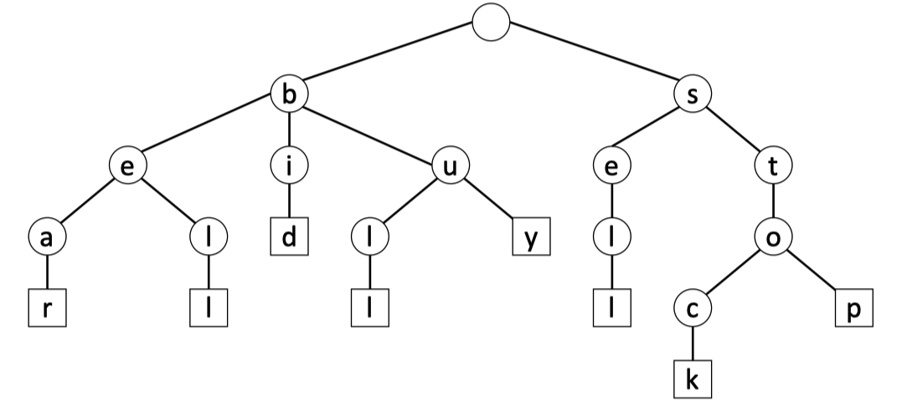

图中每条边前进一个字符，方形叶节点标出这些单词的末尾。由于该例没有单词是另一个的前缀，单词恰好都在叶节点结束。

若边上每次读取一个普通字符，且不另计结束符，则树高等于最长字符串长度。设所有字符串的总长度为 $L$，节点数不超过 $L+1$，其中包含根节点。

#### 6.1.1 共享前缀与节点数量

八个单词对应的根到终点路径为：

```text
b → e → a → r          bear
b → e → l → l          bell
b → i → d              bid
b → u → l → l          bull
b → u → y              buy
s → e → l → l          sell
s → t → o → c → k      stock
s → t → o → p          stop
```

`bear` 与 `bell` 共享 `be`，`bull` 与 `buy` 共享 `bu`，`stock` 与 `stop` 共享 `sto`。单词总长度为 31，但共享前缀后，含根共有 22 个节点，其中 8 个为单词终点叶节点，14 个为内部节点。最长单词 `stock` 长度为 5，所以高度为 5。

如果固定文本很长、不同查询很多，每次运行 KMP 等算法都重新扫描文本会产生重复工作。词典查询可以把预处理成本投入 Trie，之后按查询词长逐字符定位；是否值得建索引，仍取决于查询次数、存储成本和具体查询语义。

### 6.2 插入、查询与删除

**插入**：从根开始逐字符前进，缺少对应孩子时创建节点，最后标记终点。先插入 `bell` 再插入 `bear` 时，共享 `b → e`，之后分别沿 `l → l` 与 `a → r` 分支。

**完整词查询**：读取完字符串后，还需要检查终点标记。若只存储 `bear` 与 `bell`，则 `be` 的路径存在，但 `be` 不是已存储单词。

**前缀查询**：只需确认前缀路径存在。自动补全还需遍历其子树，收集所有标记为终点的节点，而不是仅输出直接孩子。

**删除**：先确认完整单词存在，取消终点标记，再从末尾向上删除“既不是其他单词终点、也没有孩子”的节点。

| 原词集 | 操作 | 结果 |
| --- | --- | --- |
| `{dog}` | 删除 `dog` | 只保留空根节点 |
| `{bell, belly}` | 删除 `bell` | 保留路径，只取消 `bell` 的终点标记 |
| `{bear, bell}` | 删除 `bell` | 删除两个 `l` 节点，保留共享的 `be` |
| `{bear}` | 删除 `bears` | 不改变 Trie |

删除时不能因为一个节点只有一个孩子就直接删除它，该节点仍可能属于另一个单词的必要路径。

#### 6.2.1 从空树插入 bell

假设字符集为小写英文字母，用 26 个槽的孩子数组，字符 $c$ 的槽号为 `c - 'a'`。

1. 初始只有根节点，根不代表普通字符，所有孩子槽为空。
2. 读入 `b`，槽号为 1；根的 `children[1]` 为空，创建节点 `b`。
3. 在 `b` 节点读入 `e`，槽号为 4；创建孩子 `e`。
4. 在 `e` 节点读入第一个 `l`，槽号为 11；创建孩子 `l`。
5. 在这个 `l` 节点读入第二个 `l`；再创建一个 `l` 节点。相同字符位于不同层，可以有不同节点。
6. 字符处理完毕，把最后节点的 `isEndOfWord` 设为 `true`。

```text
root → b → e → l → l*
```

星号表示单词终点标记，不是单词中的字符。

#### 6.2.2 在已有 bell 后插入 bear

1. 从根沿已有 `b` 前进，不创建新节点。
2. 从 `b` 沿已有 `e` 前进，共享前缀 `be`。
3. 在 `e` 节点下，`l` 孩子已存在，但 `a` 孩子为空；创建 `a`，不能覆盖原来的 `l`。
4. 在 `a` 下创建 `r`。
5. 把 `r` 节点标为单词终点，原来 `bell` 的终点标记继续保留。

```text
root → b → e ─┬→ a → r*
              └→ l → l*
```

#### 6.2.3 逐字符查找 bear 与 be

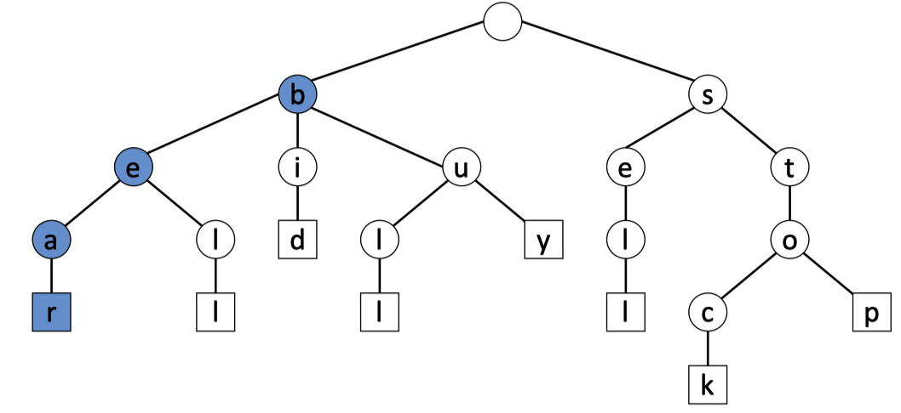

查找 `bear` 时，从根开始：先取字符 `b` 的槽 1，进入 `b`；再取 `e` 的槽 4，进入 `e`；再取 `a` 的槽 0，进入 `a`；最后取 `r` 的槽 17，进入 `r`。四次转移均存在，且 `r` 的终点标记为真，所以查找成功。

查找 `be` 时，前两次转移都存在，已经读取完查询串，但 `e` 节点未标记为终点，所以完整词查询失败。若执行的是前缀存在查询，则到达这个节点就可以返回成功。

#### 6.2.4 四种删除情况

1. **单词不存在。** 在只存储 `bid` 时删除 `bids`，查找 `s` 的转移失败，直接返回，不修改任何节点。
2. **没有其他单词共享所需路径。** 集合只有 `dog` 时，取消 `g` 的终点标记，依次删除不再需要的 `g`、`o`、`d`，只保留根。
3. **要删的词是另一个词的前缀。** 集合为 `{bell, belly}`，删除 `bell` 时取消第二个 `l` 的终点标记，但保留到 `y` 的整条路径。
4. **共享部分前缀。** 集合为 `{bear, bell}`，删除 `bell` 后先删末尾 `l`，再删前一个 `l`；到达 `e` 后，因为还有通向 `a → r` 的分支，立即停止向上删除。

### 6.3 复杂度与孩子表示

Trie 的复杂度依赖孩子容器的实现。设查询词长为 $m$，字符集大小为 $\sigma=\lvert \Sigma\rvert$，总节点数为 $N$。

| 孩子表示 | 单次字符转移 | 每个节点的主要存储特点 |
| --- | --- | --- |
| 长度为 $\sigma$ 的数组 | $O(1)$ | $\Theta(\sigma)$ 个孩子槽 |
| 哈希映射 | 期望 $O(1)$ | 存储实际存在的孩子及容器开销 |
| 平衡搜索树 | $O(\log\sigma)$ | 存储实际存在的孩子 |
| 无序兄弟链表 | 最坏 $O(\sigma)$ | 顺序查找兄弟节点 |

当字符集固定、单次转移和节点创建为常数成本时，插入、完整词查询和删除均可为 $O(m)$，构建所有词为 $O(L)$。

若孩子数组长度 $\sigma$ 也作为变量计入，初始化每个新节点需要 $\Theta(\sigma)$，空间为 $O(N\sigma)$，最坏为 $O((L+1)\sigma)$，构建时间也可能达到这一量级。若删除时扫描整个孩子数组来判断节点是否有孩子，最坏为 $O(m\sigma)$；维护孩子计数可以避免逐次扫描。

输出补全结果还必须计入子树遍历和输出成本。即使找到前缀节点只需 $O(m)$，输出大量单词也不会是 $O(m)$。

### 6.4 从文本构建词索引

可以先对文本分词，再把每个单词插入 Trie，并在终点保存它在文本中的所有出现位置。这样既能判断单词是否存在，也能得到词频和位置列表。

常见处理包括大小写归一化、标点处理和可选的停用词过滤。停用词并非“没有意义”的词；过滤 `the`、`of` 等常见词适合某些关键词检索，却会影响短语查询和完整文本检索，是否过滤取决于应用目标。

若要保留原文位置，索引应记录原文本中的偏移量；不能在删除停用词后重新编号，再把编号误称为原文字符位置。对 Unicode 文本，还应明确位置单位是字节、代码单元还是 Unicode 码点。

普通词典 Trie 支持单词和前缀查询，但并不自动支持任意文本子串检索。拼写纠错也需要额外的候选生成和距离计算，例如在 Trie 上结合编辑距离搜索。

#### 6.4.1 带原文位置的索引构造

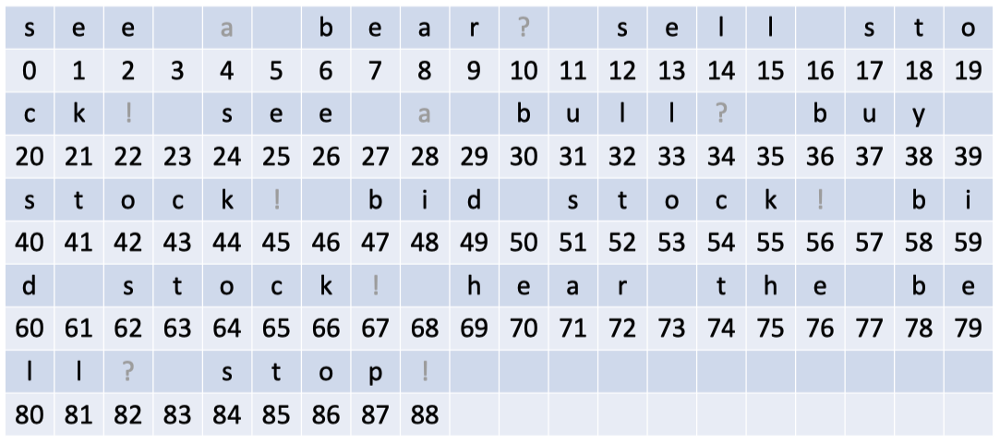

图中的文本为：

```text
see a bear? sell stock! see a bull! buy stock, bid stock! bid stock! hear the bell! stop!
```

构建过程可以分为三步。

**步骤 1：保留原文偏移。** 字符位置从 0 开始编号，包括空格和标点。因此 `see` 首次出现于 0，`bear` 出现于 6，后面的 `see` 出现于 24。

**步骤 2：分词并按检索需求过滤。** 识别单词边界，把 `?`、`!`、逗号等与单词分开。若选择过滤 `a`、`the` 等停用词，仍保留其他词在原文本中的位置。

**步骤 3：插入单词并追加位置。** 每次读到单词，沿其 Trie 路径前进，把原始起点加入终点的位置列表。

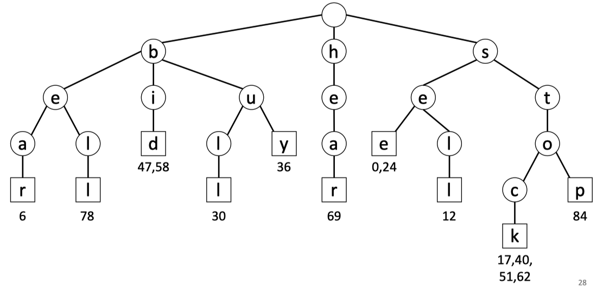

| 单词 | 原文起始位置 |
| --- | --- |
| `see` | 0、24 |
| `bear` | 6 |
| `sell` | 12 |
| `stock` | 17、40、51、62 |
| `bull` | 30 |
| `buy` | 36 |
| `bid` | 47、58 |
| `hear` | 69 |
| `bell` | 78 |
| `stop` | 84 |

搜索 `stock` 时，到达其终点便能返回四个位置，词频为 4；搜索前缀 `be` 时，可以继续枚举 `bear` 和 `bell`。位置索引增加了终点数据，不改变字符路径共享的基本结构。

### 6.5 左孩子右兄弟表示

左孩子右兄弟（left-child right-sibling）表示用两个引用编码多叉树：

- `firstChild` 指向第一个孩子。
- `nextSibling` 指向下一个兄弟。

这是一种存储表示，不会把“兄弟关系”变成原树中的“父子关系”。若通过兄弟链寻找某个字符，转移成本与实际需要扫描的兄弟数有关，不能继续无条件使用孩子数组的 $O(1)$ 查找成本。

#### 6.5.1 左孩子右兄弟的逐项转换

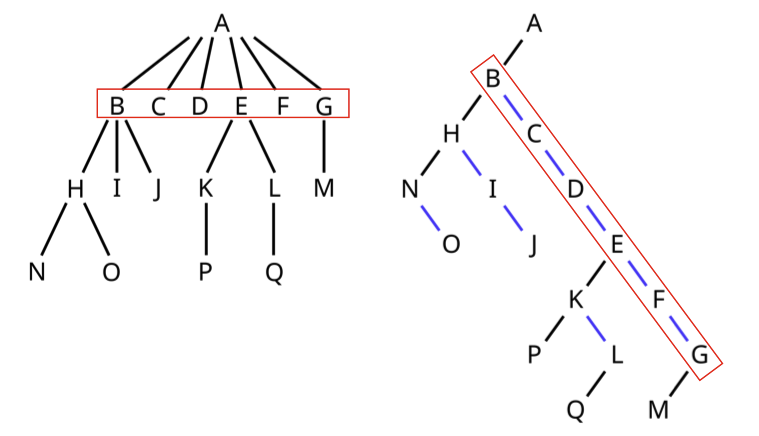

以图中 A 的孩子 B、C、D、E、F、G 为例：

1. A 的 `firstChild` 指向 B。
2. B 的 `nextSibling` 指向 C，C 的指向 D，依次连接到 G。
3. B 原有孩子 H、I、J，因此 B 的 `firstChild` 指向 H，H、I、J 再由兄弟指针连接。
4. H 下面的 N、O，同样用 `firstChild` 与 `nextSibling` 表示。
5. E 下面的 K、L，K 下面的 P、Q，也逐层采用相同规则。

转换后每个节点至多保留两个引用，但右引用的含义是“下一个兄弟”，不能按普通二叉树孩子关系解释这棵表示树。

### 6.6 压缩 Trie 与 Patricia

压缩 Trie（compressed trie、radix tree）把不需要保留的单孩子链压缩为一条带字符串标签的边。例如共享前缀 `be` 之后，可以使用标签 `ar` 和 `ll`，而不是逐字符保留所有节点。

对于上述词集，压缩后的主要分支可以表示为：

| 共享前缀 | 后续边标签 | 对应单词 |
| --- | --- | --- |
| `be` | `ar`、`ll` | `bear`、`bell` |
| `b` | `id` | `bid` |
| `bu` | `ll`、`y` | `bull`、`buy` |
| `s` | `ell` | `sell` |
| `sto` | `ck`、`p` | `stock`、`stop` |

若中间节点是某个完整单词的终点，则必须保留该终点信息，不能直接丢弃。查询时需要逐字符核对边标签，因此压缩减少节点数量，不意味着字符串比较可以忽略。

对于 $K$ 个不同单词，若除根和终点外不保留单孩子节点，结构节点数可控制为 $O(K+1)$。但标签本身或其底层字符串的存储仍需计入空间；使用原字符串的区间引用可以避免复制标签。

Patricia 通常指对二进制 Trie 的压缩表示：在分支节点记录用于区分键的位位置，跳过没有分歧的位。不同实现可能记录绝对位下标或跳过位数。查询到候选键后仍需核对完整键，避免把跳过位不同的键误认为相等。

#### 6.6.1 压缩路径与保持单词完整

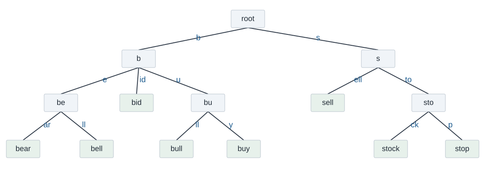

压缩时要把跳过的全部字符纳入边标签。例如 `b → i → d` 可表示为从前缀 `b` 沿标签 `id` 到达单词 `bid`；`s → t → o` 的无分支部分可变为标签 `to`。从前缀 `sto` 继续到 `stock` 的标签必须为 `ck`，到 `stop` 的标签为 `p`。

搜索 `stock` 时，依次匹配 `s`、`to`、`ck`，一共仍要检查五个字符。若查询为 `stoc`，虽然它是某条路径的前缀，也不能在没有相应终点标记时报告完整词存在。

#### 6.6.2 Patricia 的二进制编码与分支

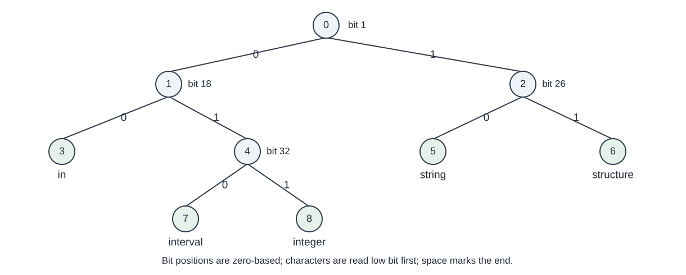

该例的键为 `in`、`integer`、`interval`、`string`、`structure`，每个键后接结束符。节点内的数字是节点标识，节点旁的数字表示用于分支的位位置；边上 0、1 表示被检查位的取值。

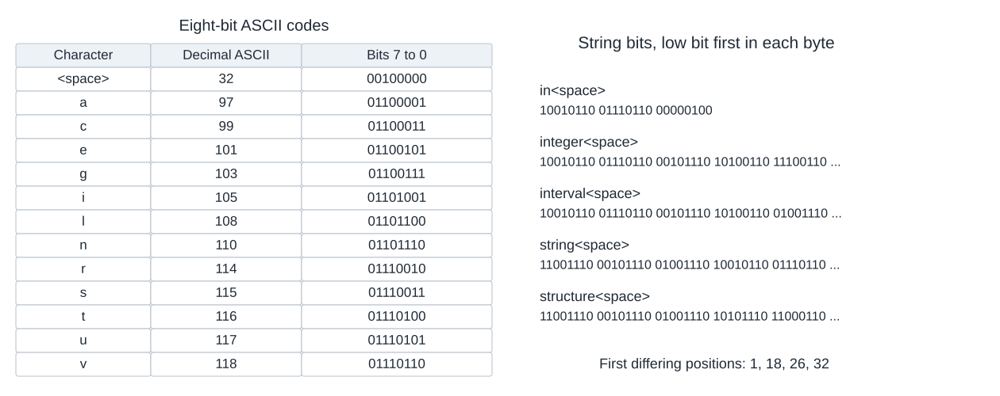

图中先给出字符的 8 位 ASCII 编码，再在下方将每个字符的位按低位到高位排列来连接成字符串位序列；位置从 0 开始。采用这个具体约定时：

1. `i` 的最低位为 1，`s` 的最低位也为 1；二者在位位置 1 首次区分。图中根旁的 1 指这个分支位置，不是“永远跳过 1 位”的通用规则。
2. `in` 后的结束字符与 `integer`、`interval` 的第三个字符在位位置 18 区分，因此 `in` 可以作为独立键保存，而不会与较长词混淆。
3. `string` 与 `structure` 在位位置 26 分开。
4. `integer` 与 `interval` 在位位置 32 分开。
5. 只在这些实际发生分歧的位置建立分支，其余共同位被跳过。到达叶子后仍核对完整键，确认所有跳过位也相同。

位的排列顺序、结束符与位编号共同决定这些数值。若采用通常的高位先行编码，分支位置会变化，但压缩二进制 Trie 的原理相同。

## 7. 算法设计范式

### 7.1 分治

分治（divide and conquer）把问题分成规模更小的子问题，递归求解，再组合结果：

1. **Divide**：划分问题。
2. **Conquer**：递归求解，遇到基本情况时直接返回。
3. **Combine**：组合子问题答案。

归并排序把数组分成两半，分别排序，再用线性时间合并：

$$
T(n)=2T(n/2)+\Theta(n)=\Theta(n\log n).
$$

标准数组归并排序通常需要 $O(n)$ 辅助空间。快速排序则围绕枢轴划分，性能依赖划分是否平衡：常见随机版本的期望时间为 $\Theta(n\log n)$，最坏仍可为 $\Theta(n^2)$。

二分查找每次只继续求解一个半区，递推式为：

$$
T(n)=T(n/2)+\Theta(1)=\Theta(\log n).
$$

它常被归入分治，也可更精确地称为减治（decrease and conquer）。它要求数据有序，并且实现能高效访问中间位置。

#### 7.1.1 归并排序的三个阶段

假设待排序数组为 `[7, 2, 5, 1]`。

1. Divide：拆为 `[7, 2]` 与 `[5, 1]`，再分别拆成单元素数组。
2. Conquer：单元素数组本身有序；递归得到 `[2, 7]` 与 `[1, 5]`。
3. Combine：比较两个有序数组的当前最小元素，依次取 1、2、5、7，得到 `[1, 2, 5, 7]`。

每层合并总工作量为 $\Theta(n)$，递归层数为 $\Theta(\log n)$。快速排序也会递归处理划分后的区间，但划分点由枢轴决定；若划分连续严重失衡，递归深度和总成本会增加。

### 7.2 穷举搜索

穷举（exhaustive search）系统检查所有候选解。只要候选空间有限、枚举覆盖全部候选且检查过程正确，就能找到存在的可行解；检查全部候选并比较目标值，还能求最优解。

成本由搜索空间决定，可能是多项式、指数或阶乘级，不能一概称为指数时间。例如在 $n$ 个元素中找最大值也可以逐一检查，只需要 $\Theta(n)$ 时间。

若枚举长度为 $\ell$、每个位置有 $k$ 种字符的所有字符串，候选数为 $k^\ell$。这说明输入长度增加时，枚举空间可能迅速增长。

### 7.3 回溯与剪枝

回溯（backtracking）在搜索树上逐步构造部分解。当已经能够证明某个部分解不可能扩展为合法解时，就撤销最近的选择并尝试其他分支。

```text
BACKTRACK(state)
    if state is a complete solution
        output state
        return
    for each candidate choice
        if choice is compatible with state
            apply choice
            BACKTRACK(state)
            undo choice
```

安全剪枝不会删除任何可能包含合法解的分支，因此完整枚举所有剩余分支时仍有完备性。剪枝可能大幅减少实际搜索量，但不能保证每个输入都显著加速，最坏复杂度仍可能很高。

回溯通常只保存当前搜索路径及辅助约束。若深度为 $d$，每层新增状态为 $O(1)$，递归栈为 $O(d)$；不能把整个搜索树的节点数直接当作同时占用的空间。若每层复制完整状态，则需另计复制成本。

#### 7.3.1 试探、失败与撤销

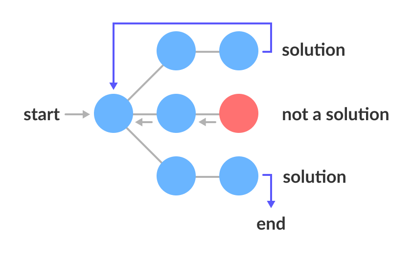

图中的每条边可理解为一次选择。沿分支前进时形成部分解；到达“not a solution”时，撤销最近选择并返回仍有未试选项的状态，再沿另一个分支前进。

数独可以逐格填数，图染色可以逐点选颜色，N 皇后可以逐行放置。它们都要求检查当前选择是否违反已知约束。若只根据猜测删除一个仍可能有解的分支，就会失去完整性；只有可证明安全的剪枝才能保持“有解必能找到”的性质。

### 7.4 N 皇后

N 皇后要求在 $N\times N$ 棋盘上放置 $N$ 个皇后，任意两个不能位于同一行、同一列或同一对角线上。

若直接从所有格子中选 $N$ 个位置，候选数为：

$$
\binom{N^2}{N}.
$$

当 $N=8$ 时：

$$
\binom{64}{8}=4{,}426{,}165{,}368.
$$

更合理的搜索方式是每行恰放一个皇后，并且逐行回溯。第 $r$ 行在第 $c$ 列放置皇后前，检查：

- 列 $c$ 是否已经被占用。
- 主对角线编号 $r-c$ 是否已经被占用。
- 副对角线编号 $r+c$ 是否已经被占用。

```text
PLACE-QUEENS(r)
    if r = N
        output positions
        return
    for c ← 0 to N - 1
        if column c and diagonals r-c, r+c are unused
            positions[r] ← c
            mark column and diagonals
            PLACE-QUEENS(r + 1)
            unmark column and diagonals
```

例如 $N=4$ 时，第 1 行放第 1 列，第 2 行放第 3 列会使第 3 行无处可放；改试第 2 行第 4 列，虽然第 3 行可以放第 2 列，第 4 行仍会失败。继续回溯到第 1 行并改放第 2 列，最终可以得到列序列：

$$
(2,4,1,3).
$$

该序列使用从 $1$ 开始的行列编号。按行并排除重复列后，候选排列上界降到 $N!$；对角线剪枝进一步减少搜索。具体运行时间还取决于枚举候选列、检查约束和输出全部解的实现成本，$N!$ 不能不加说明地等同于每个实现的精确时间。

#### 7.4.1 八皇后布局与穷举空间

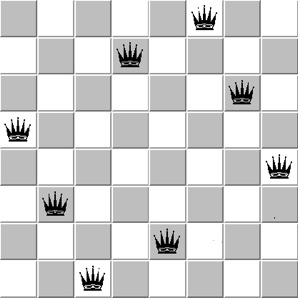

在行列编号均从 1 开始的约定下，这个布局的列序列为 $(6,4,7,1,8,2,5,3)$。每行和每列恰有一个皇后，任意两行的列差绝对值都不等于行差，所以不存在对角线冲突。

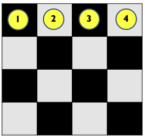

若不先利用“一行一个皇后”的限制，直接从 $N^2$ 个格子选择 $N$ 个位置，就有 $\binom{N^2}{N}$ 个候选。若逐行任选一列而暂不检查列冲突，则有 $N^N$ 种列序列。若进一步要求各列不同，完整候选缩为 $N!$ 个排列。三种计数对应不同枚举方式，不能互相混用。

#### 7.4.2 四皇后的全部试探与回退步骤

以下始终按从上到下的行顺序放置，列从左向右尝试；黄色圆点中的数字表示第几个皇后，着色格表示当前不能选择的位置。

**步骤 1：把第一个皇后放在第 1 行第 1 列。**

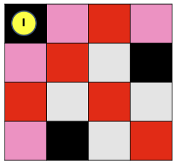

当前列序列为 $(1)$。第一行已处理，第二行不能再选第 1 列，也不能选与第一个皇后处于对角线的第 2 列。

**步骤 2：把第二个皇后放在第 2 行第 3 列。**

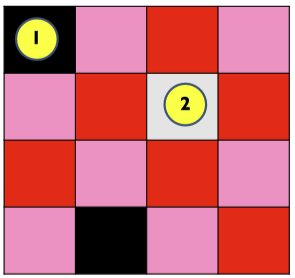

当前序列为 $(1,3)$。第三行第 1 列与第一个皇后同列，第 2、4 列受第二个皇后的对角线攻击，第 3 列也已被占。因此第三行无解，撤销第二个皇后。

**步骤 3：第二行改试第 4 列。**

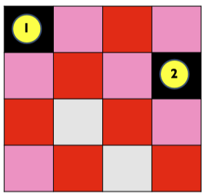

当前序列为 $(1,4)$。这是从同一个第一行选择继续尝试新的第二行候选，而不是重建整个搜索。

**步骤 4：第三行选择第 2 列。**

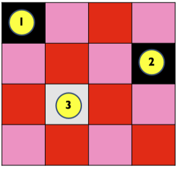

当前序列为 $(1,4,2)$。第四行第 1、2、4 列已被占，第 3 列受第三个皇后的对角线攻击，所以第四行也没有合法位置。

**步骤 5：撤销第三个皇后。**

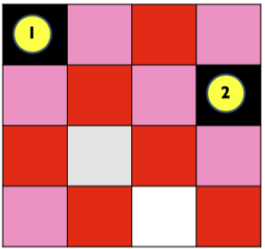

回到 $(1,4)$ 后继续检查第三行剩余列，没有其他合法候选，说明第二行第 4 列这条分支也失败。

**步骤 6：撤销第二个皇后，再检查第一行分支。**

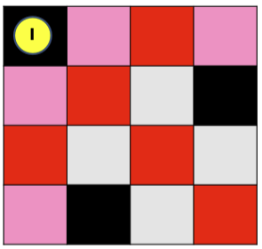

回到 $(1)$。第二行第 2 列原本就因对角线冲突被排除，第 3、4 列两条可行分支均已试完，所以第一行第 1 列无法扩展为完整解。

**步骤 7：第一行改试第 2 列。**

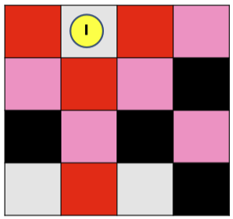

当前序列为 $(2)$。第二行的第 1、2、3 列分别因对角线或同列被排除，只剩第 4 列。

**步骤 8：第二行选择第 4 列。**

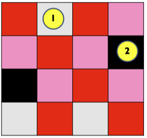

当前序列为 $(2,4)$。第三行可以选择第 1 列。

**步骤 9：第三行选择第 1 列。**

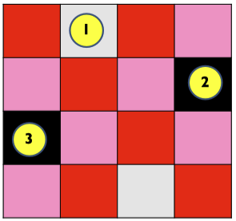

当前序列为 $(2,4,1)$。检查第四行，唯一剩余合法列为第 3 列。

**步骤 10：第四行选择第 3 列，得到解。**

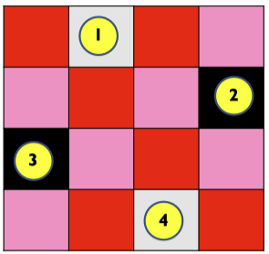

得到 $(2,4,1,3)$。四个列编号互不相同，主对角线编号 $r-c$ 与副对角线编号 $r+c$ 也分别不重复。若任务是找到任意一个解，可以返回；若需全部解，则记录此解并继续回溯，另一个四皇后解为 $(3,1,4,2)$。

#### 7.4.3 回溯的收益与成本

与枚举每个完整布局后再检查相比，回溯在前几行已经发生冲突时就停止该分支，可以省去大量无效后续选择。它常用于数独、图染色、组合、排列、迷宫和约束满足问题。

这一收益依赖剪枝效果。最坏情况下仍可能探索巨大搜索空间；递归还需要保存当前深度的状态，但只保留当前路径时，空间通常远小于整个搜索树的节点总数。

### 7.5 贪心与最优性

优化问题在可行解集合 $\mathcal F$ 中最小化或最大化目标函数。例如：

$$
\min_{x\in\mathcal F}C(x).
$$

全局最优解在整个可行域上达到最优值，可能有一个、多个，甚至所有可行解都同样最优。局部最优则依赖给定的邻域定义，不能保证全局最优。

贪心算法（greedy algorithm）每次依据局部规则选择，并通常不撤销已有选择。它能否求得全局最优解，需要证明，常用方法包括交换论证和割性质。仅有“每一步看起来最好”或“具有最优子结构”都不够。

旅行商问题说明了搜索空间增长的困难：固定一个起点后，$N$ 个城市的访问排列有 $(N-1)!$ 种；若是对称旅行商并把反向路线视为相同，$N\ge3$ 时可再除以 $2$。这说明朴素枚举开销大，不表示所有规模的实例都绝对无法精确求解。

#### 7.5.1 局部最优与全局最优的图示

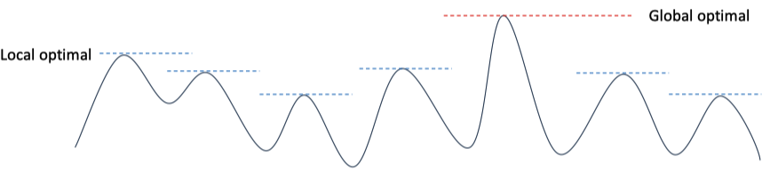

图中一个峰在附近可能比两侧都高，但仍低于远处的另一个峰，这就是局部最大与全局最大的区别。局部最优依赖如何定义邻域；全局最优依据整个可行域和目标函数定义。

实际优化还要考虑求解时间、内存、不完整信息、环境变化及参数敏感性。某个精确最优解虽然数学上存在，计算或维护它的代价也可能使近似方法更实用。但“实际更合用”与“对给定目标达到数学最优”是两个不同评价维度，不能用主观好坏替代最优性证明。

固定起点枚举访问顺序时，10 个城市有 $9!=362880$ 种排列，20 个城市有 $19!\approx1.216\times10^{17}$ 种。这说明朴素枚举会发生组合爆炸；也说明评估算法时要研究是否能够利用结构减少搜索，而不是仅看计算机能多快执行一次操作。

### 7.6 0/1 背包与贪心反例

0/1 背包有 $n$ 个物品，每件最多取一次，重量 $w_i>0$、价值 $v_i\ge0$，容量为 $W$：

$$
\begin{gathered}
\max\sum_{i=1}^n v_ix_i,\\
\sum_{i=1}^n w_ix_i\le W,\qquad x_i\in\{0,1\}.
\end{gathered}
$$

以 $W=10$ 为例：

| 物品 | 重量 | 价值 | 单位重量价值 |
| --- | ---: | ---: | ---: |
| 1 | 4 | 5 | 1.25 |
| 2 | 4 | 7 | 1.75 |
| 3 | 3 | 3 | 1.00 |
| 4 | 1 | 2 | 2.00 |
| 5 | 6 | 10 | 约 1.67 |
| 6 | 2 | 1 | 0.50 |
| 7 | 1 | 2 | 2.00 |

按单位重量价值降序，能装下就选，得到：

| 步骤 | 选择物品 | 累计重量 | 累计价值 |
| --- | ---: | ---: | ---: |
| 1 | 4 | 1 | 2 |
| 2 | 7 | 2 | 4 |
| 3 | 2 | 6 | 11 |
| 4 | 1 | 10 | 16 |

然而选择物品 $2$ 和 $5$，总重量为 $4+6=10$，总价值为 $7+10=17$，优于贪心得到的 $16$。这直接说明按价值密度贪心不能保证解决 0/1 背包。

若允许取物品的一部分，即分数背包（fractional knapsack），在正重量、非负价值条件下，按价值密度排序后依次装入是最优的。

#### 7.6.1 按价值密度逐次装包

**步骤 1：比较所有单位重量价值。** 物品 4、7 的价值密度都为 2，最高；物品 2 为 1.75，物品 5 为 $10/6$，随后是物品 1、3、6。

**步骤 2：先选择物品 4。** 当前重量为 1，价值为 2，剩余容量为 9。

**步骤 3：选择物品 7。** 当前物品集合为 $\{4,7\}$，重量为 2，价值为 4，剩余容量为 8。

**步骤 4：选择物品 2。** 当前集合为 $\{4,7,2\}$，重量为 6，价值为 11，剩余容量为 4。

**步骤 5：检查物品 5。** 它的重量为 6，超过剩余容量 4，所以跳过，不能把它的一部分放入 0/1 背包。

**步骤 6：选择下一件能放下的物品 1。** 它的重量为 4、价值为 5，最终重量恰为 10、价值为 16。容量用尽，结束。

这个过程每一步都符合既定的贪心规则，但物品 $\{2,5\}$ 能以相同重量得到价值 17。因此反例不是执行错了规则，而是规则本身不足以保证 0/1 背包全局最优。

### 7.7 动态规划与背包递推

动态规划（dynamic programming）保存子问题答案，避免反复求解重叠子问题。实现可以是自顶向下的记忆化搜索，也可以是自底向上的表格计算。

对于整数容量和整数重量的 0/1 背包，令 $D[i,c]$ 表示只使用前 $i$ 件物品、容量不超过 $c$ 的最大价值：

$$
D[0,c]=0,
$$

$$
D[i,c]=D[i-1,c]\qquad(c<w_i).
$$

当 $c\ge w_i$ 时，比较不取与取第 $i$ 件物品的价值：

$$
D[i,c]=\max\left\{
\begin{array}{l}
D[i-1,c],\\
D[i-1,c-w_i]+v_i
\end{array}
\right\}.
$$

时间为 $O(nW)$，二维表空间为 $O(nW)$。只求最优值时，可以使用一维数组：

```text
ZERO-ONE-KNAPSACK(items, W)
    dp[0..W] ← 0
    for each item (weight, value)
        for c ← W downto weight
            dp[c] ← max(dp[c], dp[c - weight] + value)
    return dp[W]
```

容量必须倒序遍历，避免同一件物品在一次迭代中被重复使用。若改为正序更新，就可能变成可重复取物品的完全背包。

$O(nW)$ 对容量数值 $W$ 是多项式，但 $W$ 的二进制编码只需 $\Theta(\log W)$ 位，因此称为伪多项式时间。

### 7.8 设计范式比较

| 范式 | 基本思路 | 正确性或性能的关键 |
| --- | --- | --- |
| 分治 | 拆分、递归、组合 | 子问题划分和合并正确 |
| 穷举 | 检查所有候选 | 覆盖完整，检查准确 |
| 回溯 | 构造部分解并剪枝 | 剪枝不丢失合法解 |
| 贪心 | 逐步作局部选择 | 证明局部选择可以保留某个全局最优解 |
| 动态规划 | 记录并复用子问题答案 | 状态定义、转移、边界和计算次序正确 |

同一个算法也可能结合多种思想。例如 Floyd–Warshall 使用动态规划，Prim 与 Kruskal 则利用图的割性质设计贪心选择。

## 8. 文本压缩与 Huffman 编码

### 8.1 固定长度编码与可变长度编码

若字符集有 $k\ge2$ 个不同字符，每个字符使用等长二进制码字，至少需要：

$$
\lceil\log_2 k\rceil
$$

位。考虑总计 $100{,}000$ 个字符的文本：

| 字符 | 频数 | 固定长度码字 | 可变长度码字 |
| --- | ---: | --- | --- |
| a | 45,000 | `000` | `0` |
| b | 13,000 | `001` | `101` |
| c | 12,000 | `010` | `100` |
| d | 16,000 | `011` | `111` |
| e | 9,000 | `100` | `1101` |
| f | 5,000 | `101` | `1100` |

固定长度编码每个字符需 $3$ 位，文本载荷占用：

$$
100{,}000\times3=300{,}000\text{ bits}.
$$

可变长度编码让高频字符使用较短码字。例如 `face` 的两种编码分别为：

```text
固定长度：101 000 010 100 → 101000010100
可变长度：1100 0 100 1101 → 110001001101
```

单个短词不一定变短；收益取决于整个文本的字符频率与码长分配。

#### 8.1.1 频数、码字与总文件成本

六个字符的总频数为 $45000+13000+12000+16000+9000+5000=100000$。固定长度码需要容纳六个不同码字，2 位只有四种取值，不够；3 位有八种取值，足够，所以使用 $\lceil\log_2 6\rceil=3$ 位。

以 `face` 为例，按固定表依次查得 `f=101`、`a=000`、`c=010`、`e=100`，拼接为 `101000010100`。按可变长表依次为 `1100`、`0`、`100`、`1101`，拼接为 `110001001101`。

虽然这两个词例恰好都占 12 位，整个文件中 `a` 出现了 45000 次，把它从 3 位缩短为 1 位会产生很大收益；低频字母码字变长造成的增加则需要一并计入。

### 8.2 前缀码与解码

前缀码（prefix-free code）要求任意一个字符的码字都不是另一个字符码字的前缀。因此可以从左向右即时解码，无需额外分隔符。

上表中的可变长度编码是前缀码。例如：

```text
100011001101
= 100 | 0 | 1100 | 1101
= c   | a | f    | e
= cafe
```

这里编码的字符是普通字母 `e`，并不包含带重音的 `é`。

前缀码可以表示为二叉树：左边标 $0$、右边标 $1$，字符放在叶节点。从根到叶的路径就是码字。因为叶节点不可能同时是另一个叶节点的祖先，码字之间不会存在前缀关系。

前缀码是唯一可解码的一种充分条件，但唯一可解码的变长码不一定都是前缀码。

#### 8.2.1 沿编码树解码

读取 `100011001101` 时，从根出发，逐位走到一个叶节点就输出对应字符，并返回根重新开始。

1. 读 `1` 后还未到叶子，继续读 `0`、`0`，得到完整码字 `100`，输出 `c`。
2. 回根，读下一位 `0`，已是完整码字，输出 `a`。
3. 回根，依次读 `1100`，输出 `f`。
4. 回根，依次读 `1101`，输出 `e`。
5. 比特串刚好读完，且停在完整码字边界，解码结果为 `cafe`。

之所以可以在第一次到达叶子时立即输出，是因为没有其他字符码字会以这个叶子的完整路径为前缀。

### 8.3 编码成本与满二叉树

设字符集合为 $C$，字符 $c$ 的频数为 $\operatorname{freq}(c)$，在编码树 $T$ 中的叶深度为 $d_T(c)$。文本载荷总位数为：

$$
B(T)=\sum_{c\in C}\operatorname{freq}(c)d_T(c).
$$

对于至少两个字符、每个字符频数都为正的情况，最优二进制前缀码树不会包含只有一个孩子的内部节点。压缩掉这种节点会缩短其后代的码字并严格减少成本。因此可将最优树限制为满二叉树。

满二叉树只是这一最优性的必要结构条件，并不足以保证某一具体码长分配最优。左右孩子交换也会改变码字，但不改变码长和成本。

#### 8.3.1 单孩子节点、满二叉树与成本比较

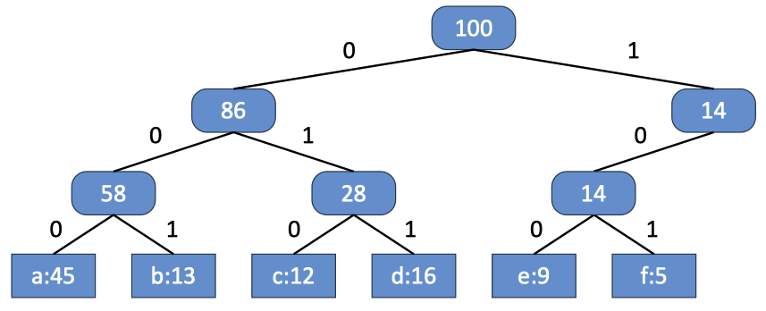

这棵树的 `a`、`b`、`c`、`d`、`e`、`f` 都在深度 3，因此载荷为 $100000\times3=300000$ 位。字符仍在叶子，所以它是前缀码；但右侧有一个仅为延长路径而存在的单孩子节点。

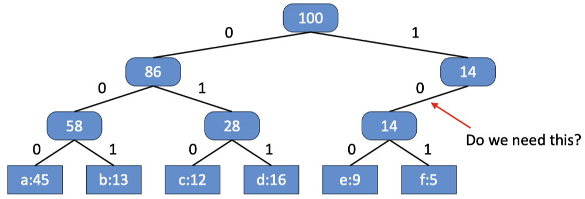

压缩这条单孩子连接后，`e`、`f` 的路径各缩短一位，其他码字不变：

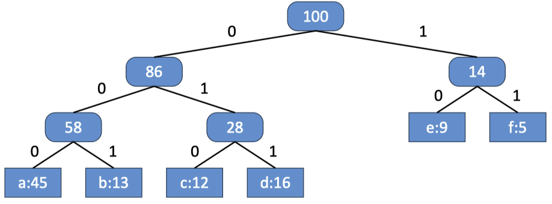

此时可以使用 `a=000`、`b=001`、`c=010`、`d=011`、`e=10`、`f=11`，载荷为：

$$
\begin{aligned}
B(T)&=86000\cdot3+14000\cdot2\\
&=286000\text{ bits}.
\end{aligned}
$$

树已经是满二叉树，但载荷仍大于 Huffman 树的 224000 位。由此可以看出，去掉单孩子节点能改进成本，却还没有解决“不同频率字符应如何分配深度”的问题。

### 8.4 Huffman 算法

Huffman 算法每次从当前森林中选择权重最小的两棵树合并，而不只是选择最小的两个原始字符叶子。

```text
HUFFMAN(characters)
    Q ← a min-priority queue containing one leaf per character
    while size(Q) > 1
        x ← EXTRACT-MIN(Q)
        y ← EXTRACT-MIN(Q)
        z ← a new node with children x and y
        z.weight ← x.weight + y.weight
        INSERT(Q, z)
    return the remaining tree
```

将频数以千为单位，示例的合并过程为：

| 步骤 | 合并的两个权重 | 新权重 |
| --- | --- | ---: |
| 1 | 5、9 | 14 |
| 2 | 12、13 | 25 |
| 3 | 14、16 | 30 |
| 4 | 25、30 | 55 |
| 5 | 45、55 | 100 |

一种最终码字分配就是第 8.1 节的可变长度码字。其载荷为：

$$
\begin{aligned}
B(T)
&=45{,}000\cdot1+41{,}000\cdot3\\
&\quad +14{,}000\cdot4\\
&=224{,}000\text{ bits}.
\end{aligned}
$$

平均码长为 $2.24$ 位，相对 $300{,}000$ 位的固定长度载荷，减少约 $25.33\%$。

#### 8.4.1 Huffman 森林的全部合并状态

以下图中的权重以千次出现为单位；左右边分别为 0、1。每轮都在当前剩余的叶子或合并子树中取权重最小的两个。

**初始化：六棵单节点树。**


当前权重为 $45,13,12,16,9,5$，总权重为 100。

**步骤 1：合并 5 与 9。**

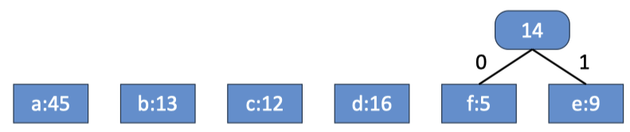

新建内部节点 14，孩子为 f、e。当前权重集合变为 $\{12,13,14,16,45\}$。图中 f 在左、e 在右，因此它们相对这棵子树根的位分别为 0、1。

**步骤 2：合并 12 与 13。**

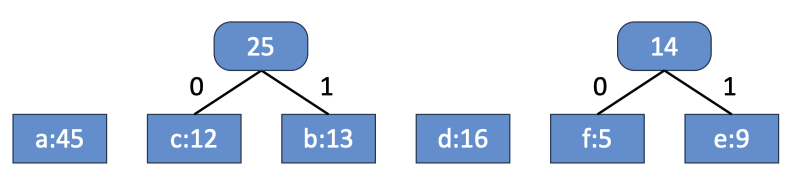

新建内部节点 25，孩子为 c、b。当前权重变为 $\{14,16,25,45\}$。先前的权重 14 是一棵完整子树，不会被展开回原始叶子。

**步骤 3：合并 14 与 16。**

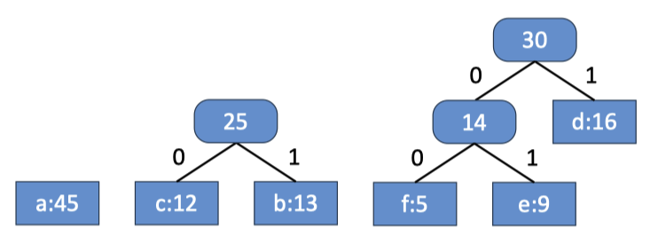

当前最小的不是两个原始字符，而是权重 14 的子树和 d 的叶子。合并后权重集合为 $\{25,30,45\}$。

**步骤 4：合并 25 与 30。**

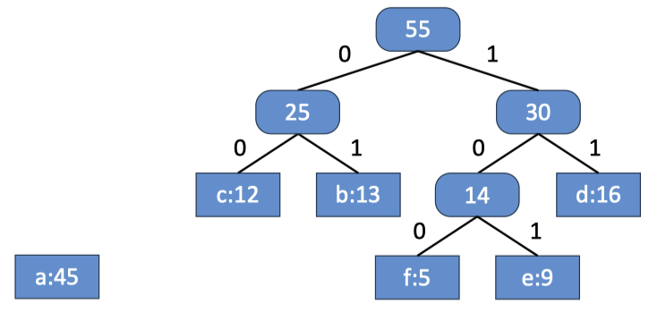

当前只剩权重为 45 的 a 叶子和权重为 55 的子树。c、b 位于 55 子树的左侧，f、e、d 位于右侧。

**步骤 5：合并 45 与 55。**

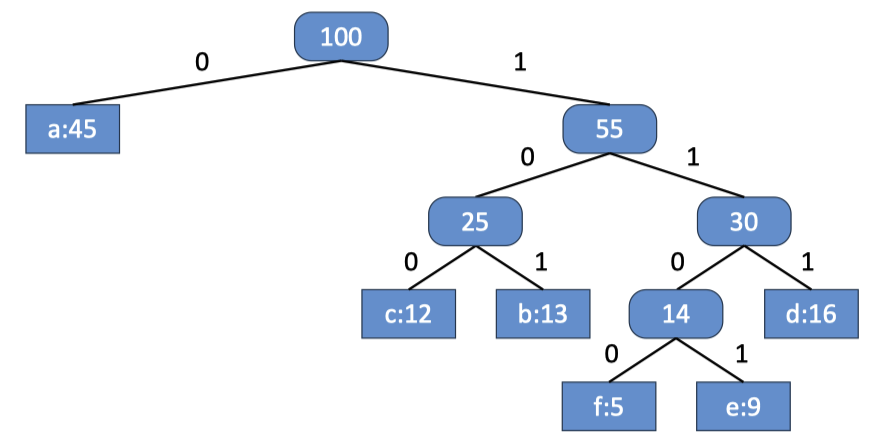

从最终根沿边读取，可得 `a=0`、`c=100`、`b=101`、`f=1100`、`e=1101`、`d=111`。内部节点的权重都等于两个孩子权重之和，根权重为全部字符频数之和。

还有一种核对载荷的方式：每次合并都会使两棵子树中所有字符的深度增加 1，因此总代价等于所有合并权重之和：

$$
\begin{aligned}
B(T)&=(14+25+30+55+100)\\
&\quad\times1000\\
&=224000\text{ bits}.
\end{aligned}
$$

### 8.5 最优性与适用范围

Huffman 的交换论证表明：对于给定的正频数，可以选择一棵最优树，使两个最低频字符成为最深层的兄弟叶子。将它们合并为一个权重等于二者之和的伪字符后，剩余问题仍是同类的最优前缀编码问题，由此得到递归的贪心构造。

对于 $k$ 个字符，二叉堆实现的建树时间为 $O(k\log k)$，树本身占用 $O(k)$ 空间。实际编码与解码还需计入读写字符和比特流的成本。

Huffman 在“给每个单独字符分配二进制前缀码”这一模型中最优，不能据此断言它是所有压缩方法中的最优算法。最终文件还可能需要码表、树或频数等元数据，上述 $224{,}000$ 位只计算载荷。

如果只有一种字符，树可以只含一个叶节点；实际格式通常给它分配一个比特码字，或另外保存重复次数，避免无法判断空码字的出现次数。

## 9. 图、遍历与最短路径

### 9.1 图的定义

图 $G=(V,E)$ 由顶点集合 $V$ 和边集合 $E$ 构成。顶点也称 node，边也称 link。图可以表示城市与航线、网页与超链接、用户与社交关系等。

有向图（directed graph）的边是有序对 $(u,v)$，表示从 $u$ 到 $v$；无向图（undirected graph）的边是无序对 $\{u,v\}$。对于简单图，通常不允许自环与平行边。

对于不含自环的简单有向图：

$$
E\subseteq\{(u,v)\in V\times V:u\ne v\}.
$$

对于简单无向图：

$$
E\subseteq\{\{u,v\}:u,v\in V,\ u\ne v\}.
$$

无向边可以用两条反向有向边模拟，便于复用某些遍历和最短路径实现。但这种表示不表示两类图的所有性质都能直接互换。例如同一无向边对应的两条弧，不应被误判为原无向图中的一个环。

子图 $G'=(V',E')$ 满足 $V'\subseteq V$、$E'\subseteq E$，并且 $E'$ 中每条边的端点都属于 $V'$。

#### 9.1.1 顶点、边与方向的图示

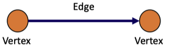

一条有向边由起点和终点共同确定。例如 $(u,v)$ 是从 $u$ 指向 $v$ 的关系；若反向边存在，它是另一条边 $(v,u)$。

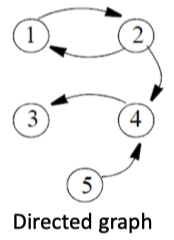

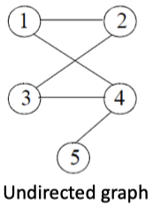

无向图的 $\{1,2\}$ 与 $\{2,1\}$ 是同一条边；有向图的 $(1,2)$ 与 $(2,1)$ 则分别表达两个方向。网页超链接适合有向关系模型，互相承认的好友关系可用无向模型，城市航线是否双向则取决于实际数据。

空间网络还为每个顶点附加地理位置。例如路网用路口表示顶点、路段表示边，长度或通行时间作为权重。把实际道路变成图时，还需要区分单行道、禁止通行和不同交通方式的限制。

### 9.2 邻接、度与连通性

无向图中，两个顶点之间有边便称为相邻。有向图中需要明确方向：若 $(u,v)\in E$，则 $v$ 是 $u$ 的出邻居，$u$ 是 $v$ 的入邻居；这并不意味着 $(v,u)$ 存在。

| 概念 | 含义 |
| --- | --- |
| 无向度 $\deg(v)$ | 与 $v$ 关联的边端数量；自环贡献 2 |
| 入度 $\deg^-(v)$ | 指向 $v$ 的有向边数量 |
| 出度 $\deg^+(v)$ | 从 $v$ 出发的有向边数量 |

对有限无向图：

$$
\sum_{v\in V}\deg(v)=2\lvert E\rvert.
$$

对有限有向图：

$$
\sum_{v\in V}\deg^-(v)
=\sum_{v\in V}\deg^+(v)=\lvert E\rvert.
$$

无向图中，任意两顶点之间都有路径时，图是连通的。有向图把边方向忽略后连通，称为弱连通；若任意两顶点都能沿有向边互相到达，则称为强连通。

强连通分量（strongly connected component，SCC）是按包含关系极大的、内部顶点两两互相可达的顶点集合。把每个 SCC 收缩为一个顶点后，得到的分量图一定是 DAG。Tarjan 或 Kosaraju 算法可在邻接表上用 $O(\lvert V\rvert+\lvert E\rvert)$ 时间求 SCC。

#### 9.2.1 逐点计算入度与出度

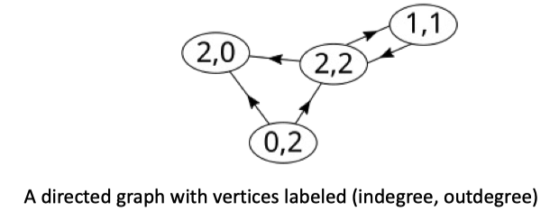

图中每个括号按“入度，出度”排列。左上顶点有两条入边、没有出边，所以为 $(2,0)$；下方顶点没有入边、有两条出边，所以为 $(0,2)$；中间顶点分别有两条入边和出边，为 $(2,2)$；右上顶点一进一出，为 $(1,1)$。

把所有入度相加得到 $2+0+2+1=5$，所有出度也相加得到 $0+2+2+1=5$，与图的有向边数相同。这为计数提供了独立检查。

### 9.3 游走、路径、环与权重

一个游走（walk）是顶点序列：

$$
(v_0,v_1,\ldots,v_k),
$$

其中相邻两点之间存在相应方向的边。游走允许重复顶点和重复边；简单路径不重复顶点。部分教材把允许重复的游走也称为 path，使用时需要明确约定。

无权长度是经过的边数 $k$。若边有权重函数 $w:E\to\mathbb R$，则加权长度为：

$$
w(p)=\sum_{i=0}^{k-1}w(v_i,v_{i+1}).
$$

简单环的起点与终点相同，除此以外顶点不重复；对于简单无向图，环至少包含三条边。

当所有边权非负时，从游走中删除重复顶点形成的环不会增加总权重，因此可选择一条简单最短路径。如果存在从起点可达、又能通向终点的负权环，则可以反复经过负环，使路径代价无限降低；此时相应最短游走不存在有限最优值。

标签图可以在顶点或边上保存名称、位置等属性。带权图则专门把某些数值属性作为算法使用的权重；地理网络还为顶点关联实际空间位置。

#### 9.3.1 含重复顶点的游走

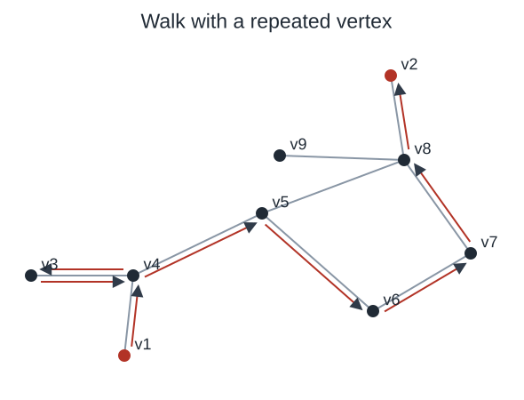

红色路线可表示为：

$$
(v_1,v_4,v_3,v_4,v_5,v_6,v_7,v_8,v_2).
$$

相邻点都有连接，因此它是一个合法游走；但 $v_4$ 被访问两次，不是简单路径。它包含 9 个顶点位置、8 次边移动，长度为 8，不能按不同顶点的个数计算长度。

#### 9.3.2 去掉重复部分后的简单路径

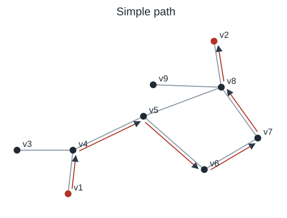

删去 `v4 → v3 → v4` 这一绕行后，可取：

$$
(v_1,v_4,v_5,v_6,v_7,v_8,v_2).
$$

该路径只有 6 条边，且没有重复顶点。在无权或非负权条件下，删除这样的环不会增加代价；有负环时则必须另行分析。

#### 9.3.3 闭合成环

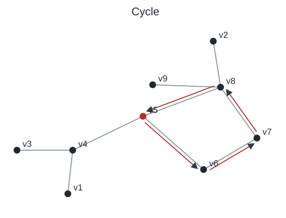

图中的环为：

$$
(v_5,v_6,v_7,v_8,v_5).
$$

它包含 4 条边，起终点相同，除此之外没有重复顶点。若不存在边 $\{v_7,v_5\}$，就不能把它简写为三边环；路径序列中的每一对相邻点都必须核对图中的实际连接。

#### 9.3.4 带标签与带权重的网络


数字可以表示距离、时间、费用、能量或其他目标相关成本。带相同顶点和类似线路的两个图，因方向不同，可达性和最短路线也可能不同。算法只根据给定权重计算，权重代表的实际量和单位需要在建模时明确。

### 9.4 图的存储表示

邻接矩阵用一个 $\lvert V\rvert\times\lvert V\rvert$ 矩阵表示是否存在边：

$$
A[i,j]=
\begin{cases}
1,&(v_i,v_j)\in E,\\
0,&\text{否则}.
\end{cases}
$$

无向图的矩阵对称，可以只存一半以减少常数，但空间阶数仍为 $\Theta(\lvert V\rvert^2)$。

最短路径常使用初始代价矩阵：不同点之间有边时记边权，无边记 $+\infty$，对角线通常记 $0$。若允许负自环，对角线应取 $\min\{0,w(v_i,v_i)\}$；平行边取最小权重。权重为 $0$ 的边不能与“没有边”混淆。

邻接表为每个顶点保存出邻居。带权图保存 `(邻居, 权重)`，例如：

```text
1: [(2, 2)]
2: [(3, 9), (4, 6), (5, 3)]
3: [(2, 4), (5, 6)]
4: [(1, 1), (2, 8)]
5: [(4, 7)]
```

无向图中，一条边通常在两端的邻接表中各出现一次。

| 表示 | 空间 | 检查一条指定边 | 枚举某顶点的出邻居 |
| --- | --- | --- | --- |
| 邻接矩阵 | $\Theta(\lvert V\rvert^2)$ | $O(1)$ | $\Theta(\lvert V\rvert)$ |
| 普通邻接表 | $\Theta(\lvert V\rvert+\lvert E\rvert)$ | 通常 $O(\deg^+(v))$ | $\Theta(1+\deg^+(v))$ |

稀疏矩阵是另一种存储稀疏边信息的方式，与邻接表用途接近，但具体布局和操作成本由格式决定。

#### 9.4.1 从无向图逐项写出邻接矩阵


按行列顺序 1、2、3、4、5，顶点 1 与 2、4 相邻，所以第 1 行为 `0 1 0 1 0`；顶点 2 与 1、3、4、5 相邻，所以第 2 行为 `1 0 1 1 1`。其他行同样按是否有边填写。


$$
A=
\begin{pmatrix}
0&1&0&1&0\\
1&0&1&1&1\\
0&1&0&1&1\\
1&1&1&0&1\\
0&1&1&1&0
\end{pmatrix}.
$$

矩阵对称，例如 $A[2,4]=A[4,2]=1$；对角线为 0，因为这个例子没有自环。原图虽然有边权，但该邻接矩阵只记录存在性，没有记录具体权重。

#### 9.4.2 从有向图写出代价矩阵


$$
C=
\begin{pmatrix}
0&2&\infty&\infty&\infty\\
\infty&0&9&6&3\\
\infty&4&0&\infty&6\\
1&8&\infty&0&\infty\\
\infty&\infty&\infty&7&0
\end{pmatrix}.
$$

逐项读取时，$C[1,2]=2$ 表示有边 $1\to2$ 且代价为 2；$C[1,3]=\infty$ 表示没有直接边 $1\to3$；$C[2,3]=9$ 与 $C[3,2]=4$ 表示两个方向的代价不同；$C[4,1]=1$ 表示从 4 可以直接到 1。

#### 9.4.3 把相同有向图转换为邻接表


从顶点 1 只列 `(2,2)`；从 2 列 `(3,9)`、`(4,6)`、`(5,3)`；从 3 列 `(2,4)`、`(5,6)`；从 4 列 `(1,1)`、`(2,8)`；从 5 列 `(4,7)`。这样只保存实际存在的边，无需为全部无边点对分配矩阵项。

#### 9.4.4 无权无向图的邻接表


```text
1: [2, 4]
2: [1, 3, 5]
3: [2]
4: [1]
5: [2]
```

边 $\{1,2\}$ 同时出现在 1 的表和 2 的表中。若只列一个方向，就不能再把这个表直接当成完整的无向图邻接表。

### 9.5 BFS 与 DFS

广度优先搜索（breadth-first search，BFS）使用队列，按与起点的最少边数逐层发现顶点。深度优先搜索（depth-first search，DFS）使用递归或显式栈，沿一个分支深入后再回溯。

```text
BFS(G, s)
    for each vertex v
        visited[v] ← false
        distance[v] ← infinity
        parent[v] ← null
    visited[s] ← true
    distance[s] ← 0
    Q ← a queue containing s
    while Q is not empty
        u ← DEQUEUE(Q)
        for each outgoing neighbor v of u
            if not visited[v]
                visited[v] ← true
                distance[v] ← distance[u] + 1
                parent[v] ← u
                ENQUEUE(Q, v)
```

应在入队时标记顶点，避免同一顶点被重复加入队列。BFS 能求无权图，或所有边权相同且为正时的最短路径；DFS 一般不保证最短。

如果根树只保存从父到子的孩子引用，遍历时可以不另设 `visited`。如果把树作为无向图存储，则需要记住父节点或使用访问标记，防止沿同一条边走回父节点。

单次搜索只访问从起点可达的部分。若要遍历整个非连通图，需要对每个尚未访问的顶点启动搜索。完整遍历使用邻接表的时间为 $O(\lvert V\rvert+\lvert E\rvert)$，辅助空间最坏为 $O(\lvert V\rvert)$；邻接矩阵实现通常需 $O(\lvert V\rvert^2)$ 时间。

#### 9.5.1 树遍历与一般图遍历的区别

根树若只沿孩子引用向下访问，从根出发不会重访父节点，递归结构可直接保证每个节点处理一次。一般图可能有环，也可能有多个前驱指向同一个后继，因此 BFS 和 DFS 需要记录访问状态。

BFS 用队列保存等待扩展的顶点，按层次处理；DFS 则沿当前分支深入，到达没有未访问后继的位置后回退。图中起点可以任选，若想覆盖全部顶点，就在一轮结束后继续寻找新的未访问起点。树的根来自其指定的层次结构，并不是所有图天生都有唯一根。

### 9.6 最短路径与松弛

单源最短路径（single-source shortest paths）给定源点 $s$，求从 $s$ 到每个顶点的最短距离，并可保存每个可达顶点的一条最短路径。它不要求枚举所有等长最短路径。

距离估计初始化为：

$$
d[s]=0,
\qquad d[v]=+\infty\quad(v\ne s).
$$

对边 $(u,v)$ 的松弛（relaxation）为：

$$
\begin{gathered}
\text{若 }d[u]+w(u,v)<d[v],\\
\text{则 }d[v]\leftarrow d[u]+w(u,v),\\
\operatorname{parent}[v]\leftarrow u.
\end{gathered}
$$

有限的距离估计对应一条已经发现的路径，所以是最短距离的上界。随着松弛进行，这个上界逐步降低。

#### 9.6.1 四顶点无向图的单源例题


从 A 出发，分别考察三个目标：

1. 到 B：直接走 `A → B`，代价为 2。
2. 到 C：直接走 `A → C`，代价为 4；绕行 `A → B → D → C` 需要 $2+1+3=6$，所以选直接边。
3. 到 D：`A → B → D` 代价为 $2+1=3$，优于 `A → C → D` 的 $4+3=7$。

输出为三个最短距离以及相应路径，源点自身距离为 0。下一节使用的是另一张带五条有向边的四顶点图，不能把两例的边权和结果混在一起。

### 9.7 Dijkstra 算法

Dijkstra 适用于边权非负的图。它每次从尚未确定的顶点中取出距离估计最小者，确定其最短距离，再松弛出边。

```text
DIJKSTRA(G, s)
    for each vertex v
        d[v] ← infinity
        parent[v] ← null
    d[s] ← 0
    Q ← an indexed min-priority queue containing all vertices with keys d
    while Q is not empty
        u ← EXTRACT-MIN(Q)
        if d[u] = infinity
            break
        for each edge (u, v) with v still in Q
            if d[u] + w(u, v) < d[v]
                d[v] ← d[u] + w(u, v)
                parent[v] ← u
                DECREASE-KEY(Q, v, d[v])
    return d, parent
```

在非负权条件下，未确定顶点无法通过未来的一段路径，把已经取出的最小距离再降低，这是贪心选择正确的关键。存在负权边时，这一论证不成立。

若使用不支持 `decrease-key` 的堆，可以在改进距离时插入新条目，并在取出时跳过过期条目；此时堆大小和复杂度应按该实现重新分析。

考虑有向边：

```text
A → B: 2
A → C: 5
B → C: 1
B → D: 4
C → D: 1
```

| 阶段 | 新确定顶点 | $d[A]$ | $d[B]$ | $d[C]$ | $d[D]$ |
| --- | --- | ---: | ---: | ---: | ---: |
| 初始化 | 无 | 0 | $\infty$ | $\infty$ | $\infty$ |
| 松弛 A 的出边 | A | 0 | 2 | 5 | $\infty$ |
| 松弛 B 的出边 | B | 0 | 2 | 3 | 6 |
| 松弛 C 的出边 | C | 0 | 2 | 3 | 4 |
| 完成 | D | 0 | 2 | 3 | 4 |

最终路径分别为 `A → B`、`A → B → C`、`A → B → C → D`。中间阶段的前驱可能变化，只有完成后才能把最终前驱关系称为最短路径树。

邻接表加二叉最小堆的时间为：

$$
O((\lvert V\rvert+\lvert E\rvert)\log\lvert V\rvert).
$$

使用数组扫描最小距离时为 $O(\lvert V\rvert^2)$，适用于某些稠密图。只求一个目标时，可以在目标以有效最小条目被取出、距离得到确定时停止，不能在第一次发现目标时停止。

#### 9.7.1 距离确定与前驱改变的每一步

仍使用有向边 `A → B:2`、`A → C:5`、`B → C:1`、`B → D:4`、`C → D:1`。

**初始化。** A 的距离为 0，B、C、D 为无穷；尚无前驱边。

**步骤 1：确定 A。** 松弛 A 的两条出边，得到 $d[B]=2$、$d[C]=5$，前驱都暂设为 A：

```text
A (0)
├── B (2)
└── C (5)

D 尚不可达
```

这里的括号是累计距离估计。C 的 5 仍是可改进的估计，不应因为已经出现前驱就提前确定。

**步骤 2：确定 B。** 在未确定顶点中，B 的估计 2 最小。经 B 到 C 的候选为 $2+1=3<5$，把 C 前驱改为 B；经 B 到 D 的候选为 $2+4=6$，给 D 设置前驱 B：

```text
A (0)
└── B (2)
    ├── C (3)
    └── D (6)
```

**步骤 3：确定 C。** C 的 3 小于 D 的 6。经 C 到 D 的候选为 $3+1=4<6$，因此把 D 的估计改为 4，前驱改为 C：

```text
A (0)
└── B (2)
    └── C (3)
        └── D (4)
```

**步骤 4：确定 D。** D 是最后一个可达且未确定的顶点，距离 4 得到确认。最终读取前驱链，得到 A 到 B、C、D 的三条路径。

Dijkstra 只依据当前累计距离排序，没有目标方向偏好；这使它适合一次获得全部单源距离。若只查询一个目标，可在该目标距离被确定时停止；若要利用终点位置提供的额外信息，则可以考虑双向搜索或 A*。

### 9.8 双向 Dijkstra

双向 Dijkstra 从源点正向搜索，同时从目标点反向搜索。有向图的反向搜索必须沿反图进行，即把每条边反向，保留其权重。

算法维护目前找到的完整起终点路径的最小代价 $\mu$，并在两个搜索之间发现可连接的路径时更新它。不能在两个搜索第一次碰到同一顶点时就直接返回，因为这条连接路径可能还不是最短。

在标准实现中，维护两侧有效队列最小键 $\ell_f$、$\ell_b$，并按规则持续更新跨两侧的候选路径；当满足以下条件时可以停止：

$$
\ell_f+\ell_b\ge\mu.
$$

该条件表明剩余搜索不可能找到更短的连接路径。完整实现还需要处理队列为空与不可达情况。

双向搜索常能减少单对最短路径的实际搜索量，但不存在任意图上“半径恰好减半、面积恰好减半”或“一定更快”的保证，效果取决于网络结构、边权和搜索调度。

#### 9.8.1 正向与反向搜索如何配合

正向状态 $d_f[u]$ 表示从起点到 $u$ 的已知路径代价，反向状态 $d_b[v]$ 表示从 $v$ 到终点的已知路径代价。对于跨两侧连接的原边 $(u,v)$，可以用：

$$
d_f[u]+w(u,v)+d_b[v]
$$

更新当前完整路径上界 $\mu$；若两侧在同一顶点 $x$ 连接，也可考察 $d_f[x]+d_b[x]$。算法继续维护各侧 Dijkstra 的队列和距离，直到队列最小键之和给出的下界不再小于 $\mu$。

在近似均匀的地理路网中，两侧搜索可能各覆盖较小区域，因此常有实际收益；在不规则图、极不平衡的分支结构或高度偏斜的权重下，不能预先断言每侧只需搜索一半距离或一定节省固定比例。

### 9.9 A* 搜索

A* 使用目标相关的启发式估计，按以下优先级扩展顶点：

$$
f(v)=g(v)+h(v).
$$

其中 $g(v)$ 是目前已发现的从起点到 $v$ 的最小路径代价，尚未确定时不一定等于真实最短距离；$h(v)$ 是从 $v$ 到目标的估计代价。

常用启发式要求如下：

**可采纳性（admissibility）**：不高估真实剩余最短代价 $h^*(v)$，并约定目标 $t$ 的估计为 $0$：

$$
0\le h(v)\le h^*(v),
\qquad h(t)=0.
$$

**一致性（consistency）**：对每条边 $(u,v)$：

$$
h(u)\le w(u,v)+h(v).
$$

一致性配合 $h(t)=0$ 蕴含可采纳性。在非负权图中，使用一致启发式的标准 A* 图搜索可以在顶点取出后不再重新打开它，并在目标被取出时得到最优路径。若启发式只有可采纳性而不一致，则可能需要在发现更小的 $g$ 时重新打开已经扩展过的顶点。

具体例题可以把已知路径代价与启发式估计分别列出，再在开放集合中比较它们的和。后面的逐步演示使用实线表示原边、虚线表示估计，避免把启发式当成真实连接。

当所有 $h(v)=0$ 时，A* 退化为按路径代价排序的 Dijkstra 搜索。启发式越准确通常越有助于减少扩展，但计算启发式本身也有成本。若边权是距离，直线距离可作为常见下界；若边权是时间，必须先根据速度上界换算成时间，不能混用单位。

#### 9.9.1 按 f 值展开候选顶点


图中实线为 `A → B:4`、`A → C:6`、`C → D:5`。虚线用于展示到 D 的估计，不是额外的原图边；红字给出 $h(B)=12$、$h(C)=5$，A 的估计为 9，且 $h(D)=0$。

1. 初始把 A 放入开放集合，$g(A)=0$、$f(A)=9$。
2. 展开 A，发现 B、C。B 的 $g=4$、$f=4+12=16$；C 的 $g=6$、$f=6+5=11$。
3. 选择开放集合中 $f$ 较小的 C，不是仅按边权 4 与 6 决定先访问谁。
4. 展开 C 后发现 D，得到 $g(D)=6+5=11$、$f(D)=11$。
5. 此时 D 的优先级 11 小于 B 的 16，取出 D，得到路径 `A → C → D`，总代价为 11。

图中 B 没有已给出的后续实线路径，因此不能把虚线的 12 当成一条可直接走到 D 的边。启发式只影响搜索优先级，不会创造原图中不存在的通路。

### 9.10 Bellman–Ford 与负权边

Bellman–Ford 可以处理有负权边的单源最短路径。对所有边反复松弛 $\lvert V\rvert-1$ 轮后，若不存在源点可达的负权环，就能得到所有最短距离。因为简单路径至多包含 $\lvert V\rvert-1$ 条边。

再扫描一轮，若仍有从有限距离出发的松弛能严格降低某个距离，则存在源点可达的负权环。受该负环影响的顶点还包括从它可达的后继顶点。

标准实现时间为 $O(\lvert V\rvert\lvert E\rvert)$，距离与前驱数组占 $O(\lvert V\rvert)$ 辅助空间。有向无环图即使存在负权边，也可以按拓扑顺序松弛，在 $O(\lvert V\rvert+\lvert E\rvert)$ 时间内求单源最短路径。

### 9.11 Floyd–Warshall 的动态规划

Floyd–Warshall 求所有点对的最短距离。它允许负权边；若希望所有可达点对都有有限最短距离，需要不存在负权环。

把顶点编号为 $1,\ldots,n$。令 $D^{(k)}[i,j]$ 表示只允许编号在 $1,\ldots,k$ 中的顶点充当内部顶点时，从 $i$ 到 $j$ 的最短距离。初始矩阵 $D^{(0)}$ 只考虑直接边与长度为零的自身路径。

递推式为：

$$
D^{(k)}[i,j]=\min\left\{
\begin{array}{l}
D^{(k-1)}[i,j],\\
D^{(k-1)}[i,k]+D^{(k-1)}[k,j]
\end{array}
\right\}.
$$

新允许的顶点 $k$ 要么不在最优路径内部，要么把路径分成 $i\to k$ 和 $k\to j$ 两部分。实现时中间顶点 $k$ 必须置于最外层循环：

```text
FLOYD-WARSHALL(D)
    for k ← 1 to n
        for i ← 1 to n
            for j ← 1 to n
                if D[i,k] ≠ infinity and D[k,j] ≠ infinity
                    D[i,j] ← min(D[i,j], D[i,k] + D[k,j])
    return D
```

在不存在负环的标准情形下可以原地更新。使用有限整数哨兵表示无穷时，需要先检查可达性并防止加法溢出，避免把“无穷加负数”错误地当成有效路径。

时间为 $\Theta(n^3)$，距离矩阵空间为 $\Theta(n^2)$。图很大或仅需单源距离时，通常应选择其他算法。

#### 9.11.1 新增中间顶点的两种选择


固定 $k$ 后，对每个起终点对 $(i,j)$ 比较两个候选：保持旧路径，或者把 $i\to k$ 的最短已知路径与 $k\to j$ 的最短已知路径连接。

如果前一阶段已经允许集合中的中间顶点，就不能把它们的使用次数理解成“只能经过一个点”。第 $k$ 轮的两段路径本身可以已经经过多个编号小于 $k$ 的中间顶点；本轮只增加“允许使用顶点 $k$”这一种新的权限。

### 9.12 Floyd–Warshall 的矩阵例题

设有向边为：

```text
A → B: 5       A → C: 2       B → C: 8
C → D: 7       D → A: 4       D → B: 6
```


行、列顺序均为 A、B、C、D；行表示起点，列表示终点。以下完整展示四轮迭代。

#### 9.12.1 步骤 1 写出初始矩阵

有直接边时填入边权，无边时填入 $\infty$，对角线填 0：

$$
D^{(0)}=\begin{pmatrix}
0&5&2&\infty\\
\infty&0&8&\infty\\
\infty&\infty&0&7\\
4&6&\infty&0
\end{pmatrix}.
$$

#### 9.12.2 步骤 2 允许 A 作为中间顶点


候选代价为 $D^{(0)}[i,A]+D^{(0)}[A,j]$。例如 D 到 C 的候选是 D 到 A 的 4，加 A 到 C 的 2，不是把任意两项相加。


因为本例没有负环且 $D[A,A]=0$，第 A 行和第 A 列不会因经过 A 而改善；其余九个位置逐项比较：

| 起终点 | 经 A 的候选代价 | 旧距离 | 操作 |
| --- | --- | --- | --- |
| B → B | $\infty+5=\infty$ | 0 | 保持 |
| B → C | $\infty+2=\infty$ | 8 | 保持 |
| B → D | $\infty+\infty=\infty$ | $\infty$ | 保持 |
| C → B | $\infty+5=\infty$ | $\infty$ | 保持 |
| C → C | $\infty+2=\infty$ | 0 | 保持 |
| C → D | $\infty+\infty=\infty$ | 7 | 保持 |
| D → B | $4+5=9$ | 6 | 保持 |
| D → C | $4+2=6$ | $\infty$ | 改为 6 |
| D → D | $4+\infty=\infty$ | 0 | 保持 |


$$
D^{(1)}=\begin{pmatrix}
0&5&2&\infty\\
\infty&0&8&\infty\\
\infty&\infty&0&7\\
4&6&6&0
\end{pmatrix}.
$$

#### 9.12.3 步骤 3 允许 B 作为中间顶点


本轮使用 $D^{(1)}[i,B]+D^{(1)}[B,j]$：

| 起终点 | 经 B 的候选代价 | 旧距离 | 操作 |
| --- | --- | --- | --- |
| A → A | $5+\infty=\infty$ | 0 | 保持 |
| A → C | $5+8=13$ | 2 | 保持 |
| A → D | $5+\infty=\infty$ | $\infty$ | 保持 |
| C → A | $\infty+\infty=\infty$ | $\infty$ | 保持 |
| C → C | $\infty+8=\infty$ | 0 | 保持 |
| C → D | $\infty+\infty=\infty$ | 7 | 保持 |
| D → A | $6+\infty=\infty$ | 4 | 保持 |
| D → C | $6+8=14$ | 6 | 保持 |
| D → D | $6+\infty=\infty$ | 0 | 保持 |

没有严格更短的候选，所以 $D^{(2)}=D^{(1)}$。


#### 9.12.4 步骤 4 允许 C 作为中间顶点


比较 $D^{(2)}[i,C]+D^{(2)}[C,j]$：

| 起终点 | 经 C 的候选代价 | 旧距离 | 操作 |
| --- | --- | --- | --- |
| A → A | $2+\infty=\infty$ | 0 | 保持 |
| A → B | $2+\infty=\infty$ | 5 | 保持 |
| A → D | $2+7=9$ | $\infty$ | 改为 9 |
| B → A | $8+\infty=\infty$ | $\infty$ | 保持 |
| B → B | $8+\infty=\infty$ | 0 | 保持 |
| B → D | $8+7=15$ | $\infty$ | 改为 15 |
| D → A | $6+\infty=\infty$ | 4 | 保持 |
| D → B | $6+\infty=\infty$ | 6 | 保持 |
| D → D | $6+7=13$ | 0 | 保持 |


$$
D^{(3)}=\begin{pmatrix}
0&5&2&9\\
\infty&0&8&15\\
\infty&\infty&0&7\\
4&6&6&0
\end{pmatrix}.
$$

#### 9.12.5 步骤 5 允许 D 作为中间顶点


比较 $D^{(3)}[i,D]+D^{(3)}[D,j]$：

| 起终点 | 经 D 的候选代价 | 旧距离 | 操作 |
| --- | --- | --- | --- |
| A → A | $9+4=13$ | 0 | 保持 |
| A → B | $9+6=15$ | 5 | 保持 |
| A → C | $9+6=15$ | 2 | 保持 |
| B → A | $15+4=19$ | $\infty$ | 改为 19 |
| B → B | $15+6=21$ | 0 | 保持 |
| B → C | $15+6=21$ | 8 | 保持 |
| C → A | $7+4=11$ | $\infty$ | 改为 11 |
| C → B | $7+6=13$ | $\infty$ | 改为 13 |
| C → C | $7+6=13$ | 0 | 保持 |


$$
D^{(4)}=\begin{pmatrix}
0&5&2&9\\
19&0&8&15\\
11&13&0&7\\
4&6&6&0
\end{pmatrix}.
$$

所有顶点都已被允许作为中间点，迭代结束。每轮都基于递推式比较实际的起点到中间点、再到终点的距离，行列高亮只是定位这些数值的辅助方式。

### 9.13 路径恢复与负环检测

令前驱矩阵 $\Pi[i,j]$ 保存选定的 $i\to j$ 最短路径中，$j$ 的直接前驱。初始化时，若 $i\ne j$ 且有直接边，则 $\Pi[i,j]=i$；其他位置设为 `null`。

当通过 $k$ 严格改进距离时：

$$
\begin{aligned}
D[i,j]&\leftarrow D[i,k]+D[k,j],\\
\Pi[i,j]&\leftarrow\Pi[k,j].
\end{aligned}
$$

应复制的是 $k\to j$ 路径上 $j$ 的直接前驱，不能简单把前驱一律写成中间点 $k$。

上述例题的最终前驱矩阵为：

| 起点到终点 | A | B | C | D |
| --- | --- | --- | --- | --- |
| A | — | A | A | C |
| B | D | — | B | C |
| C | D | D | — | C |
| D | D | D | A | — |

例如恢复 B 到 A：先读 $\Pi[B,A]=D$，再读 $\Pi[B,D]=C$，最后读 $\Pi[B,C]=B$，反转后得到 `B → C → D → A`，代价 $8+7+4=19$。自身路径单独返回该顶点，不可达点对则没有可恢复路径。

若改用“下一跳矩阵”，更新规则为 `next[i,j] ← next[i,k]`，与前驱矩阵不能混用。也可以保存中间点矩阵并递归拆分路径，但那是另一种定义。

Floyd–Warshall 结束后，若某个 $D[v,v]<0$，就存在负权环。对于能到达该负环、又能从该负环到达终点的点对，其最短游走代价无下界；其余不受影响的点对仍可能有有限最短距离。

#### 9.13.1 初始化与每轮前驱更新


初始化时，A 到 B、C 的前驱均为 A；B 到 C 的前驱为 B；C 到 D 的前驱为 C；D 到 A、B 的前驱均为 D。自身和不可达项为空。

对四轮的距离改进，逐项同步更新前驱：

| 允许的中间点 | 改进的距离项 | 正确的前驱赋值 |
| --- | --- | --- |
| A | D → C 变为 6 | $\Pi[D,C]\leftarrow\Pi[A,C]=A$ |
| B | 无改进 | 保持全部前驱 |
| C | A → D 变为 9 | $\Pi[A,D]\leftarrow\Pi[C,D]=C$ |
| C | B → D 变为 15 | $\Pi[B,D]\leftarrow\Pi[C,D]=C$ |
| D | B → A 变为 19 | $\Pi[B,A]\leftarrow\Pi[D,A]=D$ |
| D | C → A 变为 11 | $\Pi[C,A]\leftarrow\Pi[D,A]=D$ |
| D | C → B 变为 13 | $\Pi[C,B]\leftarrow\Pi[D,B]=D$ |


对于这个例子的若干更新，直接前驱恰好与当前中间顶点相同，但这不是通用规则。若 $k\to j$ 的选定路径本身还经过其他顶点，$\Pi[k,j]$ 就可能不是 $k$。

#### 9.13.2 四条最短路径的完整回溯


1. **A 到 B。** 查 $\Pi[A,B]=A$，已经回到起点，反向链为 B、A，反转得到 `A → B`，代价为 5。
2. **B 到 A。** 查 $\Pi[B,A]=D$，再查 $\Pi[B,D]=C$，再查 $\Pi[B,C]=B$，反向链为 A、D、C、B，反转得到 `B → C → D → A`，代价为 $8+7+4=19$。
3. **A 到 D。** 查 $\Pi[A,D]=C$，再查 $\Pi[A,C]=A$，反转得到 `A → C → D`，代价为 $2+7=9$。
4. **D 到 C。** 查 $\Pi[D,C]=A$，再查 $\Pi[D,A]=D$，反转得到 `D → A → C`，代价为 $4+2=6$。

每次查询固定起点所在的行，只更新当前回溯终点。若使用下一跳矩阵，遍历方向和索引更新方式不同，不能照搬这里的前驱回溯。

## 10. 偏序与拓扑排序

### 10.1 偏序与全序

集合 $M$ 上的非严格偏序关系 $\preceq$ 满足：

- 自反性：$x\preceq x$。
- 反对称性：若 $x\preceq y$ 且 $y\preceq x$，则 $x=y$。
- 传递性：若 $x\preceq y$ 且 $y\preceq z$，则 $x\preceq z$。

全序（total order）还要求任意两个元素可比较，即 $x\preceq y$ 或 $y\preceq x$。偏序允许某些不同元素不可比较。

穿衣任务可以有如下约束：

```text
Underpants → Pants
Underpants → Shoes
Pants → Belt
Pants → Shoes
Shirt → Belt
Shirt → Tie
Belt → Jacket
Tie → Jacket
Socks → Shoes
Watch 没有依赖
```

每条边表示严格的“必须先完成”。图本身不一定显式包含所有传递边，也通常不画自反边；在 DAG 中，以“相等或可达”定义的关系才是对应的非严格偏序。

例如 `Socks` 与 `Shirt` 之间没有依赖，可以先后任意安排。若产生 `A → B → C → A`，就不可能同时满足全部严格先后约束。

#### 10.1.1 从先后关系理解四条公理

对整数上的 $\le$，任意两个整数都可比较，所以它是全序。穿衣依赖则允许不可比对：袜子必须先于鞋，但袜子与衬衫之间没有规定先后，手表与其他任务也没有给定依赖。

使用非严格偏序符号时，`Underpants ≼ Pants` 表示前者不晚于后者；真正的任务依赖边则要求不同任务严格先后。自反性是数学关系的性质，不要求为每个任务画一条自环。反对称性排除不同任务互相依赖，传递性则意味着先于关系会沿依赖链传播。

### 10.2 拓扑排序的定义

有向图的拓扑序是包含每个顶点恰好一次的线性序列，使每条边 $(u,v)$ 的起点 $u$ 都排在终点 $v$ 之前。

有限有向图存在拓扑序，当且仅当它是有向无环图（directed acyclic graph，DAG）。拓扑序可以有多个。

穿衣任务的一种合法拓扑序为：

```text
Underpants, Socks, Pants, Shirt, Belt, Tie, Shoes, Jacket, Watch
```

它为原本没有依赖关系的任务也选定了一个顺序，相当于把偏序扩展为全序。

#### 10.2.1 检查一条拓扑序是否合法

对于序列 `Underpants, Socks, Pants, Shirt, Belt, Tie, Shoes, Jacket, Watch`，可以逐边检查：Underpants 在 Pants 和 Shoes 之前，Pants 在 Belt 和 Shoes 之前，Shirt 在 Belt 和 Tie 之前，Belt、Tie 都在 Jacket 之前，Socks 在 Shoes 之前。

Watch 没有约束，所以可以出现在多个位置。拓扑排序给这些不可比任务补上一个线性次序，而不会修改原图中的依赖。若把序列从左到右画出，每条有向边都应从较早位置指向较晚位置。

### 10.3 基于 DFS 的拓扑排序

DFS 在某个顶点所有后继都处理完成后，记录该顶点的完成顺序。对所有顶点执行 DFS 后，**反转完成顺序**，才得到拓扑序。

用三种状态检测有向环：白色表示未发现，灰色表示正在递归处理，黑色表示已经完成。

```text
DFS-TOPOLOGICAL-SORT(G)
    color[v] ← WHITE for every vertex v
    finished ← an empty list
    for each vertex v
        if color[v] = WHITE
            VISIT(v)
    return reverse(finished)

VISIT(u)
    color[u] ← GRAY
    for each outgoing neighbor v of u
        if color[v] = GRAY
            report a directed cycle and abort
        if color[v] = WHITE
            VISIT(v)
    color[u] ← BLACK
    append u to finished
```

例如 `Tie → Jacket` 中，完成时先加入 Jacket，再加入 Tie；反转后才是 Tie 在 Jacket 之前。所有顶点都要纳入外层搜索，包括没有依赖的 Watch。

邻接表实现时间为 $O(\lvert V\rvert+\lvert E\rvert)$，辅助空间为 $O(\lvert V\rvert)$；邻接矩阵实现时间为 $O(\lvert V\rvert^2)$。

#### 10.3.1 穿衣依赖图的全部 DFS 状态

以下把顶点追加到完成列表 $L$ 的末尾，并在全部 DFS 结束后反转列表。图中绿色用于高亮已触及的顶点；正在处理与已经完成的区别，需要结合递归栈和完成列表判断。

**步骤 1：从 Tie 开始。**


Tie 的后继是 Jacket，当前递归栈为 `[Tie]`，完成列表 $L=[]$。此时不能把 Tie 直接加入完成列表，因为它的后继还没有完成。

**步骤 2：访问 Jacket，先完成 Jacket，再完成 Tie。**


Jacket 没有后继，完成后追加到列表：


返回 Tie，发现其唯一后继已经完成，因此再追加 Tie：


此时 $L=[\text{Jacket},\text{Tie}]$。这一顺序是完成顺序，尚不是拓扑序。

**步骤 3：选择新的未访问起点 Underpants。**


旧的完成结果继续保留。沿 Underpants 的一个后继 Pants 递归，再从 Pants 选择 Belt。

**步骤 4：访问 Pants、Belt，并检查 Jacket。**


当前递归栈为 `[Underpants, Pants, Belt]`。Belt 的后继 Jacket 已完成，不能重复递归，也不能再次把 Jacket 加入完成列表。

**步骤 5：完成 Belt。**


此时 $L=[\text{Jacket},\text{Tie},\text{Belt}]$，回到 Pants。

**步骤 6：Pants 继续访问 Shoes。**


Shoes 没有后继，立即完成：


此时 $L=[\text{Jacket},\text{Tie},\text{Belt},\text{Shoes}]$。

**步骤 7：完成 Pants。**


此时 $L=[\text{Jacket},\text{Tie},\text{Belt},\text{Shoes},\text{Pants}]$。

**步骤 8：完成 Underpants。**


Underpants 指向 Shoes 的边仍需检查，但 Shoes 已经完成，无需重复访问。列表变为 `[Jacket, Tie, Belt, Shoes, Pants, Underpants]`。

**步骤 9：处理剩余的 Socks、Shirt、Watch。**


Socks 的后继 Shoes 已完成，所以追加 Socks；Shirt 的后继 Belt、Tie 均已完成，所以追加 Shirt；Watch 没有后继，直接追加。


**步骤 10：反转完成列表。** 得到：

```text
Watch, Shirt, Socks, Underpants, Pants, Shoes, Belt, Tie, Jacket
```

这是本次起点与邻居选择所产生的合法拓扑序。它与第 10.2 节示例不同，但都满足全部原始边的先后要求。若只返回图中从上到下的完成列表，而不反转，就会把 Jacket 排在 Tie 之前，违反依赖。

### 10.4 Kahn 算法

Kahn 算法反复取出当前入度为 $0$ 的顶点，加入结果，再删除其出边带来的入度贡献。

```text
KAHN(G)
    indegree[v] ← the indegree of v for every vertex v
    Q ← a queue containing all vertices with indegree 0
    order ← an empty list
    while Q is not empty
        u ← DEQUEUE(Q)
        append u to order
        for each outgoing edge (u, v)
            indegree[v] ← indegree[v] - 1
            if indegree[v] = 0
                ENQUEUE(Q, v)
    if length(order) < number of vertices
        report a directed cycle
    else
        return order
```

对边 `A → B`、`B → C`、`A → D`，初始入度为 A:0、B:1、C:1、D:1。

| 取出的顶点 | 更新后新出现的零入度顶点 | 当前结果 |
| --- | --- | --- |
| A | B、D | A |
| B | C | A、B |
| D | 无 | A、B、D |
| C | 无 | A、B、D、C |

该过程对应先把 B、D 入队，再把 C 接到队尾的 FIFO 实现。若每次可自由选择任一零入度顶点，也可以得到其他合法顺序。

使用队列和邻接表时，时间为 $O(\lvert V\rvert+\lvert E\rvert)$，辅助空间为 $O(\lvert V\rvert)$。若要求字典序最小的拓扑序，可以用最小堆选择零入度顶点，时间相应为 $O(\lvert E\rvert+\lvert V\rvert\log\lvert V\rvert)$。

#### 10.4.1 Kahn 算法的入度和队列变化

以 `A → B → C` 和 `A → D` 为例，使用 FIFO 队列，并在扫描 A 的出边时先加入 B，再加入 D。

1. 初始入度为 A:0、B:1、C:1、D:1；零入度队列为 `[A]`，结果为空。
2. 取出 A，结果变为 `[A]`。删除 A 到 B、D 的贡献，入度变为 B:0、C:1、D:0，队列为 `[B,D]`。
3. 取出 B，结果变为 `[A,B]`。把 C 的入度从 1 减为 0，加入队尾，队列为 `[D,C]`。
4. 取出 D，结果变为 `[A,B,D]`。D 没有出边，队列为 `[C]`。
5. 取出 C，结果变为 `[A,B,D,C]`，队列为空。
6. 已输出四个顶点，等于全部顶点数，排序成功。若输出数不足且队列为空，则剩余部分存在环导致的依赖阻塞。

### 10.5 依赖调度与环检测

拓扑排序常用于课程先修关系、构建系统、任务依赖和数据处理流程。排序失败表明图中存在有向环。

一个拓扑序给出合法串行次序，但不能只凭其中两个任务相邻或谁在前面，就判断它们能否并行。并行调度应依据依赖关系：在所有前驱完成后，任务才可以开始；多个当前就绪任务在资源允许时可以同时执行。

Kahn 算法停止后剩下的顶点不一定全部位于环上，还可能包含依赖于环的后继任务。若需要准确定位环中的顶点，应结合 DFS 或强连通分量分析。

## 11. 最小生成树与并查集

### 11.1 生成树与最小生成树

给定连通、带权无向图 $G=(V,E)$，生成树是覆盖全部顶点且连通、无环的子图 $T=(V,E_T)$。它恰有 $\lvert V\rvert-1$ 条边。

最小生成树（minimum spanning tree，MST）使边权总和最小：

$$
\min_{T\text{ 为生成树}}\sum_{e\in E_T}w(e).
$$

权重可以为负、零或正。若原图不连通，就不存在覆盖全图的生成树，但可以对各连通分量求最小生成森林（minimum spanning forest）。

MST 适合描述“使用给定候选线路，以最小总成本连通全部节点”的模型，不要求原图是完全图。它不保证源点到其他点的路径最短，因此不能与最短路径树混淆。若现实系统要求冗余或抗故障，仅用生成树模型往往不够。

#### 11.1.1 从建筑连线建立网络设计模型


建模时先把每栋建筑作为顶点，再把允许铺设的线路作为边，并用长度、施工费或其他实际费用作为权重。如果任意两栋建筑都能直接连接，可以得到完全图；若道路、地形或法规限制部分连接，就只保留实际可选边。

目标依次明确为：覆盖全部建筑，保证任意两栋建筑之间能沿所选线路到达，再在所有生成树中最小化总成本。树使用 $\lvert V\rvert-1$ 条边，但“边数最少”本身还不能确定应选哪几条，权重之和才是 MST 的优化目标。

### 11.2 割性质与安全边

对顶点集合的划分 $(S,V\setminus S)$，两端分处两侧的边称为跨割边。割上的一条最轻边至少属于某棵 MST。

更一般地，若当前边集 $A$ 可扩展为某棵 MST，且割不穿过任何 $A$ 中的边，那么加入该割的一条最轻边后，仍能扩展为某棵 MST。这种边称为安全边（safe edge）。

证明可用交换论证：若一棵包含 $A$ 的 MST 尚未包含该最轻边，加入它会形成环；环上还存在另一条跨割边，将后者移除，树的总权重不会增大。

有相同权重时可以任取一条满足条件的最轻边，结果未必唯一。所有边权互不相同时 MST 唯一；反过来，有重复权重也可能仍然唯一。

### 11.3 Prim 算法

Prim 从任意顶点开始维护一棵树，每步选择连接已加入顶点集合 $S$ 与未加入顶点集合 $V\setminus S$ 的最轻边。

候选必须是跨割边。两端都在 $S$ 内的边根本不在候选范围内，无需先选中它再以“成环”为由退回。

一种堆实现维护：`key[v]` 是连接 $v$ 与当前树的最小单边权重，`parent[v]` 保存对应树内端点。

```text
PRIM(G, root)
    key[v] ← infinity and parent[v] ← null for every vertex v
    key[root] ← 0
    Q ← an indexed min-priority queue containing all vertices with keys key
    while Q is not empty
        u ← EXTRACT-MIN(Q)
        if parent[u] ≠ null
            output edge {parent[u], u}
        for each edge {u, v} with v still in Q
            if w(u, v) < key[v]
                key[v] ← w(u, v)
                parent[v] ← u
                DECREASE-KEY(Q, v, key[v])
```

对于连通图，除根以外的顶点最终都有前驱。若需处理非连通图，应在每个新分量重新开始，得到生成森林。

Prim 的 `key` 是连接到树的单条边权；Dijkstra 的 `d` 是从源点出发的累计路径代价。两者结构相似，但更新公式和目标不同。

### 11.4 Prim 的例题

考虑顶点 $\{1,2,3,4,5,6\}$ 和以下无向边：

| 边 | 权重 |
| --- | ---: |
| $\{1,2\}$ | 6 |
| $\{1,3\}$ | 1 |
| $\{1,4\}$ | 5 |
| $\{2,3\}$ | 5 |
| $\{2,5\}$ | 3 |
| $\{3,5\}$ | 6 |
| $\{3,6\}$ | 4 |
| $\{4,6\}$ | 2 |
| $\{5,6\}$ | 6 |

从顶点 $1$ 开始：

| 步骤 | 选择边 | 权重 | 更新后的 $S$ |
| --- | --- | ---: | --- |
| 初始化 | 无 | — | $\{1\}$ |
| 1 | $\{1,3\}$ | 1 | $\{1,3\}$ |
| 2 | $\{3,6\}$ | 4 | $\{1,3,6\}$ |
| 3 | $\{6,4\}$ | 2 | $\{1,3,6,4\}$ |
| 4 | $\{3,2\}$ | 5 | $\{1,3,6,4,2\}$ |
| 5 | $\{2,5\}$ | 3 | $\{1,3,6,4,2,5\}$ |

当 $S=\{1,3,6,4\}$ 时，边 $\{1,4\}$ 的两个端点均已在树内，不是跨割候选。最终总权重为：

$$
1+4+2+5+3=15.
$$

使用数组选择最小 `key` 时，Prim 的时间为 $O(\lvert V\rvert^2)$；邻接表加二叉堆时为 $O((\lvert V\rvert+\lvert E\rvert)\log\lvert V\rvert)$，在连通图上常写成 $O(\lvert E\rvert\log\lvert V\rvert)$。

#### 11.4.1 Prim 每次跨割选边的全部状态

**步骤 1：选顶点 1 作为起点。**


$S=\{1\}$，当前边集为空。跨割候选为 $\{1,3\}:1$、$\{1,4\}:5$、$\{1,2\}:6$，其中最轻的是 $\{1,3\}$。

**步骤 2：加入顶点 3。**


选入 $\{1,3\}$ 后，$S=\{1,3\}$，累计权重为 1。五条跨割边是 $\{1,2\}:6$、$\{1,4\}:5$、$\{3,2\}:5$、$\{3,5\}:6$、$\{3,6\}:4$。最轻的是 $\{3,6\}$，权重 4。

**步骤 3：加入顶点 6。**


$S=\{1,3,6\}$，累计权重为 $1+4=5$。跨割候选为 $\{1,2\}:6$、$\{1,4\}:5$、$\{3,2\}:5$、$\{3,5\}:6$、$\{6,4\}:2$、$\{6,5\}:6$。最轻的是 $\{6,4\}$，权重 2。

**步骤 4：加入顶点 4。**


$S=\{1,3,6,4\}$，累计权重为 7。真正的跨割候选只有四条：$\{1,2\}:6$、$\{3,2\}:5$、$\{3,5\}:6$、$\{6,5\}:6$。边 $\{1,4\}$ 两端均在 $S$ 内，不是候选。选择 $\{3,2\}$，权重 5。

**步骤 5：加入顶点 2。**


$S=\{1,3,6,4,2\}$，累计权重为 12。剩下连接顶点 5 的候选为 $\{2,5\}:3$、$\{3,5\}:6$、$\{6,5\}:6$，所以选择 $\{2,5\}$。

**步骤 6：加入顶点 5 并结束。**


此时 $S=V$，累计权重为 15，选入五条边。每次都跨越“当前树与未加入顶点”的割，所以新边连接一个新顶点，不会在当前树内成环。

### 11.5 Kruskal 算法

Kruskal 按边权从小到大考虑所有边。若一条边连接两个不同的当前连通分量，就加入；若两端已在同一分量，则会形成环，跳过。

```text
KRUSKAL(G)
    A ← an empty edge set
    MAKE-SET(v) for every vertex v
    sort all edges by nondecreasing weight
    for each edge {u, v} in sorted order
        if FIND(u) ≠ FIND(v)
            add {u, v} to A
            UNION(u, v)
            if size(A) = number of vertices - 1
                break
    return A
```

在前例中，可以依次考虑：

| 考虑边 | 权重 | 操作 |
| --- | ---: | --- |
| $\{1,3\}$ | 1 | 加入 |
| $\{4,6\}$ | 2 | 加入 |
| $\{2,5\}$ | 3 | 加入 |
| $\{3,6\}$ | 4 | 加入 |
| $\{1,4\}$ | 5 | 两端已经连通，跳过 |
| $\{2,3\}$ | 5 | 加入 |

此时已有 $5=\lvert V\rvert-1$ 条边，算法可以结束，总权重同样为 $15$。如果继续扫描其余边，它们都会连接已经连通的顶点，因而被跳过。

Kruskal 每次接受的边是某个当前分量与其他顶点之间的一条最轻跨割边，因此可用割性质证明最优性。排序后单纯“选最小边”还不够，避免成环和覆盖全图同样关键。

#### 11.5.1 按排序后的每条边执行 Kruskal


以图中顺序检查全部九条边：

1. 选 $\{1,3\}$，权重 1。1、3 原本属于不同分量，接受。
2. 选 $\{4,6\}$，权重 2。4、6 属于不同分量，接受。
3. 选 $\{2,5\}$，权重 3。2、5 属于不同分量，接受。
4. 选 $\{3,6\}$，权重 4。它连接分量 $\{1,3\}$ 与 $\{4,6\}$，接受。
5. 考察 $\{1,4\}$，权重 5。1、4 已经通过 `1 → 3 → 6 → 4` 连通，再加此边会成环，跳过。
6. 选 $\{2,3\}$，权重 5。它连接分量 $\{2,5\}$ 与 $\{1,3,4,6\}$，接受。此时已有五条边，算法实际可以停止。
7. 若为检查完整排序表而继续看 $\{1,2\}$，两端已经连通，跳过。
8. 继续看 $\{3,5\}$，两端已经连通，跳过。
9. 继续看 $\{5,6\}$，两端已经连通，跳过。

最后三步展示“继续扫描会发生什么”，并非必须在已经形成生成树后继续执行。改变同权重边的处理次序可能选出另一棵 MST，但不改变最小总权重。

### 11.6 并查集

并查集（disjoint-set union，DSU；union-find）维护互不相交的集合：

- `MAKE-SET(x)`：建立只含 $x$ 的集合。
- `FIND(x)`：返回包含 $x$ 的集合的代表元。
- `UNION(x,y)`：合并两个元素所在的集合。

Kruskal 中，集合表示当前已接受边形成的连通分量。代表元只是内部标识，不一定是集合中最小的元素，也可能因合并策略改变。

前例的分量变化为：

```text
{1} {2} {3} {4} {5} {6}
{1,3} {2} {4} {5} {6}
{1,3} {2} {4,6} {5}
{1,3} {2,5} {4,6}
{1,3,4,6} {2,5}
{1,2,3,4,5,6}
```

并查集的父指针树只是描述分组的数据结构，**不是 MST 本身**。例如接受图边 $\{3,6\}$ 时，内部可能把代表元 $1$ 和 $4$ 连接起来；这不表示把图边 $\{1,4\}$ 加入 MST。

#### 11.6.1 用并查集逐步判断是否成环


以下展示一种具体的代表元选择；代表元由合并规则决定，不属于 MST 输出的边权信息。图中的自指箭头表示 `parent[root] = root`，不是原图中的自环。

**步骤 1：对每个顶点执行 Make-Set。**


```text
{1} {2} {3} {4} {5} {6}
```

当前 $A=\varnothing$。每次接受一条图边，都要同时更新 MST 边集 $A$ 和并查集分组；两者不能只更新一个。

**步骤 2：处理图边 1—3。** `FIND(1)=1`、`FIND(3)=3`，不同，接受该边并合并。选 1 为代表元：


```text
A = {(1,3)}
分量：{1,3} {2} {4} {5} {6}
```

**步骤 3：处理图边 4—6。** `FIND(4)=4`、`FIND(6)=6`，不同，接受该边，令 6 指向根 4：


```text
A = {(1,3),(4,6)}
分量：{1,3} {4,6} {2} {5}
```

**步骤 4：处理图边 2—5。** 两者代表元分别为 2、5，接受该边，令 5 指向根 2：


```text
A = {(1,3),(4,6),(2,5)}
分量：{1,3} {4,6} {2,5}
```

**步骤 5：处理图边 3—6，先找到两个根。** 沿父指针得到 `FIND(3)=1`、`FIND(6)=4`，所以可以接受图边 $\{3,6\}$：


**步骤 6：把根 4 接到根 1。**


```text
A = {(1,3),(4,6),(2,5),(3,6)}
分量：{1,3,4,6} {2,5}
```

这次内部增加的父指针是 `4 → 1`，但加入 MST 的是原图边 $\{3,6\}$，不是图边 $\{1,4\}$。并查集树与生成树在结构和用途上不同。

**步骤 7：检查图边 1—4。** `FIND(1)=FIND(4)=1`，它们已经属于同一分量。拒绝该边，$A$ 和分组均不变。

**步骤 8：处理图边 2—3。** `FIND(2)=2`、`FIND(3)=1`，不同，因此接受图边并把代表元 2 接到 1：


```text
A = {(1,3),(4,6),(2,5),(3,6),(2,3)}
分量：{1,2,3,4,5,6}
```

**步骤 9：全部顶点已经连通。** 接受边数为 $\lvert V\rvert-1=5$，生成树构造完成。后续查找可以继续压缩内部父指针，但不会再改变已经选定的 MST 边集。


图中 5 已直接连接到 1，可由一次 `FIND(5)` 把原来的 `5 → 2 → 1` 压缩得到；6 仍通过 `6 → 4 → 1` 到达根。

### 11.7 路径压缩与复杂度

路径压缩（path compression）在 `FIND(x)` 时，把这次查找路径上的节点直接连接到代表元。它不会在单次调用中自动访问并压缩整个集合的所有节点。

```text
FIND(x)
    if parent[x] ≠ x
        parent[x] ← FIND(parent[x])
    return parent[x]

UNION(x, y)
    rx ← FIND(x)
    ry ← FIND(y)
    if rx = ry
        return
    if rank[rx] < rank[ry]
        parent[rx] ← ry
    else if rank[rx] > rank[ry]
        parent[ry] ← rx
    else
        parent[ry] ← rx
        rank[rx] ← rank[rx] + 1
```

`MAKE-SET(x)` 初始化 `parent[x]=x`、`rank[x]=0`。同时使用路径压缩和按秩或按大小合并时，操作序列的单次摊还成本为 $O(\alpha(\lvert V\rvert))$，其中 $\alpha$ 是反 Ackermann 函数。这里的 $\alpha$ 与哈希表的负载因子无关。

Kruskal 的一般时间上界可写为：

$$
O\bigl(\lvert V\rvert+\lvert E\rvert\log(\lvert E\rvert+1)+\lvert E\rvert\alpha(\lvert V\rvert)\bigr).
$$

在普通连通图上，排序通常占主导，常写为 $O(\lvert E\rvert\log\lvert E\rvert)$；简单图还可写成 $O(\lvert E\rvert\log\lvert V\rvert)$。并查集本身需要 $O(\lvert V\rvert)$ 空间，排序与边存储的空间取决于具体实现。

#### 11.7.1 单次查找怎样压缩路径

从上一节的最后状态查找顶点 6：先访问 6 的父节点 4，再访问 4 的父节点 1；因为 `parent[1]=1`，确定代表元为 1。递归返回时，把这次访问到的 6、4 的父指针都设为 1。


当对各节点的查找都执行到相应路径时，可以得到图中平坦的星状父指针结构。它表示所有元素的集合归属没有变化，只是以后的 `FIND` 更快。路径压缩不会删除原图边，也不会把 MST 改成一棵星形图。

## 12. 网络流、最大流与最小割

### 12.1 流网络与可行流

流网络是带有容量的有向图 $G=(V,E)$，有不同的源点 $s$ 和汇点 $t$，每条边容量满足 $c(u,v)\ge0$，并假设容量有限。流量 $f(u,v)$ 表示原边 $(u,v)$ 上实际发送的非负流量。

若某个方向没有原边，为便于求和，约定该方向的 $c(u,v)=f(u,v)=0$。如果两个方向都存在原边，则分别记录两条边各自的非负流量。

可行流必须满足以下约束。

**容量约束**：对所有原边：

$$
0\le f(u,v)\le c(u,v).
$$

非负性已包含在容量约束中，无需重复列成独立条件。

**流量守恒**：对每个中间顶点 $u\in V\setminus\{s,t\}$：

$$
\sum_{v\in V}f(v,u)=\sum_{v\in V}f(u,v).
$$

这表示中间顶点既不创造流量，也不消耗流量。

#### 12.1.1 串联水管如何成为流网络


第一段最多输送 29 单位，第二段最多输送 24 单位。中间点 v 不积累流量，因此两段的实际流量必须相同，并且同时不超过各自容量。若送入第一段 29、第二段只能输出 24，就违反了稳态流量守恒。

令两段都输送 24，既满足 $0\le24\le29$，也满足 $0\le24\le24$，并且 v 的流入等于流出。由于第二段容量只有 24，任何可行流都不能超过 24。

### 12.2 流值与线性规划

流值是源点的净流出量：

$$
\lvert f\rvert=\sum_{v\in V}f(s,v)-\sum_{v\in V}f(v,s).
$$

由中间顶点的守恒可知，它等于汇点的净流入量：

$$
\lvert f\rvert=\sum_{v\in V}f(v,t)-\sum_{v\in V}f(t,v).
$$

只有在不允许流入源点、流出汇点等相应条件下，才能直接用“源点总流出”或“汇点总流入”代替净流量。在一般模型中必须保留减项。

最大流问题是：

$$
\begin{aligned}
\max\quad
&\sum_{v\in V}f(s,v)-\sum_{v\in V}f(v,s)\\
\text{s.t.}\quad
&0\le f(u,v)\le c(u,v),\\
&\sum_{v\in V}f(v,u)=\sum_{v\in V}f(u,v).

\end{aligned}
$$

其中第一组约束对所有原边 $(u,v)\in E$ 成立，第二组约束对所有中间顶点 $u\in V\setminus\{s,t\}$ 成立。目标和约束都是线性的，因此这是一个线性规划。若所有容量均为整数，则存在一个所有原边流量也为整数的最大流。

### 12.3 残量网络

残量网络（residual network）表示在保持可行性的前提下，还能如何改变当前流。

对每条原边 $(u,v)$，有两种残量操作：

| 残量方向 | 残量容量 | 含义 |
| --- | --- | --- |
| 正向 $u\to v$ | $c(u,v)-f(u,v)$ | 还可以增加多少原边流量 |
| 反向 $v\to u$ | $f(u,v)$ | 还可以撤销多少已有原边流量 |

反向残量边不要求原图中有反向边，也不表示在原边上发送负的实际流量。它是用于重新安排已有流的调整操作。

若把相同方向的残量贡献相加，在原图允许双向边的情况下可统一写为：

$$
c_f(u,v)=c(u,v)-f(u,v)+f(v,u).
$$

其中第一部分来自原边 $u\to v$ 的剩余容量，第二部分来自撤销原边 $v\to u$ 的已有流量。仅用“若有正向边则取第一项，否则若有反向边则取第二项”的分段公式，会遗漏双向边同时存在的情况。

实现中更常见的做法是为每条原边建立一对互相引用的残量边，分别保存容量和反向边索引。即使存在双向原边或平行边，也保留各自独立的边对，更新时不会混淆“增加原流”与“撤销另一条原边的流”。

只把正残量边用于搜索；残量为 $0$ 的方向不能通过。

### 12.4 残量更新的简单例题

考虑四个顶点和五条原边：

```text
s → v3: 2       s → v4: 2
v3 → v4: 1     v3 → t: 2       v4 → t: 2
```

下图展示了这个网络可以达到的一种流量分配：两条直达分支各传送 2，总流值为 4，中间边未使用。边上的 `流量/容量` 与单独标注的容量要区分。


下面从零流开始，先故意选择经过中间边的路径，观察残量如何变化。

#### 12.4.1 步骤 1 沿 s 到 v3 到 v4 到 t 推送 1

该路径的容量为 $2,1,2$，瓶颈为 1。更新后的原边流量为：$f(s,v_3)=1$、$f(v_3,v_4)=1$、$f(v_4,t)=1$，其他原边为 0。


| 原边 | 流量／容量 | 正向残量 | 反向残量 |
| --- | --- | ---: | ---: |
| $s\to v_3$ | $1/2$ | 1 | 1 |
| $s\to v_4$ | $0/2$ | 2 | 0 |
| $v_3\to v_4$ | $1/1$ | 0 | 1 |
| $v_3\to t$ | $0/2$ | 2 | 0 |
| $v_4\to t$ | $1/2$ | 1 | 1 |

例如中间边已满，所以正向残量 $v_3\to v_4$ 为 0；但反向 $v_4\to v_3$ 的残量为 1，表示允许撤销这 1 单位原流。反向容量为 0 的方向通常不画。

#### 12.4.2 步骤 2 选择新的路径 s 到 v3 到 t


当前 $s\to v_3$ 的剩余容量为 1，$v_3\to t$ 的剩余容量为 2，因此只可再推送 1。增广后：


| 原边 | 新流量／容量 | 新正向残量 | 新反向残量 |
| --- | --- | ---: | ---: |
| $s\to v_3$ | $2/2$ | 0 | 2 |
| $s\to v_4$ | $0/2$ | 2 | 0 |
| $v_3\to v_4$ | $1/1$ | 0 | 1 |
| $v_3\to t$ | $1/2$ | 1 | 1 |
| $v_4\to t$ | $1/2$ | 1 | 1 |

总流值为 2。$s\to v_3$ 的原始容量始终为 2，不会因为上一轮剩余 1 而变成容量 1。其反向残量则从 1 累计到 2，记录可以撤销的总流量。

#### 12.4.3 步骤 3 利用反向边重新分配

选择残量路径 `s → v4 → v3 → t`，瓶颈为 1。其中 $v_4\to v_3$ 是原边 $v_3\to v_4$ 的反向残量操作。

增广后，$f(s,v_4)$ 从 0 增至 1，$f(v_3,v_4)$ 从 1 降至 0，$f(v_3,t)$ 从 1 增至 2；原来的 $f(v_4,t)=1$ 保持不变，总流值增为 3。中间点的守恒仍然成立。

#### 12.4.4 步骤 4 沿剩余直达分支增广

最后沿 `s → v4 → t` 再推送 1，得到 $f(s,v_4)=f(v_4,t)=2$。连同另一支的 $f(s,v_3)=f(v_3,t)=2$，正好得到开始展示的流值 4。

源点两条出边的总容量为 $2+2=4$，给出上界；已构造可行流达到 4，因此它是最大流。这个过程也说明，先前沿中间边作出的选择可以通过反向残量撤销，不会把算法永久限制在最初的路径安排上。

### 12.5 Ford–Fulkerson 方法

增广路径（augmenting path）是在当前残量网络中，从 $s$ 到 $t$、且每条边残量容量都为正的路径。

路径 $p$ 的瓶颈为：

$$
\Delta=\min_{e\in p}c_f(e).
$$

沿路径把流值增加 $\Delta$，并同步更新残量。下面的伪代码使用独立残量边对，`reverse(e)` 表示与某条残量边配对的反向边：

```text
FORD-FULKERSON(G, s, t)
    initialize every original edge flow to 0
    for each original edge e = (u, v) with capacity c
        create a forward residual edge e_plus from u to v with residual c
        create its paired reverse edge e_minus from v to u with residual 0

    value ← 0
    while a simple s-to-t path p exists using positive residual edges
        delta ← minimum residual capacity along p
        for each residual edge e in p
            residual[e] ← residual[e] - delta
            residual[reverse(e)] ← residual[reverse(e)] + delta
        value ← value + delta
    return value and the flow encoded by the residual edge pairs
```

若路径经过正向残量边，增加对应原边流量；若经过反向残量边，减少对应原边已有流量。每次增广都保持容量约束与中间顶点守恒，并使流值增加 $\Delta$。

每条原边的最终流量可以由其专用正向残量边恢复：`flow[e] = capacity[e] - residual[e_plus]`。

#### 12.5.1 每次增广需要执行的五项工作

1. **初始化**：所有原边流量为 0，正向残量等于容量，反向残量为 0。
2. **寻找路径**：在当前残量网络上从 s 搜索到 t，只允许经过正残量边；可以采用 DFS、BFS 或其他策略。
3. **确定瓶颈**：读取路径上每条残量边的容量，取最小正值 $\Delta$。只有第一次从零流增广且沿正向原边走时，残量才直接等于原容量。
4. **更新流与残量**：路径上每条残量边减去 $\Delta$，其配对反向边加上 $\Delta$；对应地增加或撤销原边流量。
5. **重复或终止**：重新搜索更新后的网络，直到不存在增广路径。不能在图上还有未满边时就认定可以增广，关键是是否仍能把正残量边连接成完整起终点路径。

### 12.6 最大流例题与反向边的作用

考虑以下网络：


完整边表为：

| 原边 | 容量 |
| --- | ---: |
| $s\to v_1$ | 16 |
| $s\to v_2$ | 13 |
| $v_2\to v_1$ | 4 |
| $v_1\to v_3$ | 12 |
| $v_3\to v_2$ | 9 |
| $v_2\to v_4$ | 14 |
| $v_4\to v_3$ | 7 |
| $v_3\to t$ | 20 |
| $v_4\to t$ | 4 |

可以按以下顺序增广：

| 轮次 | 残量网络中的增广路径 | 增广量 | 累计流值 |
| --- | --- | ---: | ---: |
| 1 | $s\to v_1\to v_3\to v_2\to v_4\to t$ | 4 | 4 |
| 2 | $s\to v_1\to v_3\to t$ | 8 | 12 |
| 3 | $s\to v_2\to v_3\to t$ | 4 | 16 |
| 4 | $s\to v_2\to v_4\to v_3\to t$ | 7 | 23 |

第一轮后，$v_4\to t$ 已饱和，所以 `s → v2 → v4 → t` 不能作为下一条增广路径。原图中路径存在，不代表当前残量网络里这条路径仍可用。

第三轮中的 $v_2\to v_3$ 是原边 $v_3\to v_2$ 的反向残量边。这次增广把第一轮在 $v_3\to v_2$ 上推送的 $4$ 单位流量撤销，并重新安排为流向汇点。若只允许使用原图中的正向剩余边，就可能错过这种改进。

最终各原边流量为：

| 原边 | 最终流量／容量 |
| --- | --- |
| $s\to v_1$ | $12/16$ |
| $s\to v_2$ | $11/13$ |
| $v_2\to v_1$ | $0/4$ |
| $v_1\to v_3$ | $12/12$ |
| $v_3\to v_2$ | $0/9$ |
| $v_2\to v_4$ | $11/14$ |
| $v_4\to v_3$ | $7/7$ |
| $v_3\to t$ | $19/20$ |
| $v_4\to t$ | $4/4$ |

因此：

$$
\lvert f\rvert=12+11=19+4=23.
$$

#### 12.6.1 六顶点例题的每轮残量变化

以下从全部原边流量为 0 开始。图中突出显示的是当轮考察的残量路径；更新图中的反向箭头表示可撤销的流量，不是新增加的原边。

**步骤 1：选择第一条增广路径。**


路径为 `s → v1 → v3 → v2 → v4 → t`，残量分别为 $16,12,9,14,4$，瓶颈为 4。沿全部五条边推送 4：


| 原边对应的正向方向 | 增广前残量 | 增广后残量 | 配对反向残量 |
| --- | ---: | ---: | ---: |
| $s\to v_1$ | 16 | 12 | 4 |
| $v_1\to v_3$ | 12 | 8 | 4 |
| $v_3\to v_2$ | 9 | 5 | 4 |
| $v_2\to v_4$ | 14 | 10 | 4 |
| $v_4\to t$ | 4 | 0 | 4 |

未经过的边残量不变，总流值为 4。

**步骤 2：选择 s 到 v1 到 v3 到 t。**


瓶颈为 $\min\{12,8,20\}=8$。更新后，$s\to v_1$ 正向残量为 4、反向为 12；$v_1\to v_3$ 正向为 0、反向为 12；$v_3\to t$ 正向为 12、反向为 8。


这里的 8 是本轮增加的流量，不是累计流值；累计值为 $4+8=12$。

**步骤 3：检查一条不能使用的候选路径。**


候选 `s → v2 → v4 → t` 的前两段残量为 13、10，但 $v_4\to t$ 的正向残量已经为 0，所以不是增广路径。图中存在的是反向 $t\to v_4$，容量 4；箭头方向相反，不能用于最后一段到达 t。本步骤不改变任何流量，累计值仍为 12。

**步骤 4：选择 s 到 v2 到 v3 到 t。**


残量分别为 $13,4,12$，瓶颈为 4。中间的 $v_2\to v_3$ 不是原边，而是撤销原边 $v_3\to v_2$ 上已有的 4 单位流量。


逐项更新：$s\to v_2$ 的正向残量从 13 降到 9、反向从 0 增到 4；$v_2\to v_3$ 的反向操作容量从 4 降到 0，原方向 $v_3\to v_2$ 的剩余容量从 5 增到 9；$v_3\to t$ 的正向残量从 12 降到 8、反向从 8 增到 12。总流值为 $12+4=16$。

**步骤 5：选择 s 到 v2 到 v4 到 v3 到 t。**


当前残量为 $9,10,7,8$，所以推送 7。


| 本轮残量边 | 增广前正向残量 | 增广后正向残量 | 增广后配对反向残量 |
| --- | ---: | ---: | ---: |
| $s\to v_2$ | 9 | 2 | 11 |
| $v_2\to v_4$ | 10 | 3 | 11 |
| $v_4\to v_3$ | 7 | 0 | 7 |
| $v_3\to t$ | 8 | 1 | 19 |

总流值为 $16+7=23$。

**步骤 6：检查最终残量网络。**


从 s 仍可到 v1、v2，并可经 v2 到 v4；但进入集合 $\{v_3,t\}$ 所需的三个跨割正向方向均无剩余容量，因此到不了 t。源点净流出为 $12+11=23$，汇点净流入为 $19+4=23$，与逐轮累计值一致。

### 12.7 终止性与 Edmonds–Karp

Ford–Fulkerson 是一个方法框架，性能取决于增广路径的选择。

若容量都是非负整数，从零流开始，每次增广量至少为 $1$，所以增广次数不超过最大流值 $F$。每轮在邻接表上用 BFS 或 DFS 搜索及更新，需要 $O(\lvert V\rvert+\lvert E\rvert)$ 时间；包括最后一次失败搜索和初始化，可给出上界：

$$
O((\lvert V\rvert+\lvert E\rvert)(F+1)).
$$

在已经忽略无关孤立点、每次搜索可按 $O(\lvert E\rvert)$ 计且 $F>0$ 的常见分析中，通常简写为 $O(\lvert E\rvert F)$。由于 $F$ 的数值可能相对容量的编码位数很大，这只是伪多项式界。

有理数容量可以乘以公分母化为整数，因此在精确算术下仍终止，但所需次数未必多项式。任意实数容量，尤其包含无理数时，不恰当的路径选择可能导致方法不终止。

Edmonds–Karp 每次使用 BFS，在残量网络中选择边数最少的增广路径，而非选择总容量最大或权重最小的路径。

其增广次数为 $O(\lvert V\rvert\lvert E\rvert)$，常用时间界为：

$$
O(\lvert V\rvert\lvert E\rvert^2).
$$

该界不依赖最大流值的数值；它是在容量比较和算术操作按常数成本计算的标准模型下给出的。辅助数据需要保存残量图和 BFS 状态，空间为 $O(\lvert V\rvert+\lvert E\rvert)$。

#### 12.7.1 路径选择为什么影响效率

普通 Ford–Fulkerson 允许任意正残量增广路径。在某些整数网络中，如果不断选择瓶颈很小的路径，可能每次只增加 1，却需要达到很大的最大流值；此时运行次数会随容量数值增长。

Edmonds–Karp 把选择规则固定为 BFS 找到的最少边数路径。它比较的是残量图中的层数，而不是原图的地理距离、边容量总和或瓶颈大小。反向残量边也同样参与 BFS；不能只在原边集合上执行搜索。

### 12.8 割与割容量

一个 $s$-$t$ 割是顶点集合的划分 $(S,T)$，满足：

$$
\begin{gathered}
S\cup T=V,\qquad S\cap T=\varnothing,\\
s\in S,\qquad t\in T.
\end{gathered}
$$

割容量只计算从 $S$ 指向 $T$ 的原边：

$$
c(S,T)=\sum_{u\in S}\sum_{v\in T}c(u,v).
$$

从 $T$ 指向 $S$ 的边容量不计入割容量。对于任意可行流，由中间顶点的守恒得到：

$$
\begin{aligned}
\lvert f\rvert
&=\sum_{u\in S}\sum_{v\in T}f(u,v)\\
&\quad-\sum_{u\in T}\sum_{v\in S}f(u,v)\\
&\le c(S,T).
\end{aligned}
$$

因此每一个割都给最大流提供上界。最小割（minimum cut）是在所有 $s$-$t$ 割中容量最小者，不是割边条数最少者。

#### 12.8.1 枚举四个割并找到容量最小者


s 必须位于 S、t 必须位于 T。两个中间点 $v_3,v_4$ 各可选择一侧，共有四种割：


| $S$ | $T$ | 跨割容量之和 | 容量 |
| --- | --- | --- | ---: |
| $\{s\}$ | $\{v_3,v_4,t\}$ | $5+2$ | 7 |
| $\{s,v_3\}$ | $\{v_4,t\}$ | $2+1+2$ | 5 |
| $\{s,v_4\}$ | $\{v_3,t\}$ | $5+10$ | 15 |
| $\{s,v_3,v_4\}$ | $\{t\}$ | $2+10$ | 12 |

第二个割容量最小，为 5。其三条跨割边是 $s\to v_4$、$v_3\to v_4$、$v_3\to t$。第三个割中，$v_3\to v_4$ 指向的是 T 到 S，因此不计入容量；这与无向图的跨割计数不同。

可以沿 `s → v3 → t` 发送 2，沿 `s → v3 → v4 → t` 发送 1，沿 `s → v4 → t` 发送 2。该可行流总值为 5，恰好达到最小割容量，说明这个网络的最大流为 5。

### 12.9 最大流最小割定理

对于有限流网络和一个可行流 $f$，以下命题等价：

1. $f$ 是最大流。
2. 残量网络中不存在从 $s$ 到 $t$ 的增广路径。
3. 存在一个割 $(S,T)$，使得 $\lvert f\rvert=c(S,T)$。

所以：

$$
\max_{f\text{ 为可行流}}\lvert f\rvert
=\min_{(S,T)\text{ 为 }s\text{-}t\text{ 割}}c(S,T).
$$

当残量网络中找不到增广路径时，从 $s$ 出发沿正残量边搜索，把所有可达顶点组成 $S$，其余顶点组成 $T$。因为 $t$ 不可达，该划分是一个割。

对从 $S$ 到 $T$ 的原边，必须有 $f(u,v)=c(u,v)$，否则仍有正向残量可以到达 $T$；对从 $T$ 到 $S$ 的原边，必须有 $f(u,v)=0$，否则其反向残量边也会让 $T$ 可达。因此净过割流量恰好等于割容量，达到可行流的共同上界。

在第 12.6 节的最终网络中：

$$
S=\{s,v_1,v_2,v_4\},
\qquad T=\{v_3,t\}.
$$

跨割原边为 $v_1\to v_3$、$v_4\to v_3$、$v_4\to t$，所以：

$$
c(S,T)=12+7+4=23=\lvert f\rvert.
$$

这同时证明当前流为最大流、该割为最小割。

#### 12.9.1 用定理验证算法已经完成

如果某个可行流还存在增广路径，就能沿路径增加正流值，所以它尚不是最大流。若已不存在增广路径，从 s 可达的集合给出的割又与当前流值相等，因此没有其他可行流能超过当前值。

验证一个答案时，可以分别检查流的可行性和一个同值割：每条边满足容量限制，中间顶点满足守恒，源点与汇点的净流量一致，并且某个割容量恰好等于该值。这些条件构成相互独立、可直接检查的证据。

### 12.10 路径瓶颈与整个网络的瓶颈

如果网络只有一条串联路线，两段容量分别为 $29$ 与 $24$，最大流就是：

$$
\min\{29,24\}=24.
$$

但一般网络可能存在多条并行路线，最大流由最小割容量决定，不能用某一条路径上最小的单边容量代表整个网络的最大流。例如两条相互独立、容量都为 $10$ 的并行路线，可共同传送 $20$ 单位流。

在单条串联路径中，增加非瓶颈边容量不会提高该路径的最大流；在一般网络中，则需要分析所有最小割。如果增加的边没有跨过某个仍保持原容量的最小割，最大流就不会增加。

即使增加某个最小割中的一条边，也可能因另一个同容量最小割仍然存在而不提高最大流。因此“加宽一条瓶颈边就一定提高整个网络最大流”并不成立。

#### 12.10.1 串联路径与网络最小割的关系


对于图中的串联网络，只有两种把中间点放入 S 或 T 的割，容量分别为 29、24，因此最小割为 24；“取最细管道”是最大流最小割定理在单条串联路径上的特例。

若只把第一段从 29 加宽到更大，第二段容量仍为 24，最大流不变；若把第二段提高到 27，最大流提高到 27；若提高到 35，则第一段 29 成为新的限制，最大流为 29。瓶颈可能随着容量修改而转移。

### 12.11 二分图匹配与最大流

二分图 $G=(L\cup R,E)$ 的匹配是一组不共享端点的边。最大匹配可以归约为最大流：

1. 加入源点 $s$，向每个左侧顶点连一条容量为 $1$ 的边。
2. 把每条二分图边定向为左侧到右侧，容量为 $1$。
3. 每个右侧顶点向汇点 $t$ 连一条容量为 $1$ 的边。
4. 求一个整数最大流，选择流量为 $1$ 的左右顶点间边作为匹配。

源点和汇点附近的容量限制保证每个原顶点最多参与一条匹配边。整数流性质保证所选边是离散匹配，最大流值等于最大匹配的边数。
