# 常微分方程 Ordinary Differential Equations

## 引言

常微分方程用未知函数及其导数之间的关系描述连续变化。种群的增长与竞争、弹簧的振动、电路中的电荷变化，都可以通过微分方程建立模型。给定方程与初始状态后，既可以求出具体的解，也可以研究解的存在性、唯一性、稳定性及长期行为。

学习常微分方程，需要将微积分运算、线性代数与定性分析结合起来。一阶方程的求解从分离变量、积分因子与恰当方程展开；方程组借助特征值、特征向量与相平面揭示解的几何结构；二阶线性方程则以基本解组为基础，结合待定系数法、降阶法和常数变易法求解，并用于分析振动与电路模型。

## 目录

- [基本概念（Basic definitions）](#basics)
  - [常微分方程、阶与解](#ode-definitions)
  - [线性、齐次与平凡解](#linear-and-homogeneous-equations)
- [微积分 I 与 II 回顾（Review of Calculus I and II）](#calculus-review)
  - [微分运算（Differentiation）](#differentiation)
  - [利用导数分析函数（Analyzing functions using derivatives）](#derivative-analysis)
  - [不定积分（Indefinite integrals）](#indefinite-integrals)
- [第一单元：一阶常微分方程（First-order ODEs）](#first-order-odes)
  - [一阶方程的分类](#first-order-classification)
  - [一阶线性方程的求解](#first-order-linear-methods)
  - [一阶线性初值问题的存在唯一性与有效区间](#first-order-linear-existence)
  - [可分离变量方程（Separable equations）](#separable-equations)
  - [恰当微分方程（Exact equations）](#exact-equations)
  - [平衡解与一般一阶方程的存在唯一性](#first-order-existence)
  - [自治方程的相线与稳定性](#phase-lines)
  - [自治方程的四种模型](#autonomous-models)
- [第二单元：微分方程组（Systems of differential equations）](#ode-systems)
  - [一阶线性方程组的矩阵形式](#linear-system-form)
  - [叠加原理、线性独立与基本矩阵](#fundamental-matrices)
  - [常系数齐次系统的特征值法](#system-eigenvalue-method)
  - [平面线性自治系统的相图（Phase portraits）](#linear-phase-portraits)
  - [平面非线性自治系统的分析](#nonlinear-phase-plane)
  - [捕食者—猎物模型（Predator–prey model）](#predator-prey-model)
  - [竞争模型（Competition model）](#competition-model)
- [第三单元：二阶线性常微分方程（Second-order linear ODEs）](#second-order-linear-odes)
  - [标准形式与初值问题](#second-order-initial-values)
  - [基本解组、叠加原理与通解](#second-order-fundamental-solutions)
  - [常系数齐次方程](#constant-coefficient-homogeneous)
  - [常系数非齐次方程：待定系数法](#undetermined-coefficients)
  - [变系数方程与降阶法（Reduction of order）](#reduction-of-order)
  - [常数变易法（Variation of parameters）](#variation-of-parameters)
  - [二阶线性方程求解方法汇总](#second-order-methods)
  - [应用一：弹簧振动（Mass–spring systems）](#mass-spring-systems)
  - [应用二：串联 RLC 电路（Series RLC circuit）](#rlc-circuits)
  - [应用三：变化率与混合问题（Rates and mixing）](#mixing-problems)

---

## 基本概念（Basic definitions）

### 常微分方程、阶与解

**常微分方程**（ordinary differential equation，ODE）是包含未知函数及其对单个自变量的导数的方程，例如

$$
y''+p(x)y'+q(x)y=f(x).
$$

- **阶**（order）：方程中出现的最高阶导数的阶数。上式为二阶方程。“阶”与多项式的“次数”不是同一概念。
- **解**（solution）：在某个区间上具有所需阶数的导数，并且在区间内处处满足原方程的函数。
- **初值问题**（initial value problem，IVP）：微分方程与同一个初始自变量处的初始条件共同组成的问题。
- **通解**（general solution）：在指定区间上表示全部解的解族。分离变量等运算可能遗漏平衡解或其他分支，需另行检查。
- **特解**（particular solution）：某个具体的解。在线性非齐次方程中，$y_p$ 通常专指任取的一个非齐次特解，不一定已经满足给定初值。

### 线性、齐次与平凡解

$n$ 阶线性常微分方程的形式为

$$
a_n(x)y^{(n)}+a_{n-1}(x)y^{(n-1)}+\cdots+a_1(x)y'+a_0(x)y=f(x),
\qquad a_n(x)\ne0.
$$

未知函数及其导数只以一次幂出现，彼此不相乘，系数只依赖自变量。

- 若 $f\equiv0$，称为**齐次线性方程**（homogeneous linear ODE）。
- 若 $f$ 不恒为零，称为**非齐次线性方程**（nonhomogeneous linear ODE）；$f$ 在个别点等于零不改变分类。
- 齐次线性方程总有**平凡解** $y\equiv0$；其他解称为非平凡解。

线性方程的“齐次”由右端是否恒为零决定。一阶方程 $y'=G(y/x)$ 则称为“齐次型方程”，属于另一种分类。

## 微积分 I 与 II 回顾（Review of Calculus I and II）

### 微分运算（Differentiation）

以下公式均在函数有定义且可微的区间内使用，$c$ 为常数。

#### 基础法则

$$
\begin{aligned}
\frac{d}{dx}x^n&=nx^{n-1},\\
\frac{d}{dx}[cf(x)]&=cf'(x),\\
\frac{d}{dx}[f(x)+g(x)]&=f'(x)+g'(x),\\
\frac{d}{dx}[f(x)g(x)]&=f'(x)g(x)+f(x)g'(x),\\
\frac{d}{dx}\frac{f(x)}{g(x)}
&=\frac{f'(x)g(x)-f(x)g'(x)}{[g(x)]^2},\qquad g(x)\ne0.
\end{aligned}
$$

幂函数公式用于一般实数指数时，应先检查实数定义域；例如在 $x>0$ 上可用于任意实数 $n$。

#### 三角函数

$$
\begin{aligned}
(\sin x)'&=\cos x,& (\cos x)'&=-\sin x,\\
(\tan x)'&=\sec^2x,& (\cot x)'&=-\csc^2x,\\
(\sec x)'&=\sec x\tan x,& (\csc x)'&=-\csc x\cot x.
\end{aligned}
$$

#### 指数与对数函数

$$
\begin{aligned}
\frac{d}{dx}a^x&=a^x\ln a,\qquad a>0,\\
\frac{d}{dx}e^x&=e^x,\\
\frac{d}{dx}\log_a x&=\frac{1}{x\ln a},\qquad a>0,\ a\ne1,\ x>0,\\
\frac{d}{dx}\ln x&=\frac1x,\qquad x>0,\\
\frac{d}{dx}\ln|x|&=\frac1x,\qquad x\ne0.
\end{aligned}
$$

#### 链式法则（Chain rule）

$$
\frac{d}{dx}f(g(x))=f'(g(x))g'(x).
$$

先对外层函数求导，保留内层表达式，再乘以内层函数的导数。

### 利用导数分析函数（Analyzing functions using derivatives）

#### 临界数与临界点（Critical numbers and points）

若 $c$ 是定义域内部的点，$f(c)$ 有定义，且 $f'(c)=0$ 或 $f'(c)$ 不存在，则称 $c$ 为临界数，对应的 $(c,f(c))$ 为临界点。

1. 求 $f'(x)$，并保留原函数的定义域限制。
2. 解 $f'(x)=0$。若导数写成分式，应使分子为零且分母不为零。
3. 检查导数不存在但原函数有定义的内部点。

#### 绝对极值（Absolute extrema）

若 $f$ 在闭区间 $[a,b]$ 上连续，则一定取得绝对最大值和绝对最小值。求法为：

1. 找出 $(a,b)$ 内的所有临界数。
2. 计算这些点及端点 $a,b$ 处的函数值。
3. 比较函数值，确定绝对最大值与绝对最小值。

在开区间、无界区间或不连续的定义域上，极值可能不存在；还需检查端点附近、间断点附近及无穷远处的极限。

#### 单调性（Increasing and decreasing）

若 $f$ 在区间上可微，则

$$
\begin{aligned}
f'(x)>0&\ \Longrightarrow\ f\text{ 在该区间严格递增},\\
f'(x)<0&\ \Longrightarrow\ f\text{ 在该区间严格递减}.
\end{aligned}
$$

用临界数和导数不存在的点划分区间，逐段判断 $f'$ 的符号。导数严格为正或严格为负是严格单调的充分条件；严格单调函数的导数可以在个别点等于零。

具体步骤为：

1. 求 $f'(x)$，找出 $f'(x)=0$ 以及 $f'$ 不存在的点，并结合定义域划分区间。
2. 在数轴上标出这些点，逐段代入测试值，画出 $f'$ 的符号表（sign chart）；也可依据 $f'$ 的图像判断正负。
3. 在 $f'>0$ 的区间标上升箭头，在 $f'<0$ 的区间标下降箭头，写出 $f$ 的增减区间。

#### 局部极值（Local extrema）

**一阶导数判别法**：设 $f$ 在 $c$ 连续，并在 $c$ 两侧的邻近区间可微。

1. 找到临界数 $c$。
2. 在 $c$ 左右各取测试点，判断 $f'$ 的符号，画符号表。
3. 比较经过 $c$ 时的符号变化，按下表判断局部极值。

| $f'$ 在 $c$ 两侧的符号变化 | 结论 |
| --- | --- |
| 正变负 | $f(c)$ 为严格局部最大值 |
| 负变正 | $f(c)$ 为严格局部最小值 |
| 两侧同号且均非零 | $c$ 不是局部极值点 |

**二阶导数判别法**：设 $f$ 在 $c$ 附近二阶连续可微，且 $f'(c)=0$。

- 若 $f''(c)>0$，则 $f(c)$ 为严格局部最小值。
- 若 $f''(c)<0$，则 $f(c)$ 为严格局部最大值。
- 若 $f''(c)=0$，判别法无结论；可改用一阶导数判别法。

上述符号表适用于两侧导数均非零的情形。常数函数等情形可能出现非严格局部极值。

#### 凹性（Concavity）

- **凹向上**（concave up）：对可微函数，$f'$ 单调不减；函数图像位于各切线上方或切线上。
- **凹向下**（concave down）：对可微函数，$f'$ 单调不增；函数图像位于各切线下方或切线上。

在二阶可微的区间上，$f''\ge0$ 保证凹向上，$f''\le0$ 保证凹向下；严格不等式分别给出严格凹向上、严格凹向下的充分条件。可用 $f''$ 的符号表逐段判断。

判断步骤为：

1. 求 $f''(x)$，以其零点、不存在的点和定义域边界划分区间。
2. 画出二阶导数的符号表，或依据 $f''$ 的图像判断各区间的正负。
3. $f''>0$ 的区间画成凹向上，$f''<0$ 的区间画成凹向下；相应地，$f'$ 分别递增、递减。

#### 拐点（Inflection points）

拐点是函数连续且凹性发生改变的点。常见候选点满足 $f''(c)=0$，或 $f''(c)$ 不存在但 $f(c)$ 有定义；候选点必须进一步检查。

1. 找候选点并检查函数在该点的连续性。
2. 判断候选点两侧的凹性。
3. 若凹性确实改变，则 $(c,f(c))$ 为拐点。

若 $f''$ 在两侧分别恒正、恒负，则凹性改变。单独的 $f''(c)=0$ 不够，例如 $f(x)=x^4$ 在 $0$ 处没有拐点。

在满足上述连续性及可微性条件时，两种符号变化都给出拐点：

- $f''$ 从正变负：凹向上变为凹向下，$f'$ 从递增转为递减。
- $f''$ 从负变正：凹向下变为凹向上，$f'$ 从递减转为递增。

### 不定积分（Indefinite integrals）

以下 $C$ 为任意常数；公式在被积函数有定义的区间上使用。

#### 基础法则与幂函数

$$
\begin{aligned}
\int0\,dx&=C,\\
\int k\,dx&=kx+C,\\
\int[af(x)+bg(x)]\,dx&=a\int f(x)\,dx+b\int g(x)\,dx,\\
\int x^n\,dx&=\frac{x^{n+1}}{n+1}+C,\qquad n\ne-1,\\
\int\frac1x\,dx&=\ln|x|+C,\qquad x\ne0.
\end{aligned}
$$

线性公式按原函数理解，右侧的积分常数合并为一个常数。

#### 三角函数

$$
\begin{aligned}
\int\sin x\,dx&=-\cos x+C,&
\int\cos x\,dx&=\sin x+C,\\
\int\sec^2x\,dx&=\tan x+C,&
\int\csc^2x\,dx&=-\cot x+C,\\
\int\sec x\tan x\,dx&=\sec x+C,&
\int\csc x\cot x\,dx&=-\csc x+C.
\end{aligned}
$$

#### 指数函数

$$
\int e^x\,dx=e^x+C,\qquad
\int a^x\,dx=\frac{a^x}{\ln a}+C,\qquad a>0,\ a\ne1.
$$

当 $a=1$ 时，$\int1^x\,dx=x+C$。

#### 换元积分（Substitution）

若被积函数可写成 $f(g(x))g'(x)$，令 $u=g(x)$，则 $du=g'(x)\,dx$，于是

$$
\int f(g(x))g'(x)\,dx=\int f(u)\,du=F(g(x))+C,
\qquad F'=f.
$$

$du$ 是微分，不是单独的导数。换元后应消去原自变量，积分后再代回 $u=g(x)$。

求解步骤（Steps）：

1. **选择换元。** 找出复合函数的内层，令 $u=g(x)$，计算 $g'(x)$ 并写成 $du=g'(x)\,dx$。
2. **完成替换。** 将被积函数中的 $g(x)$ 替换成 $u$，将 $g'(x)\,dx$ 替换成 $du$。若只差非零常数因子，先把该常数提出；换元后积分内应只出现 $u,du$。
3. **关于新变量积分。** 求出 $\int f(u)\,du=F(u)+C$。
4. **代回原变量。** 用 $u=g(x)$ 代回，写成 $F(g(x))+C$，并检查原表达式的定义域。

#### 部分分式（Partial fractions）

部分分式法适用于有理函数 $P(x)/Q(x)$。

1. 若 $\deg P\ge\deg Q$，先做多项式除法。
2. 将 $Q$ 在实数范围内分解为线性因子与不可约二次因子的乘积。
3. 根据因子类型设分式，通分后比较系数或代入适当数值求未知量。
4. 逐项积分，并保留 $Q(x)\ne0$ 的区间限制。

常见形式如下：

$$
\begin{aligned}
(x-a)^m&:\quad
\frac{A_1}{x-a}+\frac{A_2}{(x-a)^2}+\cdots+\frac{A_m}{(x-a)^m},\\
(x^2+bx+c)^m&:\quad
\sum_{j=1}^{m}\frac{B_jx+C_j}{(x^2+bx+c)^j},\qquad b^2-4c<0.
\end{aligned}
$$

重复线性因子与不可约二次因子均可按上述形式分解。

对由不同线性因子组成的分母，待定系数的求法可具体写为：

1. 设真分式

$$
\frac{P(x)}{(x-a)(x-b)(x-c)}
=\frac A{x-a}+\frac B{x-b}+\frac C{x-c},
$$

其中 $a,b,c$ 两两不同，$A,B,C$ 为待定常数。

2. 两边同时乘以原分母，得到多项式恒等式

$$
P(x)=A(x-b)(x-c)+B(x-a)(x-c)+C(x-a)(x-b).
$$

3. 在该多项式恒等式中依次代入 $x=a,b,c$，得到

$$
A=\frac{P(a)}{(a-b)(a-c)},\quad
B=\frac{P(b)}{(b-a)(b-c)},\quad
C=\frac{P(c)}{(c-a)(c-b)}.
$$

代入根的操作针对通分后得到的多项式恒等式；原有理函数在这些根处仍无定义。

4. 将 $A,B,C$ 代回部分分式，利用积分的线性性质逐项积分：

$$
\begin{aligned}
\int\frac{P(x)}{(x-a)(x-b)(x-c)}\,dx
&=A\ln|x-a|+B\ln|x-b|\\
&\quad+C\ln|x-c|+C_0.
\end{aligned}
$$

$C_0$ 是积分常数，与待定系数 $C$ 区分。遇到重因子或不可约二次因子时，按前述分解形式列恒等式，再比较系数或代入适当数值。

#### 分部积分（Integration by parts）

由乘积求导法则得到

$$
\int u\,dv=uv-\int v\,du.
$$

1. 选择 $u$ 与 $dv$，使 $u\,dv$ 等于原被积表达式。
2. 求 $du$ 并选择 $v$ 为 $dv$ 的一个原函数。
3. 代入公式，再计算剩下的积分。

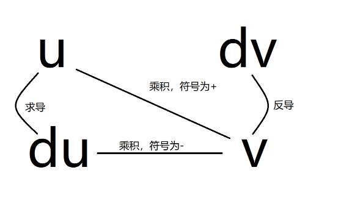

*分部积分的记忆示意图。*

常见选择：$x^n\ln x$ 可取 $u=\ln x$；$x\sin x$、$x\cos x$、$xe^x$ 可取 $u=x$。选择 $u$ 与 $dv$ 的目标是简化剩余积分。例如，计算 $\int\ln x\,dx$ 时可取 $u=\ln x$、$dv=dx$。

#### 常用积分恒等式

$$
\int\frac{f'(x)}{f(x)}\,dx=\ln|f(x)|+C,\qquad f(x)\ne0,
$$

$$
\int f(ax+b)\,dx=\frac1aF(ax+b)+C,\qquad F'=f,\ a\ne0.
$$

## 第一单元：一阶常微分方程（First-order ODEs）

### 一阶方程的分类

一阶线性方程的标准形式为

$$
y'+p(x)y=f(x).
$$

更一般的 $a(x)y'+b(x)y=g(x)$ 应先在 $a(x)\ne0$ 的区间上除以 $a(x)$。标准化后，$f\equiv0$ 为齐次，否则为非齐次。不符合线性形式的方程称为非线性方程。

可分离、线性、恰当是不同的分类角度，可能重叠；恰当方程不一定不可分离。

### 一阶线性方程的求解

设 $p,f$ 在区间 $I$ 上连续。

#### 齐次方程

$$
y'+p(x)y=0
\quad\Longrightarrow\quad
y(x)=Ce^{-\int p(x)\,dx}.
$$

其中 $C=0$ 包含平凡解。

#### 积分因子法（Integrating factor）

取积分因子

$$
\mu(x)=e^{\int p(x)\,dx}.
$$

乘入原方程后，

$$
(\mu y)'=\mu f,
$$

所以

$$
y(x)=\frac1{\mu(x)}\left(\int\mu(x)f(x)\,dx+C\right).
$$

积分因子中可任选一个原函数，不需要再保留其积分常数；非零常数倍不影响方法。

#### 常数变易法（Variation of parameters）

取齐次方程的非零解 $y_1=e^{-\int p(x)\,dx}$，设 $y=uy_1$，代入后得到 $u'y_1=f$，故

$$
y(x)=y_1(x)\left(\int\frac{f(x)}{y_1(x)}\,dx+C\right).
$$

### 一阶线性初值问题的存在唯一性与有效区间

若 $p,f$ 在开区间 $I=(a,b)$ 上连续，$x_0\in I$，则对任意实数 $y_0$，初值问题

$$
\begin{cases}
y'+p(x)y=f(x),\\
y(x_0)=y_0
\end{cases}
$$

在整个 $I$ 上存在唯一解。

实际判断时，应找包含 $x_0$、且标准化系数 $p,f$ 连续的最大开区间。先检查最高阶导数的系数是否为零，并检查分母、对数等限制。

该区间是定理保证的解区间。若某个解可以跨过系数奇点延拓，应在未标准化的原方程中验证其延拓是否仍为解。

### 可分离变量方程（Separable equations）

对于

$$
y'=g(x)h(y),
$$

先检查 $h(y_*)=0$ 对应的平衡解 $y\equiv y_*$。在 $h(y)\ne0$ 的解分支上，按以下步骤求解：

1. 将 $y'$ 写成 $dy/dx$，即 $dy/dx=g(x)h(y)$。
2. 把含 $y$ 的因子及 $dy$ 移至一侧，把含 $x$ 的因子及 $dx$ 移至另一侧。
3. 两边分别对相应变量积分。两侧的积分常数可合并为一个常数，只在一侧写 $C$。

$$
\frac{dy}{h(y)}=g(x)\,dx,
\qquad
\int\frac1{h(y)}\,dy=\int g(x)\,dx+C.
$$

求得隐式或显式解后，代入初值确定常数，再根据原方程定义域、表达式定义域及可能的发散点，选取包含初始点的有效区间。除以 $h(y)$ 时遗漏的平衡解应补回。

#### 自治方程（Autonomous equations）

自治方程中自变量不显式出现，形式为

$$
\frac{dy}{dt}=f(y).
$$

1. 解 $f(y_*)=0$，先列出平衡解 $y\equiv y_*$。
2. 在 $f(y)\ne0$ 的分支上，写成 $dy/f(y)=dt$。
3. 两边积分：

$$
\int\frac{dy}{f(y)}=\int1\,dt+C=t+C.
$$

4. 求出隐式或显式解，再连同平衡解一起检查初值与解区间。

#### 例：分离变量可能遗漏解

考虑

$$
y'=\sqrt[3]{y}.
$$

对于非零解分支，

$$
\int y^{-1/3}\,dy=\int1\,dx,
\qquad
\frac32y^{2/3}=x+C.
$$

先将积分等式改写为

$$
y^{2/3}=\frac23x+C_1,\qquad C_1=\frac23C.
$$

左侧非负，因此要求 $\frac23x+C_1\ge0$。令 $C_1=-\frac23a$，分别选取正、负两个分支，得到

$$
y(x)=\pm\left[\frac23(x-a)\right]^{3/2},\qquad x>a.
$$

还存在 $y\equiv0$。由于 $f(y)=\sqrt[3]{y}$ 在 $0$ 处不满足局部 Lipschitz 条件，初值 $y(x_0)=0$ 允许“等待后离开零点”的解：对任意 $a\ge x_0$，

$$
y(x)=
\begin{cases}
0,&x\le a,\\
\displaystyle\pm\left[\frac23(x-a)\right]^{3/2},&x>a.
\end{cases}
$$

这些拼接函数在 $a$ 处可微且满足原方程，说明只写非零分支并不能表示全部解。

### 恰当微分方程（Exact equations）

#### 形式与判定

方程

$$
M(x,y)\,dx+N(x,y)\,dy=0
$$

若存在势函数 $F$，满足 $F_x=M$、$F_y=N$，则称为恰当方程，其积分曲线由

$$
F(x,y)=C
$$

描述。在可表示为函数 $y(x)$ 的部分，方程也可写成 $M+Ny'=0$。若 $N\ne0$，可由隐函数定理在局部解出 $y(x)$。

若改用 $y$ 作自变量，在可表示为 $x(y)$ 的部分，方程写为

$$
M(x,y)\frac{dx}{dy}+N(x,y)=0.
$$

因此微分形式、$y(x)$ 形式和 $x(y)$ 形式分别适用于相应的参数化；涉及除以 $M$ 或 $N$ 时，应检查其是否为零。

设 $M,N$ 在平面中的单连通开区域 $D$ 上具有连续一阶偏导数，则

$$
M\,dx+N\,dy\text{ 恰当}
\quad\Longleftrightarrow\quad
M_y=N_x\text{ 在 }D\text{ 上处处成立}.
$$

开矩形或整个 $\mathbb R^2$ 满足上述区域条件。在有孔区域上，$M_y=N_x$ 一般只保证局部恰当，不能直接推出全局存在单值势函数。

#### 求解步骤与例题

考虑

$$
(4x^3y^3+3x^2)\,dx+(3x^4y^2+6y^2)\,dy=0.
$$

1. **识别 $M,N$。** 写出

$$
M(x,y)=4x^3y^3+3x^2,\qquad N(x,y)=3x^4y^2+6y^2.
$$

若存在势函数，则 $F_x=M$、$F_y=N$。

2. **检查恰当性。** 分别求偏导：

$$
M_y=12x^3y^2,\qquad N_x=12x^3y^2.
$$

两者相等，且都是全平面上的连续函数，因此方程在 $\mathbb R^2$ 上恰当。

3. **选择积分方向。** 可以对 $M$ 关于 $x$ 积分，或对 $N$ 关于 $y$ 积分。先选择前者，把 $y$ 当作常数，并保留关于 $y$ 的未知函数：

$$
\begin{aligned}
F(x,y)&=\int M(x,y)\,dx+\varphi(y)\\
&=\int(4x^3y^3+3x^2)\,dx+\varphi(y)\\
&=x^4y^3+x^3+\varphi(y).
\end{aligned}
$$

4. **对另一变量求偏导。** 已经对 $x$ 积分，接着对 $y$ 求偏导：

$$
F_y(x,y)=3x^4y^2+\varphi'(y).
$$

5. **与对应的原系数比较。** 将 $F_y$ 与 $N$ 比较：

$$
3x^4y^2+\varphi'(y)=3x^4y^2+6y^2,
$$

消去共同项，得到

$$
\varphi'(y)=6y^2.
$$

6. **积分确定未知函数。**

$$
\varphi(y)=\int6y^2\,dy=2y^3+C_0.
$$

$C_0$ 可并入最终等值常数，因此可取 $\varphi(y)=2y^3$。

7. **写出隐式解。**

$$
F(x,y)=x^4y^3+x^3+2y^3,\qquad
x^4y^3+x^3+2y^3=C.
$$

**另一条求解路径：先对 $N$ 积分。**

1. 对 $y$ 积分，并保留关于 $x$ 的未知函数：

$$
\begin{aligned}
F(x,y)&=\int N(x,y)\,dy+\psi(x)\\
&=\int(3x^4y^2+6y^2)\,dy+\psi(x)\\
&=x^4y^3+2y^3+\psi(x).
\end{aligned}
$$

2. 对 $x$ 求偏导：

$$
F_x=4x^3y^3+\psi'(x).
$$

3. 与 $M$ 比较：

$$
4x^3y^3+\psi'(x)=4x^3y^3+3x^2,\qquad \psi'(x)=3x^2.
$$

4. 积分得到

$$
\psi(x)=\int3x^2\,dx=x^3+C_0.
$$

5. 将结果代回，合并常数后仍得到

$$
x^4y^3+x^3+2y^3=C.
$$

若先对 $M$ 积分，后续应计算 $F_y$ 并与 $N$ 比较；若先对 $N$ 积分，后续应计算 $F_x$ 并与 $M$ 比较。

#### 用积分因子化为恰当方程

若原方程不恰当，可尝试寻找非零函数 $\mu$，使

$$
\mu M\,dx+\mu N\,dy=0
$$

成为恰当方程。两种常用的充分条件为：

- 在 $N\ne0$ 的区域内，若 $(M_y-N_x)/N$ **只依赖 $x$**，记为 $h(x)$，则可取

$$
\mu(x)=e^{\int h(x)\,dx}.
$$

- 在 $M\ne0$ 的区域内，若 $(N_x-M_y)/M$ **只依赖 $y$**，记为 $k(y)$，则可取

$$
\mu(y)=e^{\int k(y)\,dy}.
$$

选用公式前，先确认相应比值只依赖指定变量。乘入积分因子后验证恰当性；求解过程中排除的点或曲线，应回到原方程检查是否对应其他解。

完整操作顺序为：

1. 写出 $M,N$，计算 $M_y,N_x$，确认原方程是否已经恰当。
2. 若不恰当，在相应分母非零的区域内分别检查 $(M_y-N_x)/N$ 和 $(N_x-M_y)/M$ 的变量依赖。
3. 对符合单变量条件的比值积分，求出 $\mu(x)$ 或 $\mu(y)$。
4. 将原方程的每一项乘以同一个 $\mu$，令 $\widetilde M=\mu M$、$\widetilde N=\mu N$。
5. 验证 $\widetilde M_y=\widetilde N_x$，再按恰当方程的步骤求势函数并写成 $F=C$。

### 平衡解与一般一阶方程的存在唯一性

#### 恒定解（Constant or equilibrium solutions）

对 $y'=f(x,y)$，$y\equiv y_*$ 为恒定解的条件是

$$
f(x,y_*)=0
$$

在所讨论区间的所有 $x$ 上成立。对自治方程 $y'=f(y)$，这简化为 $f(y_*)=0$。恒定解是完整解集的一部分，也是相线分析的基础。

在分离变量求非恒定解之前，应先列出恒定解。若随后除以在 $y=y_*$ 时为零的因子，就在该运算中暂取 $y\ne y_*$；运算结束后把恒定解补回。非恒定分支的取值范围，还需结合初值、原方程及唯一性分析确定。

#### 局部存在与唯一性定理

考虑

$$
\begin{cases}
y'=f(x,y),\\
y(x_0)=y_0.
\end{cases}
$$

设开矩形 $R=\{(x,y):a<x<b,\ c<y<d\}$ 包含 $(x_0,y_0)$。

- 若 $f$ 在 $R$ 上连续，则至少有一个解存在于包含 $x_0$ 的某个开区间内。
- 若 $f$ 和 $f_y$ 在 $R$ 上均连续，则在包含 $x_0$ 的某个开区间内存在唯一解。这是常用充分条件；更一般的唯一性条件是 $f$ 关于 $y$ 局部 Lipschitz 连续。

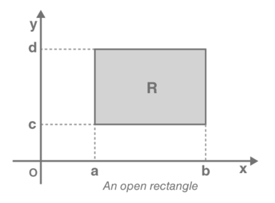

*存在唯一性定理中的局部区域。*

这些条件是充分条件；条件不成立时，解的存在性与唯一性需要另行分析。定理给出局部结论，解能否延拓到整个 $(a,b)$ 取决于方程与初值；非线性方程的解可能在有限时间发散。

#### 初值问题的检查顺序

1. 写成 $y'=f(x,y)$，检查初始点是否在原方程定义域内。
2. 检查初始点附近的连续性与唯一性条件，区分“保证存在”“保证唯一”和“定理无结论”。
3. 求解并保留平衡解及可能的其他分支，将初值代入解来确定常数。
4. 回代原方程和初值；给出包含 $x_0$ 的解区间。

若已有解族无法满足初值，应检查平衡解及其他分支是否已全部包含。经典初值问题要求原方程在初始点有定义，且解在该点满足方程。

**求通解（Finding the general solution）。**

1. 检查恒定解；自治方程先解 $f(y)=0$。
2. 确定方程的定义区域，检查相关存在性条件；分离变量时标明暂时排除的解。
3. 选择适当方法求出非恒定解族。
4. 补回恒定解及其他可能分支，并说明各解的适用区间。

**求满足初值的解（Finding the particular solution）。**

1. 求出解族，并保留平衡解与其他分支。
2. 将初始点 $(x_0,y_0)$ 代入解，确定积分常数或对应的分支。
3. 在包含初始点的邻域内检查 $f$ 的连续性。若 $f,f_y$ 均连续，定理保证局部唯一解；只有 $f$ 连续时，定理保证局部存在，而唯一性需另行判断。
4. 选出包含 $x_0$ 的解区间，再回代验证微分方程与初值。如果定理的充分条件不成立，继续直接分析解，而不是据此作无解或不唯一的结论。

### 自治方程的相线与稳定性

对 $y'=f(y)$，在各平衡点之间判断 $f$ 的符号：$f>0$ 时 $y$ 随时间增加，相线箭头向上；$f<0$ 时箭头向下。

若 $f$ 可微，则沿解有

$$
y''=f'(y)y'=f'(y)f(y).
$$

因此，解曲线 $y(t)$ 的凹性由 $f'f$ 的符号决定；$f$ 的正负本身不能确定 $f'$ 的正负。先分析以 $y$ 为横轴的 $f(y)$ 图像，再绘制以 $t$ 为横轴的 $y(t)$ 图像。

在局部唯一性成立时，非平衡解不能在有限时间穿过平衡解。

从方程到解曲线的画图步骤为：

1. **求零点。** 解 $f(y)=0$，列出平衡点，从小到大标在以 $y$ 为横轴的 $f(y)$ 图上。
2. **画 $f$ 的符号表。** 在相邻零点之间各取测试值，判断 $f$ 正负，结合解析式画 $f(y)$。
3. **求导并判断凹性。** 计算 $f'(y)$，把 $f$ 与 $f'$ 的零点共同标在符号表上，逐段相乘得到 $y''=f'f$ 的正负。
4. **画相线。** 在竖直的 $y$ 轴上从下到上排列平衡点；$f>0$ 的区间箭头向上，$f<0$ 的区间箭头向下。
5. **画 $y(t)$。** 以 $t$ 为横轴、$y$ 为纵轴，先画恒定解对应的水平线，再结合相线的升降方向、$y''$ 的凹性和解区间画其他解曲线。

#### 稳定、渐近稳定、不稳定与半稳定

- **稳定**（stable）：从充分接近平衡点的初值出发，解在所有未来时间都保持接近该点。
- **渐近稳定**（asymptotically stable）：稳定，且充分接近的解在 $t\to\infty$ 时趋向该点。
- **不稳定**（unstable）：不满足稳定性；相线两侧箭头均背离平衡点是常见情形。
- **半稳定**（semistable）：一侧的邻近解趋向平衡点，另一侧的邻近解远离它；在平衡点两侧符号固定的通常情形下，箭头同向。

对光滑的一维自治方程，若 $f(y_*)=0$，则 $f'(y_*)<0$ 保证渐近稳定，$f'(y_*)>0$ 保证不稳定；$f'(y_*)=0$ 时需进一步分析。稳定性必须说明允许的状态域，例如全实数或种群的非负半轴。

例如，在带阈值的逻辑斯谛模型中，相线在 $K$ 两侧的箭头都指向 $K$，所以 $K$ 渐近稳定；在 $T$ 两侧的箭头都背离 $T$，所以 $T$ 不稳定。

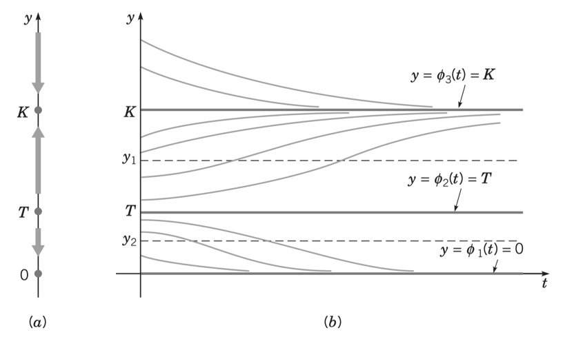

*相线中邻近平衡点的箭头给出稳定性，解曲线显示相应的长期趋势。*

半稳定例子：$y'=y(y-K)^2$，$K>0$。在 $K$ 下方且接近 $K$ 时解上升并趋向 $K$；在上方时解上升并远离 $K$。

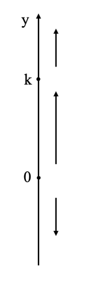

*半稳定平衡点 $K$；图中 $0$ 也是平衡点。*

### 自治方程的四种模型

以下种群模型均假设 $y_0\ge0$。在需要讨论全实数相线时会另行说明。

#### 指数增长或衰减（Exponential growth or decay）

比例常数 $r$ 为增长率或衰减率（rate of growth or decay），单位为时间的倒数；$y(t)$ 为时刻 $t$ 的数量。

$$
y'=ry,\qquad y(0)=y_0,
\qquad y(t)=y_0e^{rt}.
$$

- $r=0$：每个常数函数都是解。
- $r>0$ 且 $y_0>0$：解递增。
- $r<0$ 且 $y_0>0$：解递减并趋向 $0$。
- $y_0=0$：解恒为零。

若允许 $y_0<0$，单调方向相反，因为 $y'=ry$ 的符号同时取决于 $r$ 和 $y$。

#### 逻辑斯谛增长（Logistic growth）

设 $r>0$、$K>0$，

$$
y'=f(y)=ry\left(1-\frac yK\right).
$$

$r$ 是内禀增长率，$K$ 是环境容纳量。$K$ 是正解长期趋向的水平，不是所有允许初值的硬性上界；初值可以大于 $K$。

$$
f'(y)=r\left(1-\frac{2y}{K}\right).
$$

| $y$ 的区间 | $f(y)$ | $f'(y)$ | $y''=f'f$ |
| --- | --- | --- | --- |
| $y<0$ | 负 | 正 | 负 |
| $0<y<K/2$ | 正 | 正 | 正 |
| $K/2<y<K$ | 正 | 负 | 负 |
| $y>K$ | 负 | 负 | 正 |

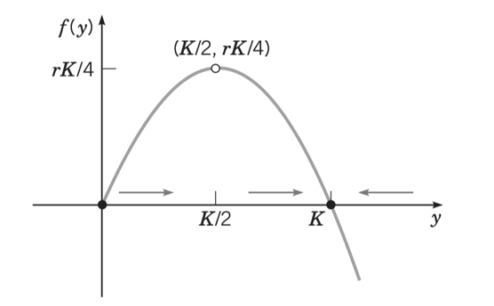

*右端函数 $f(y)$ 在 $0,K$ 处为零，在 $K/2$ 处取最大值 $rK/4$。*

平衡解为 $0,K$：$0$ 不稳定，$K$ 渐近稳定。若 $0<y_0<K$，解上升并趋向 $K$；若 $y_0>K$，解下降并趋向 $K$。在 $0<y<K$ 的解分支上，经过 $K/2$ 时凹性改变；若只看 $t\ge0$，该时刻未必落在观察区间内。

对 $y_0>0$，显式解为

$$
y(t)=\frac{K}{1+\left(\frac K{y_0}-1\right)e^{-rt}},\qquad t\ge0.
$$

另有 $y\equiv0$。

**画图演示。**

1. 由 $ry(1-y/K)=0$ 得零点 $y=0,K$。在 $f(y)$ 图上标出这两个零点，利用二次项系数为负画开口向下的抛物线。
2. 由 $f'(y)=r(1-2y/K)$ 得驻点 $y=K/2$，其函数值为 $rK/4$。
3. 分别判断 $f,f'$ 的符号，并相乘得到 $y''$ 的符号。图中实线表示正值、虚线表示负值，下方符号表示二者的乘积。

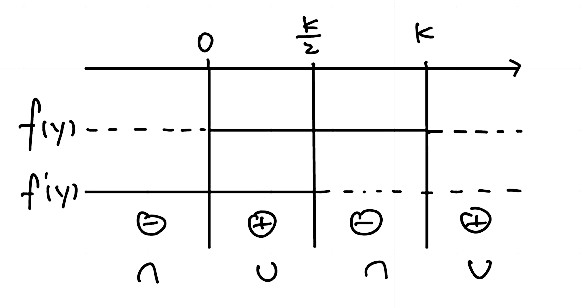

*从左到右，$y''$ 的符号为负、正、负、正；对应凹向下、凹向上、凹向下、凹向上。*

4. 在相线上标出 $0,K$：$0<y<K$ 时箭头向上，$y>K$ 时箭头向下；若讨论 $y<0$，箭头向下。
5. 在 $ty$ 平面先画 $y=0$ 和 $y=K$。对 $0<y_0<K$ 的解，按凹性先上凹后下凹；对 $y_0>K$ 的解，画下降且上凹、渐近于 $K$ 的曲线。若观察从 $t=0$ 开始且 $y_0\ge K/2$，正向时间内不再经过先上凹的部分。

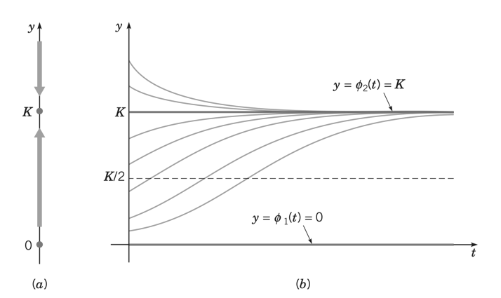

*正初值的长期极限为 $K$。*

#### 临界阈值（Critical threshold）

设 $r,T>0$，

$$
y'=f(y)=-ry\left(1-\frac yT\right)
=\frac rT y(y-T).
$$

平衡解为 $0,T$。在 $0<y<T$ 时 $f<0$，解下降并趋向 $0$；在 $y>T$ 时 $f>0$，解增长。因此 $0$ 渐近稳定，$T$ 不稳定。

$$
f'(y)=r\left(\frac{2y}{T}-1\right).
$$

| $y$ 的区间 | $f(y)$ | $f'(y)$ | $y''$ |
| --- | --- | --- | --- |
| $y<0$ | 正 | 负 | 负 |
| $0<y<T/2$ | 负 | 负 | 正 |
| $T/2<y<T$ | 负 | 正 | 负 |
| $y>T$ | 正 | 正 | 正 |

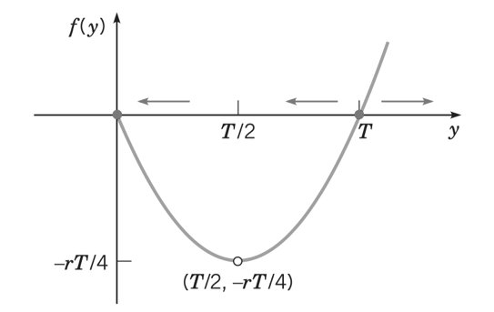

*右端函数为开口向上的抛物线。*

对 $y_0>0$，

$$
y(t)=\frac{T}{1+\left(\frac T{y_0}-1\right)e^{rt}}.
$$

当 $y_0>T$ 时，解在有限时间

$$
t_*=\frac1r\ln\frac{y_0}{y_0-T}
$$

趋向 $+\infty$，其包含初始时刻的正向解区间为 $[0,t_*)$。

**画图演示。**

1. 由 $f(y)=\frac rT y(y-T)$ 找到零点 $0,T$，并画开口向上的抛物线。
2. 解 $f'(y)=r(2y/T-1)=0$，得到最低点的横坐标 $T/2$，函数值为 $-rT/4$。
3. 在 $0,T/2,T$ 处分段，分别列出 $f,f'$ 的符号并相乘：

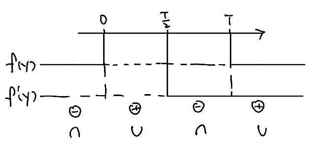

*图中实线表示正值、虚线表示负值；下方乘积的符号依次为负、正、负、正。*

4. 在相线上标出 $0,T$。$0<y<T$ 时解下降，$y>T$ 时解上升；若允许 $y<0$，解向上趋向 $0$。
5. 在 $ty$ 平面画水平解 $0,T$。位于 $(0,T/2)$ 的非恒定解下降且上凹；位于 $(T/2,T)$ 的解先下降且下凹，经过 $T/2$ 后变为上凹；位于 $T$ 上方的解上升且上凹，并在有限时间发散。

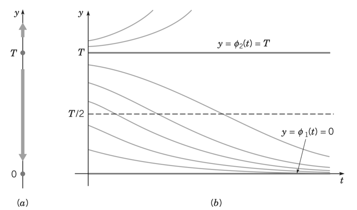

*图中高于 $T$ 的曲线仅表示发散前的一段，完整曲线在有限时间有竖直渐近线。*

#### 带阈值的逻辑斯谛增长（Logistic growth with a threshold）

设 $r>0$、$0<T<K$，

$$
y'=f(y)=-ry\left(1-\frac yT\right)\left(1-\frac yK\right).
$$

逐个因子判断符号：

| $y$ 的区间 | $f(y)$ | 相线方向 |
| --- | --- | --- |
| $y<0$ | 正 | 向上 |
| $0<y<T$ | 负 | 向下 |
| $T<y<K$ | 正 | 向上 |
| $y>K$ | 负 | 向下 |

平衡解为 $0,T,K$。$0$ 与 $K$ 渐近稳定，$T$ 不稳定。

- $0<y_0<T$：种群趋向灭绝，$y(t)\to0$。
- $y_0=T$：$y(t)\equiv T$。
- $y_0>T$：$y(t)\to K$。
- $y_0=0$：$y(t)\equiv0$。

凹性仍由 $f'f$ 判断。为避免混淆导数零点的编号，可直接将两个导数零点按大小记为

$$
y_- =\frac{T+K-\sqrt{T^2-TK+K^2}}3,\qquad
y_+ =\frac{T+K+\sqrt{T^2-TK+K^2}}3,
$$

其中 $0<y_-<T<y_+<K$。在非平衡解经过这些水平时凹性改变。

**画图演示。**

1. 解 $f(y)=0$，得到 $0,T,K$。
2. 把右端拆成各因子，分别判断正负：

$$
f(y)=r(-y)\left(1-\frac yT\right)\left(1-\frac yK\right).
$$

$r>0$ 不改变符号，另外三个因子的符号相乘得到 $f$ 的符号：

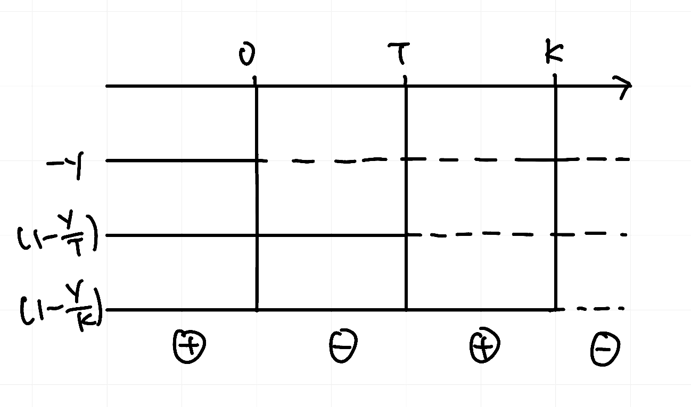

*实线表示正值，虚线表示负值；底部为乘积的符号。*

3. 根据零点及正负区间画 $f(y)$：在 $(0,T)$ 位于横轴下方，在 $(T,K)$ 位于横轴上方，$y>K$ 时位于横轴下方。

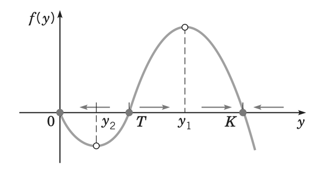

*图中较小的驻点 $y_2=y_-$ 位于 $(0,T)$，较大的驻点 $y_1=y_+$ 位于 $(T,K)$。*

4. 计算 $f'$，在 $0,y_-,T,y_+,K$ 处分段，用 $f'f$ 判断解曲线的凹性。

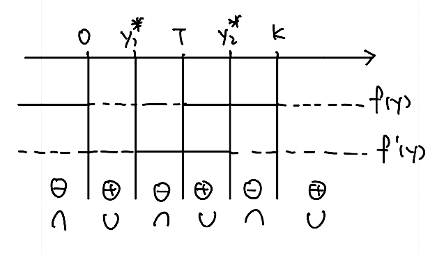

*图中 $y_1^*=y_-$、$y_2^*=y_+$。这两个带星号的标记分别表示较小和较大的导数零点。*

| $y$ 的区间 | $f(y)$ | $f'(y)$ | $y''=f'f$ |
| --- | --- | --- | --- |
| $y<0$ | 正 | 负 | 负 |
| $0<y<y_-$ | 负 | 负 | 正 |
| $y_-<y<T$ | 负 | 正 | 负 |
| $T<y<y_+$ | 正 | 正 | 正 |
| $y_+<y<K$ | 正 | 负 | 负 |
| $y>K$ | 负 | 负 | 正 |

5. 在相线上按 $0<T<K$ 排列平衡点，依次标向下、向上、向下的箭头；在 $ty$ 平面画 $y=0,T,K$ 三条水平解，再按升降和凹性补上非恒定解曲线。

*初值低于阈值 $T$ 时趋向 $0$，高于阈值时趋向 $K$。*

## 第二单元：微分方程组（Systems of differential equations）

### 一阶线性方程组的矩阵形式

一阶线性系统写为

$$
\mathbf y'=A(t)\mathbf y+\mathbf f(t),\qquad
\mathbf y(t_0)=\mathbf y_0,
$$

其中 $A(t)$ 为 $n\times n$ 矩阵，$\mathbf y,\mathbf f$ 为 $n$ 维列向量。例如

$$
\begin{cases}
y_1'=y_1-y_2,\\
y_2'=2y_2
\end{cases}
\quad\Longleftrightarrow\quad
\mathbf y'=\begin{bmatrix}1&-1\\0&2\end{bmatrix}\mathbf y.
$$

若 $A,\mathbf f$ 的各分量在开区间 $I$ 上连续，且 $t_0\in I$，则对任意 $\mathbf y_0$，初值问题在整个 $I$ 上存在唯一解。

### 叠加原理、线性独立与基本矩阵

以下先讨论齐次系统 $\mathbf y'=A(t)\mathbf y$。

#### 叠加原理（Superposition principle）

若 $\mathbf y_1,\ldots,\mathbf y_n$ 都是齐次系统的解，则任何常系数线性组合

$$
\mathbf y=c_1\mathbf y_1+\cdots+c_n\mathbf y_n
$$

仍是解。非齐次方程的解不能直接任意叠加；其通解为齐次通解加一个非齐次特解。

#### 线性独立（Linear independence）

向量函数 $\mathbf y_1,\ldots,\mathbf y_n$ 在 $I$ 上线性独立，是指恒等式

$$
c_1\mathbf y_1(t)+\cdots+c_n\mathbf y_n(t)=\mathbf0
\qquad\text{对所有 }t\in I
$$

**只有** $c_1=\cdots=c_n=0$ 这一组常数解。

#### 基本解组与朗斯基行列式

若 $n$ 个解线性独立，则构成**基本解组**（fundamental set of solutions，FSS），其所有线性组合构成齐次通解。

将这些解按列组成矩阵：

$$
Y(t)=\begin{bmatrix}\mathbf y_1(t)&\cdots&\mathbf y_n(t)\end{bmatrix},
\qquad W(t)=\det Y(t).
$$

当 $A$ 在 $I$ 上连续，且各列均为该齐次系统的解时，以下条件等价：

1. 这些解构成基本解组。
2. 这些向量函数在 $I$ 上线性独立。
3. 对某个 $t_0\in I$，$W(t_0)\ne0$。
4. 对每个 $t\in I$，$W(t)\ne0$。

此时 $Y$ 称为**基本矩阵**（fundamental matrix），通解为 $\mathbf y=Y\mathbf c$。检验行列式时，可任选 $I$ 内便于计算的点。

对一般向量函数组，某点行列式为零并不足以说明函数组线性相关；上述等价性依赖于它们是同一个连续系数齐次系统的解。

### 常系数齐次系统的特征值法

设 $A$ 为实常矩阵。对 $2\times2$ 齐次系统，按特征值及特征向量的情况分类求解。

#### 两个不同实特征值（Distinct real eigenvalues）

1. **写出矩阵。** 将系统按分量顺序写成 $\mathbf y'=A\mathbf y$。
2. **求特征值与特征向量。** 解

$$
\det(A-\lambda I)=0
$$

得到 $\lambda_1\ne\lambda_2$。再分别解

$$
(A-\lambda_1I)\mathbf v_1=\mathbf0,\qquad
(A-\lambda_2I)\mathbf v_2=\mathbf0,
$$

各取一个非零向量。

3. **列出特征对。** 写为 $(\lambda_1,\mathbf v_1)$ 和 $(\lambda_2,\mathbf v_2)$，保持特征值与向量一一对应。
4. **构造两个解。**

$$
\mathbf y_1=e^{\lambda_1t}\mathbf v_1,\qquad
\mathbf y_2=e^{\lambda_2t}\mathbf v_2.
$$

5. **检验基本解组。** 将两解按列排列：

$$
\begin{aligned}
Y(t)&=\begin{bmatrix}
e^{\lambda_1t}\mathbf v_1&e^{\lambda_2t}\mathbf v_2
\end{bmatrix},\\
W(t)&=e^{(\lambda_1+\lambda_2)t}\det[\mathbf v_1\ \mathbf v_2].
\end{aligned}
$$

由于不同特征值对应的特征向量独立，$\det[\mathbf v_1\ \mathbf v_2]\ne0$。常系数系统可在 $t=0$ 检验：

$$
W(0)=\det[\mathbf y_1(0)\ \mathbf y_2(0)]
=\det[\mathbf v_1\ \mathbf v_2]\ne0.
$$

6. **写通解。**

$$
\mathbf y=c_1\mathbf y_1+c_2\mathbf y_2
=c_1e^{\lambda_1t}\mathbf v_1+c_2e^{\lambda_2t}\mathbf v_2.
$$

若给出初值，再由 $\mathbf y(0)=c_1\mathbf v_1+c_2\mathbf v_2$ 求常数。

#### 重复实特征值（Repeated real eigenvalue）

1. **写出矩阵并求特征根。** 解 $\det(A-\lambda I)=0$，确认 $\lambda$ 为二重实根。
2. **求特征空间。** 解 $(A-\lambda I)\mathbf v=\mathbf0$，判断独立特征向量的个数。

若有两个线性独立的特征向量 $\mathbf v_1,\mathbf v_2$，则直接得到

$$
\mathbf y_1=e^{\lambda t}\mathbf v_1,\qquad
\mathbf y_2=e^{\lambda t}\mathbf v_2,\qquad
\mathbf y=e^{\lambda t}(c_1\mathbf v_1+c_2\mathbf v_2).
$$

此时 $2\times2$ 矩阵满足 $A=\lambda I$。若只有一个线性独立的特征向量 $\mathbf v$，继续以下步骤。

3. **求广义特征向量。** 解非齐次代数系统

$$
(A-\lambda I)\mathbf w=\mathbf v.
$$

$\mathbf w$ 与 $\mathbf v$ 线性独立。

4. **构造两个解。**

$$
\mathbf y_1=e^{\lambda t}\mathbf v,\qquad
\mathbf y_2=e^{\lambda t}(t\mathbf v+\mathbf w).
$$

代入可验证第二个解：

$$
\begin{aligned}
\mathbf y_2'&=e^{\lambda t}\big[\lambda(t\mathbf v+\mathbf w)+\mathbf v\big],\\
A\mathbf y_2&=e^{\lambda t}\big[t\lambda\mathbf v+\lambda\mathbf w+\mathbf v\big].
\end{aligned}
$$

两者相等。

5. **检验基本解组。**

$$
\begin{aligned}
W(t)&=e^{2\lambda t}\det[\mathbf v\ t\mathbf v+\mathbf w]\\
&=e^{2\lambda t}\det[\mathbf v\ \mathbf w]\ne0.
\end{aligned}
$$

特别地，$W(0)=\det[\mathbf v\ \mathbf w]\ne0$。

6. **写通解。**

$$
\mathbf y=c_1\mathbf y_1+c_2\mathbf y_2
=e^{\lambda t}\big[c_1\mathbf v+c_2(t\mathbf v+\mathbf w)\big].
$$

#### 共轭复特征值（Complex conjugate eigenvalues）

实矩阵系统满足叠加原理。若 $\mathbf z$ 是复值解，则 $\operatorname{Re}\mathbf z$ 与 $\operatorname{Im}\mathbf z$ 都是实值解，因为

$$
(\operatorname{Re}\mathbf z)'=\operatorname{Re}(A\mathbf z)
=A\operatorname{Re}\mathbf z,
$$

虚部同理。

1. **写出实矩阵 $A$。**
2. **求共轭特征对。** 若一个非实特征值为 $\lambda_1=a+bi$，取 $b>0$，则另一个为

$$
\lambda_2=\overline{\lambda_1}=a-bi.
$$

解 $(A-\lambda_1I)\mathbf v_1=\mathbf0$，取非零向量 $\mathbf v_1=\mathbf u+i\mathbf w$，则可相应取

$$
\mathbf v_2=\overline{\mathbf v_1}=\mathbf u-i\mathbf w.
$$

3. **构造共轭复解。**

$$
\mathbf z_1=e^{(a+bi)t}(\mathbf u+i\mathbf w),\qquad
\mathbf z_2=e^{(a-bi)t}(\mathbf u-i\mathbf w)=\overline{\mathbf z_1}.
$$

4. **用欧拉公式实数化。** 由

$$
e^{i\theta}=\cos\theta+i\sin\theta
$$

得到

$$
\begin{aligned}
\mathbf z_1
&=e^{at}(\mathbf u+i\mathbf w)(\cos bt+i\sin bt)\\
&=e^{at}\big[\mathbf u\cos bt-\mathbf w\sin bt\\
&\qquad\quad+i(\mathbf u\sin bt+\mathbf w\cos bt)\big].
\end{aligned}
$$

取其实部、虚部分别为两个实解：

$$
\begin{aligned}
\mathbf y_1&=e^{at}(\mathbf u\cos bt-\mathbf w\sin bt),\\
\mathbf y_2&=e^{at}(\mathbf u\sin bt+\mathbf w\cos bt).
\end{aligned}
$$

选择 $\lambda_1$ 时应使用其对应的 $\mathbf v_1$；选择共轭特征值时，也应同时选择共轭特征向量。

5. **检验基本解组。** $\mathbf u,\mathbf w$ 线性独立，并且

$$
W(t)=e^{2at}\det[\mathbf u\ \mathbf w],\qquad
W(0)=\det[\mathbf u\ \mathbf w]\ne0.
$$

6. **写实通解。**

$$
\mathbf y=c_1\mathbf y_1+c_2\mathbf y_2,\qquad c_1,c_2\in\mathbb R.
$$

#### 例：将复解转为实解

考虑

$$
\mathbf y'=A\mathbf y,\qquad A=\begin{bmatrix}4&-5\\5&-2\end{bmatrix}.
$$

1. **写出矩阵。** 系统的系数矩阵为上述 $A$。
2. **求特征值与特征向量。** 特征方程为

$$
\begin{aligned}
\det(A-\lambda I)&=(4-\lambda)(-2-\lambda)+25=0,\\
\lambda^2-2\lambda+17&=0.
\end{aligned}
$$

用求根公式：

$$
\lambda_{1,2}=\frac{2\pm\sqrt{(-2)^2-4\cdot1\cdot17}}2
=\frac{2\pm8i}2=1\pm4i.
$$

解特征向量方程

$$
\begin{bmatrix}4-\lambda&-5\\5&-2-\lambda\end{bmatrix}
\begin{bmatrix}v^{(1)}\\v^{(2)}\end{bmatrix}
=\begin{bmatrix}0\\0\end{bmatrix}.
$$

对 $\lambda_1=1+4i$，得到

$$
\begin{bmatrix}3-4i&-5\\5&-3-4i\end{bmatrix}
\begin{bmatrix}v^{(1)}\\v^{(2)}\end{bmatrix}
=\begin{bmatrix}0\\0\end{bmatrix}.
$$

第一行给出

$$
(3-4i)v^{(1)}-5v^{(2)}=0,\qquad
(3-4i)v^{(1)}=5v^{(2)}.
$$

取 $v^{(1)}=5$，便有 $v^{(2)}=3-4i$。第二行也满足，因为

$$
5\cdot5+(-3-4i)(3-4i)=25-25=0.
$$

因此可取

$$
\mathbf v_1=\begin{bmatrix}5\\3-4i\end{bmatrix},\qquad
\mathbf v_2=\overline{\mathbf v_1}=\begin{bmatrix}5\\3+4i\end{bmatrix}.
$$

3. **写出两个复解。**

$$
\begin{aligned}
\mathbf z_1&=\begin{bmatrix}5\\3-4i\end{bmatrix}e^{(1+4i)t},\\
\mathbf z_2&=\begin{bmatrix}5\\3+4i\end{bmatrix}e^{(1-4i)t}.
\end{aligned}
$$

4. **逐项展开并取实部、虚部。** 先把指数分开，令 $\theta=4t$：

$$
\begin{aligned}
\mathbf z_1
&=\begin{bmatrix}5\\3-4i\end{bmatrix}e^te^{4it}\\
&=e^t\begin{bmatrix}5\\3-4i\end{bmatrix}(\cos4t+i\sin4t)\\
&=e^t\begin{bmatrix}
5(\cos4t+i\sin4t)\\
(3-4i)(\cos4t+i\sin4t)
\end{bmatrix}.
\end{aligned}
$$

分配乘法：

$$
\mathbf z_1=e^t\begin{bmatrix}
5\cos4t+5i\sin4t\\
(3-4i)\cos4t+(3-4i)i\sin4t
\end{bmatrix}.
$$

利用 $i^2=-1$，第二个分量为

$$
\begin{aligned}
&(3-4i)\cos4t+(3-4i)i\sin4t\\
&=3\cos4t-4i\cos4t+3i\sin4t-4i^2\sin4t\\
&=(3\cos4t+4\sin4t)+i(3\sin4t-4\cos4t).
\end{aligned}
$$

因此

$$
\mathbf z_1=e^t\begin{bmatrix}
5\cos4t+5i\sin4t\\
3\cos4t+4\sin4t+i(3\sin4t-4\cos4t)
\end{bmatrix}.
$$

取实部为 $\mathbf y_1$，虚部为 $\mathbf y_2$：

$$
\mathbf y_1=e^t\begin{bmatrix}5\cos4t\\3\cos4t+4\sin4t\end{bmatrix},
$$

$$
\mathbf y_2=e^t\begin{bmatrix}5\sin4t\\3\sin4t-4\cos4t\end{bmatrix}.
$$

5. **检验基本解组。**

$$
W(0)=\det\begin{bmatrix}5&0\\3&-4\end{bmatrix}=-20\ne0.
$$

6. **写出实通解。**

$$
\mathbf y(t)=c_1e^t\begin{bmatrix}5\cos4t\\3\cos4t+4\sin4t\end{bmatrix}
+c_2e^t\begin{bmatrix}5\sin4t\\3\sin4t-4\cos4t\end{bmatrix}.
$$

### 平面线性自治系统的相图（Phase portraits）

以下讨论实 $2\times2$ 常矩阵系统 $\mathbf y'=A\mathbf y$。

#### 轨迹、相平面与平衡点

- 非恒定解 $\mathbf y(t)=(y_1(t),y_2(t))^{\mathsf T}$ 在 $y_1y_2$ 相平面内描出一条带方向的轨迹（trajectory）。
- 相图（phase portrait）由各条轨迹及平衡点组成；同一轨迹可由不同时间平移的解参数化。
- 唯一性保证两条不同的轨迹不能相交；若两解经过同一相点，它们描出的轨迹相同。
- 原点总是平衡点。非恒定解不能在有限时间到达原点，但可以渐近趋向原点。
- 若 $\det A\ne0$，原点是唯一平衡点；若 $A$ 奇异，$\ker A$ 中的每个点都是平衡点。

在特征向量方向上，非零特征值对应的特征解轨迹是两条半直线，箭头由特征值符号决定。一般解的轨迹通常是曲线。

#### 重复特征值且可对角化：星形节点

若 $A=\lambda I$ 且 $\lambda\ne0$，每条非平衡轨迹都是径向半直线。

- $\lambda>0$：箭头向外，原点为不稳定星形节点（star node，也称 proper node）。
- $\lambda<0$：箭头向内，原点为渐近稳定星形节点。

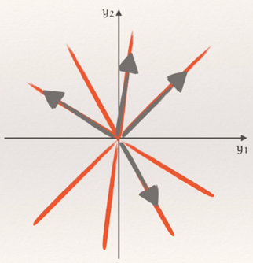

*不稳定星形节点。*

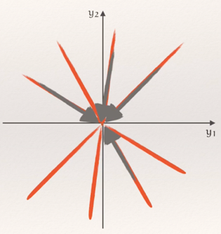

*渐近稳定星形节点。*

对任意非零初始向量 $\mathbf y_0$，$\mathbf y(t)=e^{\lambda t}\mathbf y_0$。因此

$$
\begin{aligned}
\lambda>0:&\quad
\lim_{t\to\infty}\|\mathbf y(t)\|=\infty,\quad
\lim_{t\to-\infty}\|\mathbf y(t)\|=0,\\
\lambda<0:&\quad
\lim_{t\to\infty}\|\mathbf y(t)\|=0,\quad
\lim_{t\to-\infty}\|\mathbf y(t)\|=\infty.
\end{aligned}
$$

$\lambda>0$ 的半直线箭头向外，$\lambda<0$ 的半直线箭头向内；原点本身单独表示恒定解。

#### 两个不同的非零实特征值

记 $\lambda_1<\lambda_2$，对应特征直线 $L_j=\operatorname{span}(\mathbf v_j)$。

| 特征值 | 原点类型 | 稳定性 |
| --- | --- | --- |
| $\lambda_1<\lambda_2<0$ | 稳定节点（stable node） | 渐近稳定 |
| $0<\lambda_1<\lambda_2$ | 不稳定节点（unstable node） | 不稳定 |
| $\lambda_1<0<\lambda_2$ | 鞍点（saddle） | 不稳定 |

画图时，先画特征直线，并沿各线标出箭头，再根据通解判断一般曲线：

- 稳定节点：一般轨迹在 $t\to\infty$ 趋向原点，并在原点附近切于较慢衰减方向 $L_2$；$L_1$ 本身的轨迹是例外。
- 不稳定节点：一般轨迹在 $t\to-\infty$ 趋向原点，并在原点附近切于较慢增长方向 $L_1$；$L_2$ 本身的轨迹是例外。
- 鞍点：$L_1$ 为稳定方向，$L_2$ 为不稳定方向。只有稳定直线上的非平衡轨迹在正向时间趋向原点；其他轨迹最终离开。

轨迹的远处方向由占主导的指数项决定。若要进一步确定某条直线是几何渐近线，还需检验轨迹到该直线的距离是否趋向零。

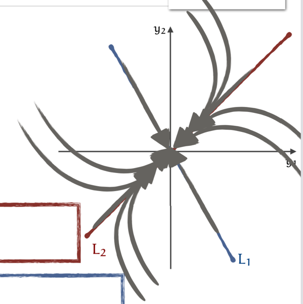

*稳定节点：一般轨迹在原点附近切于 $L_2$。*

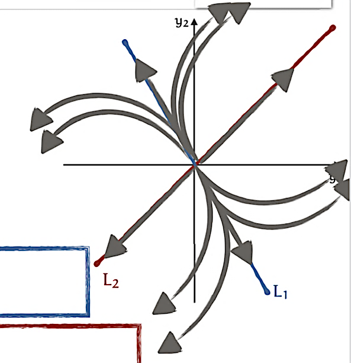

*不稳定节点：一般轨迹在原点附近切于 $L_1$。*

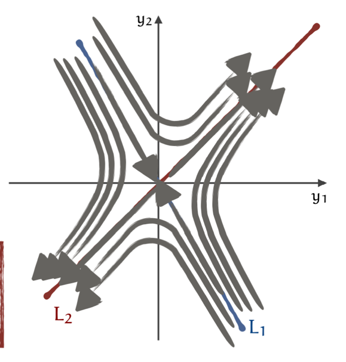

*稳定方向上的箭头向内，不稳定方向上的箭头向外。*

**相图绘制步骤。**

1. 计算特征值与对应特征向量，按 $\lambda_1<\lambda_2$ 编号。
2. 根据两根的符号判断稳定节点、不稳定节点或鞍点。
3. 在相平面画直线 $L_1=\operatorname{span}(\mathbf v_1)$、$L_2=\operatorname{span}(\mathbf v_2)$，每条直线分成两条非平衡半直线，并根据对应特征值标箭头。
4. 对节点，先以原点附近的切线方向区分曲线所在的两侧；稳定节点的一般曲线切于 $L_2$，不稳定节点的一般曲线切于 $L_1$。
5. 在远离原点的相应时间方向，一般曲线的方向趋近另一个占主导的特征向量方向：稳定节点的反向时间由 $\lambda_1$ 项主导，不稳定节点的正向时间由 $\lambda_2$ 项主导。
6. 对鞍点，沿 $L_1$ 画入原点的轨迹，沿 $L_2$ 画出原点的轨迹；其余曲线随时间从稳定方向一侧转向不稳定方向，并结合 $A\mathbf y$ 标出实际箭头。

#### 重复特征值且不可对角化：退化节点

设仅有一个独立特征向量，且 $\lambda\ne0$。利用

$$
\mathbf y(t)=e^{\lambda t}\big[c_1\mathbf v+c_2(t\mathbf v+\mathbf w)\big]
$$

判断轨迹。

- $\lambda>0$：对每个非零解，$\|\mathbf y(t)\|\to\infty$ 当 $t\to\infty$，而 $\mathbf y(t)\to\mathbf0$ 当 $t\to-\infty$；原点为不稳定退化节点（improper node）。
- $\lambda<0$：对每个非零解，$\mathbf y(t)\to\mathbf0$ 当 $t\to\infty$，而 $\|\mathbf y(t)\|\to\infty$ 当 $t\to-\infty$；原点为渐近稳定退化节点。

在趋向原点的时间方向上，一般曲线切于特征直线 $L=\operatorname{span}(\mathbf v)$。判断弯曲与箭头时，可在基底 $(\mathbf v,\mathbf w)$ 中写

$$
\mathbf y=\alpha\mathbf v+\beta\mathbf w,
\qquad
\begin{cases}
\alpha'=\lambda\alpha+\beta,\\
\beta'=\lambda\beta,
\end{cases}
$$

再变回原坐标，根据速度向量确定曲线的弯曲方向与箭头方向。

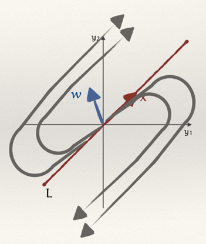

*不稳定退化节点示例。*

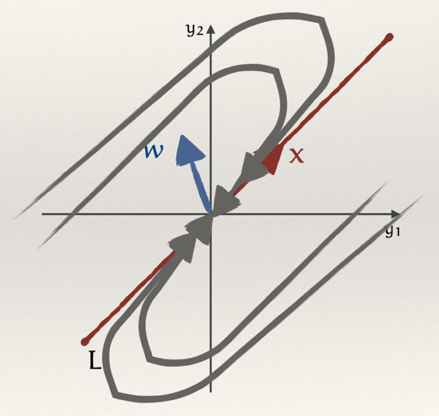

*渐近稳定退化节点示例。*

**极限与绘图步骤。** 对非零解

$$
\mathbf y=e^{\lambda t}\big[c_1\mathbf v+c_2(t\mathbf v+\mathbf w)\big],
$$

有

$$
\begin{aligned}
\lambda>0:&\quad
\lim_{t\to\infty}\|\mathbf y\|=\infty,\quad
\lim_{t\to-\infty}\|\mathbf y\|=0,\\
\lambda<0:&\quad
\lim_{t\to\infty}\|\mathbf y\|=0,\quad
\lim_{t\to-\infty}\|\mathbf y\|=\infty.
\end{aligned}
$$

1. 在相平面画出特征向量 $\mathbf v$ 与广义特征向量 $\mathbf w$。
2. 以 $\mathbf v$ 的方向画直线 $L$，其上 $c_2=0$ 的轨迹按 $\lambda$ 的符号向外或向内。
3. 对 $c_2\ne0$ 的轨迹，利用 $\alpha=e^{\lambda t}(c_1+c_2t)$、$\beta=c_2e^{\lambda t}$ 计算其在基底 $(\mathbf v,\mathbf w)$ 中的位置。$\beta$ 的符号固定，所以每条这样的轨迹保持在 $L$ 的同一侧。
4. 用 $\alpha'=\lambda\alpha+\beta$、$\beta'=\lambda\beta$ 或原向量场 $A\mathbf y$ 确定各点箭头与弯曲方向。在趋向原点的时间方向，曲线切于 $L$；在相反时间方向，远处的方向也由 $t e^{\lambda t}\mathbf v$ 项主导。
5. $\lambda>0$ 时从原点附近向外画，$\lambda<0$ 时从远处向原点画。具体位于 $\mathbf w$ 的哪一侧以及如何弯曲，由上述坐标和速度决定。

#### 复特征值：中心与螺旋点

设特征值为 $a\pm bi$，$b>0$。

| 实部 $a$ | 相图类型 | 稳定性 |
| --- | --- | --- |
| $a=0$ | 中心（center），非平衡轨迹为闭合椭圆 | 稳定，但不渐近稳定 |
| $a>0$ | 向外螺旋（spiral source） | 不稳定 |
| $a<0$ | 向内螺旋（spiral sink） | 渐近稳定 |

旋转方向由 $A\mathbf y$ 决定，与实部 $a$ 的正负没有固定对应关系。最直接的方法是在正横轴取 $\mathbf y=(1,0)^{\mathsf T}$：

$$
A\begin{bmatrix}1\\0\end{bmatrix}
=\begin{bmatrix}a_{11}\\a_{21}\end{bmatrix}.
$$

在有非实特征值的情形，$a_{21}\ne0$：若 $a_{21}>0$，轨迹经过正横轴时向上，故逆时针；若 $a_{21}<0$，则顺时针。实部决定收缩或扩张，向量场决定顺、逆时针。

前面的例子 $A=\begin{bmatrix}4&-5\\5&-2\end{bmatrix}$ 有 $a=1>0$、$a_{21}=5>0$，所以是逆时针向外螺旋。

**复特征值相图的绘制步骤。**

1. 求出 $a\pm bi$，根据 $a$ 判断中心、向外螺旋或向内螺旋。
2. 求 $a+bi$ 对应的特征向量 $\mathbf u+i\mathbf v$，在相平面标出实向量 $\mathbf u,\mathbf v$。若改选共轭特征值，应同时使用共轭特征向量。
3. 取一个方便的非零点，计算 $A\mathbf y$。例如在正横轴取 $(1,0)^{\mathsf T}$，根据竖直分量的符号确定顺、逆时针。
4. $a>0$ 时画幅度扩大的螺旋，$a<0$ 时画幅度缩小的螺旋，$a=0$ 时画闭合椭圆，并沿已确定的旋转方向标箭头。

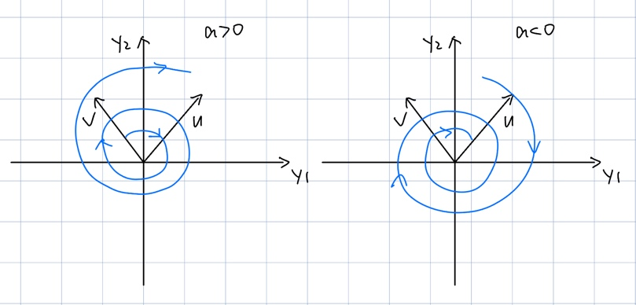

*左图为 $a>0$，右图为 $a<0$。实部控制扩张或收缩，旋转方向由特征值虚部与对应的特征向量共同决定。两图中的 $\mathbf u,\mathbf v$ 方向相同，并可具有相同旋转方向。*

例如，取 $b>0$ 且复特征向量为 $\mathbf u+i\mathbf v$，实解 $\mathbf y_1=e^{at}(\mathbf u\cos bt-\mathbf v\sin bt)$ 在 $t=0$ 满足

$$
\mathbf y_1(0)=\mathbf u,\qquad
\mathbf y_1'(0)=a\mathbf u-b\mathbf v.
$$

其中 $a\mathbf u$ 为该点的径向分量，$-b\mathbf v$ 决定横向运动。改变 $a$ 的符号会改变收缩或扩张，但不会单独决定旋转反向。

若有零特征值，应结合平衡点集合与具体解单独分析相图。

### 平面非线性自治系统的分析

考虑

$$
\begin{cases}
x'=f(x,y),\\
y'=g(x,y).
\end{cases}
$$

#### 零增长线（Nullclines）

- $x$ 零增长线：$f(x,y)=0$；在其上速度的水平分量为零。
- $y$ 零增长线：$g(x,y)=0$；在其上速度的竖直分量为零。

分别解 $f=0$、$g=0$；若可因式分解，应保留所有因子对应的解。零增长线的条数和形状取决于 $f,g$；坐标轴是否属于零增长线，可将 $x=0$ 或 $y=0$ 代入对应方程判断。

对种群模型中常见的 $f=xF(x,y)$、$g=yG(x,y)$，可按以下步骤展开：

1. 写成 $x'=xF(x,y)$、$y'=yG(x,y)$。
2. $x$ 零增长线为 $x=0$ 或 $F(x,y)=0$；$y$ 零增长线为 $y=0$ 或 $G(x,y)=0$。
3. 将每一条 $x$ 零增长线与每一条 $y$ 零增长线配对联立，求交点。
4. 把所有候选点代回 $f=g=0$，去除重复点，并区分数学平衡点与状态域内可行的平衡点。

#### 平衡点（Equilibria）

平衡点满足 $f(x_*,y_*)=g(x_*,y_*)=0$，即两类零增长线的交点。平衡点对应恒定解，不是仅指“增长率相等”。

#### 相平面分析步骤

1. 画出各条零增长线，标出所有平衡点并说明状态域。
2. 在零增长线划分出的各区域内判断 $f,g$ 的符号。若在某连通区域内两者均连续且无零点，可各取一个测试点确定符号。
3. $f>0$ 向右，$f<0$ 向左；$g>0$ 向上，$g<0$ 向下。
4. 结合向量场、零增长线上速度方向及唯一性画轨迹。符号箭头只给方向范围，不能单独确定所有轨迹形状与长期极限。

局部分类常可用雅可比矩阵

$$
J(x_*,y_*)=
\begin{bmatrix}f_x&f_y\\g_x&g_y\end{bmatrix}_{(x_*,y_*)}.
$$

对光滑系统，若平衡点处所有特征值实部均非零，称为双曲平衡点，附近相图的定性类型可由线性化判断。若出现零实部特征值，尤其纯虚特征值，线性化可能无结论；非线性系统不能仅凭纯虚特征值就断言是中心。

### 捕食者—猎物模型（Predator–prey model）

令 $R(t)$ 为猎物（兔子）数量，$W(t)$ 为捕食者（狼）数量，$r,k,a,b>0$。

假设兔子食物充足，狼以兔子为食。在没有相互作用时，分别有

$$
\frac{dR}{dt}=rR,\qquad r>0,
$$

$$
\frac{dW}{dt}=-kW,\qquad k>0.
$$

即无捕食者时兔子指数增长；无猎物时狼按其现有数量成比例衰减。加入捕食项后，两个种群的耦合方程为

$$
\begin{cases}
R'=rR-aRW,\\
W'=-kW+bRW.
\end{cases}
$$

- $rR$：无捕食者且食物充足时，猎物的自然增长项。
- $-aRW$：捕食导致的猎物损失项。
- $-kW$：无猎物时，捕食者的自然衰减项。
- $bRW$：捕食所支持的捕食者增长项。

这些项的单位是“个体数/时间”；例如 $r$ 是单位时间增长率，$rR$ 是种群数量的增长速率，二者应区分。

零增长线为 $R=0$、$W=r/a$，以及 $W=0$、$R=k/b$。平衡点为 $(0,0)$ 和 $(k/b,r/a)$。

### 竞争模型（Competition model）

令 $x(t),y(t)$ 为两个竞争种群，取 $r,s,u,v,K,L>0$：

$$
\begin{cases}
x'=rx\left(1-\dfrac{x}{K}\right)-uxy,\\
y'=sy\left(1-\dfrac{y}{L}\right)-vxy.
\end{cases}
$$

单独生存时，两个种群分别遵循逻辑斯谛增长；竞争项使对方存在时的增长速率降低。

两个种群单独生存时的方程分别为

$$
x'=rx\left(1-\frac{x}{K}\right),\qquad
y'=sy\left(1-\frac{y}{L}\right).
$$

当另一种群同时存在时，分别加入竞争损失 $-uxy$、$-vxy$，就得到上述耦合系统。题目给出 $r,s,u,v,K,L$ 后，代入即可建立具体模型。

#### 例：求零增长线、平衡点与长期行为

问题要求：

1. 求零增长线和平衡点。
2. 在 $xy$ 平面画出零增长线，并标注平衡点。
3. 在每个不同区域内画合成方向箭头。
4. 判断平衡点的性质。
5. 分析 $t\to\infty$ 时 $x(t),y(t)$ 的行为，并解释两种群的长期结局。

考虑非负状态域中的系统

$$
\begin{cases}
x'=0.05x\left(1-\dfrac{x}{20}\right)-0.002xy,\\
y'=0.09y\left(1-\dfrac{y}{15}\right)-0.15xy.
\end{cases}
$$

先分别展开两个右端，再提取公共因子：

$$
\begin{aligned}
x'&=0.05x-0.0025x^2-0.002xy\\
&=x(0.05-0.0025x-0.002y),\\
y'&=0.09y-0.006y^2-0.15xy\\
&=y(0.09-0.006y-0.15x).
\end{aligned}
$$

**零增长线**：

$$
\begin{aligned}
x'=0&:\quad x=0\quad\text{或}\quad y=25-1.25x,\\
y'=0&:\quad y=0\quad\text{或}\quad y=15-25x.
\end{aligned}
$$

**平衡点**：

$$
E_0=(0,0),\qquad E_1=(0,15),\qquad E_2=(20,0).
$$

两条斜直线的交点为

$$
E_3=\left(-\frac8{19},\frac{485}{19}\right)
\approx(-0.421,25.526),
$$

其不在非负种群状态域内。

求交点的四种配对为：

1. $x=0$ 与 $y=0$ 联立，得到 $E_0=(0,0)$，两个种群均不存在。
2. $x=0$ 与 $0.09-0.006y-0.15x=0$ 联立：

$$
0.09-0.006y=0\quad\Longrightarrow\quad y=15,
$$

得到 $E_1=(0,15)$。在这一平衡解上，$x$ 灭绝，$y$ 恒为 $15$。

3. $y=0$ 与 $0.05-0.0025x-0.002y=0$ 联立：

$$
0.05-0.0025x=0\quad\Longrightarrow\quad x=20,
$$

得到 $E_2=(20,0)$。在这一平衡解上，$y$ 灭绝，$x$ 恒为 $20$。

4. 联立两条非坐标轴零增长线：

$$
\begin{cases}
0.05-0.0025x-0.002y=0,\\
0.09-0.006y-0.15x=0.
\end{cases}
$$

整理为

$$
\begin{cases}
5x+4y=100,\\
25x+y=15.
\end{cases}
$$

第二式给出 $y=15-25x$，代入第一式：

$$
5x+4(15-25x)=100,\qquad -95x=40.
$$

所以 $x=-8/19$、$y=485/19$，得到状态域外的 $E_3$。

**区域方向**：在第一象限中，较低的直线为 $y=15-25x$（其第一象限部分），较高的直线为 $y=25-1.25x$。

| 测试点 | $x'$ | $y'$ | 方向 |
| --- | --- | --- | --- |
| $(0.5,0.5)$ | $0.023875>0$ | $0.006>0$ | 右上 |
| $(2,2)$ | $0.082>0$ | $-0.444<0$ | 右下 |
| $(30,30)$ | $-2.55<0$ | $-137.7<0$ | 左下 |

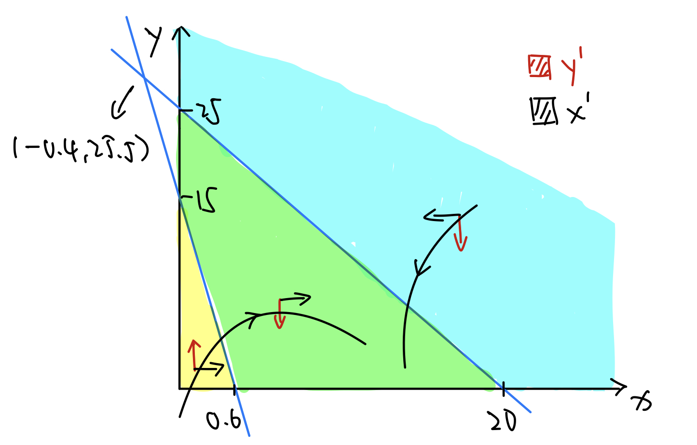

*非负状态域中的相平面示意；负横坐标交点不代表可行种群状态。*

逐个区域的代入计算为：

1. **黄色区域，取 $(0.5,0.5)$。**

$$
\begin{aligned}
x'&=0.5(0.05-0.0025\cdot0.5-0.002\cdot0.5)\\
&=0.023875>0,\\
y'&=0.5(0.09-0.006\cdot0.5-0.15\cdot0.5)\\
&=0.006>0.
\end{aligned}
$$

因此箭头向右上。

2. **绿色区域，取 $(2,2)$。**

$$
\begin{aligned}
x'&=2(0.05-0.0025\cdot2-0.002\cdot2)=0.082>0,\\
y'&=2(0.09-0.006\cdot2-0.15\cdot2)=-0.444<0.
\end{aligned}
$$

因此箭头向右下。

3. **蓝色区域，取 $(30,30)$。**

$$
\begin{aligned}
x'&=30(0.05-0.0025\cdot30-0.002\cdot30)=-2.55<0,\\
y'&=30(0.09-0.006\cdot30-0.15\cdot30)=-137.7<0.
\end{aligned}
$$

因此箭头向左下。

**平衡点分类**：

$$
J(x,y)=
\begin{bmatrix}
0.05-0.005x-0.002y&-0.002x\\
-0.15y&0.09-0.012y-0.15x
\end{bmatrix}.
$$

| 平衡点 | 特征值 | 类型 |
| --- | --- | --- |
| $E_0=(0,0)$ | $0.05,\ 0.09$ | 不稳定节点 |
| $E_1=(0,15)$ | $0.02,\ -0.09$ | 鞍点 |
| $E_2=(20,0)$ | $-0.05,\ -2.91$ | 渐近稳定节点 |

**长期行为**：若 $x_0>0$、$y_0>0$，则

$$
x(t)\longrightarrow20,\qquad y(t)\longrightarrow0
\qquad(t\to\infty).
$$

为说明这一极限，先利用两种群均为正且受各自的逻辑斯谛方程上界控制，得到解对所有 $t\ge0$ 存在，且最终有 $y\le16$。于是最终

$$
x'\ge x(0.018-0.0025x),
$$

由标量比较可得 $\liminf_{t\to\infty}x(t)\ge7.2$，从而最终 $x\ge1$，使 $y'\le-0.06y$，所以 $y\to0$。再将 $y\to0$ 代回 $x$ 方程，利用逻辑斯谛上下界得到 $x\to20$。

必须区分边界初值：若 $x_0=0,y_0>0$，则 $x\equiv0$、$y\to15$；若 $x_0>0,y_0=0$，则 $y\equiv0$、$x\to20$；若两者初值均为零，则一直停在原点。

## 第三单元：二阶线性常微分方程（Second-order linear ODEs）

### 标准形式与初值问题

一般形式为

$$
P_0(x)y''+P_1(x)y'+P_2(x)y=F(x).
$$

系数 $P_0,P_1,P_2$ 为自变量的函数。在 $P_0\ne0$ 的区间上标准化为

$$
y''+p(x)y'+q(x)y=f(x),\qquad
p=\frac{P_1}{P_0},\quad q=\frac{P_2}{P_0},\quad f=\frac F{P_0}.
$$

$f\equiv0$ 时齐次，否则非齐次。

若 $p,q,f$ 在开区间 $I$ 上连续，且 $x_0\in I$，则对任意 $k_0,k_1\in\mathbb R$，初值问题

$$
\begin{cases}
y''+p(x)y'+q(x)y=f(x),\\
y(x_0)=k_0,\\
y'(x_0)=k_1
\end{cases}
$$

在整个 $I$ 上存在唯一解。这里的初始条件给出同一点处的函数值与一阶导数值。不同点处的函数值 $y(x_0),y(x_1)$ 构成边值条件，其解的存在性与唯一性需另行分析。

### 基本解组、叠加原理与通解

#### 齐次方程

设 $y_1,y_2$ 是同一齐次方程 $y''+py'+qy=0$ 的解，则任意线性组合 $c_1y_1+c_2y_2$ 仍是解。

朗斯基行列式为

$$
W[y_1,y_2](x)=
\det\begin{bmatrix}y_1&y_2\\y_1'&y_2'\end{bmatrix}
=y_1y_2'-y_1'y_2.
$$

若 $p,q$ 在 $I$ 上连续，则以下条件等价：

1. $y_1,y_2$ 在 $I$ 上线性独立。
2. $W(x_0)\ne0$ 对某个 $x_0\in I$ 成立。
3. $W(x)\ne0$ 对所有 $x\in I$ 成立。
4. $\{y_1,y_2\}$ 为基本解组，且

$$
y_h=c_1y_1+c_2y_2
$$

是齐次通解。

基本解组为函数集合 $\{y_1,y_2\}$，齐次通解为其带任意常数的线性组合。使用朗斯基行列式判定基本解组时，$y_1,y_2$ 应均为该齐次方程的解。

若 $W(x_0)\ne0$，任意给定的 $y(x_0),y'(x_0)$ 都能唯一确定 $c_1,c_2$。若 $W(x_0)=0$，某些特定初值仍可能由该线性组合满足，但不能满足任意初值。

#### 非齐次方程

取对应齐次方程的基本解组 $\{y_1,y_2\}$，再取原非齐次方程的任一特解 $y_p$，则

$$
y=y_h+y_p=c_1y_1+c_2y_2+y_p
$$

为非齐次通解。这里的 $y_h$ 也称互补解（complementary solution）；$y_p$ 不是基本解组中的一个元素。

#### 阿贝尔公式（Abel's formula）

对齐次标准方程 $y''+p(x)y'+q(x)y=0$ 的两个解，

$$
W(x)=W(x_0)\exp\left(-\int_{x_0}^{x}p(t)\,dt\right),\qquad x,x_0\in I.
$$

指数因子始终非零，因此 $W$ 要么在整个 $I$ 上恒为零，要么在整个 $I$ 上处处非零。上述结论适用于系数连续的同一区间，检验点 $x_0$ 可任选于该区间内。

### 常系数齐次方程

考虑

$$
ay''+by'+cy=0,\qquad a,b,c\in\mathbb R,\quad a\ne0.
$$

令 $y=e^{rx}$，得到特征方程

$$
ar^2+br+c=0.
$$

求解步骤为：

1. 从原方程识别常数 $a,b,c$，并确认 $a\ne0$。
2. 解特征方程，求出 $r_1,r_2$，按“不同实根、二重实根、共轭非实根”分类。
3. 按下列各情形写出两个齐次解 $y_1,y_2$，计算它们及其一阶导数组成的朗斯基行列式。
4. 确认 $W\ne0$ 后，写成 $y=c_1y_1+c_2y_2$。若有初值，再解常数 $c_1,c_2$。

三个情形的基本解组与通解如下。

#### 两个不同实根

若 $r_1,r_2\in\mathbb R$ 且 $r_1\ne r_2$，则

$$
y=c_1e^{r_1x}+c_2e^{r_2x}.
$$

相应 $W=(r_2-r_1)e^{(r_1+r_2)x}\ne0$。

具体地，

$$
y_1=e^{r_1x},\quad y_2=e^{r_2x},\quad
y_1'=r_1e^{r_1x},\quad y_2'=r_2e^{r_2x},
$$

$$
W(x)=\det\begin{bmatrix}
e^{r_1x}&e^{r_2x}\\
r_1e^{r_1x}&r_2e^{r_2x}
\end{bmatrix}.
$$

展开行列式，即得到上述非零结果。

#### 二重实根

若 $r_1=r_2=r$，则

$$
y=(c_1+c_2x)e^{rx}.
$$

相应基本解为 $e^{rx},xe^{rx}$，$W=e^{2rx}\ne0$。

此时

$$
y_1=e^{rx},\quad y_2=xe^{rx},\quad
y_1'=re^{rx},\quad y_2'=(1+rx)e^{rx},
$$

$$
W(x)=\det\begin{bmatrix}
e^{rx}&xe^{rx}\\
re^{rx}&(1+rx)e^{rx}
\end{bmatrix}=e^{2rx}.
$$

#### 共轭非实根

若 $r_{1,2}=\alpha\pm i\beta$，$\beta>0$，则

$$
y=e^{\alpha x}\big(c_1\cos\beta x+c_2\sin\beta x\big).
$$

相应 $W=\beta e^{2\alpha x}\ne0$。

两个实基本解为

$$
y_1=e^{\alpha x}\cos\beta x,\qquad
y_2=e^{\alpha x}\sin\beta x.
$$

求导得

$$
\begin{aligned}
y_1'&=e^{\alpha x}(\alpha\cos\beta x-\beta\sin\beta x),\\
y_2'&=e^{\alpha x}(\alpha\sin\beta x+\beta\cos\beta x).
\end{aligned}
$$

代入 $W=y_1y_2'-y_1'y_2$，利用 $\cos^2\beta x+\sin^2\beta x=1$ 得 $W=\beta e^{2\alpha x}$。

### 常系数非齐次方程：待定系数法

考虑 $ay''+by'+cy=f(x)$。待定系数法适用于右端为多项式、指数、正弦、余弦及这些函数的有限和与乘积的情形，不适用于任意 $f$。先求齐次通解，再找一个 $y_p$。

#### 试探解与共振修正

对单项右端

$$
f(x)=e^{\alpha x}\big[P_n(x)\cos\beta x+Q_m(x)\sin\beta x\big],
\qquad \beta>0,
$$

其中 $P_n,Q_m$ 为多项式。忽略恒零项后，设 $N$ 为剩余多项式次数的最大值；若右端恒为零，则直接求齐次解。取

$$
y_p=x^{\ell}e^{\alpha x}
\big[A_N(x)\cos\beta x+B_N(x)\sin\beta x\big].
$$

其中 $A_N,B_N$ 都是含全部待定系数的次数至多为 $N$ 的多项式，$\ell$ 是 $\alpha+i\beta$ 作为特征多项式根的重数；不是根时 $\ell=0$。

若 $\beta=0$，右端为 $e^{\alpha x}P_n(x)$，相应设

$$
y_p=x^{\ell}e^{\alpha x}A_n(x),
$$

$\ell$ 为实数 $\alpha$ 作为特征根的重数。对二阶方程，实根的 $\ell$ 可为 $0,1,2$；非实根的 $\ell$ 可为 $0,1$。

| 右端形式 | 未作共振修正的试探解 |
| --- | --- |
| 任意 $n$ 次多项式 $P_n(x)$ | $A_0+A_1x+\cdots+A_nx^n$ |
| $ke^{\alpha x}$ | $Ae^{\alpha x}$ |
| $k\cos\beta x$ 或 $k\sin\beta x$ | $A\cos\beta x+B\sin\beta x$ |
| $e^{\alpha x}P_n(x)$ | $e^{\alpha x}(A_0+A_1x+\cdots+A_nx^n)$ |
| $e^{\alpha x}(p\cos\beta x+q\sin\beta x)$ | $e^{\alpha x}(A\cos\beta x+B\sin\beta x)$ |

对表中每项，都要按特征根重数将整个试探式乘以 $x^{\ell}$，再代入原方程比较系数。

正弦与余弦的导数相互转换，因此试探式同时包含二者，并为其分别设置独立系数。多项式部分包含从常数项到相应最高次项的全部待定系数。

共振由相应指数或指数三角模式是否属于齐次解空间决定，具体通过特征根及其重数判断。若右端为多个此类项之和，可分别求特解后相加。

**待定系数法的完整步骤。**

1. 写出对应齐次方程，解特征方程并得到基本解组，写出 $y_h$。
2. 识别右端的函数类型，检查其指数或指数三角模式是否与齐次解共振。
3. 按右端类型设置包含全部待定系数的试探解。
4. 按特征根重数作共振修正：不共振保持原式，一重根乘 $x$，二重实根乘 $x^2$。
5. 求 $y_p',y_p''$，把 $y_p,y_p',y_p''$ 全部代回原非齐次方程，展开并合并同类项。
6. 比较多项式各次幂、正弦项、余弦项等对应系数，解出待定常数，得到一个 $y_p$。
7. 写出 $y=y_h+y_p$，回代检查；有初值时再求 $c_1,c_2$。

**右端组合形式的逐类设置。**

1. **多项式与指数函数：** $f(x)=kP_n(x)e^{\alpha x}$。

设 $A_n(x)=A_0+A_1x+\cdots+A_nx^n$。根据 $\alpha$ 的特征根重数，分别取

$$
\begin{aligned}
\alpha\text{ 不是特征根}:&\quad y_p=e^{\alpha x}A_n(x),\\
\alpha\text{ 为一重特征根}:&\quad y_p=xe^{\alpha x}A_n(x),\\
\alpha\text{ 为二重特征根}:&\quad y_p=x^2e^{\alpha x}A_n(x).
\end{aligned}
$$

例如 $n=2$ 时，$A_n(x)=A+Bx+Cx^2$；其他次数按同样原则列出全部幂次。已知常数 $k$ 随右端一起参与比较系数。

2. **多项式与三角函数：** $f(x)=P(x)\cos\omega x+Q(x)\sin\omega x$，$\omega>0$。

令 $N$ 为非零多项式 $P,Q$ 的次数最大值，$A_N,B_N$ 各含次数 $0$ 到 $N$ 的独立待定系数。若 $\pm i\omega$ 不是特征根，取

$$
y_p=A_N(x)\cos\omega x+B_N(x)\sin\omega x.
$$

若 $\pm i\omega$ 是特征根，取

$$
y_p=x\big[A_N(x)\cos\omega x+B_N(x)\sin\omega x\big].
$$

3. **指数函数与三角函数：** $f(x)=e^{\alpha x}(p\cos\omega x+q\sin\omega x)$。

若 $\alpha\pm i\omega$ 不是特征根，取

$$
y_p=e^{\alpha x}(A\cos\omega x+B\sin\omega x).
$$

若 $\alpha\pm i\omega$ 是特征根，取

$$
y_p=xe^{\alpha x}(A\cos\omega x+B\sin\omega x).
$$

$A,B$ 是两个独立待定常数，包括 $p=q$ 时也一样。

4. **多项式、指数函数与三角函数：**

$$
f(x)=e^{\alpha x}\big[P(x)\cos\omega x+Q(x)\sin\omega x\big].
$$

同样令 $A_N,B_N$ 各含全部待定系数。不共振时取

$$
y_p=e^{\alpha x}\big[A_N(x)\cos\omega x+B_N(x)\sin\omega x\big],
$$

共振时取

$$
y_p=xe^{\alpha x}\big[A_N(x)\cos\omega x+B_N(x)\sin\omega x\big].
$$

这里 $\omega>0$。对实系数二阶方程，非实根成共轭对且各为一重，因此以上非实共振情形乘一次 $x$ 即可。

#### 例一：二重根引起的共振

考虑

$$
y''-8y'+16y=2e^{4x}.
$$

1. **求齐次解。** 特征方程为

$$
r^2-8r+16=(r-4)^2=0.
$$

所以基本解组为 $\{e^{4x},xe^{4x}\}$，齐次通解为

$$
y_h=c_1e^{4x}+c_2xe^{4x}.
$$

2. **判断共振。** 右端含 $e^{4x}$，而 $4$ 是二重特征根。
3. **设置并修正试探解。** 初始候选为 $Ae^{4x}$；乘一次 $x$ 得 $Axe^{4x}$，仍属于齐次解空间，所以再乘一次 $x$：

$$
y_p=Ax^2e^{4x}.
$$

4. **求一阶与二阶导数。**

$$
\begin{aligned}
y_p'&=A(2xe^{4x}+4x^2e^{4x})\\
&=Ae^{4x}(2x+4x^2),\\
y_p''&=A\big[4e^{4x}(2x+4x^2)+e^{4x}(2+8x)\big]\\
&=Ae^{4x}(2+16x+16x^2).
\end{aligned}
$$

5. **完整代回原方程。**

$$
\begin{aligned}
&Ae^{4x}(2+16x+16x^2)\\
&\quad-8Ae^{4x}(2x+4x^2)+16Ax^2e^{4x}
=2e^{4x}.
\end{aligned}
$$

提出公因子并逐项消去：

$$
\begin{aligned}
Ae^{4x}\big[2+16x+16x^2-16x-32x^2+16x^2\big]
&=2e^{4x},\\
2Ae^{4x}&=2e^{4x}.
\end{aligned}
$$

6. **求待定系数。** $e^{4x}\ne0$，所以 $2A=2$，$A=1$，得到 $y_p=x^2e^{4x}$。
7. **写出通解。**

$$
y=c_1e^{4x}+c_2xe^{4x}+x^2e^{4x}.
$$

#### 例二：多项式与指数函数相乘

考虑

$$
y''-4y'+3y=e^{3x}(6+8x+12x^2).
$$

1. **求基本解组并设置试探解。** 特征方程为

$$
r^2-4r+3=(r-1)(r-3)=0.
$$

基本解组为 $\{e^x,e^{3x}\}$。$3$ 是一重特征根，右端多项式为二次，所以取

$$
y_p=xe^{3x}(A+Bx+Cx^2)=e^{3x}(Ax+Bx^2+Cx^3).
$$

2. **提出指数因子。** 令

$$
y_p=u(x)e^{3x},\qquad u=Ax+Bx^2+Cx^3.
$$

3. **求导并完整代入。**

$$
\begin{aligned}
y_p'&=u'e^{3x}+3ue^{3x}=e^{3x}(u'+3u),\\
y_p''&=u''e^{3x}+6u'e^{3x}+9ue^{3x}\\
&=e^{3x}(u''+6u'+9u).
\end{aligned}
$$

代回原方程并消去非零因子 $e^{3x}$：

$$
(u''+6u'+9u)-4(u'+3u)+3u=6+8x+12x^2.
$$

按 $u'',u',u$ 合并：

$$
u''+(6-4)u'+(9-12+3)u=6+8x+12x^2,
$$

即

$$
u''+2u'=6+8x+12x^2.
$$

4. **计算多项式部分的导数。**

$$
u=Ax+Bx^2+Cx^3,\quad
u'=A+2Bx+3Cx^2,\quad
u''=2B+6Cx.
$$

5. **代回降简后的方程并比较系数。**

$$
(2B+6Cx)+2(A+2Bx+3Cx^2)=6+8x+12x^2.
$$

整理为

$$
(2A+2B)+(4B+6C)x+6Cx^2=6+8x+12x^2.
$$

比较二次项、一次项与常数项：

$$
\begin{cases}
6C=12,\\
6C+4B=8,\\
2B+2A=6.
\end{cases}
$$

先得 $C=2$，再由 $12+4B=8$ 得 $B=-1$，最后由 $-2+2A=6$ 得 $A=4$。因此

$$
u=4x-x^2+2x^3,\qquad y_p=e^{3x}(4x-x^2+2x^3).
$$

6. **写出通解。**

$$
y=c_1e^x+c_2e^{3x}+e^{3x}(4x-x^2+2x^3).
$$

### 变系数方程与降阶法（Reduction of order）

考虑

$$
P_0(x)y''+P_1(x)y'+P_2(x)y=F(x).
$$

通常选取 $P_0,P_1,P_2,F$ 连续且 $P_0\ne0$ 的区间，再标准化。降阶法和常数变易法同时适用于常系数与变系数方程。一般变系数方程的齐次解没有统一的初等公式；使用下面的方法时，需要先知道至少一个非零齐次解。

#### 已知一个齐次解时的降阶

设标准化方程为 $y''+py'+qy=f$，已知对应齐次方程的非零解 $y_1$。在 $y_1\ne0$ 的子区间上，令

$$
y=u(x)y_1(x).
$$

代入并利用 $y_1''+py_1'+qy_1=0$，得到

$$
y_1u''+(2y_1'+py_1)u'=f.
$$

再令 $z=u'$，得到一阶线性方程

$$
z'+\left(2\frac{y_1'}{y_1}+p\right)z=\frac f{y_1}.
$$

求 $z$ 后积分得到 $u$，再写出 $y=uy_1$。保留两次求解中的独立积分常数，即可得到通解。

对齐次情形 $f=0$，还可直接用

$$
y_2=y_1\int\frac{e^{-\int p(x)\,dx}}{[y_1(x)]^2}\,dx
$$

构造第二个独立齐次解。若 $y_1$ 有零点，除以 $y_1$ 的运算需在其非零子区间进行，随后再考虑延拓。

#### 例：已知 $y_1=e^x$

考虑

$$
xy''-(2x+1)y'+(x+1)y=x^2.
$$

$y_1=e^x$ 是对应齐次方程的解。标准化时需 $x\ne0$，因此在 $(0,\infty)$ 或 $(-\infty,0)$ 上求解。

1. **设 $y=uy_1$。** 取

$$
y=u(x)e^x.
$$

2. **求导、代入并合并。**

$$
y'=u'e^x+ue^x,\qquad
y''=u''e^x+2u'e^x+ue^x.
$$

完整代入原方程：

$$
\begin{aligned}
&x(u''e^x+2u'e^x+ue^x)\\
&\quad-(2x+1)(u'e^x+ue^x)+(x+1)ue^x=x^2.
\end{aligned}
$$

消去非零因子 $e^x$ 后，按各阶导数分组：

$$
xu''+[2x-(2x+1)]u'
+[x-(2x+1)+(x+1)]u=x^2e^{-x}.
$$

$u$ 的系数为零，故

$$
xu''-u'=x^2e^{-x}.
$$

3. **降为一阶方程。** 令 $z=u'$、$z'=u''$，得到

$$
xz'-z=x^2e^{-x},\qquad z'-\frac1xz=xe^{-x}.
$$

4. **用积分因子法求 $z$。** 指数公式给出

$$
\mu=e^{\int-1/x\,dx}=e^{-\ln|x|}=\frac1{|x|}.
$$

在任一不穿过 $0$ 的区间，可取非零常数倍 $\mu=1/x$。乘入后，

$$
\frac1xz'-\frac1{x^2}z=e^{-x},
\qquad
\left(\frac zx\right)'=e^{-x}.
$$

积分得

$$
\frac zx=\int e^{-x}\,dx+C_2=-e^{-x}+C_2,
$$

即

$$
z=x\left(\int xe^{-x}\frac1x\,dx+C_2\right)
=-xe^{-x}+C_2x.
$$

5. **由 $z=u'$ 积分求 $u$。**

$$
u=\int z\,dx=\int(-xe^{-x}+C_2x)\,dx.
$$

对第一项使用分部积分：

$$
\int-xe^{-x}\,dx
=xe^{-x}-\int e^{-x}\,dx
=xe^{-x}+e^{-x}.
$$

所以

$$
u=xe^{-x}+e^{-x}+\frac{C_2}{2}x^2+C_1.
$$

6. **代回并检验基本解组。**

$$
\begin{aligned}
y=ue^x
&=\left(xe^{-x}+e^{-x}+\frac{C_2}{2}x^2+C_1\right)e^x\\
&=x+1+\frac{C_2}{2}x^2e^x+C_1e^x.
\end{aligned}
$$

取齐次解 $y_1=e^x$、$y_2=x^2e^x$，则

$$
y_1'=e^x,\qquad y_2'=(2x+x^2)e^x,
$$

$$
\begin{aligned}
W(x)&=\det\begin{bmatrix}
e^x&x^2e^x\\
e^x&(2x+x^2)e^x
\end{bmatrix}\\
&=(2x+x^2)e^{2x}-x^2e^{2x}=2xe^{2x}\ne0,\qquad x\ne0.
\end{aligned}
$$

因此两解在所选区间内独立。检验点应位于该区间内，例如可在 $(0,\infty)$ 取 $x=1$，在 $(-\infty,0)$ 取 $x=-1$。

7. **写出通解。** 将 $C_1$ 重命名为 $c_1$、$C_2/2$ 重命名为 $c_2$，得到

$$
y=c_1e^x+c_2x^2e^x+x+1.
$$

所得显式解还可延拓到 $x=0$，并满足未标准化原方程；跨越该奇点的初值问题需在原方程中另行分析。

### 常数变易法（Variation of parameters）

设 $y_1,y_2$ 已构成齐次方程的基本解组，且 $W=y_1y_2'-y_1'y_2\ne0$。对

$$
P_0y''+P_1y'+P_2y=F,
$$

设 $y=u_1y_1+u_2y_2$，并附加条件 $u_1'y_1+u_2'y_2=0$。解线性系统

$$
\begin{cases}
u_1'y_1+u_2'y_2=0,\\
u_1'y_1'+u_2'y_2'=F/P_0,
\end{cases}
$$

得到

$$
u_1'=-\frac{y_2F}{P_0W},\qquad
u_2'=\frac{y_1F}{P_0W}.
$$

因此可取非齐次特解

$$
y_p=-y_1\int\frac{y_2F}{P_0W}\,dx
+y_2\int\frac{y_1F}{P_0W}\,dx.
$$

选取各积分的任意一个原函数即可，再写

$$
y=c_1y_1+c_2y_2+y_p.
$$

若在 $u_1,u_2$ 的积分中已分别保留 $c_1,c_2$，则 $u_1y_1+u_2y_2$ 本身就是通解，无需重复添加常数项。对标准形式 $P_0=1$，公式中的 $F/P_0$ 就是右端 $f$。

操作步骤（Steps）：

1. 确认已知的 $y_1,y_2$ 都是对应齐次方程的解，并设 $y=u_1y_1+u_2y_2$。
2. 求 $y_1',y_2'$，列出行列式

$$
W=\det\begin{bmatrix}y_1&y_2\\y_1'&y_2'\end{bmatrix}.
$$

在系数连续且 $P_0\ne0$ 的区间内检查 $W\ne0$。

3. 依次计算两个积分：

$$
u_1=-\int\frac{F(x)y_2(x)}{P_0(x)W(x)}\,dx+C_1,
$$

$$
u_2=\int\frac{F(x)y_1(x)}{P_0(x)W(x)}\,dx+C_2.
$$

4. 把 $u_1,u_2$ 代回 $y=u_1y_1+u_2y_2$。若两个独立积分常数已保留，所得为通解；若只选取两个固定原函数，所得为一个特解，再补 $c_1y_1+c_2y_2$ 得通解。

### 二阶线性方程求解方法汇总

| 方程或已知条件 | 常用方法 | 结果 |
| --- | --- | --- |
| 常系数齐次 | 特征方程 | 先找基本解组，再写 $y_h=c_1y_1+c_2y_2$ |
| 常系数非齐次，右端类型适合 | 待定系数法 | 找 $y_p$，再写 $y=y_h+y_p$ |
| 已知一个非零齐次解 | 降阶法 | 构造第二个齐次解，或直接求非齐次通解 |
| 已知两个独立齐次解 | 常数变易法 | 找 $y_p$，再写 $y=y_h+y_p$ |

常系数非齐次方程也可用常数变易法；一般变系数方程可能需要其他解析方法或数值方法。无论使用哪种方法，都应检查解区间、回代原方程，并在有初值时确定任意常数。

按已知齐次解选择方法时：

1. 只给出一个非零齐次解，可用降阶法求第二个齐次解，或直接降低非齐次方程的阶数。
2. 给出两个独立齐次解，可直接使用常数变易法；也可以选其中一个进行降阶。
3. 无论系数是否为常数，非齐次通解都写成 $y=y_h+y_p$，其中 $y_h=c_1y_1+c_2y_2$。

### 应用一：弹簧振动（Mass–spring systems）

#### 建模与位移约定

设 $m>0$ 为质量、$k>0$ 为弹簧劲度系数，$c\ge0$ 为线性阻尼系数。牛顿第二定律为 $F=ma$；相对于弹簧自然长度的伸长量为 $\xi$ 时，胡克回复力为 $-k\xi$。

若用 $x(t)$ 表示相对于**静态平衡位置**的位移，则竖直系统中的恒定重力已与静态弹簧力抵消。

对质量为 $m$ 的物体，牛顿第二运动定律（Newton's second law）写为

$$
F_{\mathrm{net}}=ma=mx''.
$$

以静态平衡位置为原点，回复力为 $-kx$，线性阻尼力为 $-cx'$，外部驱动力为 $F_{\mathrm{ext}}(t)$，于是

$$
mx''=-kx-cx'+F_{\mathrm{ext}}(t).
$$

将回复力和阻尼力移到左侧，得到

$$
mx''+cx'+kx=F_{\mathrm{ext}}(t).
$$

阻尼力为 $-cx'$，阻尼系数 $c$ 的单位为质量/时间。

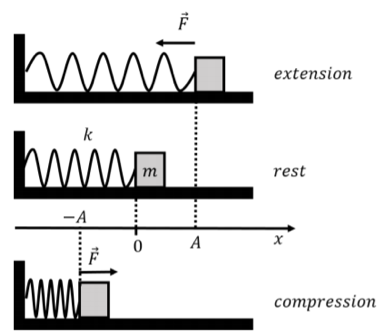

*水平弹簧的回复力方向。*

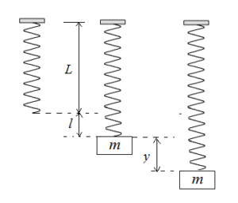

*竖直系统的动态位移从静态平衡位置量起。*

#### 无阻尼、无外部驱动力

$$
mx''+kx=0,\qquad \omega_0=\sqrt{\frac km}.
$$

解为

$$
x(t)=c_1\cos\omega_0t+c_2\sin\omega_0t.
$$

$\omega_0$ 为固有角频率，振动周期为 $2\pi/\omega_0$。

#### 有阻尼、无外部驱动力

取 $c>0$，方程为 $mx''+cx'+kx=0$，特征方程 $mr^2+cr+k=0$。

- **过阻尼**（overdamped）：$c^2>4mk$，有两个不同负实根

$$
r_{1,2}=\frac{-c\pm\sqrt{c^2-4mk}}{2m},\qquad
x(t)=c_1e^{r_1t}+c_2e^{r_2t}.
$$

- **临界阻尼**（critically damped）：$c^2=4mk$，有二重负实根 $r=-c/(2m)$

$$
x(t)=(c_1+c_2t)e^{rt}.
$$

- **欠阻尼**（underdamped）：$c^2<4mk$，有共轭复根，定义阻尼角频率

$$
\omega_d=\sqrt{\frac km-\frac{c^2}{4m^2}},
$$

于是

$$
x(t)=e^{-ct/(2m)}\big(c_1\cos\omega_dt+c_2\sin\omega_dt\big).
$$

欠阻尼频率 $\omega_d$ 与无阻尼固有频率 $\omega_0$ 不同；三种有阻尼自由运动均满足 $x(t)\to0$。

#### 有外部驱动力

$$
mx''+cx'+kx=F_{\mathrm{ext}}(t),\qquad
x=x_h+x_p.
$$

先求自由运动的齐次通解 $x_h$，再按外力形式求一个特解 $x_p$，最后利用初始位移与初始速度确定常数。

完整的解的结构为

$$
x(t)=x_h(t)+x_p(t)=c_1x_1(t)+c_2x_2(t)+x_p(t).
$$

其中 $x_1,x_2$ 构成对应齐次方程的基本解组。

### 应用二：串联 RLC 电路（Series RLC circuit）

令 $Q(t)$ 为电容器电荷，$I(t)=Q'(t)$ 为电流，$E(t)$ 为电源电动势。设电感 $L>0$、电容 $C>0$、电阻 $R\ge0$。

各元件的电压降为

$$
V_R=RI,\qquad V_L=LI',\qquad V_C=\frac QC.
$$

基尔霍夫电压定律给出

$$
LI'+RI+\frac QC=E(t).
$$

代入 $I=Q'$，得到关于电荷的二阶方程及初始条件

$$
\begin{cases}
LQ''+RQ'+\dfrac QC=E(t),\\
Q(0)=Q_0,\\
Q'(0)=I_0.
\end{cases}
$$

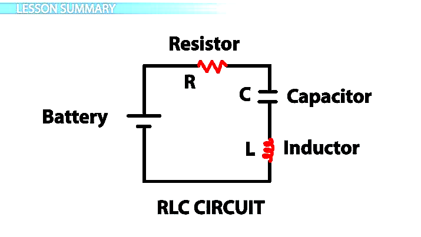

*串联 RLC 电路示意图。*

### 应用三：变化率与混合问题（Rates and mixing）

混合问题通常先得到一阶方程。设 $Q(t)$ 为溶质总量，则

$$
Q'=\text{溶质流入速率}-\text{溶质流出速率}.
$$

若混合均匀、溶液体积为 $V(t)$，流入浓度为 $c_{\mathrm{in}}(t)$，体积流率为 $r_{\mathrm{in}}(t),r_{\mathrm{out}}(t)$，则

$$
Q'=c_{\mathrm{in}}r_{\mathrm{in}}-\frac QV r_{\mathrm{out}},\qquad
V'=r_{\mathrm{in}}-r_{\mathrm{out}}.
$$

模型适用于 $V>0$ 且未超过容器容量的时间区间。两项均须具有“溶质量/时间”的单位。

#### 例：恒定体积的盐水混合

水箱最初含 $600\ \mathrm{gal}$ 水与 $40\ \mathrm{lb}$ 盐。自 $t=0$ 起，以 $4\ \mathrm{gal/min}$ 流入浓度为 $1/2\ \mathrm{lb/gal}$ 的盐水，同时以相同流率排出充分混合的溶液。求 $t>0$ 时盐量 $Q(t)$ 满足的微分方程。

体积始终为 $600\ \mathrm{gal}$，因此

$$
\begin{aligned}
\text{流入盐速率}
&=\left(\frac12\ \mathrm{lb/gal}\right)
\left(4\ \mathrm{gal/min}\right)=2\ \mathrm{lb/min},\\
\text{流出盐速率}
&=\left(\frac Q{600}\ \mathrm{lb/gal}\right)
\left(4\ \mathrm{gal/min}\right)=\frac Q{150}\ \mathrm{lb/min}.
\end{aligned}
$$

这里 $t$ 的数值以分钟计，$Q$ 的数值以磅计。初值问题为

$$
Q'+\frac Q{150}=2,\qquad Q(0)=40.
$$

用一阶线性方程方法得到

$$
Q(t)=300-260e^{-t/150},\qquad t\ge0.
$$

长期盐量趋向 $300\ \mathrm{lb}$，对应浓度趋向流入浓度 $1/2\ \mathrm{lb/gal}$。
