# 线性规划与单纯形法 Linear Programming and Simplex Method

## 引言

线性规划研究如何在线性约束下优化线性目标函数。饲料配比、混合物配方和生产安排等问题，都可以通过决策变量、目标函数与约束条件建立模型。模型的可行域描述所有满足要求的方案，目标函数则用于比较这些方案的成本或收益。

单纯形法将几何上的顶点与代数上的基本可行解联系起来，通过换基逐步优化目标。理解这一方法，需要掌握线性方程组、标准形式、约化成本和最小比值检验。两阶段法进一步解决初始可行基的寻找问题，并在计算过程中处理不可行、目标无下界、退化和冗余约束等情况。

## 目录

- [记号与目标行](#notation)
- [Lecture 0：Linear algebra as prerequisite](#lecture-0)
  - [0.1 线性方程组与维度](#section-0-1)
  - [0.2 Elementary row operations（初等行变换）](#section-0-2)
  - [0.3 ℝᵐ 与标准基向量](#section-0-3)
  - [0.4 Reduced row echelon form（RREF，简化行阶梯形）](#section-0-4)
- [Lecture 1：Definitions and examples of linear programming](#lecture-1)
  - [1.1 饲料问题：从文字到模型](#section-1-1)
  - [1.2 Feasible region（可行域）与顶点](#section-1-2)
  - [1.3 Iso-cost lines（等成本线）与最优解](#section-1-3)
  - [1.4 与边界平行：多重最优](#section-1-4)
  - [1.5 混合物问题：固定总量与比例](#section-1-5)
  - [1.6 家具生产问题：连续 LP 与整数规划](#section-1-6)
  - [1.7 家具问题的整数枚举法](#section-1-7)
- [Lecture 2：General form and standard form](#lecture-2)
  - [2.1 General form（一般形式）](#section-2-1)
  - [2.2 Standard form（标准形式）](#section-2-2)
  - [2.3 从一般形式到标准形式](#section-2-3)
  - [2.4 等式解集与可行域](#section-2-4)
  - [2.5 求解 LP 的三种结果](#section-2-5)
- [Lecture 3：Simplex algorithm 与标准形式的求解](#lecture-3)
  - [3.1 Pivoting 的精确定义](#section-3-1)
  - [3.2 Basis、canonical system 与基本解](#section-3-2)
  - [3.3 从不可行基本解到可行基本解：手工例子](#section-3-3)
  - [3.4 更新目标函数与 canonical LPP](#section-3-4)
  - [3.5 从 BFS 出发改进目标：进入变量与离开变量](#section-3-5)
  - [3.6 饲料问题：完整的手工换基过程](#section-3-6)
  - [3.7 Simplex 的两个阶段与流程](#section-3-7)
- [Lecture 4：Phase 2 的理论](#lecture-4)
  - [4.1 Canonical dictionary](#section-4-1)
  - [4.2 Theorem 1：Optimality criterion（最优性判据）](#section-4-2)
  - [4.3 Theorem 2：Unboundedness criterion（无下界判据）](#section-4-3)
  - [4.4 Theorem 3：Quotient competition（最小比值检验）](#section-4-4)
  - [4.5 Pivot 更新公式与 Theorem 3 的证明](#section-4-5)
  - [4.6 多个进入变量与 tie](#section-4-6)
  - [4.7 Degeneracy（退化）与循环](#section-4-7)
- [Lecture 5：Phase 1 的理论与标准方法](#lecture-5)
  - [5.1 为什么需要人工变量](#section-5-1)
  - [5.2 Phase 1 的可行性判据](#section-5-2)
  - [5.3 饲料问题的 Phase 1：构造辅助问题](#section-5-3)
  - [5.4 饲料问题的 Phase 1：三次 pivot](#section-5-4)
  - [5.5 切回原目标：进入 Phase 2](#section-5-5)
  - [5.6 Tie 与退化：第二个完整例子](#section-5-6)
  - [5.7 Phase 1 的两条实用性质](#section-5-7)
- [Lecture 6：Redundancy 与人工变量清理](#lecture-6)
  - [6.1 冗余约束不等于人工变量留在基中](#section-6-1)
  - [6.2 清理规则](#section-6-2)
  - [6.3 例 1：冗余等式的删除](#section-6-3)
  - [6.4 例 2：人工变量留在基中，但无需删除约束](#section-6-4)
  - [6.5 Phase 1 结束时的完整判断](#section-6-5)

## 记号与目标行

向量默认是列向量，$x\geq 0$ 表示每个分量均非负。标准形式写为

$$
\min Z=c^T x,\qquad Ax=b,\quad x\geq 0.
$$

单纯形表中的目标行为

$$
\sum_{j\in N}\bar c_jx_j=Z-Z_0,
\qquad\text{即}\qquad
Z=Z_0+\sum_{j\in N}\bar c_jx_j.
$$

其中 $N$ 是非基变量的下标集，$\bar c_j$ 是当前的 reduced cost（约化成本），$Z_0$ 是当前基本解的目标值。最小化问题依据 $\bar c_j$ 的符号选择进入变量与判断最优性。Phase 1 的辅助目标 $w$ 也采用这一目标行形式。定理与手写图中的另一种记号为 $Z=\sum c_jx_j-z_0$，其中 $c_j$ 是当前约化成本，$-z_0=Z_0$。

---

## Lecture 0：Linear algebra as prerequisite

### 0.1 线性方程组与维度

#### Systems of Linear Equations

**核心形式**

$$
Ax = b
$$

- $A$ 是 $m \times n$ 矩阵；
- $x$ 是 $n \times 1$ 矩阵；
- $b$ 是 $m \times 1$ 矩阵。

这说明维度dimension必须匹配

$$
(m \times n)(n \times 1) = (m \times 1)
$$

在Optimization里的意义：我们会说

$$
Ax = b,\ x \geq 0
$$

这就是feasible region的等式约束部分。

### 0.2 Elementary row operations（初等行变换）

#### Row Operations

**三种EROs**

- 缩放一行

    $$
    R_{i} \leftarrow cR_{i},\ c \neq 0
    $$

- 行加法

    $$
    R_i\leftarrow R_i+cR_j,\qquad i\neq j
    $$

- 交换两行

    $$
    R_{i} \leftrightarrow R_{j}
    $$

Pivoting：通过EROs把若干列变成单位向量。比如，我们考虑矩阵

$$
A = \begin{bmatrix}
2 & 1 \\
4 & 3
\end{bmatrix}
$$

##### Step 1：对第一列进行pivoting

选一个非0元素，$a_{11} = 2$，这是pivot element。

把它变成1，通过ERO 1（$R_{1} \leftarrow \frac{1}{2}R_{1}$），我们得到：

$$
\begin{bmatrix}
1 & \frac{1}{2} \\
4 & 3
\end{bmatrix}
$$

用它消掉同列其他元素，通过ERO 2（$R_{2} \leftarrow R_{2} - 4R_{1}$），我们得到：

$$
\begin{bmatrix}
1 & \frac{1}{2} \\
0 & 1
\end{bmatrix}
$$

##### Step 2：继续 pivot 第二列，我们得到

$$
\begin{bmatrix}
1 & 0 \\
0 & 1
\end{bmatrix} = \begin{bmatrix}
e_{1} & e_{2}
\end{bmatrix}
$$

### 0.3 $\mathbb R^m$ 与标准基向量

#### $\mathbf{R}^{\mathbf{m}}$ 与 Unit Vector

##### $\mathbb{R}^{m}$的定义

$$
\mathbb{R}^{m} = \{(c_{1},\ldots,c_{m}):c_{i} \in \mathbb{R}\}
$$

- $m$ 维实向量空间。
- 每个元素是长度为 $m$ 的列向量。

比如：$(1,2,3) \in \mathbb{R}^{3}$。

##### Unit Vector：

在 $\mathbb{R}^{m}$ 中，

$$
e_{1},\ e_{2},\ldots,e_{m}
$$

第 $i$ 个位置是1，其余全是0。

比如在 $\mathbb{R}^{3}$ 中：

$$
e_{1} = \left\lbrack \begin{array}{r}
1 \\
0 \\
0
\end{array} \right\rbrack,\qquad e_{2} = \left\lbrack \begin{array}{r}
0 \\
1 \\
0
\end{array} \right\rbrack,\qquad e_{3} = \left\lbrack \begin{array}{r}
0 \\
0 \\
1
\end{array} \right\rbrack
$$

##### 为什么Unit Vector很重要：

因为它们构成standard basis，并且任何向量都可以写成linear combination的形式。

$$
x = x_{1}e_{1} + x_{2}e_{2} + \cdots + x_{m}e_{m}
$$

标准基向量 $e_1,\ldots,e_m$ 都是单位向量；一般的单位向量只要求欧氏长度为 $1$，不一定仅有一个非零分量。

### 0.4 Reduced row echelon form（RREF，简化行阶梯形）

#### Reduced Echelon Form (RREF)

**RREF的要求**

- 每个非零行的 leading entry（第一个非零元素）是 1。
- 每个主元所在列其他元素为 0。
- 主元从上到下向右移动（像楼梯）。
- 允许全零行；所有全零行必须排列在非零行下方。

## Lecture 1：Definitions and examples of linear programming

### 1.1 饲料问题：从文字到模型

#### Translating Our Problem

故事情节：农场主每天要喂牛群，必须满足最低营养需求

- 营养 A：至少 60 units
- 营养 B：至少 84 units
- 营养 C：至少 72 units

可以买两种饲料：

- $F_{1}$：每磅含 $A = 3,B = 7,C = 3$，价格 10 cents/磅
- $F_{2}$：每磅含 $A = 2,B = 2,C = 6$，价格 4 cents/磅

决策：每天买多少磅各饲料，使得营养达标且总成本最小。

#### Definition 1 — Decision Variables

Decision Variables的定义：Decision Variables是模型中由我们选择或控制的未知量，也就是我们要知道和计算的variables。

在本题中，我们可以设

$$
\left\{ \begin{array}{r}
x_1=\text{购买 }F_1\text{ 的磅数} \\
x_2=\text{购买 }F_2\text{ 的磅数}
\end{array} \right.
$$

并且，很显然 $x_{1} \geq 0,x_{2} \geq 0$。

#### Definition 2 — Objective Function

Objective Function的定义：Objective Function是一个关于Decision Variables的函数，用来表示我们要优化（最大化或最小化）的目标。

在本题中，我们想要最小化总成本，因此我们的Objective Function是

$$
C\left( x_{1},x_{2} \right) = 10x_{1} + 4x_{2}
$$

我们的目标是

$$
\min{10x_{1} + 4x_{2}}
$$

#### Definition 3 — Constraints

Constraints的定义：Constraints是对Decision Variables施加的限制条件，通常用等式或不等式表示，描述必须满足的要求。

在本题中，我们本质上就是需要考虑营养需求

- A的需求：$3x_{1} + 2x_{2} \geq 60$；
- B的需求：$7x_{1} + 2x_{2} \geq 84$；
- C的需求：$3x_{1} + 6x_{2} \geq 72$；
- Non-negativity constraints：$x_{1} \geq 0,\ x_{2} \geq 0$。

完整的LPP：在本题设定下，完整的LPP就是

$$
\min{10x_{1} + 4x_{2}} \text{s.t. }
$$

$$
\left\{ \begin{aligned}
& 3x_{1} + 2x_{2} \geq 60 \\
& 7x_{1} + 2x_{2} \geq 84 \\
& 3x_{1} + 6x_{2} \geq 72 \\
& x_{1} \geq 0,x_{2} \geq 0
\end{aligned} \right.
$$

### 1.2 Feasible region（可行域）与顶点

#### Feasible Region and Solving the LPP

##### Feasible Region

定义：所有满足约束的点 $(x_{1},\ x_{2})$ 构成集合，叫 feasible region。而由于 $x_{1},\ x_{2} \geq 0$，因此 feasible region 位于第一象限及其坐标轴上。

#### 如何在图里画出和找到Feasible Region

##### Step 1: 把每个“≥”约束画成一条边界线

先把Constraints写成等式

$$
\begin{aligned}
L_{1}:3x_{1} + 2x_{2} & = 60 \\
L_{2}:7x_{1} + 2x_{2} & = 84 \\
L_{3}:3x_{1} + 6x_{2} & = 72
\end{aligned}
$$

写成斜截式（方便看斜率）

$$
\begin{aligned}
L_{1}: & x_{2} = - \frac{3}{2}x_{1} + 30 \\
L_{2}: & x_{2} = - \frac{7}{2}x_{1} + 42 \\
L_{3}: & x_{2} = - \frac{1}{2}x_{1} + 12
\end{aligned}
$$

##### Step 2: “≥”到底是线的哪一侧？

逐条代入测试点 $(0,0)$：三个左侧均为 $0$，小于对应右端，因此本题每个可行半平面都位于原点的另一侧。由于三条约束中的 $x_2$ 系数均为正，解出 $x_2$ 后，满足“≥”的一侧就是对应直线的上方及直线本身。一般约束也应通过测试点或解不等式判断可行侧。

本题的Feasible Region如下

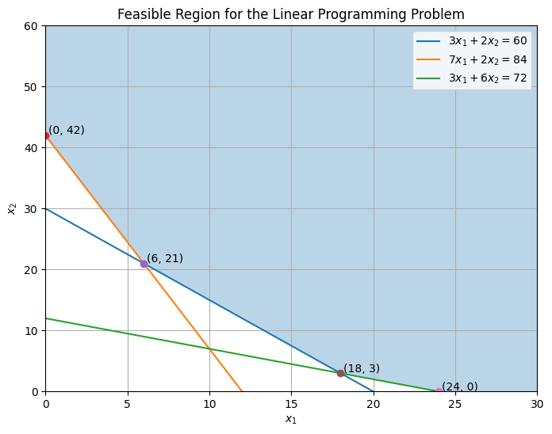

#### Feasible Region的Vertices

线性规划的几何核心：本题这样的可行多面体含有顶点，若目标有有限最优值，则至少有一个最优顶点。多重最优时，整条边或更高维的面都可能最优；一般情形也可能有最优射线。

因此我们先计算几条线的交点

##### 交点1：

$$
\left\{ \begin{aligned}
& 3x_{1} + 2x_{2} = 60 \\
& 7x_{1} + 2x_{2} = 84
\end{aligned} \right. \Rightarrow 4x_{1} = 24 \Rightarrow x_{1} = 6
$$

$$
3 \cdot 6 + 2x_{2} = 60 \Rightarrow 18 + 2x_{2} = 60 \Rightarrow x_{2} = 21
$$

$$
P_{1,2} = (6,21)
$$

##### 交点2：

$$
\left\{ \begin{aligned}
& 3x_{1} + 2x_{2} = 60 \\
& 3x_{1} + 6x_{2} = 72
\end{aligned} \right. \Rightarrow 4x_{2} = 12 \Rightarrow x_{2} = 3
$$

$$
3x_{1} + 6 = 60 \Rightarrow x_{1} = 18
$$

$$
P_{1,3} = (18,3)
$$

##### 交点3：

$$
\left\{ \begin{array}{rlr}
& 7x_{1} + 2x_{2} = 84 \\
& 3x_{1} + 6x_{2} = 72 &
\end{array} \right. \Rightarrow (10,7)
$$

但是 $(10,7)$ 不满足 $L_{1}$ 的约束（$3x_{1} + 2x_{2} \geq 60$）

$$
3(10) + 2(7) = 44 < 60
$$

所以 $(10,7)$ 是infeasible的。

##### 坐标轴上的顶点

- 在 $x_{1} = 0$上：三个约束给出 $x_{2} \geq 30,42,12$，所以最小可行点是 $(0,\ 42)$。
- 在 $x_{2} = 0$ 上：三个约束给出 $x_{1} \geq 20,12,24$，所以最小可行点是 $(24,\ 0)$。

##### 我们的结论

$$
(0,42),(6,21),(18,3),(24,0)
$$

### 1.3 Iso-cost lines（等成本线）与最优解

#### Iso-Cost lines：我们如何才能找到最优？

Iso-Cost lines：就是把Objective Function的目标值设置为常数 C，求出Iso-Cost lines和对应的斜率。

在本题中

$$
10x_{1} + 4x_{2} = C \Rightarrow x_{2} = - \frac{10}{4}x_{1} + \frac{C}{4} = - \frac{5}{2}x_{1} + \frac{C}{4}
$$

$$
m = - \frac{5}{2}
$$

#### 如何找到最优？

Iso-Cost lines往左下推就是在减少成本。

最优会出现在边界/顶点：如果 $\left( x_{1},x_{2} \right)$在可行域内部，你总能沿着“让成本下降的方向”（大致向左下）走一小步，还保持可行，同时让 $10x_{1} + 4x_{2}$变小，所以内部点不可能最优。

#### 方法1 — 等成本线画图法：

我们可以画出等成本线的图。最后接触Feasible Region的那条Iso-Cost lines就是最优的Iso-Cost line

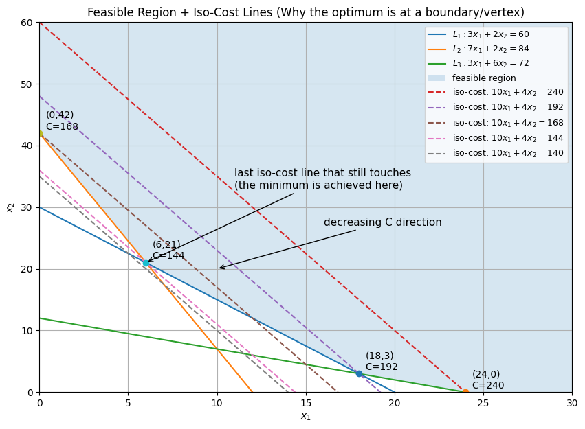

你看图里几条等成本线：

- C=240 还能穿过可行域；
- C=192 还能穿过；
- C=168 还能穿过；
- C=144 仍然还能碰到可行域（恰好在 (6,21) 接触）；
- 但 C=140 已经完全在可行域外面了（碰不到蓝色区域）。

#### 方法2 — 等成本线法

在本题的几何设定中，可行域是三条直线上方半平面的交，目标沿右上方向增大。对于下边界上的可行顶点，若目标等成本线斜率夹在两条实际相邻边的斜率之间，并且成本增加方向朝向可行域，则该点最优。斜率比较必须结合可行侧、相邻边和优化方向。

##### 如何计算

- 计算Iso-Cost lines斜率：$m = - \frac{5}{2}$。
- 计算所有约束线斜率：$m_{1} = - \frac{3}{2},\ m_{2} = - \frac{7}{2},\ m_{3} = - \frac{1}{2}$。
- $x_{1}=0$ 是竖直边界，其斜率未定义；$x_{2}=0$ 是水平边界，斜率为 $0$。竖直方向应单独处理。

按大小排序

$$
0 > - \frac{1}{2} > - \frac{3}{2} > - \frac{5}{2} > - \frac{7}{2}
$$

在本题的可行下边界上找到夹住等成本线斜率的相邻两条边，再确认其交点满足全部约束，即可得到最优点。这里就是 $m_{1} = - \frac{3}{2}$ 和 $m_{2} = - \frac{7}{2}$ 的交点。

#### 方法3 — 顶点枚举法（最终用这个验证）：

把所有Vertices代入目标函数，最符合objective的那个点就是

在本题中，我们可得

$$
(0,42):C = 10(0) + 4(42) = 168
$$

$$
(6,21):10(6) + 4(21) = 144
$$

$$
(18,3):10(18) + 4(3) = 192
$$

$$
(24,0):10(24) = 240
$$

因此我们可得，$\min C = 144$ at (6,21)。

### 1.4 与边界平行：多重最优

如果Iso-Cost lines斜率和约束边界平行怎么办？

#### Example：把 $F_{1}$的单价从 10 cents 提到 14 cents

$$
C'(x_{1},x_{2}) = 14x_{1} + 4x_{2}
$$

$$
m' = - \frac{14}{4} = - \frac{7}{2}
$$

这恰好等于 $L_{2}$ 的斜率 $m_{2} = - \frac{7}{2}$。

这意味着：当我们把Iso-Cost line往左下推到“最后接触”时，它不是碰到一个点，而是沿着 $L_{2}$的某一段边界整段贴住可行域。

所以连线段上每个点成本都一样 ⇒ 无穷多个最优解。

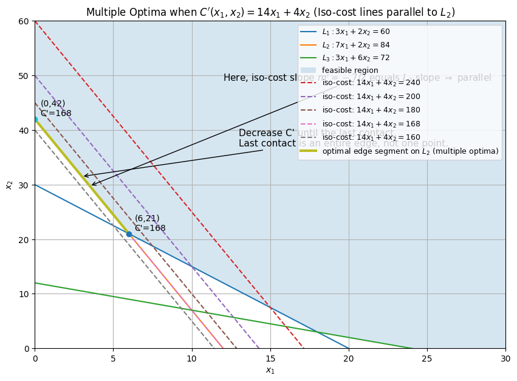

最优线段的两个端点为 $(0,42)$ 与 $(6,21)$。沿该线段，$7x_1+2x_2=84$，故 $C'=14x_1+4x_2=168$。可行点满足 $C'\geq168$，因此这条线段上的每一点都最优。

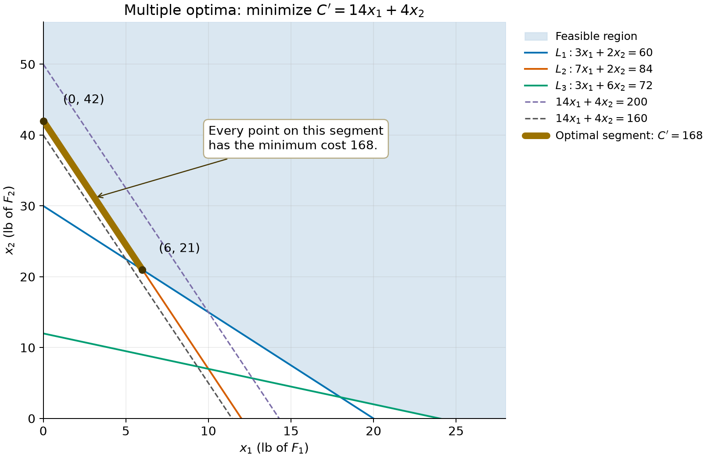

### 1.5 混合物问题：固定总量与比例

#### Second Example of LPP

背景信息：你是一个生产商，需要做一种最终产品（比如饲料、化学混合物等）。我们要用2个原料来混合。我们的目标是用这两种原料混出一个满足质量要求的产品，同时成本最低。

| 原料      | G1含量 | G2含量 | 价格       |
|-----------|--------|--------|------------|
| $B_{1}$ | 60%    | 10%    | \$0.8 / 磅 |
| $B_{2}$ | 20%    | 50%    | \$0.6 / 磅 |

你生产出来的“最终混合物”必须满足：

- 至少 30% 是 G1；
- 至少 26% 是 G2。

#### 转化为数学语言/求解

##### Decision Variables：设

$$
\left\{ \begin{array}{r}
x_1=\text{使用 }B_1\text{ 的磅数} \\
x_2=\text{使用 }B_2\text{ 的磅数}
\end{array} \right.
$$

##### Constraints：

为了确定最低单位成本的配方，固定一个 $100$ 磅批次，即 $x_1+x_2=100$。这一归一化使总成本直接对应配方的单位成本；百分比约束本身也可写成线性不等式。若不规定正的总产量而直接最小化总成本，就无法表达生产固定数量产品的要求。

- $60\%\left( x_{1} \right) + 20\%\left( x_{2} \right) \geq 30\%\left( x_{1} + x_{2} \right) = 30\  \rightarrow 3x_{1} + x_{2} \geq 150\ (L_{1})$
- $10\%\left( x_{1} \right) + 50\%\left( x_{2} \right) \geq 26\%\left( x_{1} + x_{2} \right) = 26\  \rightarrow x_{1} + 5x_{2} \geq 260\ (L_{2})$
- $x_{1} + x_{2} = 100\ (L_{3})$

#### Objective与等成本线斜率

$$
\min{C'(x_{1},x_{2})} = 0.8x_{1} + 0.6x_{2}
$$

$$
0.8x_{1} + 0.6x_{2} = C \Rightarrow x_{2} = - \frac{0.8}{0.6}x_{1} + \frac{C}{0.6} \Rightarrow m = - \frac{4}{3}
$$

#### 计算Constraints斜率（把 $x_{1}$ 当 $x$）

- $L_{1}:\ 3x_{1} + x_{2} = 150 \rightarrow x_{2} = - 3x_{1} + 150 \rightarrow m_{1} = - 3$
- $L_{2}:\ x_{1} + 5x_{2} = 260 \rightarrow 5x_{2} = - x_{1} + 260 \rightarrow x_{2} = - \frac{1}{5}x_{1} + 52 \rightarrow m_{2} = - \frac{1}{5}$
- $L_{3}:x_{1} + x_{2} = 100 \rightarrow x_{2} = - x_{1} + 100 \rightarrow m_{3} = - 1$

Feasible Region本质上是在 $x_{1} + x_{2} = 100$ 线上。

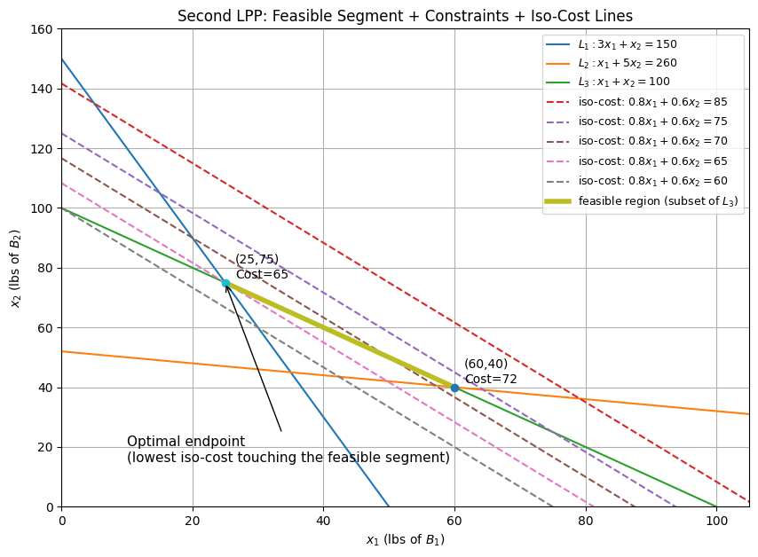

#### 寻找Vertices

##### $L_{1}$和$L_{2}$

- 计算得出结果：$(35,\ 45)$
- 检查是否在feasible region，不在$x_{1} + x_{2} = 100$线上。

##### $L_{1}$和$L_{3}$

- 计算得出结果：$(25,\ 75)$
- 检查是否在feasible region，成功。

##### $L_{2}$和$L_{3}$

- 计算得出结果：$(60,\ 40)$
- 检查是否在feasible region，成功。

我们没有坐标轴端点了，因为其不在feasible region中。

#### 等成本线法找optimal

我们有的斜率：$m_{1} = - 3,\ m_{2} = - \frac{1}{5},\ m_{3} = - 1,\ m = - \frac{4}{3}$

##### 排序结果

$$
- \frac{1}{5} > - 1 > - \frac{4}{3} > - 3
$$

说明目标斜率夹在 $L_{1}$与 $L_{3}$之间，最优点位于$(25,\ 75)$。

#### 通过顶点枚举法验证

$$
\begin{array}{r}
C'(25,75) = 0.8 \cdot 25 + 0.6 \cdot 75 = 20 + 45 = 65 \\
C'(60,40) = 0.8 \cdot 60 + 0.6 \cdot 40 = 48 + 24 = 72
\end{array}
$$

因此最优就是$(25,\ 75)$。

也可直接代入总量等式逐步验证：$x_2=100-x_1$，第一条营养约束给出 $2x_1+100\geq150$，即 $x_1\geq25$；第二条给出 $500-4x_1\geq260$，即 $x_1\leq60$。于是 $25\leq x_1\leq60$，而 $C=60+0.2x_1$ 随 $x_1$ 增大，故最优配方为 $(25,75)$。

### 1.6 家具生产问题：连续 LP 与整数规划

#### Third Example of LPP（整数版本操作过程）

背景信息：一家家具店在一个生产周期内要生产两种产品：

- Chair（椅子）：每把利润 \$70
- Sofa（沙发）：每个利润 \$60

但生产受到三类资源限制：

- Fabric（布料）：总共 96 yards
- Wood（木材）：总共 90 units
- Labor（人工）：总共 120 hours

| 产品  | 布料Yards | 木材Units | 人工Hours |
|-------|-----------|-----------|-----------|
| Chair | 3         | 6         | 9         |
| Sofa  | 8         | 5         | 4         |

目标：在不超过资源的前提下，使总利润最大。

#### 转化为数学语言/求解（正常做法/连续LP解法）

##### Decision Variables：设

$$
\left\{ \begin{array}{r}
x_1=\text{生产 chairs 的数量} \\
x_2=\text{生产 sofas 的数量}
\end{array} \right.
$$

##### Constraints：我们看到是资源上限，因此是$\leq$

- 布料：$3x_{1} + 8x_{2} \leq 96\ (L_{1})$
- 木材：$6x_{1} + 5x_{2} \leq 90\ (L_{2})$
- 人工：$9x_{1} + 4x_{2} \leq 120\ (L_{3})$
- Non-negativity constraints：$x_{1} \geq 0,\ x_{2} \geq 0$

#### Objective与等成本线斜率

$$
\max{P(x_{1},\ x_{2})} = 70x_{1} + 60x_{2}
$$

$$
P = 70x_{1} + 60x_{2} \Rightarrow 60x_{2} = P - 70x_{1} \Rightarrow x_{2} = \frac{P}{60} - \frac{7}{6}x_{1} \Rightarrow m = - \frac{7}{6}
$$

#### 计算Constraints斜率（把 $x_{1}$ 当 $x$）

- $L_{1}:\ 3x_{1} + 8x_{2} = 96 \rightarrow 8x_{2} = 96 - 3x_{1} \rightarrow x_{2} = 12 - \frac{3}{8}x_{1} \rightarrow m_{1} = - \frac{3}{8}$
- $L_{2}:\ 6x_{1} + 5x_{2} = 90 \rightarrow 5x_{2} = 90 - 6x_{1} \rightarrow x_{2} = 18 - \frac{6}{5}x_{1} \rightarrow m_{2} = - \frac{6}{5}$
- $L_{3}:\ 9x_{1} + 4x_{2} = 120 \rightarrow 4x_{2} = 120 - 9x_{1} \rightarrow x_{2} = 30 - \frac{9}{4}x_{1} \rightarrow m_{3} = - \frac{9}{4}$

#### 坐标轴边界

- $L_{v}:\ x_{1} = 0$（y轴）
- $L_{h}:\ x_{2} = 0$（x轴）

#### 寻找Vertices

##### $L_{1}$和$L_{2}$

- 计算得出结果：$\left( \frac{80}{11},\frac{102}{11} \right)$
- 检查是否在feasible region，我们检查$L_{3}$，成功

    $$
    9\left( \frac{80}{11} \right) + 4\left( \frac{102}{11} \right) = \frac{1128}{11} \leq 120
    $$

##### $L_{2}$和$L_{3}$

- 计算得出结果：$\left( \frac{80}{7},\frac{30}{7} \right)$
- 检查是否在feasible region，我们检查$L_{1}$，成功

##### $L_{1}$和$L_{3}$

- 计算得出结果：$\left( \frac{48}{5},\frac{42}{5} \right)$
- 检查是否在feasible region，我们检查$L_{2}$，失败

##### $L_{v}$和$L_{H}$

- 计算得出结果：$(0,0)$，成功

##### $L_{v}$和$L_{1}$

- 计算得出结果：$(0,12)$，成功

##### $L_{H}$和$L_{3}$

- 计算得出结果：$\left( \frac{40}{3},0 \right)$，成功

以此类推，剩下的坐标轴交点都失败了。因此我们有

$$
(0,0),(0,12),\left( \frac{80}{11},\frac{102}{11} \right),\left( \frac{40}{3},0 \right),\left( \frac{80}{7},\frac{30}{7} \right)
$$

我们计算profit，会发现$\left( \frac{80}{11},\frac{102}{11} \right)$达到了最大利润，但是我们无法生产出这样的产品，因为 $x_{1}$和 $x_{2}$ 必须是整数。

### 1.7 家具问题的整数枚举法

**整数解法**

#### Step 0：先写清楚整数版问题

$$
\max P = 70x_{1} + 60x_{2}
$$

$$
\text{s.t. }\left\{ \begin{aligned}
& 3x_{1} + 8x_{2} \leq 96 \\
& 6x_{1} + 5x_{2} \leq 90 \\
& 9x_{1} + 4x_{2} \leq 120 \\
& x_{1} \geq 0,x_{2} \geq 0 \\
& x_{1},x_{2} \in \mathbb{Z}
\end{aligned} \right.
$$

#### Step 1：枚举一个variable，比如我们枚举 $x_{1}$。

因为如果你让 $x_{1}$取一个整数值，剩下的所有约束都会变成 **对** $x_{2}$**的限制**，你就能直接算出 $x_{2}$的最大可行整数

#### Step 2：给 $x_{1}$ 找到一个区间

随便选择一个约束，比如 $9x_{1} + 4x_{2} \leq 120$

因为$x_{2} \geq 0$，所以$4x_{2} \geq 0$，那么

$$
9x_{1} \leq 120 \Rightarrow x_{1} \leq \frac{120}{9} = 13.\overline{3}
$$

由于 $x_{1} \in \mathbb{Z}$且 $x_{1} \geq 0$，得到

$$
x_{1} \in \{ 0,1,2,\ldots,13\}
$$

#### Step 3：固定一个 $x_{1}$，把每条约束变成 $x_{2}$的上界

- 约束1：$3x_{1} + 8x_{2} \leq 96$

    $$
    x_{2} \leq \frac{96 - 3x_{1}}{8} = u_{1}(x_{1})
    $$

- 约束2：$6x_{1} + 5x_{2} \leq 90$

    $$
    x_{2} \leq \frac{90 - 6x_{1}}{5} = u_{2}(x_{1})
    $$

- 约束3：$9x_{1} + 4x_{2} \leq 120$

    $$
    x_{2} \leq \frac{120 - 9x_{1}}{4} = u_{3}(x_{1})
    $$

#### Step 4：把三个上界取最小，得到连续意义下的最大可行 $x_{2}$。

因为 $x_{2}$要同时满足三条上界，所以最终上界是最紧的那个

$$
b(x_{1}) = \min{\{ u_{1}(x_{1}),u_{2}(x_{1}),u_{3}(x_{1})\}}
$$

#### Step 5：加入整数性 → 用 floor 取最大可行整数 $x_{2}$

$$
x_{2} = \left\lfloor b(x_{1}) \right\rfloor
$$

#### Step 6：枚举全部 $x_{1}$，逐个计算候选点与利润

| $x_1$ | $u_1$ | $u_2$ | $u_3$ | $b$ | $x_2$ | 候选点 | 利润 $P$ |
| ---: | ---: | ---: | ---: | ---: | ---: | --- | ---: |
| 0 | 12.000 | 18.0 | 30.00 | 12.000 | 12 | $(0,12)$ | 720 |
| 1 | 11.625 | 16.8 | 27.75 | 11.625 | 11 | $(1,11)$ | 730 |
| 2 | 11.250 | 15.6 | 25.50 | 11.250 | 11 | $(2,11)$ | 800 |
| 3 | 10.875 | 14.4 | 23.25 | 10.875 | 10 | $(3,10)$ | 810 |
| 4 | 10.500 | 13.2 | 21.00 | 10.500 | 10 | $(4,10)$ | 880 |
| 5 | 10.125 | 12.0 | 18.75 | 10.125 | 10 | $(5,10)$ | 950 |
| 6 | 9.750 | 10.8 | 16.50 | 9.750 | 9 | $(6,9)$ | 960 |
| 7 | 9.375 | 9.6 | 14.25 | 9.375 | 9 | $(7,9)$ | 1030 |
| 8 | 9.000 | 8.4 | 12.00 | 8.400 | 8 | $(8,8)$ | 1040 |
| 9 | 8.625 | 7.2 | 9.75 | 7.200 | 7 | $(9,7)$ | 1050 |
| 10 | 8.250 | 6.0 | 7.50 | 6.000 | 6 | $(10,6)$ | **1060** |
| 11 | 7.875 | 4.8 | 5.25 | 4.800 | 4 | $(11,4)$ | 1010 |
| 12 | 7.500 | 3.6 | 3.00 | 3.000 | 3 | $(12,3)$ | 1020 |
| 13 | 7.125 | 2.4 | 0.75 | 0.750 | 0 | $(13,0)$ | 910 |

#### Step 7：得到结果

$$
\left( x_{1},x_{2} \right) = (10,6),\ P = 1060
$$

## Lecture 2：General form and standard form

### 2.1 General form（一般形式）

#### General Form of LPP

故事情节：农场主每天要喂牛群，必须满足最低营养需求

- 营养 A：至少 60 units
- 营养 B：至少 84 units
- 营养 C：至少 72 units

可以买两种饲料：

- $F_{1}$：每磅含 $A = 3,B = 7,C = 3$，价格 10 cents/磅
- $F_{2}$：每磅含 $A = 2,B = 2,C = 6$，价格 4 cents/磅

决策：每天买多少磅各饲料，使得营养达标且总成本最小。

#### General Form of a LPP

标准定义：Optimize $c_{1}x_{1} + c_{2}x_{2} + \ldots + c_{n}x_{n}$, where $c_{1},\ c_{2},\ldots,c_{n}\in \mathbb{R}$, subject to

$$
a_{1,1}x_{1} + a_{1,2}x_{2} + \ldots + a_{1,n}x_{n}\ \sim_{1}\ b_{1}
$$

$$
a_{2,1}x_{1} + a_{2,2}x_{2} + \ldots + a_{2,n}x_{n}\ \sim_{2}\ b_{2}
$$

$$
\vdots
$$

$$
a_{i,1}x_{1} + a_{i,2}x_{2} + \ldots + a_{i,n}x_{n}\ \sim_{i}\ b_{i}
$$

$$
\vdots
$$

$$
a_{m,1}x_{1} + a_{m,2}x_{2} + \ldots + a_{m,n}x_{n}\ \sim_{m}\ b_{m}
$$

**where**

- “optimize” is either “minimize” or “maximize”.
- All $a_{i,j}\in \mathbb{R}$ and $b_{1},\ldots b_{m}\in \mathbb{R}$.
- For each $i$, $1 \leq i \leq m$ and $\sim_{i}$ is either $\geq ,\  \leq$ or $=$.
- For each $j$, $1 \leq j \leq n$ either $x_{j} \geq 0$ or $x_{j}\in \mathbb{R}$.

#### 一些定义：

- Decision Variables are the unknowns that we choose or control in the model.
- The linear function $c_{1}x_{1} + c_{2}x_{2} + \cdots + c_{n}x_{n}$is called the objective function and “Optimize” is either “Minimize” or “Maximize”.
- **The relation**

    $$
    a_{i1}x_{1} + a_{i2}x_{2} + \cdots + a_{in}x_{n} \sim_{i}b_{i}
    $$

    is called the i-th constraint.

    The number of variables is $n$.

- The number of constraints is $m$.
- Example（参考上述故事情节）：Optimize (Minimize) $10x_{1} + 4x_{2}$, subject to

    $$
    \left\{ \begin{aligned}
    & 3x_{1} + 2x_{2} \geq 60 \\
    & 7x_{1} + 2x_{2} \geq 84 \\
    & 3x_{1} + 6x_{2} \geq 72 \\
    & x_{1} \geq 0,x_{2} \geq 0
    \end{aligned} \right.
    $$

### 2.2 Standard form（标准形式）

#### Standard Form of LPP

**定义**

**标准定义：A LPP is in Standard Form if**

- “Optimize” is “Minimize”.
- Each $\sim_{i}$ is $=$ (all constraints are equalities).
- For each $j$, $x_{j} \geq 0$ (all variables are non-negative).

完整数学表示：Minimize $c_{1}x_{1} + c_{2}x_{2} + \cdots + c_{n}x_{n}$
subject to $x_{j} \geq 0$, $1 \leq j \leq n$ and

$$
a_{i1}x_{1} + a_{i2}x_{2} + \cdots + a_{in}x_{n} = b_{i}
$$

矩阵形式：It is convenient, efficient and productive to use the matrix formulation.

$$
\text{Minimize }\overline{c}^{T}\overline{x}
$$

$$
\text{subject to }\overline{x} \geq 0
$$

$$
A\overline{x} = \overline{b}
$$

这里 $\overline c$、$\overline x$、$\overline b$ 均按列向量理解，目标 $\overline c^T\overline x$ 是标量。非负条件允许变量等于零。

### 2.3 从一般形式到标准形式

#### 如何把General Form转化为Standard Form — 三个 transformation 技术：

- ≤ —— 加 slack variable
- ≥ —— 减 surplus variable
- Unrestricted —— 拆成两个非负变量

    $$
    x = x^{+} - x^{-},x^{+},x^{-} \geq 0
    $$

#### Example 1

原问题：$\text{Minimize }Z\left( x_{1},x_{2},x_{3} \right) = 3x_{1} + 2x_{2} + 4x_{3}$, subject to

$$
\begin{aligned}
30x_{1} + 100x_{2} + 85x_{3} & \leq 2500 \\
6x_{1} + 2x_{2} + 3x_{3} & \geq 90 \\
x_{j} & \geq 0
\end{aligned}
$$

##### 转化为Standard Form

对于$30x_{1} + 100x_{2} + 85x_{3} \leq 2500$，我们发现是 $\leq$，因此加 slack variable $x_{4}$。

$$
30x_{1} + 100x_{2} + 85x_{3} + x_{4} = 2500
$$

对于$6x_{1} + 2x_{2} + 3x_{3} \geq 90$，我们发现是 $\geq$，因此是减 surplus variable $x_{5}$。

$$
6x_{1} + 2x_{2} + 3x_{3} - x_{5} = 90
$$

我们获得新变量 $x_{4}$ 和 $x_{5}$，并要求 $x_4,x_5\geq0$；它们在目标函数中的系数均为 $0$。

#### Example 2

原问题：$\text{Minimize }Z(x_{1},x_{2}) = 2x_{1} - x_{2}$, subject to

$$
\begin{aligned}
& x_{1} + x_{2} \geq 3 \\
& 2x_{1} - x_{2} \leq 4 \\
& x_{1} \geq 0,x_{2} \in \mathbb{R}\text{ (unrestricted)}
\end{aligned}
$$

##### 转化为Standard Form

##### Step 1：我们把 $x_{2}$ 用两个非负变量表示

$$
x_{2} = x_{2}^{+} - x_{2}^{-},x_{2}^{+} \geq 0,x_{2}^{-} \geq 0
$$

##### Step 2：代入目标函数

$$
Z = 2x_{1} - (x_{2}^{+} - x_{2}^{-}) = 2x_{1} - x_{2}^{+} + x_{2}^{-}
$$

##### Step 3：代入约束

约束1：$x_{1} + x_{2} \geq 3 \Rightarrow x_{1} + (x_{2}^{+} - x_{2}^{-}) \geq 3$

约束2：$2x_{1} - x_{2} \leq 4 \Rightarrow 2x_{1} - (x_{2}^{+} - x_{2}^{-}) \leq 4 \Rightarrow 2x_{1} - x_{2}^{+} + x_{2}^{-} \leq 4$

##### Step 4：把不等式转成等式（slack / surplus）

$$
\text{Minimize }Z(x_{1},x_{2}^{+},x_{2}^{-},s_{1},s_{2}) = 2x_{1} - x_{2}^{+} + x_{2}^{-}
$$

$$
\begin{aligned}
\text{subject to } & x_{1} + x_{2}^{+} - x_{2}^{-} - s_{1} = 3 \\
& 2x_{1} - x_{2}^{+} + x_{2}^{-} + s_{2} = 4 \\
& x_{1},x_{2}^{+},x_{2}^{-},s_{1},s_{2} \geq 0
\end{aligned}
$$

#### 等价转换：

任何线性规划都可转成标准形式，并通过换元关系还原原变量与目标值。

转换前后：

- 只添加 slack/surplus 变量时，新增变量由原变量唯一决定，可行解一一对应；自由变量拆分时，同一个原变量可能有多个非负拆分表示。
- 只添加零成本变量或按等式代入时，目标函数值相同；若把最大化改为最小化，需要将目标取负，并在报告最优值时还原符号。
- 原问题和标准形式的最优解通过变量转换及投影对应。

只添加 slack/surplus 变量的可行解对应是 bijection（双射）。自由变量拆分则通常是多对一映射：$(x_j^++t,x_j^-+t)$ 对所有 $t\geq0$ 都表示同一个差值。下图区分单射、满射与双射；双射对应每个元素恰有一个原像。

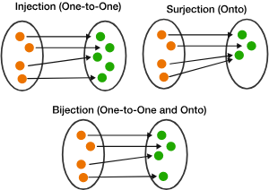

#### Example（$\text{Minimize }Z\left( x_{1},x_{2},x_{3} \right) = 3x_{1} + 2x_{2} + 4x_{3}$）

原问题：$(12,10,4)$

满足约束

$Z = 36 + 20 + 16 = 72$

##### 对应到新变量

$$
x_{4} = 2500 - 1700 = 800
$$

$$
x_{5} = 104 - 90 = 14
$$

我们得到 $(12,10,4,800,14)$

##### 标准形式 → 原问题

- 反过来$(12,10,4,800,14)$，可以满足约束。
- 投影回$(12,10,4)$，同样成立。

### 2.4 等式解集与可行域

下文将等式系统 $Ax=b$ 记为 $(*)$，将附有目标函数与非负约束的标准形式 LP 记为 $(\ell)$。

**Feasible / Feasible Region**

#### Recall

Standard Form of LPP是

$$
\text{Minimize }\overline{c}^{T}\overline{x}
$$

$$
\text{subject to }\overline{x} \geq 0
$$

$$
A\overline{x} = \overline{b}
$$

#### 例子（饲料问题 → Standard Form）

##### 原问题

$$
\min 10x_{1} + 4x_{2}
$$

$$
\text{s.t. }\left\{ \begin{aligned}
& 3x_{1} + 2x_{2} \geq 60 \\
& 7x_{1} + 2x_{2} \geq 84 \\
& 3x_{1} + 6x_{2} \geq 72 \\
& x_{1},x_{2} \geq 0
\end{aligned} \right.
$$

##### Standard Form of LPP

$$
\left\{ \begin{aligned}
& 3x_{1} + 2x_{2} - s_{1} = 60 \\
& 7x_{1} + 2x_{2} - s_{2} = 84 \\
& 3x_{1} + 6x_{2} - s_{3} = 72 \\
& x_{1},x_{2},s_{1},s_{2},s_{3} \geq 0
\end{aligned} \right.
$$

我们写出矩阵形式

$$
x = \left( \begin{array}{r}
x_{1} \\
x_{2} \\
s_{1} \\
s_{2} \\
s_{3}
\end{array} \right) \in \mathbb{R}^{5},c = \left( \begin{array}{r}
10 \\
4 \\
0 \\
0 \\
0
\end{array} \right),
$$

$$
A = \begin{pmatrix}
3 & 2 & - 1 & 0 & 0 \\
7 & 2 & 0 & - 1 & 0 \\
3 & 6 & 0 & 0 & - 1
\end{pmatrix},b = \left( \begin{array}{r}
60 \\
84 \\
72
\end{array} \right).
$$

#### 定义 $S$：先只看等式系统 $Ax = b$

定义：We let $S$ be the solution set of (\*). Technically speaking,

$$
S\overset{def}{=}\{(s_{1},\ldots,s_{n}) \in \mathbb{R}^{n}:a_{i1}s_{1} + \cdots + a_{in}s_{n} = b_{i},\forall i\}
$$

也就是矩阵形式

$$
S = \{\overline{s} \in \mathbb{R}^{n}:A\overline{s} = \overline{b}\}.
$$

##### Example：饲料问题的 $S$

$$
S = \left\{ (x_{1},x_{2},s_{1},s_{2},s_{3}) \in \mathbb{R}^{5}:\begin{array}{r}
3x_{1} + 2x_{2} - s_{1} = 60 \\
7x_{1} + 2x_{2} - s_{2} = 84 \\
3x_{1} + 6x_{2} - s_{3} = 72
\end{array} \right\}.
$$

#### 定义 $S^{\geq}$：把非负限制加进去

$$
S^{\geq}\overset{def}{=}\{\overline{s} \in S:s_{j} \geq 0,\forall j\}.
$$

$S^{\geq}$ = 同时满足

- 等式系统 $Ax = b$
- 非负限制 $x \geq 0$

这就是标准形式 LP 的“合法解空间”。

##### Example：饲料问题的 $S^{\geq}$

$$
S^{\geq} = \left\{ (x_{1},x_{2},s_{1},s_{2},s_{3}) \in \mathbb{R}^{5}:\begin{array}{r}
3x_{1} + 2x_{2} - s_{1} = 60 \\
7x_{1} + 2x_{2} - s_{2} = 84 \\
3x_{1} + 6x_{2} - s_{3} = 72 \\
x_{1},x_{2},s_{1},s_{2},s_{3} \geq 0
\end{array} \right\}.
$$

这就是这道题的 feasible region。

#### Feasible Solutions / Feasible Region / Feasible LPP

定义

- Elements of $S^{\geq}$are called “feasible solutions of (\*)”.（Feasible Solution就是 $S^{\geq}$ 里的一个点。）
- $S^{\geq}$ is called the “feasible region of (ℓ)”.（Feasible Region就是集合 $S^{\geq}$ 本身。）
- and (ℓ) is said to be a feasible LPP if $S^{\geq} \neq \varnothing$.（如果$S^{\geq} \neq \varnothing$，则为Feasible LPP。）

##### Example：我们随便挑一个满足原不等式的 $(x_{1},\ x_{2})$，例如

$$
x_{1} = 12,\ x_{2} = 12
$$

**检查原不等式**

- $3(12) + 2(12) = 36 + 24 = 60 \geq 60$
- $7(12) + 2(12) = 84 + 24 = 108 \geq 84$
- $3(12) + 6(12) = 36 + 72 = 108 \geq 72$

**对应到标准形式的 surplus：**

$$
s_{1} = 3x_{1} + 2x_{2} - 60 = 0
$$

$$
s_{2} = 7x_{1} + 2x_{2} - 84 = 24
$$

$$
s_{3} = 3x_{1} + 6x_{2} - 72 = 36
$$

所以点：

$$
(12,12,0,24,36) \in S^{\geq}
$$

因此它是一个 feasible solution；而所有这样的点组成的集合就是 feasible region。并且因为我们已经找到了一个点，所以 $S^{\geq} \neq \varnothing$，本题是 feasible LPP。

### 2.5 求解 LP 的三种结果

#### 如何解Standard Form LPP

**Solving (ℓ)**

我们之前已经了解了Standard Form LPP的标准定义，了解了有关Solution的定义。现在我们要了解如何solve Standard Form LPP。

##### Step 1：先判断 $S^{\geq}$是否为空

- 如果可行域空：infeasible，问题无解（在约束下没有任何合法点）。
- 如果可行域不为空，我们继续，也就是其是一个Feasible LPP。

##### Step 2

情况一：存在最优解，也就是我们要find ${\overline{s}}_{\min} \in S^{\geq}$satisfying for $\overline{c}^{T}{\overline{s}}_{\min} \leq \overline{c}^{T}\overline{s}$ every $\overline{s} \in S^{\geq}$，数学形式化写法就是

$$
x^{*} \in S^{\geq}\text{s.t. }c^{T}x^{*} \leq c^{T}x,\forall x \in S^{\geq}.
$$

这就是“解”这个 LP 的精确定义。

情况二：no such ${\overline{s}}_{\min}$exists，也就是虽然可行，但目标函数没有最小值。该情况叫做Not Bounded Below。

#### Not Bounded Below

定义：A feasible Standard Form lpp for which ${\overline{s}}_{\min}$does not exist is said to be “Not Bounded Below”.

- $S^{\geq} \neq \varnothing$
- 但不存在最小点
- 目标函数可以趋向 $- \infty$

#### Example：现在有一个Standard Form LPP

$$
\begin{aligned}
& \min{Z(x_{1},x_{2})} = x_{1} - 2x_{2} \\
& \text{s.t. }x_{1},x_{2} \geq 0 \\
& - x_{1} + x_{2} = 2
\end{aligned}
$$

##### Step 1：求 $S$

$$
S = \{(x_{1},x_{2}) \in \mathbb{R}^{2}:\  - x_{1} + x_{2} = 2\}
$$

我们也可以写成参数形式parametric representation：由 $- x_{1} + x_{2} = 2$ 可得，$x_{1} = x_{2} - 2$。我们设 $x_{2} = t$，得到 $\left( x_{1},x_{2} \right) = (t - 2,t)$。因此

$$
S = \{(t - 2,t):t \in \mathbb{R}\}
$$

##### Step 2：求 $S^{\geq}$

我们要求 $x_{1} \geq 0,\ x_{2} \geq 0$，代入可得 $t - 2 \geq 0 \rightarrow t \geq 2$。

$$
S^{\geq} = \{(t - 2,t):t \geq 2\}
$$

##### Step 3：说明feasible。

因为 $t = 2 \Rightarrow (0,2) \in S^{\geq}$，所以 $S^{\geq} \neq \varnothing$。这是一个Feasible LPP

##### Step 4：看目标函数

$$
Z\left( x_{1},x_{2} \right) = x_{1} - 2x_{2}
$$

因此：

$$
Z(t) = (t - 2) - 2t = - 2 - t
$$

##### Step 5：关键分析。

我们发现当$t \rightarrow \infty$的时候，$Z(t) \rightarrow - \infty$。这feasible，但是不存在 $s_{\min}$

#### Minimum Value and Minimum Point

定义：A minimum point is any point that results in the minimum value.

在可行且具有有限最优值的情况下

- minimum value 是唯一的
- minimum point 可能多个（例如一条边）

但是比如

$$
\min Z = x_{1} + x_{2}
$$

$$
x_{1} + x_{2} = 4,x \geq 0
$$

这个时候所有点都有 $Z = 4$，所以minimum value = 4（唯一），minimum point = 无穷多个。

#### 如何解LPP？

我们之前已经有很多examples告诉我们如何手动解LPP，但是这只用于低维，也就是能画图，顶点少的情况。但是一旦100个变量，200个约束。我们就做不了了。

我们需要把“找顶点”的过程变成一个系统算法，这个算法就叫做simplex。

上述三类结果使用了线性规划的性质：线性目标在非空多面体上若有有限下界，就能取得最小值。NBB 更直接的定义是：对任意实数 $M$，都存在可行点使目标小于 $M$。可行域无界与目标无下界是两个不同的性质。

## Lecture 3：Simplex algorithm 与标准形式的求解

### 3.1 Pivoting 的精确定义

#### Pivoting

#### 如何 Solve a Standard Form LPP

表达方法切换：使用matrix formulation来表达Standard Form LPP。

$$
\left( \mathcal{l}' \right)min{Z(x)} = \overline{c}^{T}\overline{x} \text{s.t. }overline{x} \geq \overline{0},\ A'\overline{x} = \overline{b}'
$$

解Standard Form LPP的方法叫做Simplex Algorithm，其是made up of a sequence of steps called ‘pivoting’ operations。

#### Pivoting

#### Notation and Concepts

- Pivot Position：首先我们需要寻找/确定一个Pivot Position，我们用 $(r,c)$ 表示，这是第 $r$ 行第 $c$ 列的位置。
- Pivot：该位置的数 $a_{rc}$，要求非0。
- Pivot Row：第 $r$ 行。
- Pivot Column：第 $c$ 列。

#### Pivoting的过程

##### Step 1：让 pivot 变成 1（归一化 pivot row）

$$
R_{r} \leftarrow \frac{1}{a_{rc}}R_{r}
$$

##### Step 2：用这个 1 把 pivot column 的其它元素都消成 0

$$
R_{i} \leftarrow R_{i} - a_{ic}R_{r}
$$

完成后，pivot column 会变成一个“单位列”：第r行是1，其他行是0。

Pivoting 不改变解集：因为这两步都是初等行变换（Gauss–Jordan row operations）。对等式系统 $Ax = b$来说，做初等行变换得到的是一个**等价系统**，解集完全相同

$$
\left\{ x:Ax = b \right\} = \{ x:A'x = b'\}
$$

#### Example

$$
\left\{ \begin{aligned}
& x_{1} + 2x_{2} + x_{3} = 4 \\
& 2x_{1} + x_{2} + 3x_{3} = 7
\end{aligned} \right.
$$

##### Step 0：写成增广矩阵

$$
\lbrack A:b\rbrack = \begin{bmatrix}
1 & 2 & 1 & | & 4 \\
2 & 1 & 3 & | & 7
\end{bmatrix}
$$

##### Step 1：选 pivot position $\left( r,c) = (1,1 \right)$（第一行第一列的 1）

###### Step (i)：让 pivot 变 1。目前本身就是1，所以不变。

###### Step (ii)：消掉 pivot column 的其它元素（把第2行第1列的 2 消成 0）。

$$
R_{2} = \lbrack 2,1,3|7\rbrack - \lbrack 2,4,2|8\rbrack = \lbrack 0, - 3,1 \mid - 1\rbrack
$$

$$
\begin{bmatrix}
1 & 2 & 1 & | & 4 \\
0 & - 3 & 1 & | & - 1
\end{bmatrix}
$$

##### Step 2：选 pivot position $\left( 2,2 \right)$（第二行第二列的 -3）

###### Step (i)：归一化 pivot row（让 pivot 变 1）

$$
R_{2} \leftarrow \frac{1}{- 3}R_{2}
$$

$$
\begin{bmatrix}
1 & 2 & 1 & | & 4 \\
0 & 1 & - \frac{1}{3} & | & \frac{1}{3}
\end{bmatrix}
$$

###### Step (ii)：用这个 1 消掉 pivot column 的其它元素（把第一行第二列的 2 消成 0）

$$
\begin{bmatrix}
1 & 0 & \frac{5}{3} & | & \frac{10}{3} \\
0 & 1 & - \frac{1}{3} & | & \frac{1}{3}
\end{bmatrix}
$$

### 3.2 Basis、canonical system 与基本解

假设约束矩阵具有满行秩 $m$；若存在冗余等式，应先检查一致性并删除冗余行，或在 Phase 1 结束时清理。一个基由 $m$ 个线性无关列组成。

**Simplex到底在干什么**

#### Canonical Form of an LPP

定义：$A\overline{x} = \overline{b}$ is in Canonical Form with basis $B = \{ x_{j_{1}},...,x_{j_{m}}\},$ if the columns of A indexed by $x_{j1},x_{j2},\ldots,x_{jm}$ are the m unit vectors $\overline{e_{1}},\ \overline{e_{2}},\ \overline{e_{3}},\ldots,\overline{e_{m}}$ of $\mathbb{R}^{m}$ in some order.

解读：存在一组变量 $B = \{ x_{j_{1}},...,x_{j_{m}}\}$，使得 它们在矩阵 A 里的列 = 单位向量。也就是说

$$
A\lbrack:,j_{1}\rbrack,A\lbrack:,j_{2}\rbrack,...,A\lbrack:,j_{m}\rbrack = e_{1},e_{2},...,e_{m}
$$

换句话说，canonical form = 在 $A$ 的列中能找到 m 列组成单位矩阵（一个 $m \times m$的结构）。

##### Example：识别 canonical form

- $A = \begin{bmatrix} 1 & 0 \\ 0 & 1 \end{bmatrix}$，我们可以选$B = \{ x_{1},x_{2}\}$，这两列对应基变量 $x_1,x_2$，因为这两列可以组成单位矩阵 $\begin{bmatrix} 1 & 0 \\ 0 & 1 \end{bmatrix}$。

- $A = \begin{bmatrix} 1 & 1 \\ 0 & 1 \end{bmatrix}$，这不是canonical form，因为没有任何一组列可以组成$\begin{bmatrix} 1 & 0 \\ 0 & 1 \end{bmatrix}$。

- $A = \begin{bmatrix} 1 & 0 & 0 & 2 & - 1 \\ 0 & 1 & 0 & 3 & 4 \\ 0 & 0 & 1 & - 2 & 5 \end{bmatrix}$，我们可以选$B = \{ x_{1},x_{2},x_{3}\}$。这三列就是$I_{3}$，因此是canonical form。

- $A = \begin{bmatrix} 0 & 1 \\ 1 & 0 \end{bmatrix}$，这也是canonical form。

#### Pivoting用法一 — Pivoting 可以改变矩阵，使其变成Canonical Form

目标：线性代数操作，造单位矩阵。

##### Example：

$\begin{bmatrix} 1 & 1 & 2 & 1 & | & 6 \\ 0 & 3 & 1 & 8 & | & 3 \end{bmatrix}$

###### Step 1：判断canonical form，这不是canonical form

###### Step 2：进行pivoting

**Step 2.1：选择pivot position，为$(\text{row }2,\text{ column }x_2)$**

**Step 2.2：进行pivoting**

$$
\begin{bmatrix}
1 & 0 & 5/3 & - 5/3 & | & 5 \\
0 & 1 & 1/3 & 8/3 & | & 1
\end{bmatrix}
$$

#### Basic Solution

定义：

The m variables $x_{j1},x_{j2},\ldots,x_{jm}$ are called basic variables.

When the system $A\overline{x} = \overline{b}$ is in canonical form with basis $B = \{ x_{j1},x_{j2},\ldots,x_{jm}\}$. The associated basic solution is the element of S ${\overline{s}}_{B} = (s_{1},s_{2},\ldots,s_{n})$ satisfying

- $s_{j} = 0$ for $j \notin \{ j_{1},j_{2},\ldots,j_{m}\}$. (all non-basic variables are set equal to 0).
- For $j \in \{ j_{1},j_{2},\ldots,j_{m}\}$, $s_{j_{i}} =$ the right hand number in the row indexed by $x_{j_{i}}$.

解读： Basic Solution就是这样一个向量 $x$，保证

**所有非基变量设为 0**

$$
x_j=0\quad\text{for non-basic indices }j
$$

**基变量直接由方程解出**

$$
x_{j_{i}} = b_{i}
$$

##### Example：

$A = \begin{bmatrix} 1 & 0 & 2 \\ 0 & 1 & 3 \end{bmatrix},b = \left\lbrack \begin{array}{r} 4 \\ 5 \end{array} \right\rbrack$

###### Step 1：判断canonical form，选 $B = \{ x_{1},x_{2}\}$

###### Step 2：构造 Basic Solution

**Non-basic variables：$x_{3} = 0$**

代入方程可以得到

$$
\left\{ \begin{aligned}
& x_{1} + 2(0) = 4 \\
& x_{2} + 3(0) = 5
\end{aligned} \right.
$$

我们得到$x_{1} = 4,\ x_{2} = 5$，最终basic solution

$$
x = (4,5,0)
$$

#### Basic Feasible Solution

定义：If ${\overline{s}}_{B} \in S^{\geq}$, then ${\overline{s}}_{B}$is called a Basic Feasible Solution.

解读：如果这个 basic solution **刚好也满足** $x \geq 0$，那其就是Basic Feasible Solution。

##### Example：判断基本解的可行性

- $x = (3,0,0, - 7)$，不是Basic Feasible Solution。
- $x=(0,3,7,0,2)$ 的各分量非负；若已知它是当前约束系统某个基对应的基本解，则它是 BFS。仅凭分量非负还需进一步检查等式和基本解条件。

令 $A_B$ 为基列组成的可逆矩阵，则 $x_B=A_B^{-1}b$、$x_N=0$。可行域非空时存在 BFS；存在冗余等式时，基的规模应取独立约束数。

### 3.3 从不可行基本解到可行基本解：手工例子

**Pivoting用法二 — Pivoting 可以改变 basis，尝试得到 Basic Feasible Solution**

#### Example

$$
\left[\begin{array}{rrrr|r}1&0&2&7&29\\0&1&-1&-5&-11\end{array}\right]
$$

##### Step 1：判断canonical form。选

$$
B = \{ x_{1},x_{2}\}
$$

##### Step 2：读 basic solution

$x_{3} = x_{4} = 0$

$x_{1} = 29,\ x_{2} = - 11$

$$
{\overline{s}}_{B} = (x_{1},x_{2},x_{3},x_{4}) = (29, - 11,0,0)
$$

##### Step 3：判断是否feasible。

这里$x_{2} = - 11 < 0$，因此不feasible

##### Step 4：通过pivoting将其变feasible

##### Step 4.1：找到pivot position

在这个手工例子中，负基本变量 $x_2=-11$ 对应第二行；该行 $x_3,x_4$ 的系数分别为 $-1,-5$。可以尝试这两个非零主元，并在换基后检查全部基本变量是否非负。这种手工尝试不构成保证成功的一般 Phase 1 规则。

因此我们这里使用

$$
(\text{row }x_{2},\ \text{col }x_{3})
$$

##### Step 4.2：开始pivoting

把 pivot 元素变成 1（原来是 $-1$）：$R_2\leftarrow-R_2$。整行的所有系数和 RHS 同时变号。

$$
\left[\begin{array}{rrrr|r}1&0&2&7&29\\0&-1&1&5&11\end{array}\right]
$$

用这个 $1$ 消掉 pivot 列在其他行的数：$R_1\leftarrow R_1-2R_2$。

$$
\left[\begin{array}{rrrr|r}1&2&0&-3&7\\0&-1&1&5&11\end{array}\right]
$$

##### Step 5：判断canonical form。选

$$
B = \{ x_{1},x_{3}\}
$$

##### Step 6：从 pivot 后的矩阵读出新的 basic solution

$$
{\overline{s}}_{B'} = (x_{1},x_{2},x_{3},x_{4}) = (7,0,11,0)
$$

它是一个 Basic Feasible Solution (BFS)。

### 3.4 更新目标函数与 canonical LPP

#### Pivoting的过程中，Z（目标函数）表达式必须更新

**目标：Pivoting的过程中，我们希望把Z写成只用 non-basic variables 表达的current expression。**

##### 为什么非要把 $Z$ 写成 “只含 non-basic variables”

因为在 canonical form 下，我们把 non-basic variables 设为 0 得到 BFS。你想从这个 BFS “走出去”去寻找更小的 $Z$，你唯一能主动调的自由度就是让某个 non-basic variable 从 0 开始增大（entering）。

所以我们必须知道：每个 non-basic variable 增大一点点，会让 $Z$怎么变化。而这恰好由 canonical form 的 $Z$表达式提供。

#### 方法：把Z当作一行加入增广矩阵（Tableau形式，或者叫hyper augmented matrix）。

比如

$$
\min Z = x_{1} - x_{2} + 2x_{3} - 5x_{4}
$$

subject to

$$
\left\{ \begin{aligned}
& x_{1} + x_{2} + 2x_{3} + x_{4} = 6 \\
& 3x_{2} + x_{3} + 8x_{4} = 3
\end{aligned} \right. x_{j} \geq 0
$$

现在写成增广矩阵：

$$
\begin{bmatrix}
1 & 1 & 2 & 1 & | & 6 \\
0 & 3 & 1 & 8 & | & 3
\end{bmatrix}
$$

现在把Z也写进去：$Z = x_{1} - x_{2} + 2x_{3} - 5x_{4}$

| 行 | $x_1$ | $x_2$ | $x_3$ | $x_4$ | RHS |
| --- | ---: | ---: | ---: | ---: | --- |
| $R_1$ | 1 | 1 | 2 | 1 | 6 |
| $R_2$ | 0 | 3 | 1 | 8 | 3 |
| $Z$ | 1 | -1 | 2 | -5 | $Z$ |

##### Step 1：选 pivot/把pivot变成1（在 $x_{2}$列、第2行的 3）

| 行 | $x_1$ | $x_2$ | $x_3$ | $x_4$ | RHS |
| --- | ---: | ---: | ---: | ---: | --- |
| $R_1$ | 1 | 1 | 2 | 1 | 6 |
| $R_2$ | 0 | 1 | 1/3 | 8/3 | 1 |
| $Z$ | 1 | -1 | 2 | -5 | $Z$ |

##### Step 2：把 pivot 列其它行消成 0（包括 Z-row）

消掉第一行的 $x_{2}$系数 1：$R_{1} \leftarrow R_{1} - 1(R_{2})$
新$R_{1}$：

$$
\lbrack 1,\text{ 0, 5/3, } - 5/3 \mid 5\rbrack
$$

消掉 Z-row 的 $x_{2}$系数 $- 1$：$R_{Z} \leftarrow R_{Z} + 1(R_{2})$

$$
\lbrack 1,0,7/3, - 7/3 \mid Z + 1\rbrack
$$

| 行 | $x_1$ | $x_2$ | $x_3$ | $x_4$ | RHS |
| --- | ---: | ---: | ---: | ---: | --- |
| $R_1$ | 1 | 0 | 5/3 | -5/3 | 5 |
| $R_2$ | 0 | 1 | 1/3 | 8/3 | 1 |
| $Z$ | 1 | 0 | $7/3$ | $-7/3$ | $Z+1$ |

##### Step 3：调整Z-row，保证basis对应的列只有一个1。

这里我们需要消除Z-row 里的 $x_{1}$系数：$R_{Z} \leftarrow R_{Z} - 1(R_{1})$

| 行 | $x_1$ | $x_2$ | $x_3$ | $x_4$ | RHS |
| --- | ---: | ---: | ---: | ---: | --- |
| $R_1$ | 1 | 0 | 5/3 | -5/3 | 5 |
| $R_2$ | 0 | 1 | 1/3 | 8/3 | 1 |
| $Z$ | 0 | 0 | $2/3$ | $-2/3$ | $Z-4$ |

##### Final Step：从 tableau 读出“新的 Z 表达式”。

$$
\frac{2}{3}x_{3} - \frac{2}{3}x_{4} = Z - 4
$$

$$
Z = \frac{2}{3}x_{3} - \frac{2}{3}x_{4} + 4
$$

这就是pivot后的current expression。

**我们可以发现**

- $x_{3}$ 增大会让 $Z$ 变大（对minimization不利）。
- $x_{4}$ 增大会让 $Z$ 变小（对 minimization 有利）；可行步长由基变量非负性决定。

这就是为啥我们要在 $Z$ “只含 non-basic variables”。

#### Canonical System

定义：A standard form LPP has a feasible canonical representation if

- Constraints are in canonical form.
- The associated basic solution is feasible.
- The expression for the objective function is in terms of the non-basic variables only.

##### Example：比如刚才那个例子，经过pivoting后

Constraints are in canonical form: Basis $B = \{ x_{1},x_{2}\}$ and $x_{1},x_{2}$ form the $\begin{bmatrix} 1 & 0 \\ 0 & 1 \end{bmatrix}$.

**The associated basic solution is feasible**

$$
\left( x_{1},x_{2},x_{3},x_{4} \right) = (5,1,0,0)
$$

The expression for the objective function is in terms of the non-basic variables only: $Z = \frac{2}{3}x_{3} - \frac{2}{3}x_{4} + 4$.

### 3.5 从 BFS 出发改进目标：进入变量与离开变量

#### Pivoting用法三 — 得到Basic Feasible Solution之后，“推动”我们走向最优解

Pivoting的核心结论：pivot 改变当前 basis；非退化 pivot 移动到相邻顶点，退化 pivot 保持同一个 BFS 点不变

还是看之前的例子

当前BFS：$(5,1,0,0)$

我们要判断entering variable和leaving variable

**Entering variable看目标函数：**$Z = \frac{2}{3}x_{3} - \frac{2}{3}x_{4} + 4$，你会发现$x_{4}$增大会有利于我们达成Z最小的目标。因此$x_{4}$ enters。

**Leaving variable看约束（Ratio Test）：**$\left\{ \begin{array}{r} x_{1} = 5 - \frac{5}{3}x_{3} + \frac{5}{3}x_{4} \\ x_{2} = 1 - \frac{1}{3}x_{3} - \frac{8}{3}x_{4} \end{array} \right.$，现在只考虑 $x_{4}$，把$x_{3}$设为0。

- $x_{1} = 5 + \frac{5}{3}x_{4} \geq 0 \rightarrow x_{4} \geq - 3$
- $x_{2} = 1 - \frac{8}{3}x_{4} \geq 0 \rightarrow x_{4} \leq \frac{3}{8}$

你会发现增大$x_{4}$不会让$x_{1}$变负，但是会让$x_{2}$变负数。因此$x_{2}$ leaves。在等式左侧的进入列中，只对正系数行计算 RHS/系数，取最小非负比值，离开变量为相应行的基变量。

我们换basis：$\left\{ x_{1},x_{2} \right\} \rightarrow \{ x_{1},x_{4}\}$

那我们新的pivoting position就是$(\text{row }x_{2},\ \text{col }x_{4})$

| 行 | $x_1$ | $x_2$ | $x_3$ | $x_4$ | RHS |
| --- | ---: | ---: | ---: | ---: | --- |
| $R_1$ | 1 | 0 | 5/3 | -5/3 | 5 |
| $R_2$ | 0 | 1 | 1/3 | 8/3 | 1 |
| $Z$ | 0 | 0 | $2/3$ | $-2/3$ | $Z-4$ |

因为我们本质上是想要把8/3变成1。

**最终tableau：**

| 行 | $x_1$ | $x_2$ | $x_3$ | $x_4$ | RHS |
| --- | ---: | ---: | ---: | ---: | --- |
| $R_1$ | 1 | 5/8 | 15/8 | 0 | 45/8 |
| $R_2$ | 0 | 3/8 | 1/8 | 1 | 3/8 |
| $Z$ | 0 | $1/4$ | $3/4$ | 0 | $Z-15/4$ |

我们的新BFS是

$$
\left( x_{1},x_{2},x_{3},x_{4} \right) = \left( \frac{45}{8},0,0,\frac{3}{8} \right)
$$

### 3.6 饲料问题：完整的手工换基过程

**整理与案例 —— Simplex全过程**

#### Recall：Pivoting的作用

- Pivoting用法一：Pivoting 可以改变矩阵，使其变成Canonical Form。
- Pivoting用法二 ：Pivoting 可以改变 basis，尝试得到 Basic Feasible Solution。
- Pivoting用法三：得到Basic Feasible Solution之后，“推动”我们走向最优解。

下面我们通过一个完整的案例串起来之前的所有概念。案例如下

$$
\min{10x_{1} + 4x_{2}}
$$

$$
\text{s.t. } x_{1},x_{2} \geq 0,\left\{ \begin{aligned}
& 3x_{1} + 2x_{2} \geq 60 \\
& 7x_{1} + 2x_{2} \geq 84 \\
& 3x_{1} + 6x_{2} \geq 72
\end{aligned} \right.
$$

#### Step 1：把原问题变成 Standard Form

这里都是 $\geq$ 约束，因此我们引入surplus variables。

$$
\left\{ \begin{aligned}
& 3x_{1} + 2x_{2} - x_{3} = 60 \\
& 7x_{1} + 2x_{2} - x_{4} = 84 \\
& 3x_{1} + 6x_{2} - x_{5} = 72
\end{aligned} \right. x_{j} \geq 0,j = 1,\ldots,5
$$

$$
\text{Objective: }Z - 10x_{1} - 4x_{2} = 0
$$

写成hyper augmented matrix。

| 行 | $x_1$ | $x_2$ | $x_3$ | $x_4$ | $x_5$ | RHS |
| --- | ---: | ---: | ---: | ---: | ---: | --- |
| $R_1$ | 3 | 2 | -1 | 0 | 0 | 60 |
| $R_2$ | 7 | 2 | 0 | -1 | 0 | 84 |
| $R_3$ | 3 | 6 | 0 | 0 | -1 | 72 |
| $Z$ | 10 | 4 | 0 | 0 | 0 | $Z$ |

#### Step 2：计算bases数量，确定Canonical Form，选择起点basis，开始pivoting（

这是为了得到Canonical Form以及得到basic feasible solution而pivoting，也就是pivoting用法一和用法二）

候选列组合数量：$\begin{pmatrix} 5 \\ 3 \end{pmatrix} = 10$ 个；选出的列线性无关时才构成基。本例这 10 个组合均非奇异，但不一定都给出可行基本解。

##### 选择起点basis

观察hyper augmented matrix，我们发现 $\{ x_{3},\ x_{4},\ x_{5}\}$似乎可以构成单位矩阵。

对矩阵变换，每个等式乘 $- 1$（Pivoting用法一）。

| 行 | $x_1$ | $x_2$ | $x_3$ | $x_4$ | $x_5$ | RHS |
| --- | ---: | ---: | ---: | ---: | ---: | --- |
| $R_1$ | -3 | -2 | 1 | 0 | 0 | -60 |
| $R_2$ | -7 | -2 | 0 | 1 | 0 | -84 |
| $R_3$ | -3 | -6 | 0 | 0 | 1 | -72 |
| $Z$ | 10 | 4 | 0 | 0 | 0 | $Z$ |

此时约束列已呈 canonical form，但 RHS 为负，对应基本解不可行。

$$
B_{1} = \{ x_{3},\ x_{4},\ x_{5}\}
$$

**判断是否要pivoting：**

- 用法一：Pivoting 可以改变矩阵，使其变成Canonical Form（已经完成，不再需要）

- 用法二：Pivoting 可以改变 basis，尝试得到 Basic Feasible Solution（Basic Feasible Solution要求Basic Solution $\geq 0$，此时${\overline{s}}_{B_{1}} = (x_{1},x_{2},x_{3},x_{4},x_{5}) = (0,0, - 60, - 84, - 72)$，很明显不是Basic Feasible Solution，因此需要Pivoting）。

##### Pivoting 1

Pivot Position：本例手工选择 RHS 为 $-84$ 的第二行，并取 $x_1$ 列的 $-7$ 作主元。换基后继续检查可行性；一般 Phase 1 使用辅助问题的规则。

$$
(\text{row }x_{4},\ \text{col }x_{1})
$$

进行Pivoting。
第二行乘$- 1/7$：

| 行 | $x_1$ | $x_2$ | $x_3$ | $x_4$ | $x_5$ | RHS |
| --- | ---: | ---: | ---: | ---: | ---: | --- |
| $R_1$ | -3 | -2 | 1 | 0 | 0 | -60 |
| $R_2$ | 1 | 2/7 | 0 | -1/7 | 0 | 12 |
| $R_3$ | -3 | -6 | 0 | 0 | 1 | -72 |
| $Z$ | 10 | 4 | 0 | 0 | 0 | $Z$ |

用第二行消去第一列的其他约束系数：$R_1\leftarrow R_1+3R_2$，$R_3\leftarrow R_3+3R_2$。

| 行 | $x_1$ | $x_2$ | $x_3$ | $x_4$ | $x_5$ | RHS |
| --- | ---: | ---: | ---: | ---: | ---: | --- |
| $R_1$ | 0 | -8/7 | 1 | -3/7 | 0 | -24 |
| $R_2$ | 1 | 2/7 | 0 | -1/7 | 0 | 12 |
| $R_3$ | 0 | -36/7 | 0 | -3/7 | 1 | -36 |
| $Z$ | 10 | 4 | 0 | 0 | 0 | $Z$ |

消去目标行的第一列：$R_Z\leftarrow R_Z-10R_2$。

| 行 | $x_1$ | $x_2$ | $x_3$ | $x_4$ | $x_5$ | RHS |
| --- | ---: | ---: | ---: | ---: | ---: | --- |
| $R_1$ | 0 | -8/7 | 1 | -3/7 | 0 | -24 |
| $R_2$ | 1 | 2/7 | 0 | -1/7 | 0 | 12 |
| $R_3$ | 0 | -36/7 | 0 | -3/7 | 1 | -36 |
| $Z$ | 0 | $8/7$ | 0 | $10/7$ | 0 | $Z-120$ |

**新basis是**

$$
B = \{ x_{3},x_{1},x_{5}\}
$$

**新basic solution**

$$
\left( x_{1},x_{2},x_{3},x_{4},x_{5} \right) = (12,\ 0, - 24,\ 0, - 36)
$$

**判断是否要pivoting：**

- 用法一：Pivoting 可以改变矩阵，使其变成Canonical Form（已经完成，不再需要）

- 用法二：Pivoting 可以改变 basis，尝试得到 Basic Feasible Solution（Basic Feasible Solution要求Basic Solution $\geq 0$，此时${\overline{s}}_{B_{2}} = (x_{1},x_{2},x_{3},x_{4},x_{5}) = (12,\ 0, - 24,\ 0, - 36)$，很明显不是Basic Feasible Solution，因此需要Pivoting）。

##### Pivoting 2

Pivot Position：当前第三行 RHS 为 $-36$。本例继续手工选择该行 $x_4$ 列的 $-3/7$ 作主元，并检查新基本解的非负性。

$$
(\text{row }x_{5},\ \text{col }x_{4})
$$

进行Pivoting。
第三行乘$- 7/3$：

| 行 | $x_1$ | $x_2$ | $x_3$ | $x_4$ | $x_5$ | RHS |
| --- | ---: | ---: | ---: | ---: | ---: | --- |
| $R_1$ | 0 | -8/7 | 1 | -3/7 | 0 | -24 |
| $R_2$ | 1 | 2/7 | 0 | -1/7 | 0 | 12 |
| $R_3$ | 0 | 12 | 0 | 1 | -7/3 | 84 |
| $Z$ | 0 | $8/7$ | 0 | $10/7$ | 0 | $Z-120$ |

用第三行消去第四列的其他约束系数：$R_1\leftarrow R_1+\frac37R_3$，$R_2\leftarrow R_2+\frac17R_3$。

| 行 | $x_1$ | $x_2$ | $x_3$ | $x_4$ | $x_5$ | RHS |
| --- | ---: | ---: | ---: | ---: | ---: | --- |
| $R_1$ | 0 | 4 | 1 | 0 | -1 | 12 |
| $R_2$ | 1 | 2 | 0 | 0 | -1/3 | 24 |
| $R_3$ | 0 | 12 | 0 | 1 | -7/3 | 84 |
| $Z$ | 0 | $8/7$ | 0 | $10/7$ | 0 | $Z-120$ |

消去目标行的第四列：$R_Z\leftarrow R_Z-\frac{10}{7}R_3$。

| 行 | $x_1$ | $x_2$ | $x_3$ | $x_4$ | $x_5$ | RHS |
| --- | ---: | ---: | ---: | ---: | ---: | --- |
| $R_1$ | 0 | 4 | 1 | 0 | -1 | 12 |
| $R_2$ | 1 | 2 | 0 | 0 | -1/3 | 24 |
| $R_3$ | 0 | 12 | 0 | 1 | -7/3 | 84 |
| $Z$ | 0 | -16 | 0 | 0 | $10/3$ | $Z-240$ |

**新basis是**

$$
B = \{ x_{3},x_{1},x_{4}\}
$$

**新basic solution**

$$
\left( x_{1},x_{2},x_{3},x_{4},x_{5} \right) = (24,\ 0,12,\ 84,0)
$$

**新目标函数**

$$
16x_{2} - \frac{10}{3}x_{5} = - Z + 240
$$

$$
Z = 240 - 16x_{2} + \frac{10}{3}x_{5}
$$

我们终于找到我们的basic feasible solution$\left( x_{1},x_{2},x_{3},x_{4},x_{5} \right) = (24,\ 0,12,\ 84,0)$，要不要继续pivoting？

对于minimization：如果Z-row所有系数都 $\geq 0$，则最优。

现在目标表达式中 $x_2$ 的 reduced cost 为 $-16$，因此选择它作下一轮候选进入变量。

#### Step 3：继续pivoting（为了最优而pivoting，这是pivoting用法三）

##### Pivoting 3

Pivot Position：这是一个minimization问题

**Entering variable看目标函数：增大 $x_{2}$ 可以让Z最小。最终结论就是entering variable是$x_{2}$。**

**Leaving variable看约束：**

$$
\left\{ \begin{array}{r}
0x_{1} + 4x_{2} + x_{3} + 0x_{4} - x_{5} = 12 \\
x_{1} + 2x_{2} + 0x_{3} + 0x_{4} - \frac{1}{3}x_{5} = 24 \\
0x_{1} + 12x_{2} + 0x_{3} + x_{4} - \frac{7}{3}x_{5} = 84
\end{array} \right.
$$

把 nonbasic 移到右边：

$$
\left\{ \begin{array}{r}
x_{3} = 12 - 4x_{2} + x_{5} \\
x_{1} = 24 - 2x_{2} + \frac{1}{3}x_{5} \\
x_{4} = 84 - 12x_{2} + \frac{7}{3}x_{5}
\end{array} \right.
$$

现在做 ratio test：只考虑 $x_{2}$，先令 $x_{5} = 0$。

$$
x_{3} = 12 - 4x_{2} \geq 0 \Rightarrow x_{2} \leq 3
$$

$$
x_{1} = 24 - 2x_{2} \geq 0 \Rightarrow x_{2} \leq 12
$$

$$
x_{4} = 84 - 12x_{2} \geq 0 \Rightarrow x_{2} \leq 7
$$

这三行在进入列上的系数都为正，因此比较全部三个非负比值，取最小者。$\min{\{ 3,12,7\}} = 3$。最终结论就是leaving variable是$x_{3}$。

**Pivot Position就是**

$$
(\text{row }x_{3},\ \text{col }x_{2})
$$

进行Pivoting。
第一行乘$1/4$：

| 行 | $x_1$ | $x_2$ | $x_3$ | $x_4$ | $x_5$ | RHS |
| --- | ---: | ---: | ---: | ---: | ---: | --- |
| $R_1$ | 0 | 1 | 1/4 | 0 | -1/4 | 3 |
| $R_2$ | 1 | 2 | 0 | 0 | -1/3 | 24 |
| $R_3$ | 0 | 12 | 0 | 1 | -7/3 | 84 |
| $Z$ | 0 | -16 | 0 | 0 | $10/3$ | $Z-240$ |

用第一行消去第二列的其他约束系数：$R_2\leftarrow R_2-2R_1$，$R_3\leftarrow R_3-12R_1$。

| 行 | $x_1$ | $x_2$ | $x_3$ | $x_4$ | $x_5$ | RHS |
| --- | ---: | ---: | ---: | ---: | ---: | --- |
| $R_1$ | 0 | 1 | 1/4 | 0 | -1/4 | 3 |
| $R_2$ | 1 | 0 | -1/2 | 0 | 1/6 | 18 |
| $R_3$ | 0 | 0 | -3 | 1 | 2/3 | 48 |
| $Z$ | 0 | -16 | 0 | 0 | $10/3$ | $Z-240$ |

消去目标行的第二列：$R_Z\leftarrow R_Z+16R_1$。

| 行 | $x_1$ | $x_2$ | $x_3$ | $x_4$ | $x_5$ | RHS |
| --- | ---: | ---: | ---: | ---: | ---: | --- |
| $R_1$ | 0 | 1 | 1/4 | 0 | -1/4 | 3 |
| $R_2$ | 1 | 0 | -1/2 | 0 | 1/6 | 18 |
| $R_3$ | 0 | 0 | -3 | 1 | 2/3 | 48 |
| $Z$ | 0 | 0 | 4 | 0 | $-2/3$ | $Z-192$ |

**新basis是**

$$
B = \{ x_{2},x_{1},x_{4}\}
$$

**新basic solution**

$$
\left( x_{1},x_{2},x_{3},x_{4},x_{5} \right) = (18,\ 3,0,\ 48,0)
$$

**新目标函数**

$$
- 4x_{3} + \frac{2}{3}x_{5} = - Z + 192
$$

$$
Z = 192 + 4x_{3} - \frac{2}{3}x_{5}
$$

**要不要继续pivoting？**

对于minimization：如果Z-row所有系数都 $\geq 0$，则最优。

现在目标表达式中 $x_5$ 的 reduced cost 为 $-2/3$，因此选择它作下一轮候选进入变量。

##### Pivoting 4

Pivot Position：这是一个minimization问题

**Entering variable看目标函数：增大 $x_{5}$ 可以让Z最小。最终结论就是entering variable是$x_{5}$。**

**Leaving variable看约束：**

$$
\left\{ \begin{array}{r}
0x_{1} + x_{2} + \frac{1}{4}x_{3} + 0x_{4} - \frac{1}{4}x_{5} = 3 \\
x_{1} + 0x_{2} - \frac{1}{2}x_{3} + 0x_{4} + \frac{1}{6}x_{5} = 18 \\
0x_{1} + 0x_{2} - 3x_{3} + x_{4} + \frac{2}{3}x_{5} = 48
\end{array} \right.
$$

把 nonbasic 移到右边：

$$
\left\{ \begin{array}{r}
x_{2} = 3 - \frac{1}{4}x_{3} + \frac{1}{4}x_{5} \\
x_{1} = 18 + \frac{1}{2}x_{3} - \frac{1}{6}x_{5} \\
x_{4} = 48 + 3x_{3} - \frac{2}{3}x_{5}
\end{array} \right.
$$

现在做 ratio test：只考虑 $x_{5}$，先令 $x_{3} = 0$。

$$
x_{2} = 3 + \frac{1}{4}x_{5} \geq 0 \Rightarrow x_{5} \geq - 12
$$

$$
x_{1} = 18 - \frac{1}{6}x_{5} \geq 0 \Rightarrow x_{5} \leq 108
$$

$$
x_{4} = 48 - \frac{2}{3}x_{5} \geq 0 \Rightarrow x_{5} \leq 72
$$

我们发现增大 $x_{5}$ 有可能让 $x_{1}$ 和 $x_{4}$ 变负数，在这里我们选

$$
\min{(108,72)} = 72
$$

因此leaving variable是 $x_{4}$。

**Pivot Position就是**

$$
(\text{row }x_{4},\ \text{col }x_{5})
$$

进行Pivoting。
第三行乘$3/2$：

| 行 | $x_1$ | $x_2$ | $x_3$ | $x_4$ | $x_5$ | RHS |
| --- | ---: | ---: | ---: | ---: | ---: | --- |
| $R_1$ | 0 | 1 | 1/4 | 0 | -1/4 | 3 |
| $R_2$ | 1 | 0 | -1/2 | 0 | 1/6 | 18 |
| $R_3$ | 0 | 0 | -9/2 | 3/2 | 1 | 72 |
| $Z$ | 0 | 0 | 4 | 0 | $-2/3$ | $Z-192$ |

用第三行消去第五列的其他约束系数：$R_1\leftarrow R_1+\frac14R_3$，$R_2\leftarrow R_2-\frac16R_3$。

| 行 | $x_1$ | $x_2$ | $x_3$ | $x_4$ | $x_5$ | RHS |
| --- | ---: | ---: | ---: | ---: | ---: | --- |
| $R_1$ | 0 | 1 | -7/8 | 3/8 | 0 | 21 |
| $R_2$ | 1 | 0 | 1/4 | -1/4 | 0 | 6 |
| $R_3$ | 0 | 0 | -9/2 | 3/2 | 1 | 72 |
| $Z$ | 0 | 0 | 4 | 0 | $-2/3$ | $Z-192$ |

消去目标行的第五列：$R_Z\leftarrow R_Z+\frac23R_3$。

| 行 | $x_1$ | $x_2$ | $x_3$ | $x_4$ | $x_5$ | RHS |
| --- | ---: | ---: | ---: | ---: | ---: | --- |
| $R_1$ | 0 | 1 | -7/8 | 3/8 | 0 | 21 |
| $R_2$ | 1 | 0 | 1/4 | -1/4 | 0 | 6 |
| $R_3$ | 0 | 0 | -9/2 | 3/2 | 1 | 72 |
| $Z$ | 0 | 0 | 1 | 1 | 0 | $Z-144$ |

**新basis是**

$$
B = \{ x_{2},x_{1},x_{5}\}
$$

**新basic solution**

$$
\left( x_{1},x_{2},x_{3},x_{4},x_{5} \right) = (6,\ 21,0,\ 0,72)
$$

**新目标函数**

$$
- x_{3} - x_{4} = - Z + 144
$$

$$
Z=144+x_3+x_4
$$

**要不要继续pivoting？**

对于minimization：如果Z-row所有系数都 $\geq 0$，则最优。

这里没有负数，所以结束。

#### Step 4：得出答案

Basic solution是$\left( x_{1},x_{2},x_{3},x_{4},x_{5} \right) = (6,\ 21,0,\ 0,72)$。

我们关心$\left( x_{1},x_{2} \right) = (6,21)$，这就是最终答案。

$$
Z = 10x_{1} + 4x_{2} = 10(6) + 4(21) = 60+84=144
$$

最小值是$Z_{\min} = 144$。

### 3.7 Simplex 的两个阶段与流程

#### 总结：解一个standard form LPP到底要完成哪些任务

##### 第一部分：判断Feasibility（先判断 $S^{\geq}$是否为空）

如果可行域空：infeasible，问题无解（在约束下没有任何合法点）。

如果可行域不为空，我们继续，也就是其是一个Feasible LPP。

##### 第二部分：看目标函数是否 NBB

情况一：存在最优解，也就是我们要find ${\overline{s}}_{\min} \in S^{\geq}$satisfying for $\overline{c}^{T}{\overline{s}}_{\min} \leq \overline{c}^{T}\overline{s}$ every $\overline{s} \in S^{\geq}$，数学形式化写法就是

$$
x^{*} \in S^{\geq}\text{s.t. }c^{T}x^{*} \leq c^{T}x,\forall x \in S^{\geq}.
$$

这就是“解”这个 LP 的精确定义。

情况二：no such ${\overline{s}}_{\min}$exists，也就是虽然可行，但目标函数没有最小值。该情况叫做Not Bounded Below。

#### Simplex 的“两阶段”对应上面两件事

- Phase 1：解决 (1) —— 找到一个basic feasible solution（这通常更难，我们目前还没有真正定义如何在Phase 1确定pivot position）。
- Phase 2：解决 (2) —— 从一个“好”的起点出发，不断 pivot 改善目标值，直到最优或判定 NBB。

#### 目前的逻辑

##### Phase 1：找到确定Canonical Form，选择起点basis，开始pivoting得到basic feasible solution。

**停止条件：得到basic feasible solution**

**确定 pivot position：**手工例子曾尝试在负 RHS 行选择负系数；标准 Phase 1 则引入人工变量，通过辅助问题的 reduced costs 和最小比值检验选择主元。

##### Phase 2：就是得到最优或判定 NBB。

**停止条件**

- 对于minimization：如果目标函数所有系数都 ≥0，则最优。
- 对于maximization：如果目标函数所有系数都 ≤0，则最优。

**Entering variable**

- 对 min：挑一个 $c_j<0$ 的非基变量进入；步长为正时 $Z$ 下降，零步长时保持不变。
- 对 max：挑一个 $c_j>0$ 的非基变量进入；步长为正时 $Z$ 上升，零步长时保持不变。

**Ratio test and leaving variable：**把其余非基变量设为零，让进入变量从零增大。只比较进入列中正约束系数对应的 RHS/系数，最小比值行的基变量离开，以保持全部基变量非负。

#### 在Simplex中如何判定NBB？

在 simplex / tableau 视角里，NBB 通常长这样：

你挑到了一个 entering variable 能让目标下降（min 下对应 “reduced cost \< 0”）。

但是你对该 entering variable 做 ratio test 时发现：

所有相关约束都不限制它向 $+ \infty$ 增长（要么系数符号不对，要么根本没有正系数项导致上界不存在）。

那就意味着：你可以让这个变量无限增大，同时不破坏可行性，而目标一直下降 ⇒ NBB。

##### Example

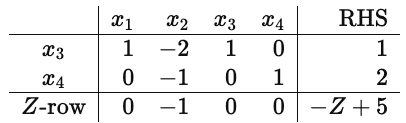

**基本信息：**

- Basis：$\{ x_{3},x_{4}\}$。
- 非基：$\{ x_{1},x_{2}\}$。
- 当前 BFS：$(x_1,x_2,x_3,x_4)=(0,0,1,2)$。
- 目标函数：$Z = 5 + x_{2}$。

选 entering variable：这里就可以看出端倪，因为 $x_{2}$ 没办法最小化Z。

假设我们选$x_{2}$作为了entering variable，当我们做ratio test时

$x_{3} + x_{1} - 2x_{2} = 1 \Rightarrow x_{3} = 1 - x_{1} + 2x_{2}$：令$x_{1} = 0$，

$$
x_{3} = 1 + 2x_{2}
$$

$x_{4} - x_{2} = 2 \Rightarrow x_{4} = 2 + x_{2}$：令$x_{1} = 0$，

$$
x_{4} = 2 + x_{2}
$$

没有任何 basic variable 会被压到 0，更不会变负。

图中 $x_2$ 可以无限增大，但目标是 $Z=5+x_2$，沿这一方向上升。因此该图对应的最小化问题有下界，当前 BFS 的目标值 $5$ 已最优。无下界还要求该无限可行方向能降低目标，具体例子见 Theorem 2。

#### Simplex算法的其他重要细节

不是所有 pivot 都是“好 pivot”：Simplex 的强大之处在于：它可以选择避免“让 Z 变坏”的 pivot。

可行域非空 ⇒ 至少存在一个 BFS：

$$
S^{\geq}\neq\varnothing\Longrightarrow\text{存在 BFS（基的规模取独立约束数）}
$$

#### Simplex算法流程图

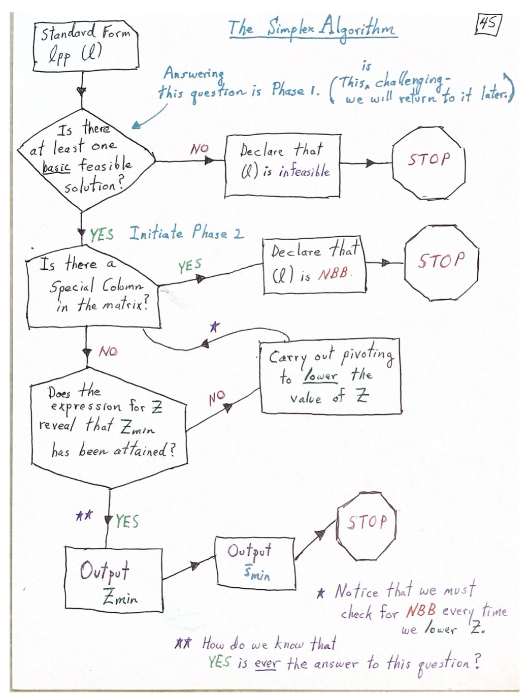

流程图中“lower the value”在退化情形应理解为“不增加目标值”；配合防循环规则才能保证有限终止。

## Lecture 4：Phase 2 的理论

### 4.1 Canonical dictionary

本节假设已有 BFS，约束独立。为简化下标，先把当前基变量重编号为 $x_1,\ldots,x_m$：

$$
x_i+\sum_{j=m+1}^n a_{ij}x_j=b_i,
\qquad i=1,\ldots,m,\qquad b_i\geq0.
$$

所有变量非负，当前目标为

$$
Z=Z_0+\sum_{j=m+1}^n\bar c_jx_j.
$$

这里 $a_{ij}$ 和 $b_i$ 表示**当前表**的系数与 RHS，$\bar c_j$ 表示当前 reduced cost，并不一定等于原模型的系数。若原始目标系数记为 $c$，则

$$
Z_0=c_B^TA_B^{-1}b^{\mathrm{orig}},\qquad
\bar c_j=c_j-c_B^TA_B^{-1}A_j.
$$

当前 BFS 为 $(b_1,\ldots,b_m,0,\ldots,0)^T$。以下判据都要求当前基本解可行。

本节的推导也使用 $Z=\sum_{j=m+1}^n c_jx_j-z_0$。这里 $c_j$ 表示当前 reduced cost，常数项为 $-z_0=Z_0$；它与原模型系数的区别由当前基决定。手写图中的 $c_j$ 和 $z_0+Z$ 采用这一记号。

### 4.2 Theorem 1：Optimality criterion（最优性判据）

**本节的3个Theorem都只适用于Phase 2**

**Theorem 1: Optimality Criterion**

#### Example：我们给一个有 $n = 5$个变量、$m = 2$ 条约束的 canonical form（basis 取 $B = \{ x_{1},x_{2}\}$，非基是 $x_{3},x_{4},x_{5}$）

**约束**

$$
\left\{ \begin{aligned}
& x_{1} + 2x_{3} - x_{4} + x_{5} = 4 \\
& x_{2} - x_{3} + 3x_{4} + 2x_{5} = 5 \\
& x_{j} \geq 0,j = 1,\ldots,5
\end{aligned} \right.
$$

注意 RHS：$b_{1} = 4,\ b_{2} = 5 \geq 0$。所以当前 BFS 是可行的。

**目标函数的 canonical 表达式（只含非基变量）**

$$
Z = 7x_{3} + 1x_{4} + 4x_{5} - 10
$$

非基变量系数全部$\geq 0$。

当前的BFS：显然可以，全部非负。

$$
{\overline{s}}_{B} = (x_{1},x_{2},x_{3},x_{4},x_{5}) = (4,5,0,0,0)
$$

**算这个 BFS 的目标值**

$$
Z({\overline{s}}_{B}) = 7 \cdot 0 + 1 \cdot 0 + 4 \cdot 0 - 10 = - 10
$$

所以我们已经得到一个可行值 $Z = - 10$。

现在有一个定理说：因为 $Z = 7x_{3} + 1x_{4} + 4x_{5} - 10$，且

$$
x_{3},x_{4},x_{5} \geq 0, 7,1,4 \geq 0
$$

所以

$$
7x_{3} + x_{4} + 4x_{5} \geq 0
$$

因此 $Z \geq - 10$。这句话对所有可行点都成立，所以全局最小值一定满足

$$
Z_{\min} \geq - 10
$$

但我们刚刚已经找到了一个可行点 ${\overline{s}}_{B}$使得 $Z({\overline{s}}_{B}) = - 10$，因此

$$
Z_{\min} = - 10
$$

$$
Z_{\min} \geq - 10
$$

并且 ${\overline{s}}_{B} = (4,5,0,0,0)$就是最优解。

#### 形式化表述：

Consider a *canonical form* linear programming problem in $n$ variables and $m$ constraints $\left( m\leq n \right)$, presented in the form $\min Z$ subject to

$$
x_{j} \geq 0(1 \leq j \leq n),
$$

and

$$
x_{i} + \sum_{j = m + 1}^{n} a_{ij}x_{j} = b_{i}(1 \leq i \leq m),
$$

where the current basis is $B = \{ x_{1},x_{2},\ldots,x_{m}\}$ (so the left $m \times m$block is $I_{m}$), and $b_{i} \geq 0$ for all $1 \leq i \leq m$.

Assume that the current expression for the objective function is

$$
Z = \sum_{j = m + 1}^{n} c_{j}x_{j} - z_{0}.
$$

If

$$
c_j\geq0\quad\text{for all }j = m + 1,\ldots,n,
$$

then the minimum value of the objective function is $Z_{\min} = - z_{0}$, and it is attained at the feasible point

$$
{\overline{s}}_{B} = (b_{1},b_{2},\ldots,b_{m},0,0,\ldots,0).
$$

In particular, ${\overline{s}}_{B}$ is an optimal feasible point.

#### Proof

我们要证明：在 canonical form 下，如果目标函数当前写成

$$
Z = \sum_{j = m + 1}^{n} c_{j}x_{j} - z_{0}.
$$

且对所有非基变量 $x_{m + 1},\ldots,x_{n}$都有 $c_{j} \geq 0$，那么最小值就是 $- z_{0}$，并且在当前 BFS ${\overline{s}}_{B} = (b_{1},\ldots,b_{m},0,\ldots,0)$ 取得。

##### Step 0：先明确 canonical form 给了我们什么

我们知道约束是

$$
x_{i} + \sum_{j = m + 1}^{n} a_{ij}x_{j} = b_{i}(1 \leq i \leq m)
$$

变量都要求非负 $x_{j} \geq 0(1 \leq j \leq n)$。

本节的可行 canonical LPP 要求 $b_{i} \geq 0$ for all $1 \leq i \leq m$。

这就意味着我们把非基变量取 0 时，得到的点${\overline{s}}_{B} = (b_{1},\ldots,b_{m},0,\ldots,0)$是feasible points（所有分量非负，且满足等式）。

目标函数被写成“只含非基变量”的形式：

$$
Z = \sum_{j = m + 1}^{n} c_{j}x_{j} - z_{0}
$$

##### Step 1：用当前 BFS 给出一个“可达到的值” ⇒ 得到上界

因为 ${\overline{s}}_{B}$是可行点，所以它的目标值是一个合法的可行目标值。我们把 ${\overline{s}}_{B}$代入目标函数。此时非基变量 $x_{m + 1} = \cdots = x_{n} = 0$，所以

$$
Z({\overline{s}}_{B}) = \sum_{j = m + 1}^{n} c_{j} \cdot 0 - z_{0} = - z_{0}.
$$

既然我们在做 minimization，那么“最小值”一定不可能大于任何一个可行点的目标值。因此：$Z_{\min} \leq Z({\overline{s}}_{B}) = - z_{0}.$

##### Step 2：证明任何可行点都满足 $Z \geq - z_{0}$⇒ 得到下界

$Z = \sum_{j = m + 1}^{n} c_{j}x_{j} - z_{0}$可以得到$Z + z_{0} = \sum_{j = m + 1}^{n} c_{j}x_{j}\ (1)$。

对于(1)式，约束要求$x_{j} \geq 0$，定理假设$c_{j} \geq 0$，因此$c_{j}x_{j} \geq 0$。

因此，$\sum_{j = m + 1}^{n} c_{j}x_{j} \geq 0\ (2)$。

合并(1)式和(2)式，我们可得

$$
Z + z_{0} \geq 0\ \  \Longrightarrow \ \ Z \geq - z_{0}
$$

这句话对所有可行点都成立，因此特别地，对最小值也成立：

$$
Z_{\min} \geq - z_{0}
$$

##### Step 3：上下界夹逼 ⇒ 最小值等于 $- z_{0}$

我们从Step 1可知$Z_{\min} \leq - z_{0}$。

我们从Step 2可知$Z_{\min} \geq - z_{0}$。

因此

$$
Z_{\min} = - z_{0}
$$

##### Step 4：最小值在 ${\overline{s}}_{B}$处取得 ⇒ ${\overline{s}}_{B}$最优

我们在 Step 1 已经算出

$$
Z({\overline{s}}_B)=-z_0
$$

而 Step 3 告诉我们最小值就是 $- z_{0}$。所以 ${\overline{s}}_{B}$达到了最小值，必然是最优点。

#### 总结：

在 canonical dictionary 里，如果你能把目标写成

$$
Z = - z_{0} + \sum_{j \in N}^{} c_{j}x_{j}
$$

并且所有非基变量系数 $c_{j} \geq 0$（min），那么因为 $x_{j} \geq 0$，右侧求和始终 $\geq 0$，所以

$$
Z \geq - z_{0}
$$

而当前 BFS 取到 $- z_{0}$，所以最优。

#### 应用：

和之前的例子一样，在 simplex 的 canonical form 中，目标函数可以写成只包含 non-basic variables 的形式（Z-row）。因此，在进入phase 2后，每一步 pivot 后，我们只需要检查 Z-row：

- 如果存在某个 non-basic variable 的系数 $c_j<0$，可把它作为候选进入变量；若可行步长为正，就能降低目标值，若步长为零则发生退化 pivot。
- 如果所有 $c_{j} \geq 0$，说明当前 BFS 已经达到最优值，算法终止。

Theorem 1 给出充分条件。退化时，最优点对应的某个基仍可能有负 reduced cost，因此判据暂不适用不等于该点一定非最优。

### 4.3 Theorem 2：Unboundedness criterion（无下界判据）

**Theorem 2: Unboundedness Criterion**

#### Example：我们给一个有 $n = 4$个变量、$m = 2$ 条约束的 canonical form（basis 取 $B = \{ x_{3},x_{4}\}$，非基是 $x_{1},x_{2}$）。例子和之前的NBB例子一致

| 行 | $x_1$ | $x_2$ | $x_3$ | $x_4$ | RHS |
| --- | ---: | ---: | ---: | ---: | --- |
| $x_{3}$ | 1 | -2 | 1 | 0 | 1 |
| $x_{4}$ | 0 | -1 | 0 | 1 | 2 |
| $Z$ | 0 | -1 | 0 | 0 | $Z-5$ |

基本信息：

- Basis：$\{ x_{3},x_{4}\}$。
- 非基：$\{ x_{1},x_{2}\}$。
- 当前 BFS：$(x_1,x_2,x_3,x_4)=(0,0,1,2)$。
- 目标函数：$Z=5-x_2$。

选 entering variable：$x_2$ 的 reduced cost 为 $-1$，增大它能够降低目标，因此选择 $x_2$ 进入。

假设我们选$x_{2}$作为了entering variable，当我们做ratio test时

$x_{3} + x_{1} - 2x_{2} = 1 \Rightarrow x_{3} = 1 - x_{1} + 2x_{2}$：令$x_{1} = 0$，

$$
x_{3} = 1 + 2x_{2}
$$

$x_{4} - x_{2} = 2 \Rightarrow x_{4} = 2 + x_{2}$：令$x_{1} = 0$，

$$
x_{4} = 2 + x_{2}
$$

没有任何 basic variable 会被压到 0，更不会变负。

**现在有一个定理说，我们可以通过下面3步直接判断NBB**

##### Step 1：确认non-basic variable，这里是$\{ x_{1},x_{2}\}$

##### Step 2：如果non-basic variable中有一个在z-row里$< 0$，满足条件1（$c_{2} = - 1 < 0$）

##### Step 3：查看对应的那一列（看 $x_{2}$这一列），如果这一列都$\leq 0$，则满足条件2（这里$\begin{pmatrix} - 2 \\ - 1 \end{pmatrix} \leq 0$）

我们称这一列为special column，并且如果出现special column，可以判定NBB。

#### 标准版定义：

If there exists a non-basic variable $x_{j}$ such that

- $c_{j} < 0$, and
- $a_{ij} \leq 0$ for all $i$,

then the corresponding column is a special column, and the LP is unbounded below (NBB).

#### 形式化表述：

If there exists $j^{*}$ with

$$
\underbrace{m+1\leq j^*\leq n}_{\text{non-basic range}}
$$

satisfying

- $c_{j^{*}} < 0$ and
- $a_{ij^{*}} \leq 0$ for each $i$ with $1 \leq i \leq m$

then the objective function is NBB. This is the analytic way of saying that if there is a “special” column then the problem is NBB.

#### Proof

先回忆 theorem 2 的条件：我们假设存在某个 $j^{*}$满足$c_{j^{*}} < 0$和$a_{ij^{*}} \leq 0$ for each $i$ with $1 \leq i \leq m$。这里的$j^{*}$对应的是一个non-basic variable 的列。

证明总策略：我们显式构造了一族点 ${\overline{s}}_{t}(t \geq 0)$，然后证明2件事情

- 对每个 $t \geq 0$，${\overline{s}}_{t}$ 都是 feasible solution。
- 当 $t \rightarrow \infty$时，$Z({\overline{s}}_{t}) \rightarrow - \infty$。

这样我们就知道：有无穷多个 feasible points，且它们的 objective values 可以降到任意小。所以 objective function NBB。

##### Step 1：构造 ${\overline{s}}_{t}$

- Set $x_{j^{*}} = t \geq 0.$（这里的$x_{j^{*}}$就是我们special column对应的那个variable，比如上述例子中$x_{j^{*}} = x_{2}$。）
- Set $x_{j} = 0\ \text{for each }j\ with\ m + 1 \leq j \leq n,j \neq j^{*}.$（其他 non-basic variables 全部继续保持 0，只有 $x_{j^{*}}$这一个 non-basic variable 被放开，设成 $t$。）
- Set $x_{i} = b_{i} - a_{i,j^{*}}t,i = 1,\ldots,m.$

在 canonical form 里，每个 basic variable 本来都写成

$$
x_{i} = b_{i} - \sum_{j = m + 1}^{n} a_{ij}x_{j}.
$$

现在除了 $x_{j^{*}}$之外，别的 non-basic variables 全都设成 0，所以只剩：

$$
x_{i} = b_{i} - a_{i,j^{*}}x_{j^{*}} = b_{i} - a_{i,j^{*}}t.
$$

##### Step 2：证明这些点都是 nonnegative

Since $a_{ij^{*}} \leq 0$, $- a_{ij^{*}} \geq 0$.

We are at phase 2 and we have BFS, so $b_{i} \geq 0$.

Therefore, $x_{i} = b_{i} - a_{i,j^{*}}t = b_{i} + \left( - a_{i,j^{*}}t \right) \geq 0.$ （这说明每个 basic variable 都非负。）

For non-basic variables, we have $x_{j^{*}} = t \geq 0$ and the remaining non-basic variables is 0. （这说明每个 non-basic variable 都非负。）

所以所有坐标都非负。

##### Step 3：定义 ${\overline{s}}_{t}$的完整形式

$$
{\overline{s}}_{t} = (b_{1} - a_{1,j^{*}}t,b_{2} - a_{2,j^{*}}t,\ldots,b_{m} - a_{m,j^{*}}t,0,\ldots,0,t,0,\ldots,0).
$$

- 前 $m$ 个 basic coordinates 按公式算。
- 后面的 non-basic coordinates 全是 0，只有第 $j^{*}$个位置是 $t$。

##### Step 4：证明 ${\overline{s}}_{t}$满足约束等式（这是为了证明这些点不只是非负，而且真的还在可行域里）

已知对任意 $i = 1,\ldots,m$，

$$
x_{i} + \sum_{j = m + 1}^{n} a_{ij}x_{j}
$$

代入 ${\overline{s}}_{t}$后变成

$$
(b_{i} - a_{i,j^{*}}t) + \sum_{j = m + 1}^{n} a_{ij}x_{j}.
$$

由于除了 $j^{*}$以外，所有 non-basic $x_{j} = 0$，所以这个求和里只有一个 surviving term，也就是：$a_{i,j^{*}}x_{j^{*}}$。

因此，$(b_{i} - a_{i,j^{*}}t) + a_{i,j^{*}}x_{j^{*}}$。并且代入$x_{j^{*}} = t \geq 0$，我们得到

$$
(b_{i} - a_{i,j^{*}}t) + a_{i,j^{*}}t = b_{i}.
$$

这恰好就是第 $i$ 条 canonical constraint 的右端。所以对每个 $i$，约束等式都成立。

我们得出结论：

$$
{\overline{s}}_{t}\text{ is a feasible solution for every }t \geq 0.
$$

##### Step 5：计算目标函数 $Z({\overline{s}}_{t})$

在 canonical form 中，我们知道basic columns 的 bottom-row entries 都是 0，因此

$$
Z = \sum_{j = m + 1}^{n} c_{j}x_{j} - z_{0}.
$$

因此我们得到

$$
Z({\overline{s}}_{t}) = c_{j^{*}}x_{j^{*}} - z_{0} = c_{j^{*}}t - z_{0}.
$$

##### Step 6：最后如何推出 $- \infty$

因为$c_{j^{*}} < 0$，因此当 $t \rightarrow \infty$时，

$$
c_{j^{*}}t - z_{0} \rightarrow - \infty.
$$

这说明了

$$
\lim_{t \rightarrow \infty} Z({\overline{s}}_{t}) = - \infty.
$$

所以 objective function 没有下界，即the problem is NBB。

### 4.4 Theorem 3：Quotient competition（最小比值检验）

**Theorem 3: Quotient Competition**

直观版：若当前存在负 reduced cost，且所选进入列至少有一个正约束系数，就可做一次最小比值检验与 pivot，使得

- 仍然保持 feasible
- 并且目标函数不增加；可行步长为正时严格下降

换句话来说，如果

- Theorem 1 的条件不满足 → 存在 $c_j<0$ → 当前表尚未通过该充分判据确认最优，可以选择负 reduced cost 的非基列。退化时当前点仍可能已经最优。
- Theorem 2 的条件不满足 → 当前没有 special column → 当前表尚未给出无下界证据；每个负 reduced cost 的候选列均有正系数可参加比值检验。

那说明，一定存在某一列

- $c_j<0$，对应目标下降的候选方向；实际下降量取决于可行步长
- 且该列至少有一个正数，可以做 pivot

#### 如何通过pivoting找到最优解（这是我们之前学习的pivoting的第三个用法）— 得到Basic Feasible Solution之后，“推动”我们走向最优解

Pivoting的核心结论：pivot 改变当前 basis；非退化 pivot 移动到相邻顶点，退化 pivot 保持同一个 BFS 点不变

还是看之前的例子

| 行 | $x_1$ | $x_2$ | $x_3$ | $x_4$ | RHS |
| --- | ---: | ---: | ---: | ---: | --- |
| $R_1$ | 1 | 0 | 5/3 | -5/3 | 5 |
| $R_2$ | 0 | 1 | 1/3 | 8/3 | 1 |
| $Z$ | 0 | 0 | $2/3$ | $-2/3$ | $Z-4$ |

当前BFS：$(5,1,0,0)$

##### Step 0：先判断处在哪种情况

Theorem 1 的条件不满足（需继续分析）：因为Z-row存在负的 $c_{j}$

$$
c_{3} = \frac{2}{3} > 0,c_{4} = - \frac{2}{3} < 0
$$

Theorem 2 的条件不满足（当前尚无无界证据）：因为没有special column，$x_{4}$这一列有正数8/3

所以我们进入Theorem 3（做 pivot）

##### Step 1：选 pivot column（也就是之前说的entering variable）

要求：$c_{j} < 0$

这里只有：$c_{4} = - 2/3 < 0$，因此pivot column = $x_{4}$

##### Step 2：选 pivot row（ratio test）

###### Step 2.1：筛选eligible rows。

只看column $j^{*}$ 上方的 entries $a_{1j^{*}},a_{2j^{*}},\ldots,a_{mj^{*}}$，只有满足

$$
a_{ij^{*}} > 0
$$

才有资格参加ratio test。这里 $x_4$ 列的 reduced cost 为 $-2/3$，其约束系数为 $-5/3$ 和 $8/3$。只有第二行的 $8/3>0$，因此只有第二行参加 ratio test。

###### Step 2.2：对于每个 eligible row，计算

$$
\frac{b_{i}}{a_{ij^{*}}}
$$

- $b_{i}$ 是这一行RHS
- $a_{ij^{*}}$ 是这一行在 pivot column 里的 entry

这里的候选人只有一个，因此

$$
\frac{b_{i}}{a_{ij^{*}}} = \frac{1}{8/3} = \frac{3}{8}
$$

##### Step 3：选最小 ratio

$$
\min\left\{ \frac{b_{i}}{a_{ij^{*}}}:a_{ij^{*}} > 0 \right\}
$$

取得最小值的那一行，就是 pivot row。对应的 basic variable 就是 leaving variable。

##### Step 4：确定 pivot position（pivot row 和 pivot column 的交点）

特殊情况：如果我们出现了多个$c_{j} < 0$的column，理论上选任意一个都可以，但是为了使本轮目标下降量最大，我们可以使用

$$
- z_{0}' = - z_{0} + \frac{c_{j^{*}}b_{i^{*}}}{a_{i^{*},j^{*}}}
$$

计算。具体来说

针对每个候选column，使用ratio test找出该column的pivoting position，这是我们的$a_{i^{*},j^{*}}$。

使用公式

$$
- z_{0}' = - z_{0} + \frac{c_{j^{*}}b_{i^{*}}}{a_{i^{*},j^{*}}}
$$

也就是对于每一个候选column，算出下一轮 BFS 的目标值：

$$
\text{新目标值}=\text{原目标值}+\frac{\text{进入列的 reduced cost}\times\text{主元行 RHS}}{\text{主元}}
$$

对比所有候选column的新目标函数值，选出本轮下降量最大的候选 column 作为 pivot column，并选择对应的pivot row。

#### 几个需要注意的情况（分别对每个候选 column 检查）

- 正常情况 — 有多个 eligible rows：计算每一个的ratio，谁最小谁赢。
- 正常情况 — 只有1个 eligible row：直接作为pivot row。
- 特殊情况 — ratio test的两个ratios算出来一样：那么两行都可以作为 pivot row。
- 特殊情况 — 1个 eligible row 的 ratio 是 0：这等价于$b_{i} = 0$，因为$a_{ij^{*}} > 0$。这说明 pivot 后目标值不严格下降，这是 degeneracy 的来源之一。
- 特殊情况 — 根本没有 eligible row：属于NBB，Theorem 2判断。

#### 形式化表述：

Assume the current tableau is in canonical form and corresponds to a feasible basic solution, and that neither Theorem 1 nor Theorem 2 applies. Then there exists a non-basic variable $x_{j^{*}}$ such that:

$$
c_{j^*}<0\quad\text{and}\quad a_{i,j^*}>0\quad\text{for at least one }i.
$$

**Let $i^{*}$ be a row that:**

- is eligible ($a_{i^{*},j^{*}} > 0$)
- **and satisfies:**

    $$
    \frac{b_{i^{*}}}{a_{i^{*},j^{*}}} = \min\left\{ \frac{b_{i}}{a_{i,j^{*}}}:a_{i,j^{*}} > 0 \right\}
    $$

**Then, pivoting at $\left( i^{*},j^{*} \right)$produces:**

- New basis: $old\ basis \cup \{ x_{j^{*}}\} - \{ x_{i^{*}}\}$
- The new solution is still feasible.
- The objective function does not increase.

    $$
    Z_{new} = - z_{0} + c_{j^{*}} \cdot \frac{b_{i^{*}}}{a_{i^{*},j^{*}}} \leq - z_{0}
    $$

- If $b_{i^{*}} > 0$, the objective function decreases strictly.

这种比较只最大化当前一轮的下降量，不保证总迭代次数最少。退化时还需防循环规则。

### 4.5 Pivot 更新公式与 Theorem 3 的证明

#### Proof

##### 到底要证什么

- 新的 basic solution 仍然 feasible：我们会做pivoting，pivoting后会有新的basic solution，证明其依旧大于等于0。
- 目标函数值不增加：要证明 pivoting 后的新常数项满足

    $$
    - z_{0}' = - z_{0} + \frac{c_{j^{*}}b_{i^{*}}}{a_{i^{*},j^{*}}}
    $$

##### 重要的notation

- 行index：$i = 1,\ldots,m$

    表示第 $i$ 个constraint / row

    对应一个basic variable

- 列index：$j = m + 1,\ldots,n$

    表示第 $j$ 个non-basic variable

###### 特殊index

- $i^{*}$：pivot row，我们quotient competition 的 winner，满足

    $$
    \frac{b_{i^{*}}}{a_{i^{*},j^{*}}} = \min_{i:a_{i,j^*}>0}\frac{b_i}{a_{i,j^*}}
    $$

- $j^{*}$：pivot column，选中的entering variable，满足

    $$
    c_{j^{*}} < 0
    $$

###### 变量层面的notation

- $x_{1},\ldots,x_{m}$：basic variables
- $x_{m + 1},\ldots,x_{n}$：non-basic variables
- Pivoting发生时：$x_{j^{*}}$进入basis；$x_{i^{*}}$离开basis

###### 矩阵元素notation

- $a_{ij}$：第 $i$ 行、第 $j$ 列的 coefficient
- $a_{i^{*}j^{*}}$：pivoting entry / pivoting position，必须满足$a_{i^{*}j^{*}} > 0$

###### RHS

- $b_{i}$：pivot前，第 $i$个 basic variable 的值

- ${b'}_{j^{*}}$：pivot后，entering variable 的 RHS。因为pivoting的过程中$x_{j^{*}}$进入basis；$x_{i^{*}}$离开basis，因此原来那条 pivot row，虽然还是“那一行”，但它不再代表 $x_{i^{*}}$了，而是改成代表$x_{j^{*}}$。因此我们在 pivot 之后，开始用“新 basic variable 的名字”给这一行编号，记为${b'}_{j^{*}}$。

    $$
    b_{j^{*}}' = \frac{b_{i^{*}}}{a_{i^{*},j^{*}}}
    $$

- ${b'}_{i}$：pivot后的其他行。

##### Step 0：pivot 前矩阵长什么样

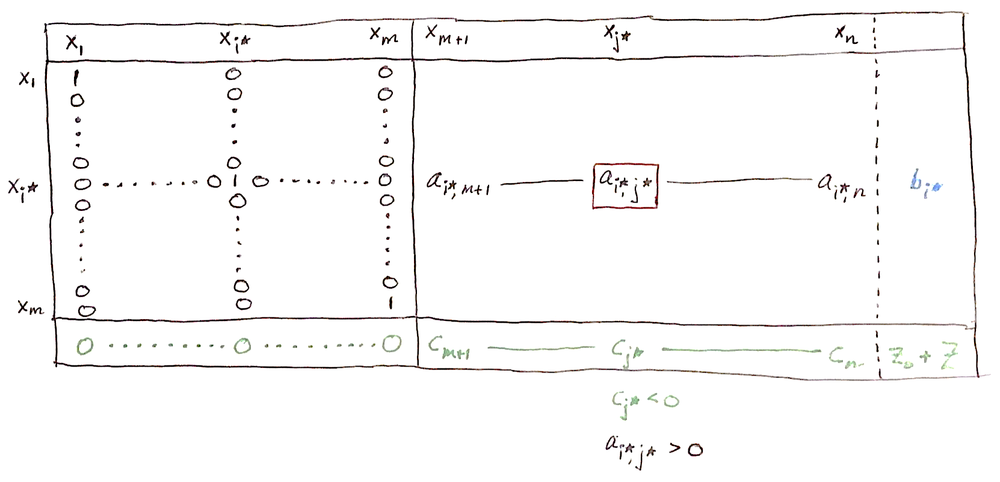

在目前的setting中，当前basis是$\{ x_{1},\ \ldots,x_{m}\}$，所以左半部分是单位矩阵 $I_{m}$，右半部分是 non-basic columns。我们选中了 pivot column $j^{*}$，也选中了 pivot row $i^{*}$。此时已知：

$$
c_{j^{*}} < 0,\ \ a_{i^{*},j^{*}} > 0.
$$

并且 $i^{*}$是 quotient competition 的 winner。
**我们需要重点关注3个位置**

- Pivot entry：$a_{i^{*},j^{*}} > 0$
- Pivot row 的 RHS：$b_{i^{*}}$
- Z-row 在 pivot column 的绿色 entry：$c_{j^{*}} < 0$

##### Step 1：Pivot的第一部分 —— 先把 pivot entry 变成 1

目前的pivot entry是$a_{i^{*},j^{*}}$，因此如果记原来的 pivot row 是 $R_{x_{i^{*}}}$，那么变成

$$
R_{x_{i^{*}}} \leftarrow \frac{1}{a_{i^{*},j^{*}}}R_{x_{i^{*}}}
$$

操作后：

- 原来 pivot position 是 $a_{i^{*},j^{*}}$，除掉以后，这里变成 1。
- pivot row 现在变成了“以 $x_{j^{*}}$为主元”的那一行，也就是说它以后要对应新的 basic variable $x_{j^{*}}$。

因此：这一行的RHS变成

$$
b_{j^{*}}' = \frac{b_{i^{*}}}{a_{i^{*},j^{*}}}
$$

对于任何非 pivot 的 non-basic 列 $j \neq j^{*}$，这行的系数变成

$$
\frac{a_{i^{*},j}}{a_{i^{*},j^{*}}}
$$

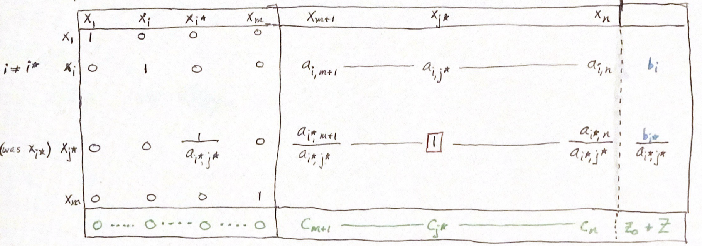

重要结论：$b_{j^{*}}'$已经自动非负，因为

- 原来当前 BFS feasible，所以 $b_{i^{*}} \geq 0$
- pivot row 必须 eligible，所以 $a_{i^{*},j^{*}} > 0$

因此，

$$
b_{j^{*}}' = \frac{b_{i^{*}}}{a_{i^{*},j^{*}}} \geq 0.
$$

##### Step 2：Pivot的第二部分 —— 把 pivot column 其他位置全消成 0

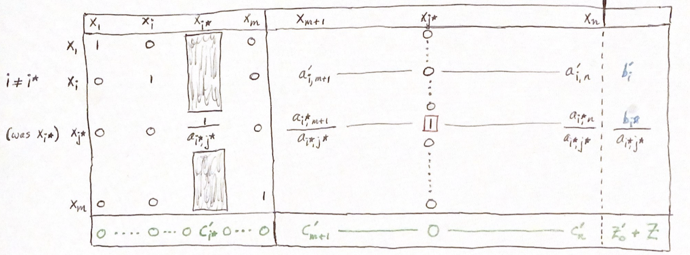

对非 pivot row $i \neq i^{*}$：如果第 $i$行在 pivot column 上的 entry 是 $a_{i,j^{*}}$，那就做

$$
R_{x_{i}} \leftarrow R_{x_{i}} - a_{i,j^{*}}R_{x_{j^{*}}}.
$$

对 objective row：objective row 在 pivot column 上的绿色 entry 是 $c_{j^{*}}$。为了把它也消成 0，要做：

$$
R \leftarrow R - c_{j^{*}}R_{x_{j^{*}}}.
$$

**总结一下row operations 之后，能读出哪些公式**

**非 pivot row、非 pivot column 的新系数：**对任意 $i \neq i^{*}$，以及任意 non-basic 列 $j \neq j^{*}$，新系数是

$$
a_{ij}' = a_{ij} - a_{i,j^{*}} \cdot \frac{a_{i^{*},j}}{a_{i^{*},j^{*}}}.
$$

本质上就是原系数减去“本行 pivot-column entry × pivot-row 该列系数”。

**非 pivot row 的新 RHS：**

$$
b_{i}' = b_{i} - a_{i,j^{*}} \cdot \frac{b_{i^{*}}}{a_{i^{*},j^{*}}}(i \neq i^{*})
$$

**新的 objective coefficients：对于任意 $j \neq j^{*}$的 non-basic column，**

$$
c_{j}' = c_{j} - c_{j^{*}} \cdot \frac{a_{i^{*},j}}{a_{i^{*},j^{*}}}.
$$

**新的目标函数常数项：**

$$
z_{0}' = z_{0} - c_{j^{*}} \cdot \frac{b_{i^{*}}}{a_{i^{*},j^{*}}}.
$$

等价于：

$$
- z_{0}' = - z_{0} + \frac{c_{j^{*}}b_{i^{*}}}{a_{i^{*},j^{*}}}.
$$

##### Step 3：证明目标函数值下降

$$
- z_{0}' = - z_{0} + \frac{c_{j^{*}}b_{i^{*}}}{a_{i^{*},j^{*}}}
$$

由于$c_{j^{*}} < 0,\ b_{i^{*}} \geq 0,\ a_{i^{*}j^{*}} > 0$，因此

$$
\frac{c_{j^{*}}b_{i^{*}}}{a_{i^{*},j^{*}}} \leq 0.
$$

于是：$- z_{0}' \leq - z_{0}$，这说明pivot 后的新 objective value 不会比旧的更大；在 minimization 里，这意味着值变小了或者不变。

什么时候严格下降：如果 $b_{i^{*}} > 0$，那上面的修正项就是严格负数

$$
\frac{c_{j^{*}}b_{i^{*}}}{a_{i^{*},j^{*}}} < 0
$$

因此$- z_{0}' < - z_{0}$，这就是严格下降。

什么时候可能不下降：如果 $b_{i^{*}} = 0$，那修正项等于 0，所以$- z_{0}' = - z_{0}$。

##### Step 4：证明feasibility

已知 $b_{j^{*}}' = \frac{b_{i^{*}}}{a_{i^{*},j^{*}}} \geq 0$，需要证明对每个 $i \neq i^{*}$，

$$
b_{i}' = b_{i} - a_{i,j^{*}} \cdot \frac{b_{i^{*}}}{a_{i^{*},j^{*}}} \geq 0
$$

###### Case 1：如果 $a_{i,j^{*}} \leq 0$

由于$a_{i,j^{*}} \leq 0,\ b_{i^{*}} \geq 0,\ a_{i^{*},j^{*}} > 0$，因此

$$
- a_{i,j^{*}} \cdot \frac{b_{i^{*}}}{a_{i^{*},j^{*}}} \geq 0.
$$

于是

$$
b_{i}' = b_{i} - a_{i,j^{*}} \cdot \frac{b_{i^{*}}}{a_{i^{*},j^{*}}} = b_{i} + \left( - a_{i,j^{*}} \cdot \frac{b_{i^{*}}}{a_{i^{*},j^{*}}} \right) \geq b_{i}.
$$

而原来当前 BFS feasible，所以 $b_{i} \geq 0$。

因此，$b_{i}' \geq 0$。

###### Case 2：如果 $a_{i,j^{*}} > 0$

由于 $a_{i,j^{*}} > 0$，第 $i$行是 eligible row，而我们知道 pivot row $i^{*}$是 quotient competition 的 winner，所以：

$$
\frac{b_{i^{*}}}{a_{i^{*},j^{*}}} \leq \frac{b_{i}}{a_{i,j^{*}}}\  \Longleftrightarrow \ \frac{b_{i}}{a_{i,j^{*}}} \geq \ \frac{b_{i^{*}}}{a_{i^{*},j^{*}}}.
$$

现在因为 $a_{i,j^{*}} > 0$，我们可以两边同乘 $a_{i,j^{*}}$，不改变不等号方向，得到

$$
b_{i} \geq a_{i,j^{*}} \cdot \frac{b_{i^{*}}}{a_{i^{*},j^{*}}}.
$$

把右边移到左边：

$$
b_{i} - a_{i,j^{*}} \cdot \frac{b_{i^{*}}}{a_{i^{*},j^{*}}} \geq 0.
$$

因为$b_{i}' = b_{i} - a_{i,j^{*}} \cdot \frac{b_{i^{*}}}{a_{i^{*},j^{*}}}$，所以

$$
b_{i}' \geq 0.
$$

证明结束：我们发现ratio test 不是拍脑袋的规则，它正是保证新解仍 feasible 的精确条件。

### 4.6 多个进入变量与 tie

若有多个 $\bar c_q<0$ 的非基列，可对每列分别计算 $\theta_q$ 和下一步目标值

$$
Z_0+\bar c_q\theta_q.
$$

选择该值最小的列，可使**这一轮**的目标下降量最大。这不保证总 pivot 次数最少，也不能代替防循环规则。若候选列无正系数，则直接得到无下界证据，无需与有限步长比较。

最小比值检验的几种情况：

| 情况 | 处理与结论 |
| --- | --- |
| 多个 eligible rows | 计算各比值，取最小值 |
| 只有一个 eligible row | 该行离开，仍需算步长 |
| 多行达到同一最小比值 | 任一并列行可离开；实现时可用 Bland 规则 |
| 最小比值为零 | 发生 degenerate pivot，解与目标值均不变 |
| 没有 eligible row 且 $\bar c_q<0$ | 目标无下界 |

若两个以上行在正的最小比值处并列，本轮仍有正步长、目标仍严格下降，但新 BFS 中至少有一个留在基中的变量变为零，因此新 BFS 退化。

### 4.7 Degeneracy（退化）与循环

**Degeneracy**

#### Example：比如下面这个tableau

| 行 | $x_1$ | $x_2$ | $x_3$ | $x_4$ | RHS |
| --- | ---: | ---: | ---: | ---: | --- |
| $x_{1}$ | 1 | 0 | 1 | 0 | 0 |
| $x_{2}$ | 0 | 1 | 1 | 0 | 2 |
| $Z$ | 0 | 0 | -1 | 0 | $Z$ |

**已知条件**

- 当前 basis：$\{ x_{1},x_{2}\}$
- 当前basic solution：$x_{1} = 0,\ x_{2} = 2,\ x_{3} = 0,\ x_{4} = 0$
- 当前目标函数：$Z = - x_{3}$

##### Step 1：选 entering variable，看z-row

$$
c_{3} = - 1 < 0
$$

entering variable = $x_{3}$

##### Step 2：做ratio test，看$x_{3}$列

| row       | $a_{i3}$ | RHS | ratio   |
|-----------|------------|-----|---------|
| $x_{1}$ | 1          | 0   | 0/1 = 0 |
| $x_{2}$ | 1          | 2   | 2/1 = 2 |

很明显最小ratio是0，因此pivot row = 第一行（$x_{1}$）

##### Step 3：做pivot，pivoting position是 $(\text{row }x_1,\text{col }x_3)$

| 行 | $x_1$ | $x_2$ | $x_3$ | $x_4$ | RHS |
| --- | ---: | ---: | ---: | ---: | --- |
| $x_{3}$ | 1 | 0 | 1 | 0 | 0 |
| $x_{2}$ | -1 | 1 | 0 | 0 | 2 |
| $Z$ | 1 | 0 | 0 | 0 | $Z$ |

我们发现basis变了 $\left\{ x_{1},x_{2} \right\} \rightarrow \{ x_{3},x_{2}\}$，但是solution没变，Z没变。

$$
x_{1} = 0,\ x_{2} = 2,\ x_{3} = 0,\ x_{4} = 0
$$

原因解析：所选 pivot row 的 RHS 为 $b_{i^*}=0$，主元本身为 $a_{i^*j^*}=1>0$；因此最小比值为零。

Theorem 3 的 corollary：如果pivot row满足$b_{i^{*}} > 0$，那么Z会下降。但是如果$b_{i^{*}} = 0$，此时Z不变，这叫做degenerate pivot。虽然associated basic solution 不变，但 basis 变了。

原因：关键在于$b_{i^{*}} = 0$。

- pivot 后 entering variable 的值是：$x_{j^{*}} = \frac{b_{i^{*}}}{a_{i^{*},j^{*}}} = 0$，entering variable = 0。
- leaving variable 原本就是：$x_{i^{*}} = 0$

所以你做了一个0和0的交换。

#### Ratio Test 的五种情况

- 正常情况 — 有多个 eligible rows：计算每一个的ratio，谁最小谁赢。
- 正常情况 — 只有1个 eligible row：直接作为pivot row。
- 特殊情况 — ratio test的两个ratios算出来一样：那么两行都可以作为 pivot row。
- 特殊情况 — 1个 eligible row 的 ratio 是 0：这等价于$b_{i} = 0$，因为$a_{ij^{*}} > 0$。这说明 pivot 后目标值不严格下降，这是 degeneracy 。
- 特殊情况 — 根本没有 eligible row：属于NBB，Theorem 2判断。

由于存在零步长，任意选取进入变量和并列离开变量可能导致 cycling（循环）。一种防循环方法是 **Bland's rule**：

1. 在所有 reduced cost 为负的非基变量中，选择变量下标最小者进入。
2. 在达到最小比值的各行中，选择对应基变量下标最小者离开。

在精确运算下，该规则防止重复基并保证单纯形法有限终止。不能仅凭“候选基有限”就断言任意 pivot 规则都会终止。

## Lecture 5：Phase 1 的理论与标准方法

### 5.1 为什么需要人工变量

#### 回顾我们之前学习的Phase 1

Phase 1的目的：找到确定Canonical Form，选择起点basis，开始pivoting得到basic feasible solution。

停止条件：得到basic feasible solution

手工例子通过负 RHS 行中的非零系数尝试换基，并逐轮检查可行性；一般情形使用人工变量辅助问题确定 pivot position。

但是这个方法不够标准化，这套方法本质上是在“手动试图构造一个好 basis”。而现在本节介绍标准 Simplex 方法，通过引入 Artificial Variables，来达到Phase 1的目的 —— 和之前一样，找到一个 good basis，也就是找到一个 associated basic solution feasible 的 basis。

#### Simplex 方法Phase 1

Phase 1目标：找到一个 good basis，也就是找到一个 associated basic solution feasible 的 basis。

换句话说：我们要为原问题找到一个 BFS，然后才能启动 Phase 2。

现在方法的逻辑：构造一个 auxiliary lpp，让 simplex algorithm 自己帮我们找 good basis。

### 5.2 Phase 1 的可行性判据

辅助问题总是可行，且 $w\geq0$，因此有有限最优值，不可能 NBB。

$$
\text{原问题可行}
\quad\Longleftrightarrow\quad
w_{\min}=0.
$$

**证明**：若 $x$ 原本可行，则 $(x,0)$ 辅助可行且 $w=0$。反过来，若辅助可行点满足 $w=0$，由于人工变量全部非负，必有 $y_i=0$，故其原变量部分满足 $Ax=b,x\geq0$。

因此：

- 若 $w_{\min}>0$，人工变量不可能全部为零，原问题不可行。
- 若 $w_{\min}=0$，已找到原问题可行点；若还有人工变量留在基中，先按 Lecture 6 清理，再恢复原目标进入 Phase 2。

只有在已经**证明辅助问题达到最优**后，才能用正的 $w$ 宣布原问题不可行。相反，一旦找到 $w=0$，由已知下界 $0$ 即可立即确认辅助目标最优，不必强求当前所有 reduced costs 非负。

### 5.3 饲料问题的 Phase 1：构造辅助问题

#### Example：我们用下面这个例子贯穿整个流程

$$
\min Z = 10x_{1} + 4x_{2}
$$

subject to

$$
x_{1},x_{2} \geq 0,\ \left\{ \begin{aligned}
& 3x_{1} + 2x_{2} \geq 60 \\
& 7x_{1} + 2x_{2} \geq 84 \\
& 3x_{1} + 6x_{2} \geq 72
\end{aligned} \right.
$$

准备工作：先把原问题变成 Standard Form并检查Canonical Form。

和之前的方法一样，因为原约束是“$\geq$”，所以要引入 surplus variables。我们设$x_{3},x_{4},x_{5} \geq 0$。

$$
\left\{ \begin{aligned}
& 3x_{1} + 2x_{2} - x_{3} = 60 \\
& 7x_{1} + 2x_{2} - x_{4} = 84 \\
& 3x_{1} + 6x_{2} - x_{5} = 72
\end{aligned} \right.
$$

仔细查看这里的情况，写成hyper augmented matrix。

| 行 | $x_1$ | $x_2$ | $x_3$ | $x_4$ | $x_5$ | RHS |
| --- | ---: | ---: | ---: | ---: | ---: | --- |
| $R_1$ | 3 | 2 | -1 | 0 | 0 | 60 |
| $R_2$ | 7 | 2 | 0 | -1 | 0 | 84 |
| $R_3$ | 3 | 6 | 0 | 0 | -1 | 72 |
| $Z$ | 10 | 4 | 0 | 0 | 0 | $Z$ |

我们发现这没有在Canonical Form里，因为不存在单位列，这个系统没有直接 reveal 一个 good basis。

#### Step 0：Preprocessing。

我们需要multiply by $- 1$ any constraint equality whose right hand number is negative

解读：如果某个等式RHS是负数，把整条约束乘以 $- 1$。

对于本例，我们不需要preprocess。

#### Step 1：引入 Artificial Variables

设$x_{6},x_{7},x_{8} \geq 0$，把系统改成

$$
(*)\left\{ \begin{aligned}
& 3x_{1} + 2x_{2} - x_{3} + x_{6} = 60 \\
& 7x_{1} + 2x_{2} - x_{4} + x_{7} = 84 \\
& 3x_{1} + 6x_{2} - x_{5} + x_{8} = 72
\end{aligned} \right.
$$

写出hyper augmented matrix。

| 行 | $x_1$ | $x_2$ | $x_3$ | $x_4$ | $x_5$ | $x_6$ | $x_7$ | $x_8$ | RHS |
| --- | ---: | ---: | ---: | ---: | ---: | ---: | ---: | ---: | --- |
| $R_1$ | 3 | 2 | -1 | 0 | 0 | 1 | 0 | 0 | 60 |
| $R_2$ | 7 | 2 | 0 | -1 | 0 | 0 | 1 | 0 | 84 |
| $R_3$ | 3 | 6 | 0 | 0 | -1 | 0 | 0 | 1 | 72 |
| $Z$ | 10 | 4 | 0 | 0 | 0 | 0 | 0 | 0 | $Z$ |

我们发现$x_{6},x_{7},x_{8}$的列组成了一个单位矩阵，因此The Artificial Variables form a good basis for $(*)$.

初始Basis：$B = \{ x_{6},x_{7},x_{8}\}$。

对应的 associated basic solution 是：

$$
x_{1} = x_{2} = x_{3} = x_{4} = x_{5} = 0,x_{6} = 60,x_{7} = 84,x_{8} = 72
$$

这是一个 feasible basic solution。

#### Step 2：构造 auxiliary LPP

##### Step 2.1：定义 $w = x_{6} + x_{7} + x_{8}$。

于是我们可以写出一个auxiliary LPP

$$
\left( l_{aux} \right)\min w = x_{6} + x_{7} + x_{8}
$$

subject to

$$
x_{1},x_{2},x_{3},x_{4},x_{5},x_{6},x_{7},x_{8} \geq 0
$$

and

$$
\left\{ \begin{aligned}
& 3x_{1} + 2x_{2} - x_{3} + x_{6} = 60 \\
& 7x_{1} + 2x_{2} - x_{4} + x_{7} = 84 \\
& 3x_{1} + 6x_{2} - x_{5} + x_{8} = 72
\end{aligned} \right.
$$

##### Step 2.2：把auxiliary LPP写成Canonical Form。

目前objective function还写在basic variables 里，所以

$$
x_{6} = 60 - 3x_{1} - 2x_{2} + x_{3}
$$

$$
x_{7} = 84 - 7x_{1} - 2x_{2} + x_{4}
$$

$$
x_{8} = 72 - 3x_{1} - 6x_{2} + x_{5}
$$

相加得到$w = 216 - 13x_{1} - 10x_{2} + x_{3} + x_{4} + x_{5}$，这就是 $w$ 的 canonical expression。

#### 解读：为什么最小化 $w$有用

**Crucial Fact：原系统$(l)$有解，if and only if 新系统$(*)$有一个解满足**

$$
x_{6} = x_{7} = x_{8} = 0
$$

**为什么**

- 因为如果原问题有解 $\left( x_{1},\ldots,x_{5} \right)$，那么把 $x_{6} = x_{7} = x_{8} = 0$加进去，就得到 $(*)$的一个解。
- 反过来，如果 $(*)$有一个解使 $x_{6} = x_{7} = x_{8} = 0$，那么去掉这三个 artificial variables，剩下的 $\left( x_{1},\ldots,x_{5} \right)$就是原问题 $(l)$的解。

结论：$(l)\ feasible \Longleftrightarrow (*)\ \text{has a solution with }x_{6} = x_{7} = x_{8} = 0$

这和 $w$的关系是什么：因为$x_{6},x_{7},x_{8} \geq 0$，所以

$$
w = x_{6} + x_{7} + x_{8} \geq 0
$$

并且：

$$
w = 0 \Longleftrightarrow x_{6} = x_{7} = x_{8} = 0
$$

#### Great Conclusions

- First Great Conclusion: If $w_{\min} = 0$ then $(l)$ is feasible; after removing any remaining zero-valued artificial basic variables and redundant rows, Phase 2 can start from a feasible basis.

- Second Great Conclusion: If $w_{\min} > 0$ (since artificial variables cannot all be 0 at any auxiliary feasible point), $(l)$ is infeasible.

### 5.4 饲料问题的 Phase 1：三次 pivot

#### Step 3：在 $\left( l_{aux} \right)$上应用你已经会的 Phase 2

书写auxiliary LPP的hyper augmented matrix

| 行 | $x_1$ | $x_2$ | $x_3$ | $x_4$ | $x_5$ | $x_6$ | $x_7$ | $x_8$ | RHS |
| --- | ---: | ---: | ---: | ---: | ---: | ---: | ---: | ---: | --- |
| $R_1$ | 3 | 2 | -1 | 0 | 0 | 1 | 0 | 0 | 60 |
| $R_2$ | 7 | 2 | 0 | -1 | 0 | 0 | 1 | 0 | 84 |
| $R_3$ | 3 | 6 | 0 | 0 | -1 | 0 | 0 | 1 | 72 |
| $w$ | -13 | -10 | 1 | 1 | 1 | 0 | 0 | 0 | $w-216$ |

检测Theorem 1是否适用：$c_{1} = - 13 < 0,\ c_{2} = - 10 < 0$，因此 Theorem 1 不适用。

##### Quotient Competition 1：

这里$x_{1}$和$x_{2}$都可以作为pivoting column，因此我们可以借助Theorem 3的推论判断哪个会让目标函数降低得更快。

$$
Z_{new} = - z_{0} + c_{j^{*}} \cdot \frac{b_{i^{*}}}{a_{i^{*},j^{*}}}
$$

根据该公式，我们分别进行ratio test

如果使用$x_{1}$，

$$
\frac{60}{3} = 20,\frac{84}{7} = 12,\frac{72}{3} = 24
$$

最小的是12，因此winning row 是第二行，也就是 $x_{7}$-row。因此

$$
w_{\mathrm{new}}=216+(-13)\cdot\frac{84}{7}=60
$$

如果使用$x_{2}$，

$$
\frac{60}{2} = 30,\frac{84}{2} = 42,\frac{72}{6} = 12
$$

最小的是12，因此winning row 是第三行，也就是 $x_{8}$-row。因此

$$
w_{\mathrm{new}}=216+(-10)\cdot\frac{72}{6}=96
$$

Pivoting结果：最终因为使用$x_{1}$可以让目标函数下降得更快，因此使用$x_{1}$作为entering variable；$x_{7}$是leaving variable。新basis是$B = \{ x_{6},x_{1},x_{8}\}$。

| 行 | $x_1$ | $x_2$ | $x_3$ | $x_4$ | $x_5$ | $x_6$ | $x_7$ | $x_8$ | RHS |
| --- | ---: | ---: | ---: | ---: | ---: | ---: | ---: | ---: | --- |
| $R_1$ | 0 | 8/7 | -1 | 3/7 | 0 | 1 | -3/7 | 0 | 24 |
| $R_2$ | 1 | 2/7 | 0 | -1/7 | 0 | 0 | 1/7 | 0 | 12 |
| $R_3$ | 0 | 36/7 | 0 | 3/7 | -1 | 0 | -3/7 | 1 | 36 |
| $w$ | 0 | $-44/7$ | 1 | $-6/7$ | 1 | 0 | $13/7$ | 0 | $w-60$ |

$$
w - 60 = - \frac{44}{7}x_{2} + x_{3} - \frac{6}{7}x_{4} + x_{5} + \frac{13}{7}x_{7}
$$

$$
w = - \frac{44}{7}x_{2} + x_{3} - \frac{6}{7}x_{4} + x_{5} + \frac{13}{7}x_{7} + 60
$$

##### Quotient Competition 2：

同之前方法，此处采用同样的比较步骤，我们这里选$x_{2}$列

进行ratio test

$$
\frac{24}{8/7} = 21,\frac{12}{2/7} = 42,\frac{36}{36/7} = 7
$$

最小的是7，因此winning row 是第三行，也就是 $x_{8}$-row。

Pivoting结果：$x_{2}$是entering variable；$x_{8}$是leaving variable。新basis是$B = \{ x_{6},x_{1},x_{2}\}$。

| 行 | $x_1$ | $x_2$ | $x_3$ | $x_4$ | $x_5$ | $x_6$ | $x_7$ | $x_8$ | RHS |
| --- | ---: | ---: | ---: | ---: | ---: | ---: | ---: | ---: | --- |
| $R_1$ | 0 | 0 | -1 | 1/3 | 2/9 | 1 | -1/3 | -2/9 | 16 |
| $R_2$ | 1 | 0 | 0 | -1/6 | 1/18 | 0 | 1/6 | -1/18 | 10 |
| $R_3$ | 0 | 1 | 0 | 1/12 | -7/36 | 0 | -1/12 | 7/36 | 7 |
| $w$ | 0 | 0 | 1 | $-1/3$ | $-2/9$ | 0 | $4/3$ | $11/9$ | $w-16$ |

$$
w - 16 = x_{3} - \frac{1}{3}x_{4} - \frac{2}{9}x_{5} + \frac{4}{3}x_{7} + \frac{11}{9}x_{8}
$$

$$
w = x_{3} - \frac{1}{3}x_{4} - \frac{2}{9}x_{5} + \frac{4}{3}x_{7} + \frac{11}{9}x_{8} + 16
$$

##### Quotient Competition 3：

同之前方法，此处采用同样的比较步骤，我们这里选$x_{4}$列

进行ratio test，这里只有2个eligible rows

$$
\frac{16}{1/3} = 48,\frac{7}{1/12} = 84
$$

最小的是48，因此winning row 是第一行，也就是 $x_{6}$-row。

Pivoting结果：$x_{4}$是entering variable；$x_{6}$是leaving variable。新basis是$B = \{ x_{4},x_{1},x_{2}\}$。

| 行 | $x_1$ | $x_2$ | $x_3$ | $x_4$ | $x_5$ | $x_6$ | $x_7$ | $x_8$ | RHS |
| --- | ---: | ---: | ---: | ---: | ---: | ---: | ---: | ---: | --- |
| $R_1$ | 0 | 0 | -3 | 1 | 2/3 | 3 | -1 | -2/3 | 48 |
| $R_2$ | 1 | 0 | -1/2 | 0 | 1/6 | 1/2 | 0 | -1/6 | 18 |
| $R_3$ | 0 | 1 | 1/4 | 0 | -1/4 | -1/4 | 0 | 1/4 | 3 |
| $w$ | 0 | 0 | 0 | 0 | 0 | 1 | 1 | 1 | $w$ |

$$
w = x_{6} + x_{7} + x_{8}
$$

求解：根据Theorem 1，$w_{\min} = 0$。并且根据First Great Conclusion，如果 $w_{\min} = 0$，那么原问题 $(l)$有一个 good basis。

对应的BFS：$\left(x_{1},x_{2},x_{3},x_{4},x_{5},x_{6},x_{7},x_{8}\right)=\left(18,\ 3,0,48,0,0,0,0\right)$

原问题的一个 BFS 是：$(x_{1},x_{2},x_{3},x_{4},x_{5}) = (18,3,0,48,0)$

### 5.5 切回原目标：进入 Phase 2

#### Step 4：Phase 1 结束后，如何切回原问题

##### 4.1 ：读tableau，写出目前的基本方程和目标函数

| 行 | $x_1$ | $x_2$ | $x_3$ | $x_4$ | $x_5$ | $x_6$ | $x_7$ | $x_8$ | RHS |
| --- | ---: | ---: | ---: | ---: | ---: | ---: | ---: | ---: | --- |
| $R_1$ | 0 | 0 | -3 | 1 | 2/3 | 3 | -1 | -2/3 | 48 |
| $R_2$ | 1 | 0 | -1/2 | 0 | 1/6 | 1/2 | 0 | -1/6 | 18 |
| $R_3$ | 0 | 1 | 1/4 | 0 | -1/4 | -1/4 | 0 | 1/4 | 3 |
| $w$ | 0 | 0 | 0 | 0 | 0 | 1 | 1 | 1 | $w$ |

$$
\left\{ \begin{array}{r}
- 3x_{3} + x_{4} + \frac{2}{3}x_{5} + 3x_{6} - x_{7} - \frac{2}{3}x_{8} = 48 \\
x_{1} - \frac{1}{2}x_{3} + \frac{1}{6}x_{5} + \frac{1}{2}x_{6} - \frac{1}{6}x_{8} = 18 \\
x_{2} + \frac{1}{4}x_{3} - \frac{1}{4}x_{5} - \frac{1}{4}x_{6} + \frac{1}{4}x_{8} = 3
\end{array} \right.
$$

subject to

$$
w = x_{6} + x_{7} + x_{8}
$$

##### 4.2：把the original objective function $Z$ 写出由the current non-basic variables only的形式。

之前：$Z = 10x_{1} + 4x_{2}$

把之前写出的基本方程里的artificial variables删除

$$
\left\{ \begin{array}{r}
- 3x_{3} + x_{4} + \frac{2}{3}x_{5} = 48 \\
x_{1} - \frac{1}{2}x_{3} + \frac{1}{6}x_{5} = 18 \\
x_{2} + \frac{1}{4}x_{3} - \frac{1}{4}x_{5} = 3
\end{array} \right.
$$

我们可以得到

$$
\left\{ \begin{array}{r}
x_{4} = 48 + 3x_{3} - \frac{2}{3}x_{5} \\
x_{1} = 18 + \frac{1}{2}x_{3} - \frac{1}{6}x_{5} \\
x_{2} = 3 - \frac{1}{4}x_{3} + \frac{1}{4}x_{5}
\end{array} \right.
$$

代回原目标函数得到

$$
Z = 10\left( 18 + \frac{1}{2}x_{3} - \frac{1}{6}x_{5} \right) + 4\left( 3 - \frac{1}{4}x_{3} + \frac{1}{4}x_{5} \right)
$$

化简

$$
Z = 192 + 4x_{3} - \frac{2}{3}x_{5}
$$

原问题就是：$\min Z = 192 + 4x_{3} - \frac{2}{3}x_{5}$
subject to

$$
\left\{ \begin{aligned}
& x_{4} = 48 + 3x_{3} - \frac{2}{3}x_{5} \\
& x_{1} = 18 + \frac{1}{2}x_{3} - \frac{1}{6}x_{5} \\
& x_{2} = 3 - \frac{1}{4}x_{3} + \frac{1}{4}x_{5}
\end{aligned} \right.
$$

and

$$
x_{1},x_{2},x_{3},x_{4},x_{5} \geq 0
$$

#### 过程中的重要细节：

**Phase 1 里会不会像 Theorem 2 那样出现无下界？不会，这是因为$w$有一个非常重要的性质**

$$
w \geq 0
$$

因此 auxiliary lpp 不可能 NBB，$w$被 0 下界住了。

Simplex path is path-dependent：有时候你可能可以选择两个entering variable，你选择哪个都可以。pivot 规则可能影响中间路径，虽然最终正确性不变。但是，我们可以通过Theorem 3的推论

$$
Z_{new} = - z_{0} + c_{j^{*}} \cdot \frac{b_{i^{*}}}{a_{i^{*},j^{*}}}
$$

寻找更快的pivoting position以提高速度。

### 5.6 Tie 与退化：第二个完整例子

**Degeneracy/Tie**

考虑下面这个问题：

$$
\min z = x_{1} + 2x_{2} - x_{4}
$$

subject to

$$
x_{j} \geq 0,j = 1,2,3,4
$$

$$
\left\{ \begin{aligned}
& x_{1} - x_{2} + 3x_{3} = 1 \\
& x_{2} - 2x_{3} + x_{4} = 1 \\
& 3x_{1} + x_{2} + x_{3} + x_{4} = 7
\end{aligned} \right.
$$

准备工作：先把原问题变成 Standard Form并检查Canonical Form。

| 行 | $x_1$ | $x_2$ | $x_3$ | $x_4$ | RHS |
| --- | ---: | ---: | ---: | ---: | --- |
| $R_1$ | 1 | -1 | 3 | 0 | 1 |
| $R_2$ | 0 | 1 | -2 | 1 | 1 |
| $R_3$ | 3 | 1 | 1 | 1 | 7 |
| $Z$ | 1 | 2 | 0 | -1 | $Z$ |

不是Canonical Form。进入Phase 1。

#### Phase 1.0：Preprocessing。

这里无需preprocessing，因为RHS大于等于0

#### Phase 1.1：引入 Artificial Variables

$$
\min w = x_{5} + x_{6} + x_{7}
$$

| 行 | $x_1$ | $x_2$ | $x_3$ | $x_4$ | $x_5$ | $x_6$ | $x_7$ | RHS |
| --- | ---: | ---: | ---: | ---: | ---: | ---: | ---: | --- |
| $R_1$ | 1 | -1 | 3 | 0 | 1 | 0 | 0 | 1 |
| $R_2$ | 0 | 1 | -2 | 1 | 0 | 1 | 0 | 1 |
| $R_3$ | 3 | 1 | 1 | 1 | 0 | 0 | 1 | 7 |
| $w$ | 0 | 0 | 0 | 0 | 1 | 1 | 1 | $w$ |

#### Phase 1.2：构造 auxiliary LPP

| 行 | $x_1$ | $x_2$ | $x_3$ | $x_4$ | $x_5$ | $x_6$ | $x_7$ | RHS |
| --- | ---: | ---: | ---: | ---: | ---: | ---: | ---: | --- |
| $R_1$ | 1 | -1 | 3 | 0 | 1 | 0 | 0 | 1 |
| $R_2$ | 0 | 1 | -2 | 1 | 0 | 1 | 0 | 1 |
| $R_3$ | 3 | 1 | 1 | 1 | 0 | 0 | 1 | 7 |
| $w$ | -4 | -1 | -2 | -2 | 0 | 0 | 0 | $w-9$ |

#### Phase 1.3：在 $\left( l_{aux} \right)$上应用 Phase 2

##### 第一次pivoting

选择pivoting position：我们选择 $x_{1}$作为entering variable。

如果选择 $x_{1}$ column：

$$
\left( x_{5},\ x_{1} \right):\frac{1}{1} = 1;\left( x_{7},x_{1} \right) = \frac{7}{3}
$$

最小ratio是1，因此 $x_{5}$ 离开。通过Theorem 3，

$$
w_{\mathrm{new}}=9+(-4)\cdot\frac11=5
$$

如果选择 $x_{2}$ column：

$$
\left( x_{6},\ x_{2} \right):\frac{1}{1} = 1;\left( x_{7},x_{2} \right) = \frac{7}{1} = 7
$$

最小ratio是1，因此 $x_{6}$ 离开。通过Theorem 3，

$$
w_{\mathrm{new}}=9+(-1)\cdot\frac11=8
$$

如果选择 $x_{3}$ column：

$$
\left( x_{5},\ x_{3} \right):\frac{1}{3};\left( x_{7},x_{3} \right) = \frac{7}{1} = 7
$$

最小ratio是1/3，因此 $x_{5}$ 离开。通过Theorem 3，

$$
w_{\mathrm{new}}=9+(-2)\cdot\frac13=\frac{25}{3}
$$

如果选择 $x_{4}$ column：

$$
\left( x_{6},\ x_{4} \right):\frac{1}{1} = 1;\left( x_{7},x_{4} \right) = \frac{7}{1} = 7
$$

最小ratio是1，因此 $x_{6}$ 离开。通过Theorem 3，

$$
w_{\mathrm{new}}=9+(-2)\cdot1=7
$$

因此pivoting position是

$$
\left( \text{row }x_{5},\ \text{column }x_{1} \right)
$$

做pivoting

| 行 | $x_1$ | $x_2$ | $x_3$ | $x_4$ | $x_5$ | $x_6$ | $x_7$ | RHS |
| --- | ---: | ---: | ---: | ---: | ---: | ---: | ---: | --- |
| $R_1$ | 1 | -1 | 3 | 0 | 1 | 0 | 0 | 1 |
| $R_2$ | 0 | 1 | -2 | 1 | 0 | 1 | 0 | 1 |
| $R_3$ | 0 | 4 | -8 | 1 | -3 | 0 | 1 | 4 |
| $w$ | 0 | -5 | 10 | -2 | 4 | 0 | 0 | $w-5$ |

##### 第二次pivoting

选择pivoting position：我们选择 $x_{4}$作为entering variable，这是一条合法的演示路径。若选择 $x_2$，最小比值也为 $1$ 且两行并列，可一步达到 $w=0$；tie 本身允许继续，只需按一致规则选择离开行。

$$
\left( x_{6},\ x_{4} \right):\frac{1}{1} = 1;\left( x_{7},x_{4} \right) = \frac{4}{1} = 4
$$

因此pivoting position是

$$
\left( \text{row }x_{6},\ \text{column }x_{4} \right)
$$

做pivoting

| 行 | $x_1$ | $x_2$ | $x_3$ | $x_4$ | $x_5$ | $x_6$ | $x_7$ | RHS |
| --- | ---: | ---: | ---: | ---: | ---: | ---: | ---: | --- |
| $R_1$ | 1 | -1 | 3 | 0 | 1 | 0 | 0 | 1 |
| $R_2$ | 0 | 1 | -2 | 1 | 0 | 1 | 0 | 1 |
| $R_3$ | 0 | 3 | -6 | 0 | -3 | -1 | 1 | 3 |
| $w$ | 0 | -3 | 6 | 0 | 4 | 2 | 0 | $w-3$ |

##### 第三次pivoting

选择pivoting position：我们选择 $x_{2}$作为entering variable。

$$
\left( x_{4},\ x_{2} \right):\frac{1}{1} = 1;\left( x_{7},x_{2} \right) = \frac{3}{3} = 1
$$

也就是说，$x_{4}$-row 和 $x_{7}$-row 都可以作为 pivot row。因为我们的 Phase 1 目标是把 artificial variables 从 basis 中全部赶出去，因此我们选 $x_{7}$-row 做 pivot。

因此pivoting position是

$$
\left( \text{row }x_{7},\ \text{column }x_{2} \right)
$$

做pivoting

| 行 | $x_1$ | $x_2$ | $x_3$ | $x_4$ | $x_5$ | $x_6$ | $x_7$ | RHS |
| --- | ---: | ---: | ---: | ---: | ---: | ---: | ---: | --- |
| $R_1$ | 1 | 0 | 1 | 0 | 0 | -1/3 | 1/3 | 2 |
| $R_2$ | 0 | 0 | 0 | 1 | 1 | 4/3 | -1/3 | 0 |
| $R_3$ | 0 | 1 | -2 | 0 | -1 | -1/3 | 1/3 | 1 |
| $w$ | 0 | 0 | 0 | 0 | 1 | 1 | 1 | $w$ |

#### Phase 1.4：Phase 1 结束，切回原问题

写出目前的约束

$$
\left\{ \begin{array}{r}
x_{1} + x_{3} - \frac{1}{3}x_{6} + \frac{1}{3}x_{7} = 2 \\
x_{4} + x_{5} + \frac{4}{3}x_{6} - \frac{1}{3}x_{7} = 0 \\
x_{2} - 2x_{3} - x_{5} - \frac{1}{3}x_{6} + \frac{1}{3}x_{7} = 1
\end{array} \right.
$$

移除Artificial Variables，

$$
\left\{ \begin{array}{r}
x_{1} + x_{3} = 2 \\
x_{4} = 0 \\
x_{2} - 2x_{3} = 1
\end{array} \right.
$$

$$
\left\{ \begin{array}{r}
x_{1} = 2 - x_{3} \\
x_{4} = 0 \\
x_{2} = 1 + 2x_{3}
\end{array} \right.
$$

写出最初的目标函数

$$
Z = x_{1} + 2x_{2} - x_{4}
$$

代入约束

$$
Z = \left( 2 - x_{3} \right) + 2\left( 1 + 2x_{3} \right) = 4 + 3x_{3}
$$

写出新的table

| 行 | $x_1$ | $x_2$ | $x_3$ | $x_4$ | RHS |
| --- | ---: | ---: | ---: | ---: | --- |
| $R_1$ | 1 | 0 | 1 | 0 | 2 |
| $R_2$ | 0 | 0 | 0 | 1 | 0 |
| $R_3$ | 0 | 1 | -2 | 0 | 1 |
| $Z$ | 0 | 0 | 3 | 0 | $Z-4$ |

根据Theorem 1可知，

$$
z_{\min} = 4
$$

### 5.7 Phase 1 的两条实用性质

**Phase 1的两条重要定理**

#### Theorem 1：Phase 1 的 $w$-row 检查定理

内容：对所有非人工变量列，$w$ 行系数等于当前人工基变量行对应系数的负和。当前 $w$ 值等于人工基变量行 RHS 之和，因此目标行 RHS 为 $w$ 减去该和；人工变量列还要包含原始目标系数 $1$。

##### Example

| 行 | $x_1$ | $x_2$ | $x_3$ | $x_4$ | $x_5$ | $x_6$ | $x_7$ | RHS |
| --- | ---: | ---: | ---: | ---: | ---: | ---: | ---: | --- |
| $R_1$ | 1 | -1 | 3 | 0 | 1 | 0 | 0 | 1 |
| $R_2$ | 0 | 1 | -2 | 1 | 0 | 1 | 0 | 1 |
| $R_3$ | 0 | 3 | -6 | 0 | -3 | -1 | 1 | 3 |
| $w$ | 0 | -3 | 6 | 0 | 4 | 2 | 0 | $w-3$ |

这里我们可以看到artificial-variable row（只有$x_{7}$）对应的RHS是3，因此当前 $w_0=3$，目标行 RHS 为 $w-3$，其常数部分为 $-3$。

#### Theorem 2：Artificial variable 离开 basis 后，不需要再回来

内容：An artificial variable that is removed from the basis in Phase 1 need never be returned to the basis.

用法：一旦 artificial variable 离开 basis，就不要再选它的 column 当 pivot column。

## Lecture 6：Redundancy 与人工变量清理

### 6.1 冗余约束不等于人工变量留在基中

#### 回顾Simplex的两个Phases与Redundancy

Recall Phase 1 / Phase 2

Phase 1的目标是找到BFS，我们引入 artificial variables，然后最小化

$$
w=\sum_{i=1}^k y_i\qquad\text{（所有人工变量之和）}
$$

我们的核心结论是，如果$w_{\min} > 0$，则原问题infeasible；如果$w_{\min} = 0$，则原问题feasible。

Phase 2的目标是继续优化寻找最小值。

#### 但是有一个问题：

在Phase 1中，即使$w_{\min} = 0$，Phase 1 结束时也可能还有 artificial variables 留在 basis 里面，这表示还有值为零的人工基变量需要清理；只有当对应行的所有非人工系数均为零时，才可据此删除冗余行。

#### Redundancy的标准定义：

An equation or some equations in the original system of constraints are linear combinations of the remaining equations in the system.

冗余等式的线性组合关系必须同时包括左侧系数与右端常数。若系数关系相同而常数不匹配，可能得到矛盾等式，系统应判为不可行。

### 6.2 清理规则

设某个人工基变量 $y_k$ 仍在基中，且该行 RHS 为零：

1. 查看该行的所有**非人工列**，包括原决策变量、slack 及 surplus 变量。
2. 若某个非基、非人工变量列系数非零，可在此处 pivot，将人工变量换出。该系数可以为正或负，不要求目标改进，也不需要做普通 ratio test。
3. 若所有非人工列系数均为零，则将人工变量设为零后，此行仅为 $0=0$，可删除该冗余行。
4. 对剩余人工基变量重复处理。清理完毕后，删除人工列和辅助目标行，重新计算原目标的 reduced costs，再进入 Phase 2。

**为什么负主元也可以**：pivot row 的 RHS 为 $0$，除以任何非零系数后仍为 $0$。消去其他行该列系数时，其他 RHS 不变。因此基改变、当前点不变，仍保持可行。当前其他基变量的列在该行系数均为零，所以所选非人工非零列必定是非基列。

### 6.3 例 1：冗余等式的删除

**Example of Redundancy in Simplex**

#### Example：我们考虑如下的线性规划问题

$$
\min z = x_{1}
$$

subject to

$$
\left\{ \begin{array}{r}
x_{1} + x_{2} = 2 \\
2x_{1} + 2x_{2} = 4 \\
x_{1},x_{2} \geq 0
\end{array} \right.
$$

注意第二条约束其实就是第一条约束的两倍，所以它是 redundant constraint。但是在 simplex 过程中，我们假装不知道这一点，让 Phase 1 自己把它发现出来。

#### Step 1：加入 artificial variables。

原系统没有 obvious good basis，所以我们给两条等式分别加入 artificial variables $x_{3},x_{4}$

| 行 | $x_1$ | $x_2$ | $x_3$ | $x_4$ | RHS |
| --- | ---: | ---: | ---: | ---: | --- |
| $R_1$ | 1 | 1 | 1 | 0 | 2 |
| $R_2$ | 2 | 2 | 0 | 1 | 4 |
| $w$ | -3 | -3 | 0 | 0 | $w-6$ |

这是一个 minimization problem。底行有负数，所以还没有达到 Phase 1 的 minimum。我们选择 $x_{1}$进入 basis。

#### Step 2：Quotient competition。

我们看 $x_{1}$-column

$$
\frac{2}{1} = 2,\frac{4}{2} = 2
$$

这里出现 tie。我们随便选一个 winning row。为了方便，选第一行，也就是 $x_{3}$-row。所以pivoting position是$(x_{1}\ enter,\ x_{3}\ leaves)$。

#### Step 3：做 pivot

| 行 | $x_1$ | $x_2$ | $x_3$ | $x_4$ | RHS |
| --- | ---: | ---: | ---: | ---: | --- |
| $R_1$ | 1 | 1 | 1 | 0 | 2 |
| $R_2$ | 0 | 0 | -2 | 1 | 0 |
| $w$ | 0 | 0 | 3 | 0 | $w$ |

现在Basis是 $\{ x_{1},x_{4}\}$，BFS是$\left(x_{1},x_{2},x_{3},x_{4}\right)=\left(2,0,0,0\right)$。我们发现这个时候

- 辅助目标 $w$ 行的系数没有负数；
- $w_{\min} = 0$；
- artificial variable （$x_{4}$）还在 basis；
- 查看仍在基中的人工变量 $x_4$ 对应的约束行：在 original-variable 列上均为零，没有可用于换出 $x_4$ 的非人工主元。

这正是 redundancy section 要处理的情况。

#### Step 4：删除 redundant row 和 artificial columns。

我们这里删除第二行（$x_{4}$ row），同时删除artificial columns $x_{3},x_{4}$。我们得到

| 行 | $x_1$ | $x_2$ | RHS |
| --- | ---: | ---: | --- |
| $x_{1}$ | 1 | 1 | 2 |

现在我们可以进入 Phase 2。

#### Step 5：进入 Phase 2，放回原 objective function

原来目标函数是 $\min z = x_{1}$。

写出约束

$$
x_{1} + x_{2} = 2\  \longrightarrow x_{1} = 2 - x_{2}
$$

改写目标函数为 $\min z = 2 - x_{2}$。

| 行 | $x_1$ | $x_2$ | RHS |
| --- | ---: | ---: | --- |
| $x_{1}$ | 1 | 1 | 2 |
| $Z$ | 0 | -1 | $Z-2$ |

#### Step 6：继续完成Phase 2

$x_2$ 进入，比值为 $2$，$x_1$ 离开：

| 行 | $x_1$ | $x_2$ | RHS |
| --- | ---: | ---: | --- |
| $x_2$ | 1 | 1 | 2 |
| $Z$ | 1 | 0 | $Z$ |

所以

$$
x^*=(0,2)^T,\qquad Z_{\min}=0.
$$

### 6.4 例 2：人工变量留在基中，但无需删除约束

**Example 2 of Redundancy in Simplex (New Technique)**

新方法的目标：Phase 1 已经得到 $w_{\min} = 0$，说明原问题 feasible；但是 basis 里还残留 artificial variable。这个时候不能直接进入 Phase 2，而要先用一个新 technique 把 artificial variable 从 basis 里换出去。

#### Example：我们考虑如下的线性规划问题

$$
\min z = x_{1} + 3x_{2} + 2x_{3} + x_{4}
$$

subject to

$$
\left\{ \begin{aligned}
& - 10x_{1} + 5x_{2} + 5x_{3} + x_{4} = 30, \\
& x_{1} + x_{3} = 1, \\
& 2x_{2} + x_{4} = 16, \\
& x_{1},x_{2},x_{3},x_{4} \geq 0.
\end{aligned} \right.
$$

#### Step 1：加入 artificial variables。

原系统没有 obvious good basis，所以我们给三条等式分别加入 artificial variables $x_{5},\ x_{6},\ x_{7}$

| 行 | $x_1$ | $x_2$ | $x_3$ | $x_4$ | $x_5$ | $x_6$ | $x_7$ | RHS |
| --- | ---: | ---: | ---: | ---: | ---: | ---: | ---: | --- |
| $x_{5}$ | -10 | 5 | 5 | 1 | 1 | 0 | 0 | 30 |
| $x_{6}$ | 1 | 0 | 1 | 0 | 0 | 1 | 0 | 1 |
| $x_{7}$ | 0 | 2 | 0 | 1 | 0 | 0 | 1 | 16 |
| $w$ | 9 | -7 | -6 | -2 | 0 | 0 | 0 | $w-47$ |

Phase 1 是 minimization problem。对于 $w$-row，负 coefficient 表示目标下降的候选方向；若可行步长为正，目标 $w$ 严格下降，若步长为零则保持不变。

#### Step 2：在 $\left( l_{aux} \right)$上应用 Phase 2

##### Pivoting 1

对比哪个pivoting column最好：

$$
x_{2}\ enter:\frac{30}{5} = 6;\frac{16}{2} = 8\  \longrightarrow ( - 7) \bullet 6 = - 42
$$

$$
x_{3}\ enter:\frac{30}{5} = 6;\frac{1}{1} = 1\  \longrightarrow ( - 6) \bullet 1 = - 6
$$

$$
x_{4}\ enter:\frac{30}{1} = 30;\frac{16}{1} = 16\  \longrightarrow ( - 2) \bullet 16 = - 32
$$

很明显三个选择中，$x_{2}$ 进入时 $w$降低最多。因此我们的pivoting position是

$$
(x_{2}\ enters,\ x_{5}\ leaves)
$$

做pivoting

| 行 | $x_1$ | $x_2$ | $x_3$ | $x_4$ | $x_5$ | $x_6$ | $x_7$ | RHS |
| --- | ---: | ---: | ---: | ---: | ---: | ---: | ---: | --- |
| $x_{2}$ | -2 | 1 | 1 | 1/5 | 1/5 | 0 | 0 | 6 |
| $x_{6}$ | 1 | 0 | 1 | 0 | 0 | 1 | 0 | 1 |
| $x_{7}$ | 4 | 0 | -2 | 3/5 | -2/5 | 0 | 1 | 4 |
| $w$ | -5 | 0 | 1 | $-3/5$ | $7/5$ | 0 | 0 | $w-5$ |

##### Pivoting 2

对比哪个pivoting column最好：

$$
x_{1}\ enter:\frac{1}{1} = 1;\frac{4}{4} = 1\  \longrightarrow ( - 5) \bullet 1 = - 5
$$

$$
x_{4}\ enter:\frac{6}{1/5} = 30;\frac{4}{3/5} = \frac{20}{3}\  \longrightarrow \left( - \frac{3}{5} \right) \bullet \frac{20}{3} = - 4
$$

很明显两个选择中，$x_{1}$ 进入时 $w$降低最多。不过这里出现tie，我们随机选择一个pivoting position是

$$
(x_{1}\ enters,\ x_{6}\ leaves)
$$

做pivoting

| 行 | $x_1$ | $x_2$ | $x_3$ | $x_4$ | $x_5$ | $x_6$ | $x_7$ | RHS |
| --- | ---: | ---: | ---: | ---: | ---: | ---: | ---: | --- |
| $x_{2}$ | 0 | 1 | 3 | 1/5 | 1/5 | 2 | 0 | 8 |
| $x_{1}$ | 1 | 0 | 1 | 0 | 0 | 1 | 0 | 1 |
| $x_{7}$ | 0 | 0 | -6 | 3/5 | -2/5 | -4 | 1 | 0 |
| $w$ | 0 | 0 | 6 | $-3/5$ | $7/5$ | 5 | 0 | $w$ |

这个时候我们获得$w_{\min} = 0$，但是还有artificial variable在basis里。由于 $w$ 是非负人工变量之和，当前 $w=0$ 已达到全局下界；即使这一基的 $w$ 行仍有负系数，也可以结束 Phase 1 的优化并进行清理。这个时候basis是

$$
\{ x_{2},x_{1},x_{7}\}
$$

我们的BFS是

$$
\left(x_{1},x_{2},x_{3},x_{4},x_{5},x_{6},x_{7}\right)=\left(1,8,0,0,0,0,0\right)
$$

现在出现了本节的关键问题：$x_{7}$ 仍然是 basic variable，而 $x_{7}$是 artificial variable。所以我们还不能直接进入 Phase 2。

#### Step 3：New Technique。

我们选择一个新的pivoting position。这一步不是普通 simplex algorithm 的 objective-improving pivot。因为 $w$已经等于 $0$了，不需要再降低 $w$。这一步只是为了把 artificial variable 清理出 basis。选择标准是

我们找到problematic row（也就是 $w_{\min} = 0$ 后，artificial variable的那一个row；也就是degenerate basic variable对应的row）：在这里是 $x_{7}$ row。

对于这一行，我们不看artificial variable列，我们只看原列。在原列里面，随机找一个非0的entry做pivoting：在这里可以选择

$$
\left( \text{row }x_{7},\ \text{col }x_{3} \right) = - 6\ /\ \left( \text{row }x_{7},\ \text{col }x_{4} \right) = \frac{3}{5}
$$

这两个中任意一个做pivoting position。

| 行 | $x_1$ | $x_2$ | $x_3$ | $x_4$ | $x_5$ | $x_6$ | $x_7$ | RHS |
| --- | ---: | ---: | ---: | ---: | ---: | ---: | ---: | --- |
| $x_{2}$ | 0 | 1 | 0 | 1/2 | 0 | 0 | 1/2 | 8 |
| $x_{1}$ | 1 | 0 | 0 | 1/10 | -1/15 | 1/3 | 1/6 | 1 |
| $x_{3}$ | 0 | 0 | 1 | -1/10 | 1/15 | 2/3 | -1/6 | 0 |
| $w$ | 0 | 0 | 0 | 0 | 1 | 1 | 1 | $w$ |

可以得到新的目标函数后，进入Phase 2。

重点细节：在标准 Phase 1 设置下，这个还留在 basis 里的 artificial variable 一定是 degenerate basic variable。因为Phase 1 的 auxiliary objective 是

$$
w = x_{a_{1}} + x_{a_{2}} + \cdots + x_{a_{k}},
$$

其中所有 artificial variables 都满足 $x_{a_{i}} \geq 0$。如果 Phase 1 结束时 $w_{\min} = 0$，那么因为每个 artificial variable 都是非负的，所以唯一可能是

$$
x_{a_{1}} = x_{a_{2}} = \cdots = x_{a_{k}} = 0.
$$

#### 恢复原目标并完成 Phase 2

由清理后的表：

$$
x_2=8-\frac12x_4,\qquad
x_1=1-\frac1{10}x_4,\qquad
x_3=\frac1{10}x_4.
$$

代入原目标得

$$
Z=\left(1-\frac1{10}x_4\right)
+3\left(8-\frac12x_4\right)
+2\left(\frac1{10}x_4\right)+x_4
=25-\frac25x_4.
$$

| 行 | $x_1$ | $x_2$ | $x_3$ | $x_4$ | RHS |
| --- | ---: | ---: | ---: | ---: | --- |
| $x_2$ | 0 | 1 | 0 | $1/2$ | 8 |
| $x_1$ | 1 | 0 | 0 | $1/10$ | 1 |
| $x_3$ | 0 | 0 | 1 | $-1/10$ | 0 |
| $Z$ | 0 | 0 | 0 | $-2/5$ | $Z-25$ |

$x_4$ 进入，比值为 $8/(1/2)=16$ 与 $1/(1/10)=10$，第三行不提供上界。因此 $x_1$ 离开，步长为 $10$：

| 行 | $x_1$ | $x_2$ | $x_3$ | $x_4$ | RHS |
| --- | ---: | ---: | ---: | ---: | --- |
| $x_2$ | -5 | 1 | 0 | 0 | 3 |
| $x_4$ | 10 | 0 | 0 | 1 | 10 |
| $x_3$ | 1 | 0 | 1 | 0 | 1 |
| $Z$ | 4 | 0 | 0 | 0 | $Z-21$ |

所以 $Z=21+4x_1\geq21$，最优解为

$$
x^*=(0,3,1,10)^T,\qquad Z_{\min}=21.
$$

代回原约束：

$$
-10(0)+5(3)+5(1)+10=30,\qquad
0+1=1,\qquad2(3)+10=16.
$$

目标值为 $0+3(3)+2(1)+10=21$，与最终表一致。

### 6.5 Phase 1 结束时的完整判断

| 已知状态 | 处理方法 |
| --- | --- |
| 辅助问题已最优，且 $w_{\min}>0$ | 原问题不可行 |
| 已找到 $w=0$，人工变量全部非基 | 删除人工列，恢复原目标 |
| 已找到 $w=0$，仍有人工基变量，该行有非人工非零系数 | 用该非零系数做清理 pivot |
| 已找到 $w=0$，仍有人工基变量，该行全部非人工系数为零 | 删除该冗余行 |

不能因为人工变量仍在基中就宣布原问题不可行，也不能不检查该行就删除约束。
