# 数值分析 Numerical Analysis

## 引言

数值分析研究如何通过有限次计算求得数学问题的近似解，并分析计算结果的精度、稳定性与效率。浮点数的表示限制、输入数据的扰动以及算法中的近似，都会影响最终结果。理解误差的来源与传播规律，是选择和使用数值方法的基础。

从浮点运算出发，线性方程组的求解为插值与拟合提供计算工具，数值微分与积分将连续问题转化为有限次函数计算，求根与单变量优化则通过迭代逐步逼近目标。各类方法的学习围绕三个问题展开：算法如何构造、在什么条件下有效，以及如何判断计算结果的可靠性。

除特别说明外，以下讨论中的矩阵、向量和函数均取实数值。

## 目录

- [第一单元 浮点数的运算](#unit-1)
    - [1.1 科学计数法与进制转换](#section-1-1)
    - [1.2 浮点表示、范围与机器精度](#section-1-2)
    - [1.3 整数](#section-1-3)
    - [1.4 浮点运算与误差传播](#section-1-4)
- [第二单元 线性方程组的解](#unit-2)
    - [2.1 线性方程组](#section-2-1)
    - [2.2 特殊矩阵与三角方程组](#section-2-2)
    - [2.3 向量范数](#section-2-3)
    - [2.4 矩阵范数与条件数](#section-2-4)
    - [2.5 LU 分解](#section-2-5)
    - [2.6 部分主元高斯消元与 PA=LU 分解](#section-2-6)
    - [2.7 Cholesky 分解](#section-2-7)
    - [2.8 QR 分解](#section-2-8)
    - [2.9 奇异值分解](#section-2-9)
- [第三单元 曲线拟合](#unit-3)
    - [3.1 多项式插值](#section-3-1)
    - [3.2 幂基多项式插值](#section-3-2)
    - [3.3 牛顿形式与拉格朗日形式](#section-3-3)
    - [3.4 切比雪夫多项式](#section-3-4)
    - [3.5 多项式插值误差](#section-3-5)
    - [3.6 多项式样条](#section-3-6)
    - [3.7 最小二乘拟合](#section-3-7)
- [第四单元 数值微分与积分](#unit-4)
    - [4.1 数值微分与步长选择](#section-4-1)
    - [4.2 前向差分与后向差分](#section-4-2)
    - [4.3 中心差分与误差比较](#section-4-3)
    - [4.4 积分与插值求积](#section-4-4)
    - [4.5 中点公式](#section-4-5)
    - [4.6 梯形公式](#section-4-6)
    - [4.7 复合求积与误差分析](#section-4-7)
    - [4.8 待定系数法与代数精度](#section-4-8)
    - [4.9 Peano 核定理与求积误差](#section-4-9)
    - [4.10 Gauss–Legendre 求积](#section-4-10)
    - [4.11 Gauss–Lobatto 求积](#section-4-11)
    - [4.12 标准区间变换与精度对照](#section-4-12)
- [第五单元 根的寻找](#unit-5)
    - [5.1 非线性方程求根的基本概念](#section-5-1)
    - [5.2 固定点迭代](#section-5-2)
    - [5.3 牛顿迭代](#section-5-3)
    - [5.4 割线法](#section-5-4)
    - [5.5 二分法](#section-5-5)
    - [5.6 二次反插值](#section-5-6)
    - [5.7 求根方法对比](#section-5-7)
- [第六单元 单变量优化](#unit-6)
    - [6.1 优化目标与单峰函数](#section-6-1)
    - [6.2 黄金分割搜索](#section-6-2)
    - [6.3 二次插值搜索](#section-6-3)
    - [6.4 用牛顿法最小化](#section-6-4)
    - [6.5 三次 Hermite 插值搜索](#section-6-5)

---

## 第一单元 浮点数的运算（Computing with Floating-Point Numbers）

### 1.1 科学计数法与进制转换

#### 科学计数法 Scientific Notation

**表示 Expression**

$$
x = \pm \left( d_{1}.d_{2}\ldots d_{t}d_{t + 1}\ldots \right) \times 10^{e}
$$

where $d_{i}$ are integers, $0 \leq d_{i} \leq 9$, with $d_{1} \neq 0$, and $e$ is an integer exponent.

**案例 Example**

$$
x = 1.9652 \times 10^{6}
$$

#### 电脑中表示数字的方法

**浮点数 Floating Point Numbers**

**表示 Expression**

$$
fl(x) = \pm \left( d_{1}.d_{2}d_{3}\ldots d_{t} \right) \times 10^{e}
$$

#### 浮点数的一些特征 Characteristics of Floating Point Numbers

- 不能表示任意多位有效数字。浮点系统只保留有限个数位，$t$ 表示包括首位在内的有效数字总位数。
- Cannot represent infinitely large (positive or negative) exponent. 浮点数的指数$e$受到限制，不能任意大或者任意小。
- 有限浮点数的集合是 $\mathbb R$ 的有限子集。IEEE 754 另有无穷大和 NaN 等特殊编码，它们不属于有限实数。

#### 十进制和其他进制 Decimal and Other Systems

**十进制表示法 Base-10 (Decimal)**

$$
fl(x) = \pm \left( d_{1}.d_{2}d_{3}\ldots d_{t} \right) \times 10^{e} = \pm (\frac{d_{1}}{10^{0}} + \frac{d_{2}}{10^{1}} + \ldots + \frac{d_{t}}{10^{t - 1}}) \times 10^{e}
$$

案例：对于一个十进制数字$1.9652 \times 10^{6}$，

$$
fl(x) = 1.9652 \times 10^{6} = (\frac{1}{10^{0}} + \frac{9}{10^{1}} + \frac{6}{10^{2}} + \frac{5}{10^{3}} + \frac{2}{10^{4}}) \times 10^{6}
$$

#### 对于其他进制的数字 General Base $\beta$

$$
\begin{aligned}
fl\left( (x)_{\beta} \right) &= \pm \left( d_{1}.d_{2}d_{3}\ldots d_{t} \right) \times \beta^{e}\\
&= \pm \left( \frac{d_{1}}{\beta^{0}} + \frac{d_{2}}{\beta^{1}} + \ldots + \frac{d_{t}}{\beta^{t - 1}} \right) \times \beta^{e}
\end{aligned}
$$

where $d_{i}$ integers, $0 \leq d_{i} < \beta$, $d_{1} \neq 0$.

#### 二进制 Base-2

在计算机中，其使用 on/off switches，这是一个二进制系统 binary or base-2 system。

$$
\begin{aligned}
fl(x)_{2} &= \pm \left( d_{1}.d_{2}d_{3}\ldots d_{t} \right) \times 2^{e}\\
&= \pm \left( \frac{d_{1}}{2^{0}} + \frac{d_{2}}{2^{1}} + \ldots + \frac{d_{t}}{2^{t - 1}} \right) \times 2^{e}
\end{aligned}
$$

其中，请注意以下细节

- $d_{i}$ integers, $0 \leq d_{i} < 2$, i.e. $d_{i} = 0,1$.

- $d_{1} \neq 0$.

- $t$表示有效数字位数，determined by number of bits available.

$t$ 表示有效数字位数。以十进制、三位有效数字为例，$x=93.75$ 在舍入到最近值并采用中点舍入到偶数时，$\operatorname{fl}(x)=9.38\times10^1$，因而产生舍入误差。二进制有效位数与十进制有效位数分别计数。

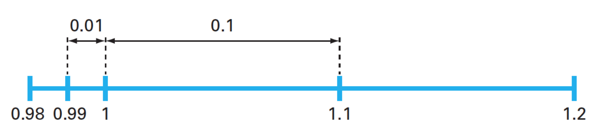

图中采用十进制两位有效数字：$0.98,0.99,1.0$ 的间距为 $0.01$，而 $1.0,1.1,1.2$ 的间距为 $0.1$，体现了跨数量级时浮点间距的变化。

#### 十进制与二进制的转化 Decimal-to-Binary Conversion

**步骤 1：** 把十进制数字分为整数部分和小数部分。对于整数部分，使用“除2取余，逆序排列”法；对于小数部分，使用“乘2取整，顺序排列”法。

**步骤 2：** 整数部分“除2取余，逆序排列”法。

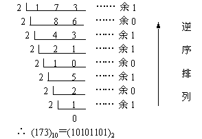

**步骤 3：** 小数部分的“乘2取整，顺序排列”法。

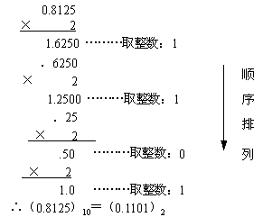

#### 十进制与任意进制的转化 Conversion of Decimal and Arbitrary Systems

**步骤 1：** 先将给定数写成十进制数值，并识别整数部分、小数部分以及目标基数 $\beta$。十进制科学计数法与位权展开为

$$
fl(x) = \pm \left( d_{1}.d_{2}d_{3}\ldots d_{t} \right) \times 10^{e} = \pm (\frac{d_{1}}{10^{0}} + \frac{d_{2}}{10^{1}} + \ldots + \frac{d_{t}}{10^{t - 1}}) \times 10^{e}
$$

**步骤 2：** 按目标基数的位权填写数位。对二进制，每位可取 $0$ 或 $1$；对一般基数 $\beta$，每位可取 $0,1,\ldots,\beta-1$。从较大的位权开始，选出不超过当前余量的数位倍数，再减去该数位贡献。

| 基数 | $\beta^0$ | $\beta^{-1}$ | $\beta^{-2}$ | $\beta^{-3}$ | $\beta^{-4}$ | $\beta^{-5}$ | $\beta^{-6}$ | $\beta^{-7}$ | $\beta^{-8}$ | $\beta^{-9}$ | $\beta^{-10}$ | 后续位 |
| --- | --- | --- | --- | --- | --- | --- | --- | --- | --- | --- | --- | --- |
| 2 | $2^0$ | $2^{-1}$ | $2^{-2}$ | $2^{-3}$ | $2^{-4}$ | $2^{-5}$ | $2^{-6}$ | $2^{-7}$ | $2^{-8}$ | $2^{-9}$ | $2^{-10}$ | $\cdots$ |
| 3 | $3^0$ | $3^{-1}$ | $3^{-2}$ | $3^{-3}$ | $3^{-4}$ | $3^{-5}$ | $3^{-6}$ | $3^{-7}$ | $3^{-8}$ | $3^{-9}$ | $3^{-10}$ | $\cdots$ |
| $\vdots$ | $\vdots$ | $\vdots$ | $\vdots$ | $\vdots$ | $\vdots$ | $\vdots$ | $\vdots$ | $\vdots$ | $\vdots$ | $\vdots$ | $\vdots$ | $\ddots$ |

具体填写方法是比较当前余量与位权。二进制中，余量不小于位权就写 $1$ 并减去该位权，否则写 $0$。例如将 $1/5=0.2$ 转化为二进制：

| 位权 | $2^0$ | $2^{-1}$ | $2^{-2}$ | $2^{-3}$ | $2^{-4}$ | $2^{-5}$ | $2^{-6}$ | $2^{-7}$ | $2^{-8}$ | $2^{-9}$ | $2^{-10}$ | $\cdots$ |
| --- | --- | --- | --- | --- | --- | --- | --- | --- | --- | --- | --- | --- |
| 数位 | 0 | 0 | 0 | 1 | 1 | 0 | 0 | 1 | 1 | 0 | 0 | $\cdots$ |

- $2^{0} = 1$大于$0.2$，因此写0；
- $2^{- 1} = 0.5$大于$0.2$，因此写0；
- $2^{- 2} = 0.25$大于$0.2$，因此写0；
- $2^{- 3} = 0.125$小于$0.2$，因此写1；
- $2^{- 4} = 0.0625$小于$0.2 - 0.125$，因此写1

继续按余量计算：

- 选取 $2^{-3}$ 后，余量为 $0.2-0.125=0.075$。
- 选取 $2^{-4}$ 后，余量为 $0.075-0.0625=0.0125$。
- $2^{-5}=0.03125>0.0125$，因此写 $0$；$2^{-6}=0.015625>0.0125$，也写 $0$。
- $2^{-7}=0.0078125\le0.0125$，写 $1$，余量为 $0.0046875$。
- $2^{-8}=0.00390625\le0.0046875$，写 $1$，余量为 $0.00078125$。

由此得到 $0.2=(0.00110011\cdots)_2$。

……

根据要求，将进制数字转化为规定的位数，并使用科学计数法表示。

### 1.2 浮点表示、范围与机器精度

#### 双精度浮点数（64位）Double-Precision Floating-Point (64 Bit)

$$
x=(-1)^s\left(1+\frac{F}{2^{52}}\right)2^{E-1023},\qquad1\le E\le2046.
$$

- 符号位 Sign Bit: 第63位，表示数的正负，0表示正，1表示负。
- 指数域（biased exponent）：第 $62$ 位至第 $52$ 位，共 $11$ 位，存储偏置指数 $E$，真实指数为 $e=E-1023$。
- 小数域（fraction）：第 $51$ 位至第 $0$ 位，共 $52$ 位，存储整数 $F$。正规数的有效数为 $1+F/2^{52}$，首位 $1$ 隐含存储，因此共有 $53$ 位二进制有效数字。

#### 单精度浮点数（32位）Single-Precision Floating-Point (32 Bit)

$$
x=(-1)^s\left(1+\frac{F}{2^{23}}\right)2^{E-127},\qquad1\le E\le254.
$$

- 符号位 Sign Bit: 1位。
- 指数部分 Biased Exponent: 8位。
- 尾数部分 Mantissa: 23位。

单精度小数域为 $23$ 位，正规数共有 $24$ 位二进制有效数字。以上两个数值公式均针对正规数。指数域为零时，次正规数采用有效数 $F/2^q$，其中双精度 $q=52$、单精度 $q=23$；指数域全为一时用于编码无穷大与 NaN。

#### 浮点数的有限表示范围 Finite Range of Floating-Point Numbers

浮点数的表示范围是有限的，计算机无法显示所有的实数，只能表示有限范围内的数字。

- 上溢（overflow）：结果超出有限表示范围。默认舍入到最近值时，足够大的结果会成为带符号的无穷大，具体行为取决于舍入模式。
- 下溢（underflow）：结果进入极小数值区域时，可先用次正规数表示并损失相对精度；更小的非零结果才可能舍入为零。

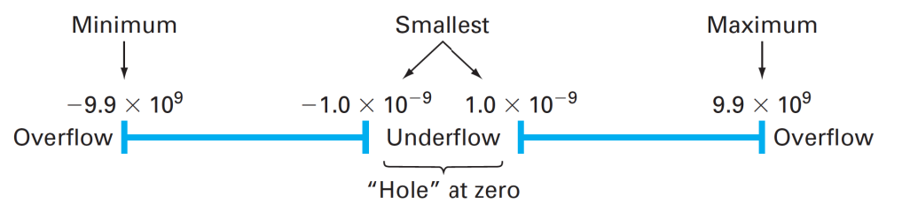

图中为不含次正规数的十进制浮点系统示意：最大有限绝对值为 $9.9\times10^9$，最小正数为 $1.0\times10^{-9}$。IEEE 754 通过次正规数实现渐进下溢。双精度的最大有限正数为 $(2-2^{-52})2^{1023}$，最小正规正数为 $2^{-1022}$，最小次正规正数为 $2^{-1074}$。

#### 浮点数间隔随数值增大而增大 Floating-Point Intervals Increase as the Value Increases

如果我们使用科学计数法表示浮点数，那么浮点数可以被表示为

$$
x=(-1)^s(1.f)_2\,2^e,\qquad e=E-B.
$$

当正规浮点数的绝对值跨入更高的指数区间时，真实指数 $e$ 增大。有效数字位数保持不变，因而相邻浮点数的绝对间距按 $\beta^{e-t+1}$ 增大。同一指数区间内间距固定，次正规数区间也具有固定间距。

#### 机器精度（Machine epsilon）

定义 $\epsilon_m$ 为 $1$ 与大于 $1$ 的下一个浮点数之差。若 $t$ 包括首位在内的全部有效数字，则

$$
\epsilon_m=\beta^{1-t}.
$$

对于双精度浮点数 Double-Precision Floating-Point，其$\epsilon_{m} = 2^{- 52} \approx 10^{- 16}$。

双精度机器精度为 $2^{-52}\approx2.22\times10^{-16}$。十进制数 $1.000000000000001$ 与 $1.000000000000002$ 转成双精度后可区分，而 $1.00000000000000001$ 舍入后等于 $1$。一般判断应考虑当前位置的浮点间距和舍入边界，$\epsilon_m$ 是 $1$ 附近的间距。

### 1.3 整数

整数的定义 Definition of Integers 用于表示没有小数部分的数值（即整数值），可以是 signed（有符号）或 unsigned（无符号）。

#### 有符号整数 Signed Integers

有符号整数 Signed Integers 可以表示正数、负数和零。在计算机中，使用二进制补码 Two's Complement 来表示负数。

位分配：补码最高位为符号相关位，其权重为 $-2^{n-1}$，其余位的权重为 $2^j$。最高位与其余位共同编码整数，而不是“符号位加绝对值”。最高位为：

- $0$ 表示非负数。

- 1 表示负数。

取值范围 Range of Values: 假设是 n 位的有符号整数，则数值范围为

$$
- 2^{n - 1}\text{ to }2^{n - 1} - 1
$$

例如，对于 8 位有符号整数，范围是

$$
- 128\text{ to }127
$$

其中 -128 是用补码表示的负数，127 是最大正数。

#### 二进制补码 Two's Complement

负数的表示方式是通过将正数取反加一来得到补码形式。例如对于 4 位有符号整数，

- 四位补码位模式 `0010` 表示 $+2$。

- 四位补码位模式 `1110` 表示 $-2$：把 `0010` 逐位取反得到 `1101`，再加一得到 `1110`。

这里 $1110$ 按四位补码解释为 $-2$；按无符号二进制解释时，$(1110)_2=14$。

#### 无符号整数 Unsigned Integers

无符号整数 Unsigned Integers 只能表示非负整数，因此不需要用位来表示符号。

位分配 Bit Distribution: 无符号整数的所有位都用于表示数值，因此可以表示更大的正数范围。

取值范围：假设是 $n$ 位无符号整数，则数值范围为

$$
0\text{ to }2^{n} - 1
$$

例如，对于 8 位无符号整数，范围是

$$
0\text{ to }255
$$

### 1.4 浮点运算与误差传播

实数的封闭性 Closure of Real Numbers: 所有实数在加法、减法、乘法和除法（除以零除外）运算下都是封闭的 closed under addition, subtraction, and multiplication, and division。也就是说，任何两个实数通过这些运算得到的结果仍然是实数。

双精度浮点数的不封闭性 Non-Closure of Double-Precision Floating-Point Numbers: 双精度浮点数集合在这些运算下并不总是封闭的。这意味着两个双精度浮点数的运算结果可能无法被精确地表示为另一个双精度浮点数。

#### 浮点数运算的定义 Definition of Floating Point Arithmetic

浮点运算的舍入模型：由于精确结果未必落在有限浮点数集合中，实际加、减、乘、除通常先形成精确结果，再舍入到最近的可表示值。若发生上溢或无效运算，还可能得到无穷大或 NaN。

##### 封闭方式 Closure Method

**Step 1:** 精确的代数运算（首先，进行实际的代数运算，不考虑浮点数的表示限制。）

$$
x + y\ \ \ x - y\ \ \ x \times y\ \ \ x \div y
$$

**Step 2:** 浮点舍入：将这个精确的代数运算结果舍入到最接近的可以用浮点数表示的数。

$$
x \oplus y\ : = \ {fl}_{DP}(x + y)
$$

$$
x \ominus y\ : = \ {fl}_{DP}(x - y)
$$

$$
x \otimes y\ : = \ {fl}_{DP}(x \times y)
$$

$$
x \oslash y\ : = \ {fl}_{DP}(x/y)
$$

$\operatorname{fl}_{\mathrm{DP}}(z)$ 表示将 $z$ 舍入到双精度，距离相等时采用约定的中点规则；默认规则为中点舍入到偶数。

- Floating point arithmetic is inherently approximate.

#### 浮点舍入规则 Floating Point Rounding Rule

我们首先把转换后的浮点数表示为

$$
{fl}_{DP}(z) = z(1 + \mu)
$$

这里 $z$ 表示精确代数结果，$\mu$ 表示相对舍入误差。对舍入到最近值且没有上溢、结果处于适用的正规范围时，有

$$
|\mu|\le u=\frac{\epsilon_{\mathrm{DP}}}{2}=2^{-53}.
$$

这里 $u$ 称为单位舍入误差。次正规数附近需要使用相应的绝对误差分析；上溢、NaN 等特殊结果不适用这一有限相对误差模型。

#### 误差的传播 Propagation of Errors

在电脑运算中，有两种 Errors，分别是:

- 数值中固有的误差 Error inherent in the numbers: 指的是由于表示数值时使用了有限精度，因此不可避免的误差。
- 由算术运算引入的误差 Error introduced by the arithmetic: 这是指在进行加减乘除等运算时，由于有限精度和舍入误差而产生的额外误差。

#### 灾难性抵消 Catastrophic Cancellation:

 在计算机算术中，减去两个接近的双精度数值时可能会导致显著的精度损失。

若输入为 $\widehat x=x+\Delta x$、$\widehat y=y+\Delta y$，即使减法本身精确，也有 $(\widehat x-\widehat y)-(x-y)=\Delta x-\Delta y$。当 $|x-y|$ 很小时，已有误差相对于差值被放大。

## 第二单元 线性方程组的解（Solution of Linear Systems）

### 2.1 线性方程组

#### 线性方程组回顾 Recall of System of Linear Equation

线性方程组和矩阵 SLE and Matrix: Linear system of equations can be written as $Ax = b$.

$$
\begin{pmatrix}
a_{11} & \cdots & a_{1n} \\
\vdots & \ddots & \vdots \\
a_{n1} & \cdots & a_{nn}
\end{pmatrix}\begin{pmatrix}
x_{1} \\
\vdots \\
x_{n}
\end{pmatrix} = \begin{pmatrix}
b_{1} \\
\vdots \\
b_{n}
\end{pmatrix}
$$

- $A$ is the matrix of coefficients.
- $x$ is the vector of unknowns.
- $b$ is the vector of constants.

#### 线性方程组的解 Solutions of SLE

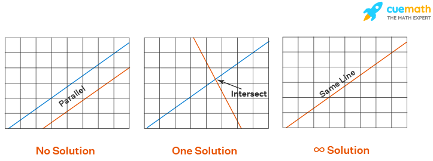

- When two distinct lines are parallel, the system has no solution because the lines do not intersect. 两条相异平行线对应无解。
- When two lines intersect at a point, the corresponding system of linear equations has a unique solution.
- When two lines coincide, the system has infinitely many solutions: every point on the common line is a solution.

#### 线性方程组的唯一解 Unique solution of SLE

对于两个表示直线的二元一次方程，若两条直线的斜率存在，唯一解要求它们斜率不同。设

$$
a_{11}x_{1} + a_{12}x_{2} = b_{1}
$$

$$
a_{21}x_{1} + a_{22}x_{2} = b_{2}
$$

$$
\frac{a_{11}}{a_{12}}\ne\frac{a_{21}}{a_{22}},\qquad a_{12}a_{22}\ne0.
$$

我们可以由此推出如下结论

- Determinant of A, i.e. $a_{11}a_{22} - a_{12}a_{21}$ for $2 \times 2$ matrix, must be nonzero.

行列式判据 $\det(A)\ne0$ 也适用于含竖直直线的情形。对一般非奇异方阵，下列可逆性条件等价。

$$
\begin{bmatrix}
a_{11} & a_{12} \\
a_{21} & a_{22}
\end{bmatrix}\begin{bmatrix}
x_{1} \\
x_{2}
\end{bmatrix} = \begin{bmatrix}
b_{1} \\
b_{2}
\end{bmatrix}
$$

- A must be nonsingular, one and only one solution.

- Columns of A must be linearly independent. (No column is linear combination of others.)

- A must be invertible.

### 2.2 特殊矩阵与三角方程组

#### 单位矩阵 Identity Matrix

$$
I = \begin{pmatrix}
1 & \cdots & 0 \\
\vdots & \ddots & \vdots \\
0 & \cdots & 1
\end{pmatrix}
$$

All diagonal entries are $1$, and every off-diagonal entry is $0$.

维度相容时，$I_mA=A=AI_n$，其中 $A\in\mathbb R^{m\times n}$。

#### 零矩阵 Zero Matrix

$$
O = \begin{pmatrix}
0 & \cdots & 0 \\
\vdots & \ddots & \vdots \\
0 & \cdots & 0
\end{pmatrix}
$$

All entries are 0.

维度相容时，矩阵与零矩阵相乘得到相应大小的零矩阵。

#### 对角矩阵 Diagonal Matrix

$$
A = \begin{pmatrix}
a_{11} & 0 & 0 \\
0 & \ddots & 0 \\
0 & 0 & a_{nn}
\end{pmatrix}
$$

A diagonal matrix is square and all off-diagonal entries are zero; diagonal entries may also be zero.

#### 下三角矩阵 Lower Triangular Matrix

$$
A = \begin{pmatrix}
1 & 0 & 0 \\
2 & 4 & 0 \\
3 & 5 & 6
\end{pmatrix}
$$

The portion above the diagonal is only 0. We can use forward substitution to get the solution of $Ax = b$, where $A$ is a lower triangular matrix.

$$
\begin{pmatrix}
1 & 0 & 0 \\
2 & 4 & 0 \\
3 & 5 & 6
\end{pmatrix}\begin{pmatrix}
x_{1} \\
x_{2} \\
x_{3}
\end{pmatrix} = \begin{pmatrix}
1 \\
2 \\
3
\end{pmatrix}
$$

##### 正向代入法 Forward Substitution:

$$
1x_{1} = 1\ \ \ x_{1} = 1
$$

我们将$x_{1}$的值代入$2x_{1} + 4x_{2} = 2$来得到$x_{2}$，并继续得到$x_{3}$。

逐项代入得

$$
x_2=\frac{2-2x_1}{4}=\frac{2-2}{4}=0,\qquad
x_3=\frac{3-3x_1-5x_2}{6}=0.
$$

#### 上三角矩阵 Upper Triangular Matrix

$$
A = \begin{pmatrix}
1 & 2 & 3 \\
0 & 4 & 5 \\
0 & 0 & 6
\end{pmatrix}
$$

The portion below the diagonal is only 0. We can use backward substitution to get the solution of $Ax = b$, where $A$ is a upper triangular matrix.

$$
\begin{pmatrix}
1 & 2 & 3 \\
0 & 4 & 5 \\
0 & 0 & 6
\end{pmatrix}\begin{pmatrix}
x_{1} \\
x_{2} \\
x_{3}
\end{pmatrix} = \begin{pmatrix}
1 \\
2 \\
3
\end{pmatrix}
$$

##### 逆向代入法 Backward Substitution:

$$
6x_{3} = 3\ \ x_{3} = 0.5
$$

我们将$x_{3}$的值代入$4x_{2} + 5x_{3} = 2$来得到$x_{2}$，并继续得到$x_{1}$。

逐项代入得

$$
x_2=\frac{2-5(1/2)}4=-\frac18,\qquad
x_1=1-2(-1/8)-3(1/2)=-\frac14.
$$

前代和回代获得唯一解的前提是三角矩阵所有对角元非零。

#### 解线性方程组 Simply Solved Linear Systems

##### 逆向代入法算法 Backward Substitution Algorithms

若已经得到一个对角元均非零的方阵上三角系统，可使用回代算法求唯一解。一般行阶梯形矩阵还需判断秩与相容性。

下图分别给出按行算法（row-oriented）和按列算法（column-oriented）的伪代码：

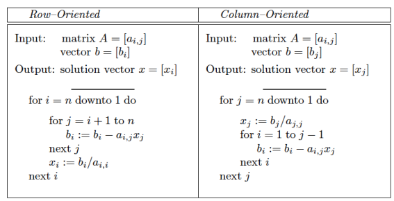

##### 列方向算法 Column-oriented Algorithm

从矩阵的最后一列开始逐列进行处理，每一列逐项计算对应的解。

**Step 1:** 从最后一列开始，计算$x_{n}$。比如，

$$
\begin{pmatrix}
4 & 2 \\
0 & 3
\end{pmatrix}\begin{pmatrix}
x_{1} \\
x_{2}
\end{pmatrix} = \begin{pmatrix}
- 2 \\
3
\end{pmatrix}
$$

在这个矩阵计算中，我们通过第二列可得$a_{2,2} = 3$，而对应的$b_{2} = 3$。

$$
x_{2} = \frac{b_{2}}{a_{2,2}} = \frac{3}{3} = 1
$$

**Step 2:** 逐步向前，直到第一列。对于每一列需要针对后面的$b$进行更新。

$$
b_{i} = b_{i} - a_{i,j} \times x_{j}
$$

比如，现在回到第一列，处理第一行$a_{1,1} = 4$，而对应的$b_{1} = - 2$。更新结果如下

$$
b_{1} = b_{1} - a_{1,2} \times x_{2} = - 4
$$

**Step 3:** 列出每一列的式子，计算剩余$x_{i}$。比如，

$$
x_{1} = \frac{b_{1}}{a_{1,1}} = \frac{- 4}{4} = - 1
$$

##### 行方向算法 Row-oriented Algorithm

从矩阵的最后一行开始向上逐行处理，每一行使用前面已经解出的解来计算当前未知行的未知数。

**Step 1:** 从最后一行开始，计算$x_{n}$。比如，

$$
3x_{2} = 3\ \ \ x_{2} = \frac{3}{3} = 1
$$

**Step 2:** 回到上一行，利用已知的$x_{n}$，计算$x_{n - 1}$。比如，

$$
4x_{1} + 2x_{2} = - 2
$$

$$
x_{1} = - 1
$$

#### 逆向代入法成本分析 Backward Substitution Cost

给定$n \times n$矩阵 A，我们通过如下公式计算乘法、减法和除法的成本

##### 乘法次数 Multiplications

$$
\frac{n(n - 1)}{2}
$$

##### 减法次数 Subtractions

$$
\frac{n(n - 1)}{2}
$$

##### 除法次数 Divisions

$$
n
$$

### 2.3 向量范数

#### 矢量范数的性质 Properties of A Norm of $v$, i.e. $\left\lVert v\right\rVert$

- 非负性 Non-Negativity: $\left\lVert v\right\rVert \geq 0$ for all vectors $v \in \mathbb{R}^{n}$, and : $\left\lVert v\right\rVert = 0$ if and only if $v = 0$.

- 三角不等式 Triangle Inequality: $\left\lVert v + w\right\rVert \leq \left\lVert v\right\rVert + \left\lVert w\right\rVert$ for all vectors $v \in \mathbb{R}^{n}$ and $w \in \mathbb{R}^{n}$.

- 齐次性 Homogeneity: $\left\lVert cv\right\rVert = |c|\left\lVert v\right\rVert$ for all vectors $v \in \mathbb{R}^{n}$ and all scalars c.

#### 矢量的三个范数 Three Vector Norms

##### 一范数与曼哈顿距离（One-norm and Manhattan distance）$\ell_1$

向量的一范数 $\lVert x\rVert_1$ 等于它到原点的曼哈顿距离；两个向量 $x,y$ 之间的曼哈顿距离为 $\lVert x-y\rVert_1$。

$$
\left\lVert x\right\rVert_{1} = \left| x_{1} \right| + \left| x_{2} \right| + \ldots + \left| x_{n} \right| = \sum_{i = 1}^{n}{|x_{i}|}
$$

##### 欧几里得范数 Euclidean Norm $\mathcal{l}_{2}$

$$
\left\lVert x\right\rVert_{2} = \sqrt{x_{1}^{2} + x_{2}^{2} + x_{3}^{2} + \ldots + x_{n}^{2}} = \left( \sum_{i = 1}^{n}x_{i}^{2} \right)^{\frac{1}{2}}
$$

##### 无穷范数 Infinity norm $\mathcal{l}_{\infty}$

向量中各个元素绝对值的最大值。

$$
\left\lVert x\right\rVert_{\infty} = \max_{1 \leq i \leq n}\left\{ \left| x_{i} \right| \right\}
$$

### 2.4 矩阵范数与条件数

#### 矩阵范数的性质 Properties of A, i.e. $\left\lVert A\right\rVert$

将矩阵视为向量空间元素时，范数满足以下三条公理。随后列出的矩阵乘法不等式要求使用相容的矩阵与向量范数；诱导范数满足这些不等式。

- 非负性 Non-Negativity: $\left\lVert A\right\rVert \geq 0$ for all matrices $A \in \mathbb{R}^{m \times n}$, and : $\left\lVert A\right\rVert = 0$ if and only if $A = 0$.

- 三角不等式：$\lVert A+B\rVert\le\lVert A\rVert+\lVert B\rVert$，其中 $A,B\in\mathbb R^{m\times n}$。
- 齐次性：$\lVert cA\rVert=|c|\lVert A\rVert$，其中 $A\in\mathbb R^{m\times n}$，$c$ 为标量。

##### 其他性质 Other Properties:

- 矩阵范数与向量范数之间的关系 Relationship between Matrix and Vector Norms

    $$
    \left\lVert Ax\right\rVert \leq \left\lVert A\right\rVert \cdot \left\lVert x\right\rVert
    $$

- 两个矩阵相乘的范数 The Norm of the Multiplication of Two Matrices

    $$
    \left\lVert A \cdot B\right\rVert \leq \left\lVert A\right\rVert \cdot \left\lVert B\right\rVert
    $$

#### F 范数 Frobenius Norm

矩阵中所有元素的平方和的平方根。

$$
\left\lVert A\right\rVert_{F} = \sqrt{\sum_{i = 1}^{m}{\sum_{j = 1}^{n}a_{ij}^{2}}}
$$

#### 诱导范数 Induced Norms

诱导矩阵范数定义为 $\lVert A\rVert_p=\max_{x\ne0}\lVert Ax\rVert_p/\lVert x\rVert_p$。Frobenius 范数一般不是诱导范数，但满足相应次乘性，并有 $\lVert Ax\rVert_2\le\lVert A\rVert_F\lVert x\rVert_2$。

##### $p = 1$，最大列和范数，定义为矩阵所有列中元素绝对值和的最大值。

$$
\left\lVert A\right\rVert_{1} = \max_{1 \leq j \leq n}{\sum_{i = 1}^{m}{|a_{ij}|}}
$$

##### $p = \infty$，最大行和范数，定义为矩阵所有行中元素绝对值和的最大值。

$$
\left\lVert A\right\rVert_{\infty} = \max_{1 \leq i \leq m}{\sum_{j = 1}^{n}{|a_{ij}|}}
$$

##### $p = 2$，谱范数，定义为 A 矩阵 SVD 分解后的最大奇异值$\sigma_{1}$。

$$
\left\lVert A\right\rVert_{2} = \sigma_{1}
$$

#### 条件数 Condition Number

**条件数的定义 Definition of Condition Number**

以下设 $A$ 为非奇异方阵，使用一致选定的诱导范数。此时 $\kappa(A)\ge1$；奇异矩阵通常记为条件数无穷大。

$$
\kappa(A) = \left\lVert A\right\rVert \cdot \left\lVert  A^{- 1} \right\rVert
$$

对于2-范数，其可以表示为

$$
\kappa(A) = \left\lVert A\right\rVert_{2} \cdot \left\lVert  A^{- 1} \right\rVert_{2} = \frac{\sigma_{1}}{\sigma_{n}}
$$

其中$\sigma_{1}$是 A 矩阵的最大奇异值，$\sigma_{n}$是矩阵的最小奇异值。

条件数的含义 Meaning of Condition Number: $\kappa(A)$帮助我们判断矩阵在求解 Linear System 时的灵敏度。

设精确解满足 $Ax=b$，$b\ne0$，近似解为 $\widehat x$，残差为 $r=b-A\widehat x$。由 $x-\widehat x=A^{-1}r$ 可得相对解误差与相对残差之间的界：

$$
\frac{\left\lVert  x - \widehat{x} \right\rVert}{\left\lVert x\right\rVert} \leq \kappa(A) \cdot \frac{\left\lVert r\right\rVert}{\left\lVert b\right\rVert}
$$

如上公式说明:

- 较大的条件数允许数据扰动和残差被更大幅度放大；具体误差大小也取决于扰动方向。

- Even if the residuals are small, the error can be large if the condition number of the matrix is large.

##### 良态矩阵和病态矩阵 Well-Conditioned and Ill-Conditioned Matrix

- 良态矩阵的条件数接近 $1$，此时小的相对残差意味着小的相对解误差。

- 病态矩阵的条件数很大，在相对尺度下接近奇异；即使相对残差很小，解误差仍可能较大。

### 2.5 LU 分解

定义 Definition: LU 分解将一个方阵 A 分解为两个矩阵的乘积

$$
A = LU
$$

其中 L 是一个下三角矩阵 Lower Triangular Matrix，其对角线元素均为1。U 是一个上三角矩阵 Upper Triangular Matrix。

此处的无主元分解要求消元过程中所用主元非零。一般非奇异矩阵可能需要换行；完成行交换后使用 $PA=LU$。

#### 步骤 Steps

**步骤 1：** 在主元非零的前提下，仅使用某行减去另一行的倍数进行无换行高斯消元，不做行归一化。得到的上三角矩阵为 $U$。

**步骤 2：** 在上述把原矩阵化简成 REF 矩阵的过程中，记录所有的初等行变换 Elementary Row Operations (EROs)步骤。并把每一步的 ERO 分别单独应用在一个 Identity Matrix 上，形成 Elementary Matrix。有几步就有几个 Elementary Matrices，分别是$E_{1},\ E_{2}\ldots$。

**步骤 3：** 分别计算消元矩阵的逆。对 $R_i\leftarrow R_i-kR_j$ 对应的消元矩阵，逆操作为 $R_i\leftarrow R_i+kR_j$，因此只需将该非对角项变号。

**步骤 4：** 通过如下公式求解 L 矩阵（下三角矩阵 Lower Triangular Matrix）。

$$
E_{1}^{- 1}E_{2}^{- 1}E_{3}^{- 1}E_{4}^{- 1}\ldots E_{k}^{- 1} = L
$$

#### 另一种方法计算 L 矩阵 Another Method to Compute the L Matrix

**步骤 1：** 对于 A 矩阵到 U 矩阵，我们只使用唯一一个 ERO 进行，即“Replacing $R_{i}$ by $R_{i} - kR_{j}$”且保证$i > j$。

**步骤 2：** 根据我们每一步“Replacing $R_{i}$ by $R_{i} - kR_{j}$”中的 k 值来得到 L 矩阵。

**案例 Example:**

$$
\begin{bmatrix}
2 & 2 & 3 \\
5 & 9 & 10 \\
4 & 1 & 2
\end{bmatrix}
$$

We use $R_{2} = R_{2} - \frac{5}{2}R_{1}\ (k = \frac{5}{2})$

$$
\begin{bmatrix}
2 & 2 & 3 \\
0 & 4 & \frac{5}{2} \\
4 & 1 & 2
\end{bmatrix}
$$

We use $R_{3} = R_{3} - 2R_{1}\ (k = 2)$

$$
\begin{bmatrix}
2 & 2 & 3 \\
0 & 4 & \frac{5}{2} \\
0 & - 3 & - 4
\end{bmatrix}
$$

We use $R_{3} = R_{3} + \frac{3}{4}R_{2}\ (k = - \frac{3}{4})$

$$
\begin{bmatrix}
2 & 2 & 3 \\
0 & 4 & \frac{5}{2} \\
0 & 0 & - \frac{17}{8}
\end{bmatrix} = U
$$

At this point, k=5/2 is used to form $a_{2,1}$, k=2 is used to form $a_{3,1}$ and k=-3/4 is used to form $a_{3,2}$.

$$
L = \begin{bmatrix}
1 & 0 & 0 \\
\frac{5}{2} & 1 & 0 \\
2 & - \frac{3}{4} & 1
\end{bmatrix}
$$

#### 根据 LU 分解求解线性方程组的解 Solving the System of Linear Equations Based on LU Decomposition

$$
Ax = b\ \ \ \ LUx = b
$$

Let $Ux = y$

$$
Ly = b
$$

We use forward substitution to solve $y$.

$$
Ux = y
$$

We use backward substitution to solve $x$.

### 2.6 部分主元高斯消元与 PA=LU 分解

定义 Definition: 在进行高斯消元时，如果进行了行交换操作，我们可以将原来的矩阵 A 转化为一个置换矩阵 Permutation Matrix 和矩阵的 LU 分解。

$$
PA = LU
$$

其中 P 是置换矩阵 Permutation Matrix，它记录了行交换的操作。L 是一个下三角矩阵 Lower Triangular Matrix，其对角线元素均为1。U 是一个上三角矩阵 Upper Triangular Matrix。

#### 为什么要使用部分主元 Why We Using Partial Pivoting?

- **Avoid Denominators of 0.** If the main diagonal element of the current column is 0, then eliminating it directly will result in a divide by 0 error.

- **Avoid Too Small Divisor.** During Gaussian elimination, if the element on the main diagonal is very small, using it directly for the elimination operation may lead to unstable values or even overflow during the calculation.

- **Improve Numerical Accuracy**. Partial Pivoting can reduce the rounding error introduced during Gaussian elimination and thus improve the accuracy of the solution.

- **控制算法误差。** 部分主元法提高消元的数值稳定性，但矩阵固有的条件性保持不变，例如 $\kappa_2(PA)=\kappa_2(A)$。病态问题仍可能对数据扰动敏感。

#### 步骤 Steps

**步骤 1：** 在第一列中，需要确保绝对值最大的元素在最上面（运用行变换），作为主元 Pivot。将行变换也应用在 Identity Matrix 形成置换矩阵 Permutation Matrix 1。

**步骤 2：** 用第一行消去第一列主元下方的元素，并在右侧各列同步更新。

**步骤 3：** 在更新后的第二列中，仅从第二行及以下选择绝对值最大的主元，换至第二行。把对应行交换应用于单位矩阵，形成置换矩阵 $P_2$。后续第 $k$ 步同样只在第 $k$ 至 $n$ 行选择主元。

**步骤 4：** 用第二行消去第二列主元下方的元素，保留已经处理好的第一行和第一列。

**步骤 5：** 以此类推，我们得到了 PA 的 U 矩阵（上三角矩阵 Upper Triangular Matrix）。

**步骤 6：** 按顺序记录消元矩阵与置换矩阵。将消元乘子存入单位下三角矩阵 $L$；后续换行时，同步交换 $L$ 已计算列中的相应两行。也可由全部操作矩阵的逆按出现顺序相乘，再左乘总置换矩阵来求 $L$。

$$
P = P_{2}P_{1}
$$

$$
\begin{aligned}U&=M_s\cdots M_2M_1A,\\ P&=P_r\cdots P_1,\\ L&=PM_1^{-1}M_2^{-1}\cdots M_s^{-1},\end{aligned}
$$

这里 $M_1,\ldots,M_s$ 按消元与换行的实际先后顺序记录，$P_1,\ldots,P_r$ 仅记录其中的行交换。

#### 根据 PA-LU 分解求解线性方程组的解 Solving the System of Linear Equations Based on PA-LU Decomposition

$$
P(Ax = b)
$$

Let $PAx = Pb = d$

Now, we have

$$
PAx = d\ \ \ \ LUx = d
$$

Let $Ux = y$

$$
Ly = d
$$

Solve $y$.

$$
Ux = y
$$

Solve $x$.

### 2.7 Cholesky 分解

定义 Definition: 一个$n \times n$的矩阵 A 是对称正定的 Symmetric Positive Definite，当且仅当其可以分解为

$$
A = R^{T}R
$$

其中，R 是一个上三角矩阵 Upper Triangular Matrix，并且其对角线元素为正数。

#### 对称正定矩阵 Symmetric Positive Definite (SPD) Matrix

##### 对称性 Symmetric

$$
A = A^{T}
$$

##### 正定性 Positive Definite

- 方法一：对实对称矩阵，全部特征值严格为正等价于正定。

- 方法二:

    $$
    x^{T}Ax \geq 0\ \ \ \ \forall x \in \mathbb{R}^{n}
    $$

    $$
    x^{T}Ax = 0\ \  \Longleftrightarrow \ \ \ x = 0
    $$

#### 科列斯基分解步骤 Steps of Cholesky Factorization

以下均在实数范围内讨论。对称正定条件为 $A=A^T$ 且 $x^TAx>0$ 对所有非零 $x$ 成立，Cholesky 上三角因子的对角元取正。

**步骤 1：** 确定矩阵 A 是对称正定的 Symmetric Positive Definite。

**步骤 2：** 确定 R 即上三角矩阵的形式

$$
R = \begin{bmatrix}
r_{11} & r_{12} & r_{13} \\
0 & r_{22} & r_{23} \\
0 & 0 & r_{33}
\end{bmatrix}\ \ \ \ R^{T} = \begin{bmatrix}
r_{11} & 0 & 0 \\
r_{12} & r_{22} & 0 \\
r_{13} & r_{23} & r_{33}
\end{bmatrix}
$$

**步骤 3：** 写出$R^{T}R$

$$
R^{T}R = \begin{bmatrix}
r_{11}^{2} & r_{11}r_{12} & r_{11}r_{13} \\
r_{11}r_{12} & r_{12}^{2} + r_{22}^{2} & r_{12}r_{13} + r_{22}r_{23} \\
r_{11}r_{13} & r_{12}r_{13} + r_{22}r_{23} & r_{13}^{2} + r_{23}^{2} + r_{33}^{2}
\end{bmatrix}
$$

**步骤 4：** 与矩阵 A 对应项对比，得到方程组，逐步解出$r_{ij}$，在解方程组的过程中，若有两根，取正根。

#### 根据 Cholesky 分解求解线性方程组的解 Solving the System of Linear Equations Based on Cholesky Factorization

$$
Ax = b\ \ \ R^{T}Rx = b
$$

Let $Rx = y$

$$
R^{T}y = b
$$

Solve y by forward substitution.

$$
Rx = y
$$

Solve x by backward substitution.

### 2.8 QR 分解

定义 Definition: 对于一个$m \times n$的矩阵 A，可以将它分解为两个矩阵 Q 和 R

$$
A = QR
$$

完整 QR 分解中，$Q\in\mathbb R^{m\times m}$ 为正交矩阵，$R\in\mathbb R^{m\times n}$ 为上梯形矩阵。若 $m\ge n$ 且 $A$ 满列秩，约化形式可取 $Q_1\in\mathbb R^{m\times n}$、$R_1\in\mathbb R^{n\times n}$，满足 $Q_1^TQ_1=I_n$，$R_1$ 为非奇异上三角矩阵。

#### 正交矩阵 Orthogonal Matrix

$$
Q=[q_1\ q_2\ \cdots\ q_m],\qquad q_i\in\mathbb R^m.
$$

$$
q_{i}^{T}q_{j} = \left\{ \begin{array}{r}
1,\ if\ i = j \\
0,\ if\ i \neq j
\end{array} \right.
$$

$$
Q^{T}Q = I
$$

#### 根据 QR 分解求解线性方程组的解 Solving the System of Linear Equations Based on QR Factorization

下面先讨论非奇异方阵的情形。若 $m>n$，同样的回代步骤给出最小二乘解；精确方程 $Q_1y=b$ 还要求 $b$ 属于 $A$ 的列空间。

$$
Ax = b\ \ \ QRx = b
$$

Let $Rx = y$

$$
Qy = b\ \ \ y = Q^{T}b
$$

Solve y.

$$
Rx = y
$$

Solve x.

### 2.9 奇异值分解

定义 Definition: 对于一个任意的$m \times n$矩阵 A，奇异值分解 SVD 将其分解为三个矩阵的乘积

$$
A = U\Sigma V^{T}
$$

U 是$m \times m$正交矩阵 Orthogonal Matrix，V 是$n \times n$正交矩阵 Orthogonal Matrix。$\Sigma$是$m \times n$的对角矩阵 Diagonal Matrix，其中对角线上的元素为 A 的奇异值 Singular Values。

$$
\Sigma = \begin{pmatrix}
\sigma_{1} & 0 & 0 \\
0 & \sigma_{2} & 0 \\
0 & 0 & \sigma_{3}
\end{pmatrix}
$$

其中$\sigma_{1} \geq \sigma_{2} \geq \ldots \geq \sigma_{r} > 0$为矩阵的 A 非零奇异值 Singular Values，r 是矩阵 A 的 Rank。

#### 根据 SVD 分解求解线性方程组的解 Solving the System of Linear Equations Based on SVD Factorization

以下令 $r=\operatorname{rank}(A)$。对非零奇异值可作除法；零奇异值对应的方程需另外检查相容性。

$$
Ax = b\ \ \ \ A = U\Sigma V^{T}
$$

We have

$$
U\Sigma V^{T}x = b
$$

$$
U^{T}(U\Sigma V^{T}x = b)
$$

$$
U^{T}U\Sigma V^{T}x = U^{T}b
$$

$$
\Sigma V^{T}x = U^{T}b = d
$$

Let $V^{T}x = y$

$$
\Sigma y = d
$$

Solve y.

$$
V^{T}x = y
$$

Solve x.

当 $\Sigma y=d$ 中 $d_i=0$（$i=r+1,\ldots,m$）时原方程相容；$y_i=d_i/\sigma_i$（$i\le r$），若 $r<n$，其余 $y_i$ 为自由变量，最后 $x=Vy$。不相容时可取 $x=A^+b$ 得最小范数最小二乘解。

## 第三单元 曲线拟合（Curve Fitting）

### 3.1 多项式插值

定义 Definition: 多项式插值 Polynomial Interpolation 的目标就是精确地拟合所有给定的数据点。我们希望找到一个多项式$p(x)$，使得该多项式在每个给定的数据点$(x_{i},\ f_{i})$处满足$p\left( x_{i} \right) = f_{i}$。

多项式的次数与节点数：给定 $n+1$ 个横坐标互不相同的节点，总能找到次数不超过 $n$ 的插值多项式。数据有特殊结构时，实际次数可能更低。

多项式插值与最小二乘法 Polynomial Interpolation and Least Squares: 这与一般的拟合（比如最小二乘法）不同，拟合方法可以近似数据点，但并不需要完全通过所有点，而多项式插值的要求则是精确地通过所有点。

#### 多项式插值的唯一性定理 Polynomial Interpolation Uniqueness Theorem

当节点 $x_0,\ldots,x_N$ 互异时，存在唯一的次数不超过 $N$ 的多项式 $p_N$，使其插值数据 $(x_i,f_i)$，$i=0,\ldots,N$。

在 $N+1$ 个不同横坐标处给定函数值，存在唯一的次数不超过 $N$ 的多项式通过这些数据，保证插值结果的确定性。

### 3.2 幂基多项式插值

#### 幂函数多项式插值条件 Power Function Polynomial Interpolation Conditions

- Condition 1: 每个插值点$(x_{i},f_{i})$必须满足给定的多项式形式。这意味着插值多项式$p_{N}(x)$在每个$x_{i}$处的值都必须等于$f_{i}$。
- Condition 2: 插值多项式的表达形式为

    $$
    p_{N}(x) = a_{0} + a_{1}x + \ldots + a_{N}x^{N}
    $$

这是次数不超过 $N$ 的幂基多项式，其中 $a_0,\ldots,a_N$ 是待定系数，最高次系数可为零。

#### 幂函数插值方程系统 Power Function System of Interpolated Equations

对于每个数据点$\left( x_{0},f_{0} \right),\ldots,(x_{N},f_{N})$，插值多项式需要满足以下方程：

$$
p_{N}\left( x_{0} \right) = a_{0} + a_{1}x_{0} + \ldots + a_{N}x_{0}^{N} = f_{0}
$$

$$
p_{N}\left( x_{1} \right) = a_{0} + a_{1}x_{1} + \ldots + a_{N}x_{1}^{N} = f_{1}
$$

$$
\ldots
$$

$$
p_{N}\left( x_{N} \right) = a_{0} + a_{1}x_{N} + \ldots + a_{N}x_{N}^{N} = f_{N}
$$

这些方程表达了多项式在每个给定的$x_{i}$处必须通过对应的$f_{i}$。

#### 如何进行幂函数的多项式插值 How to Do Power Function Polynomial Interpolation

**步骤 1：** 根据题意列出互异的插值节点。若共有 $N+1$ 个节点，则以次数不超过 $N$ 的形式设多项式；某些最高次系数可以为零。

**步骤 2：** 根据插值条件$p\left( x_{i} \right) = f_{i}$，写出插值系统方程。

**步骤 3：** 我们可以通过矩阵来解如上的插值系统方程，即一个线性方程组。插值系统方程可以写成矩阵形式，即

$$
p_{N}\left( x_{0} \right) = a_{0} + a_{1}x_{0} + \ldots + a_{N}x_{0}^{N} = f_{0}
$$

$$
p_{N}\left( x_{1} \right) = a_{0} + a_{1}x_{1} + \ldots + a_{N}x_{1}^{N} = f_{1}
$$

$$
\ldots
$$

$$
p_{N}\left( x_{N} \right) = a_{0} + a_{1}x_{N} + \ldots + a_{N}x_{N}^{N} = f_{N}
$$

可以被转化为

$$
\begin{bmatrix}
1 & x_{0} & x_{0}^{2} & \ldots & x_{0}^{N} \\
1 & x_{1} & x_{1}^{2} & \ldots & x_{1}^{N} \\
\vdots & \vdots & \vdots & \ldots & \vdots \\
1 & x_{N} & x_{N}^{2} & \ldots & x_{N}^{N}
\end{bmatrix}\left\lbrack \begin{array}{r}
a_{0} \\
a_{1} \\
\vdots \\
a_{N}
\end{array} \right\rbrack = \left\lbrack \begin{array}{r}
f_{0} \\
f_{1} \\
\vdots \\
f_{N}
\end{array} \right\rbrack
$$

其中，左侧的矩阵叫做 Vandermonde Matrix，记作 V。

$$
V = \begin{bmatrix}
1 & x_{0} & x_{0}^{2} & \ldots & x_{0}^{N} \\
1 & x_{1} & x_{1}^{2} & \ldots & x_{1}^{N} \\
\vdots & \vdots & \vdots & \ldots & \vdots \\
1 & x_{N} & x_{N}^{2} & \ldots & x_{N}^{N}
\end{bmatrix}
$$

**步骤 4：** 通过解线性方程组的方法找出系数$a_{0},a_{1},\ldots a_{N}$，并写出最后得到的多项式。

#### 案例 Example

假设有三个点$(1,2),(2,3),(3,5)$。请找到一个多项式插值这三个点。

**步骤 1：** Nodes are

$$
\left( x_{0},f_{0} \right) = (1,2),\ \left( x_{1},f_{1} \right) = (2,3),\ \left( x_{2},f_{2} \right) = (3,5).
$$

We need a quadratic polynomial to interpolate these three points.

$$
p(x) = a_{0} + a_{1}x + a_{2}x^{2}
$$

**步骤 2：** Now, we can create the System of Interpolated Equations.

When $x_{0} = 1,\ p(1) = 2$

$$
a_{0} + a_{1}(1) + a_{2}(1)^{2} = 2
$$

$$
a_{0} + a_{1} + a_{2} = 2
$$

When $x_{1} = 2,\ p(2) = 3$

$$
a_{0} + a_{1}(2) + a_{2}(2)^{2} = 3
$$

$$
a_{0} + 2a_{1} + 4a_{2} = 3
$$

When $x_{2} = 3,\ p(3) = 5$

$$
a_{0} + a_{1}(3) + a_{2}(3)^{2} = 5
$$

$$
a_{0} + 3a_{1} + 9a_{2} = 5
$$

**步骤 3：** Now, we can create the SLE that contains Vandermonde Matrix.

$$
\begin{bmatrix}
1 & 1 & 1 \\
1 & 2 & 4 \\
1 & 3 & 9
\end{bmatrix}\begin{bmatrix}
a_{0} \\
a_{1} \\
a_{2}
\end{bmatrix} = \begin{bmatrix}
2 \\
3 \\
5
\end{bmatrix}
$$

**步骤 4：** Via solving this SLE, we can get

$$
a_{0} = 2,\ a_{1} = - \frac{1}{2},\ a_{2} = \frac{1}{2}\ \ \ \ \ \ \ p(x) = 2 - \frac{1}{2}x + \frac{1}{2}x^{2}
$$

#### 多项式插值唯一性的证明 Proof of the Polynomial Interpolation Uniqueness

证明多项式插值的唯一性，需证明当$x_{0},\ x_{1},\ldots,x_{N}$互不相同时，Vandermonde 矩阵是可逆的，即证明行列式

$$
\det(V) \neq 0
$$

Vandermonde 矩阵的行列式可以表示为

$$
\det(V) = \prod_{0 \leq i < j \leq N}^{}\left( x_{j} - x_{i} \right)
$$

这个行列式是各插值点$x_{0},\ x_{1},\ldots,x_{N}$的差乘积。

如果这些点$x_{i}$都是互不相同的，那么$x_{j} - x_{i} \neq 0$对每一对$i$和$j$都成立，因此$\det(V) \neq 0$。这意味着 Vandermonde 矩阵是 Non-Singular，所以线性方程组有唯一解。

### 3.3 牛顿形式与拉格朗日形式

#### 牛顿形式 Newton Form

牛顿插值多项式 Newton Form of the Interpolating Polynomial $p_{N}(x)$可以写成如下形式

$$
\begin{aligned}
p_{N}(x) &= b_{0} + b_{1}\left( x - x_{0} \right) + b_{2}\left( x - x_{0} \right)\left( x - x_{1} \right)\\
&+ \ldots + b_{N}\left( x - x_{0} \right)\left( x - x_{1} \right)\ldots\left( x - x_{N - 1} \right)
\end{aligned}
$$

这里的$b_{0},\ b_{1},\ldots,b_{N}$是我们需要确定的系数。

牛顿多项式 Newton Form 的优点是可以在每次添加新数据点时，只需要更新一项，而不需要重新计算整个多项式。

##### 插值条件 Interpolation Conditions

**如何确定系数$b_{i}$**

Condition: 多项式在每个插值点$x_{i}$上都要等于对应的函数值$f_{i}$。

当$x = x_{0}$时，$p_{N}\left( x_{0} \right) = b_{0} = f_{0}$，即系数$b_{0}$就是第一个点的函数值。

当$x = x_{1}$时，代入牛顿多项式的表达式

$$
p_{N}\left( x_{1} \right) = b_{0} + b_{1}\left( x_{1} - x_{0} \right)
$$

通过该方程求解$b_{1}$。

以此类推，求得剩下的系数。

算法复杂度 Algorithmic Complexity: 求解这些系数所需的计算量（flops，即浮点运算次数）随着多项式的次数 N 的增加以$N^{2}$的速度增长。这意味着当多项式的次数较大时，计算复杂度也会相应增加。

##### 牛顿多项式求解案例 Example of Finding Newton Form of the Interpolating Polynomial

使用(2,88), (8,81), (4,88), (5,88), (6,87)这五个数据来寻求牛顿多项式。

**步骤 1：** 确定$b_{0}$

$$
\left( x_{0},f_{0} \right) = (2,88)\ \ \ \ \ b_{0} = f_{0} = 88\ \ \ \ \ p(x) = 88
$$

**步骤 2：** 代入第二个点$\left( x_{1},f_{1} \right) = (8,81)$，根据插值条件，多项式在$x = 8$处的数值是81。

$$
p(8) = b_{0} + b_{1}(8 - 2)
$$

已知$b_{0} = 88$和$p(8) = 81$代入方程

$$
81 = 88 + b_{1}(8 - 2)\ \ \ \ b_{1} = - \frac{7}{6}
$$

**步骤 3：** 代入第三个点$\left( x_{2},f_{2} \right) = (4,88)$，根据插值条件，多项式在$x = 4$处的数值是88。

$$
p(4) = b_{0} + b_{1}(4 - 2) + b_{2}(4 - 2)(4 - 8)
$$

$$
88 = 88 - \frac{7}{6}(4 - 2) + b_{2}(4 - 2)(4 - 8)
$$

$$
b_{2} = - \frac{7}{24}
$$

**步骤 4：** 代入第四个点$\left( x_{3},f_{3} \right) = (5,88)$，根据插值条件，多项式在$x = 5$处的数值是88。

$$
p(5) = b_{0} + b_{1}(5 - 2) + b_{2}(5 - 2)(5 - 8) + b_{3}(5 - 2)(5 - 8)(5 - 4)
$$

$$
88 = 88 - \frac{7}{6}(5 - 2) - \frac{7}{24}(5 - 2)(5 - 8) + b_{3}(5 - 2)(5 - 8)(5 - 4)
$$

$$
b_{3} = - \frac{7}{72}
$$

**步骤 5：** 代入第五个点$\left( x_{4},f_{4} \right) = (6,87)$，根据插值条件，多项式在$x = 6$处的数值是87。

$$
p(6) = b_{0} + b_{1}(6 - 2) + b_{2}(6 - 2)(6 - 8) + b_{3}(6 - 2)(6 - 8)(6 - 4) + b_{4}(6 - 2)(6 - 8)(6 - 4)(6 - 5)
$$

$$
b_{4} = \frac{1}{72}
$$

代入前面的系数可展开为

$$
87=88-\frac76(4)-\frac7{24}(4)(-2)-\frac7{72}(4)(-2)(2)+b_4(4)(-2)(2)(1),
$$

即 $87=784/9-16b_4$，从而 $b_4=1/72$。

**步骤 6：** 因此牛顿插值多项式的最终表达式为

$$
p(x) = 88 - \frac{7}{6}(x - 2) - \frac{7}{24}(x - 2)(x - 8) - \frac{7}{72}(x - 2)(x - 8)(x - 4) + \frac{1}{72}(x - 2)(x - 8)(x - 4)(x - 5)
$$

#### 拉格朗日形式 Lagrange Form

拉格朗日插值多项式 Lagrange Form $p_{N}(x)$ 的表达式为

$$
p_{N}(x) = f_{0}\mathcal{l}_{0}(x) + f_{1}\mathcal{l}_{1}(x) + \ldots + f_{N}\mathcal{l}_{N}(x)
$$

其中，$f_{0},f_{1},\ldots,f_{N}$是插值点的函数值；$\mathcal{l}_{0}(x),\ \mathcal{l}_{1}(x),\ldots,\mathcal{l}_{N}(x)$是拉格朗日基函数 Lagrange Basis Function。

##### 拉格朗日基函数 Lagrange Basis Function

$$
\mathcal{l}_{k}(x) = \prod_{j = 0,\ j \neq k}^{N}\frac{(x - x_{j})}{(x_{k} - x_{j})}
$$

##### 案例 Example

对于给定的五个插值点(2,88),(8,81),(4,88),(5,88),(6,87)，如何构造基函数$\mathcal{l}_{k}(x)$。

**步骤 1：** 五个节点对应五个拉格朗日基函数 $\ell_0(x),\ell_1(x),\ell_2(x),\ell_3(x),\ell_4(x)$，最终组合为 $\sum_{k=0}^{4}f_k\ell_k(x)$。

**Step 2:** 遵从口诀“上未知、下实际、分别减、乘起来”。比如对于$\mathcal{l}_{0}(x)$，实际点为$x_{0} = 2$。

$$
\mathcal{l}_{0}(x) = \frac{x - 8}{2 - 8} \cdot \frac{x - 4}{2 - 4} \cdot \frac{x - 5}{2 - 5} \cdot \frac{x - 6}{2 - 6}
$$

即可求出$\mathcal{l}_{0}(x)$，根据该方法求出每一个基函数。

**Step 3:** 根据拉格朗日插值公式，写出多项式$p(x)$。

##### 拉格朗日基函数的性质 Properties of Lagrange Basis Function

- 在给定插值点 Nodes $x_{i}$上，拉格朗日基函数满足

    $$
    \ell_i(x_j)=\begin{cases}1,&i=j,\\0,&i\ne j.\end{cases}
    $$

- 该性质保证插值多项式$p(x)$在$x = x_{i}$处，正好取数据点$f_{i}$的值，而并不会受到其他数据点的影响。

### 3.4 切比雪夫多项式

#### 切比雪夫多项式的形式 Form of Chebyshev Polynomial

**多项式插值的通式 General Form of Polynomial Interpolation**

$$
p_N(x)=a_0\phi_0(x)+\cdots+a_N\phi_N(x)=\sum_{i=0}^{N}a_i\phi_i(x).
$$

其中$a_{i}$是待确定的系数；$\phi_{i}(x)$是多项式的基函数 Basis Function。而在这里，我们使用切比雪夫多项式的基函数$T_{j}(x)$在该通式中。

#### 切比雪夫多项式的基函数 Basis Function of Chebyshev Polynomial

$$
T_{j}(x) = \cos\left( j\arccos(x) \right),\ j = 0,1,2,\ldots
$$

前几个切比雪夫多项式基函数的具体形式为

$$
T_{0}(x) = \cos\left( 0 \cdot \arccos(x) \right) = 1
$$

$$
T_{1}(x) = \cos\left( 1 \cdot \arccos(x) \right) = x
$$

$$
T_{2}(x) = \cos{(2 \cdot \arccos{(x)})} = 2x^{2} - 1
$$

#### 切比雪夫基函数的递归定义 Recursive Definition

使用前一个多项式和该多项式求解后一个多项式

$$
T_{j + 1}(x) = 2xT_{j}(x) - T_{j - 1}(x),\ j = 1,2,\ldots
$$

切比雪夫多项式的标准区间：余弦形式 $T_j(x)=\cos(j\arccos x)$ 在实区间 $[-1,1]$ 上成立；递推定义得到的多项式则对所有实数 $x$ 有定义。对 $[a,b]$ 上的数据，通常先用 $t=[2x-(a+b)]/(b-a)$ 映射到 $[-1,1]$。

#### 切比雪夫多项式求解案例 Example of Finding Chebyshev Polynomial

使用$( - 1, - 1),\ (0, - 2),\ (1,3)$这三个数据来寻求切比雪夫多项式。

**步骤 1：** 对于本题目，$x_{0} = - 1,\ x_{1} = 0,\ x_{2} = 1$都在区间$\lbrack - 1,1\rbrack$，因此不需要映射。

**步骤 2：** 使用前三个 Chebyshev Polynomial Basis Function，即

$$
T_{0}(x) = \cos\left( 0 \cdot \arccos(x) \right) = 1
$$

$$
T_{1}(x) = \cos\left( 1 \cdot \arccos(x) \right) = x
$$

$$
T_{2}(x) = \cos{(2 \cdot \arccos{(x)})} = 2x^{2} - 1
$$

**步骤 3：** 写出$p(x)$。

$$
p(x) = a_{0} + a_{1}x + a_{2}(2x^{2} - 1)
$$

我们需要求解的是$a_{0},a_{1},a_{2}$。

**步骤 4：** 将数据点代入$p(x)$。

当$x = - 1$时，

$$
- 1 = a_{0} + a_{1}( - 1) + a_{2}\left( 2( - 1)^{2} - 1 \right)
$$

$$
a_{0} - a_{1} + a_{2} = - 1
$$

当$x = 0$时，

$$
- 2 = a_{0} + a_{1}(0) + a_{2}(2(0)^{2} - 1)
$$

$$
a_{0} - a_{2} = - 2
$$

当$x = 1$时，

$$
3 = a_{0} + a_{1}(1) + a_{2}(2(1)^{2} - 1)
$$

$$
a_{0} + a_{1} + a_{2} = 3
$$

**步骤 5：** 通过线性方程组解出$a_{0},\ a_{1},\ a_{2}$。

$$
\left\{ \begin{array}{r}
a_{0} - a_{1} + a_{2} = - 1 \\
a_{0} - a_{2} = - 2 \\
a_{0} + a_{1} + a_{2} = 3
\end{array} \right.
$$

本算例解得 $a_0=-1/2$、$a_1=2$、$a_2=3/2$，因此 $p(x)=-1/2+2x+(3/2)(2x^2-1)=3x^2+2x-2$。

#### 切比雪夫点 Chebyshev Points

定义 Definition: 切比雪夫点 Chebyshev Points 就是切比雪夫多项式的零点 Chebyshev Polynomial Zeros $x_{i}$，其可以使用如下公式表示

$$
x_i=\cos\left(\frac{2i-1}{2n}\pi\right),\qquad i=1,2,\ldots,n.
$$

这里，$n$是题目要求的点数，$i$表示第$i$个零点的编号。 这些零点位于区间$\lbrack - 1,1\rbrack$内，并且均匀分布在$\cos{(\theta)}$的角度范围内。

切比雪夫节点在端点附近更密集，可减小误差界中节点多项式的最大绝对值，并改善高次插值的数值表现。实际误差还取决于函数光滑性和求值算法。

### 3.5 多项式插值误差

#### 插值误差公式 Interpolation Error Formula

设所有节点互异并属于 $[a,b]$，且 $f\in C^{N+1}[a,b]$。对每个 $x\in[a,b]$，存在相应的 $\xi_x\in[a,b]$，使下式成立：

$$
f(x) - p_{N}(x) = \frac{\omega_{N + 1}(x)}{(N + 1)!}f^{(N + 1)}\left( \xi_{x} \right)
$$

这个公式描述了多项式插值$p_{N}(x)$和实际函数$f(x)$之间的误差，其表明在某个点$x$处，插值多项式和真实函数直接的差异。

- **$\omega_{N + 1}(x)$: 这是一个与插值点 Nodes 相关的函数**

    $$
    \omega_{N + 1}(x) = \left( x - x_{0} \right)\left( x - x_{1} \right)\ldots(x - x_{N})
    $$

    该函数是 $x$ 与各节点带符号差值的乘积。误差界由 $|\omega_{N+1}(x)|$ 与相应高阶导数的大小共同决定，不能仅凭到某个节点的距离判断误差。

**$(N + 1)!$: 这是阶乘项，$N$是插值多项式的阶数。**

$f^{(N+1)}(\xi_x)$ 是 $N+1$ 阶导数在某个中间点的值。其绝对值越大，余项所允许的误差越大；导数阶数本身不决定其数值大小。

#### 误差的最大值 Maximum Value of Error

为了得到插值的最大误差，我们使用以下不等式，这是多项式插值误差边界 Polynomial Interpolation Error Bound。

$$
\begin{aligned}
\max_{x \in \lbrack a,b\rbrack}\left| f(x) - p_{N}(x) \right|&\\
&\leq \max_{x \in \lbrack a,b\rbrack}\left| \omega_{N + 1}(x) \right| \cdot \frac{\max_{z \in \lbrack a,b\rbrack}\left| f^{(N + 1)}(z) \right|}{(N + 1)!}\\
&\leq |b-a|^{N+1} \cdot \frac{\max_{z \in \lbrack a,b\rbrack}\left| f^{(N + 1)}(z) \right|}{(N + 1)!}
\end{aligned}
$$

这表明插值误差的上界受两个因素的影响:

- $\omega_{N + 1}(x)$: 插值点的选择（即$x_{i}$的位置）。
- $f^{(N + 1)}(z)$: 函数高级导数的最大值。

#### 选择切比雪夫点 Choosing Chebyshev Point

为了尽可能减小误差，通常建议选择 Chebyshev 点作为插值点。Chebyshev 点可以**有效降低**$\mathbf{\omega}_{\mathbf{N + 1}}\left( \mathbf{x} \right)$**的最大值**，从而改善插值的精度。

#### 不同的插值方法和插值结果的准确性 Different Interpolation Methods and Accuracy of Interpolation Results

Computation of the polynomial interpolating function and its evaluation **can produce error**.

基于 Vandermonde 矩阵的插值：在高次数、节点或尺度不利时，幂基矩阵常出现较大的条件数，系数计算中的误差可能被放大。条件数还取决于节点分布和缩放，增加点数不必在每个问题上都使误差单调增大。

牛顿表示的计算误差：牛顿形式、幂基形式和拉格朗日形式在精确算术中表示同一个插值多项式；不同节点顺序和求值算法会影响浮点误差，不能对所有数据统一断言牛顿方法的条件性更差。

区间端点附近的插值：在某些等距高次插值中，误差容易在端点附近放大。若端点本身属于插值节点，端点处的插值误差为零；误差最大的位置依赖于函数和节点。

##### 插值误差的比较 Comparison of Interpolation Errors

在某些具体数值实验中，随着 $n$ 增大，Vandermonde、Newton 或 Lagrange 实现的误差可能迅速增大。是否在 $n>60$ 时出现明显问题取决于函数、节点、精度和实现，没有通用的节点数阈值。

龙格现象 Runge's Phenomenon: 龙格现象 Runge's Phenomenon 是指在高阶多项式插值中，尤其是使用等距插值点 Equally Spaced Interpolation Points 时，随着插值点数量 Number of Nodes 的增加，插值多项式在区间端点附近可能出现剧烈的波动，导致误差增大。这种现象在区间两端尤为明显，即误差主要集中在区间的边界处，而在区间中部插值的效果较好。

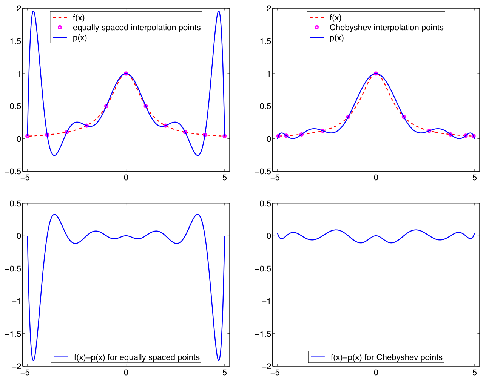

在相应光滑函数的数值实验中，Chebyshev 节点即使取 $n=100$ 也可能保持较小误差。这种表现依赖于具体问题，说明合理选择节点能显著改善高次插值。

### 3.6 多项式样条

使用样条函数插值的原因 The Reason of Using Polynomial Splines: Global interpolation often leads to larger errors because it uses a single high-degree polynomial to fit all data points, causing issues like the Runge phenomenon (oscillations at the edges) and numerical instability due to sensitivity to small changes in data. In contrast, polynomial splines divide the interval into smaller sections, using low-degree polynomials for each, ensuring better stability and accuracy in fitting local data patterns.

#### 线性样条插值 Linear Splines

定义 Definition: 线性样条插值 Linear Splines 是 simplest instance of continuous piecewise polynomial interpolation，它的每个插值区间上使用的是一条直线。也就是说，在每两个相邻的插值点之间，函数值通过一条直线连接。

函数值的连续性 Continuity of Function Values: 这种方法保证了在插值点 Nodes 的值是连续的，但是导数可能不连续。

线性样条的表达式 Expressions for Linear Splines: 在每个插值区间$\lbrack x_{i},\ x_{i + 1}\rbrack$上，

$$
S_{1,N}(x)=f(x_i)+m_i(x-x_i),\qquad m_i=\frac{f(x_{i+1})-f(x_i)}{x_{i+1}-x_i}.
$$

其中，$m_{i}$是直线的斜率。这说明，在每个插值区间上，Linear Splines 就是一条简单的直线。

线性样条简单且保证函数值连续，但相邻线段斜率不同时，一阶导数在节点处不连续，曲线出现折角。因此，对光滑过渡有要求时常采用更高次样条。

#### 误差上界 Error Bound of Linear Splines

$$
\max_{x \in \lbrack a,b\rbrack}\left| f(x) - S_{1,N}(x) \right| \leq \frac{h^{2}}{8} \cdot \max_{x \in \lbrack a,b\rbrack}\left| f^{(2)}(x) \right|
$$

**最大误差$\max_{x \in \lbrack a,b\rbrack}\left| f(x) - S_{1,N}(x) \right|$:** 这是函数$f(x)$和 linear splines $S_{1,N}(x)$之间的最大误差，也就是我们希望估计的插值误差。

**区间长度$h$: 这是插值点之间的最大距离**

$$
h = \max_{i}{(x_{i + 1} - x_{i})}
$$

**二阶导数的最大值$\max_{x \in \lbrack a,b\rbrack}\left| f^{(2)}(x) \right|$:** $f^{(2)}(x)$是函数$f(x)$的二阶导数。

Error Bound of Linear Splines 说明其 Error 随着$h$的增大而增大，并且其受到二阶导数的影响，如果函数变化剧烈，误差会增加。

#### 三次样条插值 Cubic Spline Interpolation

三次样条插值构造 $S\in C^2[a,b]$，即每个区间上的插值多项式及其一阶、二阶导数在节点处衔接连续。样条 $S$ 在每个区间上次数不超过三；构造样条本身只需数据点，高阶误差分析另需对原函数 $f$ 加光滑性假设。

##### 插值条件 Interpolation Condition: 对于每个插值区间$\lbrack x_{i},\ x_{i + 1}\rbrack$，都需要满足如下条件

- 函数值连续性 Continuity of Function Values: 对于每个区间的两端，插值多项式 Interpolating Polynomial $S_i(x)$在点$x_{i}$和$x_{i + 1}$处必须等于真实的函数值$f(x_{i})$和$f(x_{i + 1})$，即

    $$
    S_i\left( x_{i} \right) = f\left( x_{i} \right),\ {\ \ \ f}_{i}\left( x_{i + 1} \right) = f\left( x_{i + 1} \right),\ \ \ \ i = 0,1,\ldots,n - 1
    $$

- 一阶导数连续性 Continuity of First-Order Derivatives: 插值多项式 Interpolating Polynomial $S_i(x)$的导数在每个插值点上必须连续

    $$
    S_i'\left( x_{i + 1} \right) = S_{i+1}'\left( x_{i + 1} \right),\ \ \ i = 0,1,\ldots,n - 2
    $$

- 二阶导数的连续性 Continuity of Second-Order Derivatives: 插值多项式 Interpolating Polynomial $S_i(x)$的二阶导数在每个插值点上必须连续

    $$
    S_i^{''}\left( x_{i + 1} \right) = S_{i+1}^{''}\left( x_{i + 1} \right),\ \ \ i = 0,1,\ldots,n - 2
    $$

##### 三次样条插值的形式 Expressions for Cubic Spline Interpolation

$$
S(x)=S_i(x)=a_ix^3+b_ix^2+c_ix+d_i,\qquad x\in[x_i,x_{i+1}].
$$

其中$a_{i},\ b_{i},\ c_{i},\ d_{i}$是要通过插值点 Nodes 求解的系数。

#### 常见的边界条件 Common Boundary Conditions

##### 自然边界条件 Natural Boundary Conditions: 假设二阶导数在两端为0，即在$x_{0}$和$x_{N}$处有

$$
S_0^{''}\left( x_{0} \right) = 0,\ S_{N-1}^{''}\left( x_{N} \right) = 0
$$

自然边界条件适用于假设端点曲率为零的建模。若真实端点二阶导数不为零，自然边界可能限制端点附近精度；实际精度依赖原函数及边界条件。

##### 二阶导数条件：在两个端点指定二阶导数。若已知原函数端点二阶导数，可用其真实值，使边界曲率匹配：

$$
S_0^{''}\left( x_{0} \right) = f^{''}\left( x_{0} \right),\ S_{N-1}^{''}\left( x_{N} \right) = f''(x_{N})
$$

其逼近精度较好，误差可以达到$O(h^{4})$的精度。

##### 一阶导数条件：在两个端点指定一阶导数。若已知原函数端点一阶导数，可用其真实值，构成夹持样条：

$$
S_0'\left( x_{0} \right) = f'\left( x_{0} \right),\ S_{N-1}'\left( x_{N} \right) = f'(x_{N})
$$

其和 Second Derivative Conditions 一样，逼近精度较好，误差可以达到$O(h^{4})$的精度。

##### 非节点条件 Not-A-Knot Conditions: 在第二个和倒数第二个点（即$x_{1}$和$x_{N - 1}$）要求三阶导数连续

$$
S_0^{'''}\left( x_{1} \right) = S_1^{'''}\left( x_{1} \right),\ S_{N-2}^{'''}\left( x_{N - 1} \right) = S_{N-1}^{'''}(x_{N - 1})
$$

这种条件不在端点施加导数条件，而是在内部点进行约束。其可以让曲线更加平滑，是很多软件的默认条件。

常规 not-a-knot 的两条独立约束要求至少四个节点；三个节点时通常另约定为整体二次插值，两节点时可约定为直线。

#### 求解案例 Example

现在有三个插值点$x_{0} = 0,\ f\left( x_{0} \right) = 1.1;x_{1} = 1,\ f\left( x_{1} \right) = 0.9;x_{2} = 2,\ f\left( x_{2} \right) = 2.0$，请通过这些点，构建 Cubic Spline Interpolation。

**步骤 1：** 根据插值区间，写出所有的$S_i(x)$。

$$
S_0(x) = a_{0}x^{3} + b_{0}x^{2} + c_{0}x + d_{0}\ on\ \lbrack 0,1\rbrack
$$

$$
S_1(x) = a_{1}x^{3} + b_{1}x^{2} + c_{1}x + d_{1}\ on\ \lbrack 1,2\rbrack
$$

**步骤 2：** 通过函数值连续性 Continuity of Function Values 构建四个式子

$$
S_0(0) = 1.1 = a_{0} \cdot 0^{3} + b_{0} \cdot 0^{2} + c_{0} \cdot 0 + d_{0} = d_{0}
$$

$$
S_0(1) = 0.9 = a_{0} \cdot 1^{3} + b_{0} \cdot 1^{2} + c_{0} \cdot 1 + d_{0} = a_{0} + b_{0} + c_{0} + d_{0}
$$

$$
S_1(1) = 0.9 = a_{1} \cdot 1^{3} + b_{1} \cdot 1^{2} + c_{1} \cdot 1 + d_{1} = a_{1} + b_{1} + c_{1} + d_{1}
$$

$$
S_1(2) = 2.0 = a_{1} \cdot 2^{3} + b_{1} \cdot 2^{2} + c_{1} \cdot 2 + d_{1} = 8a_{1} + 4b_{1} + 2c_{1} + d_{1}
$$

**步骤 3：** 通过一阶导数连续性 Continuity of First-Order Derivatives 和二阶导数的连续性 Continuity of Second-Order Derivatives 构建两个式子

$$
S_i'(x) = 3a_{i}x^{2} + 2b_{i}x + c_{i}
$$

$$
S_i^{''}(x) = 6a_{i}x + 2b_{i}
$$

我们需要在$x_{1} = 1,\ f\left( x_{1} \right) = 0.9$确保两个连续性

$$
3a_{0} + 2b_{0} + c_{0} = 3a_{1} + 2b_{1} + c_{1}
$$

$$
6a_{0} + 2b_{0} = 6a_{1} + 2b_{1}
$$

**步骤 4：** 选定两条边界条件，补齐八个方程。本例采用自然边界条件。若已给定端点导数，也可采用其他适定边界条件；三点 not-a-knot 通常以整体二次多项式作为特殊约定。

$$
S_0^{\prime\prime}(0)=S_1^{\prime\prime}(2)=0.
$$

$$
2b_{0} = 0,\ 12a_{1} + 2b_{1} = 0
$$

解这八个方程得

$$
S_0(x)=\frac{13}{40}x^3-\frac{21}{40}x+\frac{11}{10},\qquad
S_1(x)=-\frac{13}{40}x^3+\frac{39}{20}x^2-\frac{99}{40}x+\frac74.
$$

#### 方程系统的唯一解 Unique Solution of the System of Equations

对于三次样条插值 Cubic Spline Interpolation，我们需要在每个子区间（两个插值点之间）上定义一个三次多项式，为了确保这些多项式的系数，我们需要构建一个方程系统。

假设我们有$N$个区间，即$N + 1$个节点，那么每个区间上需要4个条件（因为每个区间的多项式是3次的），因此一共需要$4N$个方程。

当节点互异且采用适定的两条边界条件时，这 $4N$ 个线性约束给出唯一的样条解。

#### 误差界限 Error Bound

以下四阶误差界假设 $f\in C^4[a,b]$，并使用匹配真实端点一阶或二阶导数的样条，或适当网格下的 not-a-knot 样条。以均匀网格为例，常数与网格步长无关。自然样条若端点曲率与原函数不匹配，则不一定满足这一全区间四阶界。

$$
\max_{x \in \left\lbrack x_{i - 1},\ x_{i} \right\rbrack}\left| f(x) - p_{3}(x) \right| \leq Ch^{4} \cdot \max_{x \in \lbrack a,b\rbrack}\left| f^{(4)}(x) \right|
$$

这是**两个相邻插值点之间的最大误差公式**。$f(x)$为 Real Function，而$p_{3}(x)$是 Cubic Spline Interpolation Polynomial。

**C 为一个常数 Constant。**

**$h$是插值点之间的最大距离$h = \max_{i}{|x_{i} - x_{i - 1}|}$。**

**$f^{(4)}(x)$是函数的四阶导数，反映函数的光滑性。**

在上述假设下，当最大网格间距 $h$ 缩小时，误差上界按 $h^4$ 的量级减小。

如果我们正确的设定 first and second derivative value 或者使用 not-a-knot cubic splines，Cubic Spline Interpolation 就可以完美重现三阶多项式，即其在拟合两个点之间的三次多项式的时候是没有误差的。

### 3.7 最小二乘拟合

#### 为什么有时候使用最小二乘拟合而不是插值 Why Least Squares Fitting?

- 希望寻求数据中的趋势 Seeking trend in data.
- 数据本身可能有测量错误 Data may contain measurement errors.
- 希望模型只依赖较少参数 $a_0,\ldots,a_M$，而不是为每个数据点增加一个参数。
- 更直接和效率构建方程 Construction of function “straightforward and efficient”.

#### 最小二乘多项式的定义 Definition of Least Squares Polynomial

我们定义一个任意拟合数据的多项式$q_{M}(x)$，其是一个 polynomial of degree at most M。假设$f_{r}$是实际值，那么误差就是

$$
q_{M}\left( x_{r} \right) - f_{r}
$$

我们可以定义一个误差度量，即平方误差和 Sum of the Squares of Errors，来说明 How well $q_{M}(x)$ fits data。

$$
\sigma\left( q_{M} \right) = \sum_{r = 0}^{N}\left\{ q_{M}\left( x_{r} \right) - f_{r} \right\}^{2}
$$

现在，我们可以设一个$p_{M}(x)$，是 polynomial of degree at most M。当

$$
\sigma\left( p_{M} \right) \leq \sigma\left( q_{M} \right)\ \forall\ q_{M}(x)
$$

我们称，$p_{M}(x)$是 M 次的最小二乘多项式 Least Squares Polynomial。

##### 关键点 Key Points

- 最小二乘法 Least Squares Fitting 寻找的多项式是让误差度量$\sigma_{M}$最小的多项式，因此我们定义$\sigma\left( p_{M} \right) \leq \sigma\left( q_{M} \right)\ \forall\ q_{M}(x)$。
- 尽管 Least Squares Polynomial $p_{M}(x)$产生了最小的误差度量$\sigma_{M}$，这不意味着其一定是对数据的“最佳拟合 Best Fit”，其可能出现过拟合或欠拟合 Overfitting or Underfitting 的情况。

#### 如何寻找最小二乘多项式 How to Find Least Squares Polynomial?

##### 幂级数的多项式形式 Polynomial Form of Power Series

$$
p_{M}(x) = a_{0} + a_{1}x + \ldots + a_{M}x^{M}
$$

其中，$a_{0},\ a_{1},\ldots,\ a_{M}$是待定的未知系数。

误差函数 Error Function: 误差度量$\sigma_{M}$是关于这些未知系数$a_{i}$的二次函数。

$$
\sigma_{M} = \sum_{r = 0}^{N}\left\{ p_{M}\left( x_{r} \right) - f_{r} \right\}^{2}
$$

##### 如何寻找$a_{i}$使得$\sigma_{M}$最小？How to Find $a_{i}$ such that $\sigma_{M}$ Is Minimized?

基本思想 Basic Ideas: 对误差函数 Error Function 对于每个系数$a_{i}$分别求偏导，并让偏导数为0。

$$
\frac{\partial\sigma_{M}}{\partial a_{0}} = 0,\ \frac{\partial\sigma_{M}}{\partial a_{1}} = 0,\ldots,\ \frac{\partial\sigma_{M}}{\partial a_{M}} = 0
$$

正规方程 Normal Equations: 这些导数方程组合起来形成了一个线性方程组，被称为正规方程 Normal Equations。通过解 Normal Equations，我们可以得到最优的$a_{i}$，从而最小化误差。

$$
\begin{array}{r}
a_{0}\sum_{r = 0}^{N}\, x_{r}^{j} + a_{1}\sum_{r = 0}^{N}\, x_{r}^{j + 1} + \cdots + a_{M}\sum_{r = 0}^{N}\, x_{r}^{j + M} = \sum_{r = 0}^{N}\, f_{r}x_{r}^{j},j = 0,1,\ldots,M
\end{array}
$$

$$
Aa = b
$$

$$
\begin{bmatrix}
\sum_{r = 0}^{N}\, 1 & \sum_{r = 0}^{N}\, x_{r} & \ldots & \sum_{r = 0}^{N}\, x_{r}^{M} \\
\sum_{r = 0}^{N}\, x_{r} & \sum_{r = 0}^{N}\, x_{r}^{2} & \ldots & \sum_{r = 0}^{N}\, x_{r}^{M + 1} \\
\vdots & \vdots & \ddots & \vdots \\
\sum_{r = 0}^{N}\, x_{r}^{M} & \sum_{r = 0}^{N}\, x_{r}^{M + 1} & \ldots & \sum_{r = 0}^{N}\, x_{r}^{2M}
\end{bmatrix}\left\lbrack \begin{array}{r}
a_{0} \\
a_{1} \\
\vdots \\
a_{M}
\end{array} \right\rbrack = \left\lbrack \begin{array}{r}
\sum_{r = 0}^{N}\, f_{r} \\
\sum_{r = 0}^{N}\, f_{r}x_{r} \\
\vdots \\
\sum_{r = 0}^{N}\, f_{r}x_{r}^{M}
\end{array} \right\rbrack
$$

其中 N 是数据点总数减1。

正规矩阵的性质：$A=V^TV$ 总是对称半正定；当设计矩阵 $V$ 满列秩时才正定，最小二乘系数唯一。平方误差函数为凸二次函数，驻点为全局最小点。正定性不自动保证良好的数值条件。

#### 使用其他基函数在最小二乘法 Other Basis Functions in Least Squares Fitting

$$
\begin{array}{r}
p_{M}(x) = a_{0}\phi_{0}(x) + a_{1}\phi_{1}(x) + \cdots + a_{M}\phi_{M}(x)
\end{array}
$$

$$
\begin{bmatrix}
\sum_{r = 0}^{N}\,\phi_{0}(x_{r})^{2} & \sum_{r = 0}^{N}\,\phi_{0}(x_{r})\phi_{1}(x_{r}) & \ldots & \sum_{r = 0}^{N}\,\phi_{0}(x_{r})\phi_{M}(x_{r}) \\
\sum_{r = 0}^{N}\,\phi_{1}(x_{r})\phi_{0}(x_{r}) & \sum_{r = 0}^{N}\,\phi_{1}(x_{r})^{2} & \ldots & \sum_{r = 0}^{N}\,\phi_{1}(x_{r})\phi_{M}(x_{r}) \\
\vdots & \vdots & \ddots & \vdots \\
\sum_{r = 0}^{N}\,\phi_{M}(x_{r})\phi_{0}(x_{r}) & \sum_{r = 0}^{N}\,\phi_{M}(x_{r})\phi_{1}(x_{r}) & \ldots & \sum_{r = 0}^{N}\,\phi_{M}(x_{r})^{2}
\end{bmatrix}\left\lbrack \begin{array}{r}
a_{0} \\
a_{1} \\
\vdots \\
a_{M}
\end{array} \right\rbrack = \left\lbrack \begin{array}{r}
\sum_{r = 0}^{N}\, f_{r}\phi_{0}(x_{r}) \\
\sum_{r = 0}^{N}\, f_{r}\phi_{1}(x_{r}) \\
\vdots \\
\sum_{r = 0}^{N}\, f_{r}\phi_{M}(x_{r})
\end{array} \right\rbrack
$$

我们可以使用其他基函数 Basis Functions 来代替幂级数，在上述公式中$\phi_{M}(x)$就是选取的基函数，其可以是拉格朗日基函数 Lagrange Basis Function、切比雪夫基函数 Chebyshev Basis Function 或其他。

不过，随着基函数数量的增加，矩阵的病态性 ill-conditioning 可能会更加严重，意味着求解可能会变得不稳定。

#### 案例一 Example 1

有四个数据点$(1,1),\ (2,2),\ (3,2),\ (4,4)$，请使用二次多项式$p(x) = a_{0} + a_{1}x + a_{2}x^{2}$来拟合这些数据点。

**步骤 1：** 定义误差函数

$$
\sigma_{M} = \sum_{r = 0}^{N}\left\{ p_{M}\left( x_{r} \right) - f_{r} \right\}^{2} = \sum_{r = 0}^{N}\left( a_{0} + a_{1}x_{r} + a_{2}x_{r}^{2} - f_{r} \right)^{2}
$$

**步骤 2：** 对$\sigma_{M}$对$a_{0},\ a_{1},\ a_{2}$分别求导，并让导数为0，得到3个线性方程。

$$
\frac{\partial\sigma_{M}}{\partial a_{0}} = 2\sum_{r = 0}^{N}{(a_{0} + a_{1}x_{r} + a_{2}x_{r}^{2} - f_{r})} = 0
$$

$$
4a_{0} + \sum_{r = 0}^{N}{a_{1}x_{r}} + \sum_{r = 0}^{N}{a_{2}x_{r}^{2}} = \sum_{r = 0}^{N}f_{r}
$$

$$
\frac{\partial\sigma_{M}}{\partial a_{1}} = 2\sum_{r = 0}^{N}\, x_{r}\left( a_{0} + a_{1}x_{r} + a_{2}x_{r}^{2} - f_{r} \right) = 0
$$

$$
a_{0}\sum_{r = 0}^{N}\, x_{r} + a_{1}\sum_{r = 0}^{N}\, x_{r}^{2} + a_{2}\sum_{r = 0}^{N}\, x_{r}^{3} = \sum_{r = 0}^{N}\, f_{r}x_{r}
$$

$$
\frac{\partial\sigma_{M}}{\partial a_{2}} = 2\sum_{r = 0}^{N}\, x_{r}^{2}\left( a_{0} + a_{1}x_{r} + a_{2}x_{r}^{2} - f_{r} \right) = 0
$$

$$
a_{0}\sum_{r = 0}^{N}\, x_{r}^{2} + a_{1}\sum_{r = 0}^{N}\, x_{r}^{3} + a_{2}\sum_{r = 0}^{N}\, x_{r}^{4} = \sum_{r = 0}^{N}\, f_{r}x_{r}^{2}
$$

**步骤 3：** 形成线性方程组（正规方程）

$$
\begin{bmatrix}
4 & \sum_{r = 0}^{3}\, x_{r} & \sum_{r = 0}^{3}\, x_{r}^{2} \\
\sum_{r = 0}^{3}\, x_{r} & \sum_{r = 0}^{3}\, x_{r}^{2} & \sum_{r = 0}^{3}\, x_{r}^{3} \\
\sum_{r = 0}^{3}\, x_{r}^{2} & \sum_{r = 0}^{3}\, x_{r}^{3} & \sum_{r = 0}^{3}\, x_{r}^{4}
\end{bmatrix}\left\lbrack \begin{array}{r}
a_{0} \\
a_{1} \\
a_{2}
\end{array} \right\rbrack = \left\lbrack \begin{array}{r}
\sum_{r = 0}^{3}\, f_{r} \\
\sum_{r = 0}^{3}\, f_{r}x_{r} \\
\sum_{r = 0}^{3}\, f_{r}x_{r}^{2}
\end{array} \right\rbrack
$$

$$
\begin{bmatrix}
4 & 10 & 30 \\
10 & 30 & 100 \\
30 & 100 & 354
\end{bmatrix}\left\lbrack \begin{array}{r}
a_{0} \\
a_{1} \\
a_{2}
\end{array} \right\rbrack = \left\lbrack \begin{array}{r}
9 \\
27 \\
91
\end{array} \right\rbrack
$$

**步骤 4：** 求解线性方程组即可得到$a_{0},\ a_{1},\ a_{2}$。

#### 案例二 Example 2

有四个数据点$( - 1,1),\ ( - 0.5,2),\ (0.5,2),\ (1,4)$，请使用切比雪夫基函数 Chebyshev Basis Function 来拟合这些数据点。

我们希望拟合的多项式是:

$$
p(x) = a_{0}T_{0}(x) + a_{1}T_{1}(x) + a_{2}T_{2}(x)
$$

正规方程可以写成矩阵形式

$$
\begin{bmatrix}
\sum_{r = 0}^{N}\, T_{0}(x_{r})^{2} & \sum_{r = 0}^{N}\, T_{0}(x_{r})T_{1}(x_{r}) & \sum_{r = 0}^{N}\, T_{0}(x_{r})T_{2}(x_{r}) \\
\sum_{r = 0}^{N}\, T_{1}(x_{r})T_{0}(x_{r}) & \sum_{r = 0}^{N}\, T_{1}(x_{r})^{2} & \sum_{r = 0}^{N}\, T_{1}(x_{r})T_{2}(x_{r}) \\
\sum_{r = 0}^{N}\, T_{2}(x_{r})T_{0}(x_{r}) & \sum_{r = 0}^{N}\, T_{2}(x_{r})T_{1}(x_{r}) & \sum_{r = 0}^{N}\, T_{2}(x_{r})^{2}
\end{bmatrix}\left\lbrack \begin{array}{r}
a_{0} \\
a_{1} \\
a_{2}
\end{array} \right\rbrack = \left\lbrack \begin{array}{r}
\sum_{r = 0}^{N}\, f_{r}T_{0}(x_{r}) \\
\sum_{r = 0}^{N}\, f_{r}T_{1}(x_{r}) \\
\sum_{r = 0}^{N}\, f_{r}T_{2}(x_{r})
\end{array} \right\rbrack
$$

在这道题中，我们可以知道$T_{0}(x) = 1,\ T_{1}(x) = x,\ T_{2}(x) = 2x^{2} - 1$。对于给定的数据点，我们代入计算即可。

#### 通过设计矩阵构建正规方程 Constructing Normal Equations by Design Matrix

设计矩阵 Design Matrix: 对于 Basis Function 是 Power Function 的情况，可以设矩阵 V 是设计矩阵 Design Matrix，其包含数据点$x_{i}$的所有幂次信息。

$$
V = \begin{bmatrix}
1 & x_{0} & \ldots & x_{0}^{M} \\
1 & x_{1} & \ldots & x_{1}^{M} \\
1 & x_{2} & \ldots & x_{2}^{M} \\
\vdots & \vdots & \ddots & \vdots \\
1 & x_{N} & \ldots & x_{N}^{M}
\end{bmatrix},\ V \in \mathbb{R}^{n \times m}
$$

此处 $n=N+1$ 为观测数量，$m=M+1$ 为基函数数量，通常 $n\ge m$。

广义设计矩阵：当基函数不是幂函数，而选用其他函数 $\phi_j$ 时，设计矩阵的元素为 $V_{ij}=\phi_j(x_i)$。以下共有 $n$ 个观测、$m$ 个基函数：

$$
V=\begin{bmatrix}
\phi_0(x_1)&\phi_1(x_1)&\cdots&\phi_{m-1}(x_1)\\
\phi_0(x_2)&\phi_1(x_2)&\cdots&\phi_{m-1}(x_2)\\
\vdots&\vdots&\ddots&\vdots\\
\phi_0(x_n)&\phi_1(x_n)&\cdots&\phi_{m-1}(x_n)
\end{bmatrix}\in\mathbb R^{n\times m}.
$$

构建正规方程 Constructing Normal Equations: 我们最初对于误差度量的定义是$\sigma\left( q_{M} \right) = \sum_{r = 0}^{N}\left\{ q_{M}\left( x_{r} \right) - f_{r} \right\}^{2}$，我们也可以使用二范数2-Norm 来表示。

$$
\parallel Va - f \parallel_{2}^{2} = \sum_{r = 0}^{N}\,(p_{M}(x_{r}) - f_{r})^{2}
$$

由于二范数2-Norm 的平方和等价于误差项的平方和，因此我们可以得出上述等式。最小二乘法 Least Squares Fitting 目标是最小化这种误差平方和，即

$$
\min_{a}{\parallel Va - f \parallel_{2}^{2}}\,
$$

通过对上式中的$a$求导并令导数为0，可以得到正规方程 Normal Equations。

根据2-Norm 的公式$\parallel x \parallel_{2} = \sqrt{x^{T}x}$，因此

$$
\parallel Va - f \parallel_{2}^{2}\  = (Va - f)^{T}(Va - f) = a^{T}V^{T}Va - 2f^{T}Va + f^{T}f
$$

$$
\frac{\partial}{\partial a}\left( a^{T}V^{T}Va - 2f^{T}Va + f^{T}f \right) = 2V^{T}Va - 2V^{T}f
$$

$$
2V^{T}Va - 2V^{T}f = 0\  \Rightarrow V^{T}Va = V^{T}f
$$

因此，我们可以将原 Normal Equations 写为$V^{T}Va = V^{T}f$。

##### 案例 Example:

 有四个数据点$(1,1),\ (2,2),\ (3,2),\ (4,4)$，请使用二次多项式$p(x) = a_{0} + a_{1}x + a_{2}x^{2}$来拟合这些数据点。

**步骤 1：** 构建设计矩阵 Design Matrix 和向量$f$。

$$
V = \begin{bmatrix}
1 & x_{0} & x_{0}^{2} \\
1 & x_{1} & x_{1}^{2} \\
1 & x_{2} & x_{2}^{2} \\
1 & x_{3} & x_{3}^{2}
\end{bmatrix} = \begin{bmatrix}
1 & 1 & 1^{2} \\
1 & 2 & 2^{2} \\
1 & 3 & 3^{2} \\
1 & 4 & 4^{2}
\end{bmatrix} = \begin{bmatrix}
1 & 1 & 1 \\
1 & 2 & 4 \\
1 & 3 & 9 \\
1 & 4 & 16
\end{bmatrix}
$$

$$
f = \left\lbrack \begin{array}{r}
f_{0} \\
f_{1} \\
f_{2} \\
f_{3}
\end{array} \right\rbrack = \left\lbrack \begin{array}{r}
1 \\
2 \\
2 \\
4
\end{array} \right\rbrack
$$

**步骤 2：** 构建正规方程 Normal Equations。

$$
V^{T}Va = V^{T}f
$$

$$
V^{T}V = \begin{bmatrix}
1 & 1 & 1 & 1 \\
1 & 2 & 3 & 4 \\
1 & 4 & 9 & 16
\end{bmatrix}\begin{bmatrix}
1 & 1 & 1 \\
1 & 2 & 4 \\
1 & 3 & 9 \\
1 & 4 & 16
\end{bmatrix} = \begin{bmatrix}
4 & 10 & 30 \\
10 & 30 & 100 \\
30 & 100 & 354
\end{bmatrix}
$$

$$
V^{T}f = \begin{bmatrix}
1 & 1 & 1 & 1 \\
1 & 2 & 3 & 4 \\
1 & 4 & 9 & 16
\end{bmatrix}\left\lbrack \begin{array}{r}
1 \\
2 \\
2 \\
4
\end{array} \right\rbrack = \begin{bmatrix}
9 \\
27 \\
91
\end{bmatrix}
$$

$$
\begin{bmatrix}
4 & 10 & 30 \\
10 & 30 & 100 \\
30 & 100 & 354
\end{bmatrix}\left\lbrack \begin{array}{r}
a_{0} \\
a_{1} \\
a_{2}
\end{array} \right\rbrack = \left\lbrack \begin{array}{r}
9 \\
27 \\
91
\end{array} \right\rbrack
$$

**步骤 3：** 解正规方程 Normal Equations。

解得 $a_0=5/4$、$a_1=-7/20$、$a_2=1/4$，因此 $p(x)=5/4-(7/20)x+x^2/4$。

#### QR 分解解最小二乘法问题 QR Decomposition for Solving Least Squares Problems

为什么使用 QR 分解：若 $V$ 满列秩，$\kappa_2(V^TV)=\kappa_2(V)^2$。显式形成正规方程会使数值条件更差，QR 可避免这一步的额外放大。

##### 如何使用 QR 分解 How to Use QR Decomposition:

$$
V = QR
$$

$Q\in\mathbb R^{n\times n}$ 为正交矩阵，$R\in\mathbb R^{n\times m}$ 为上梯形矩阵，前 $m$ 行构成非奇异上三角块 $R_m$。

将 $Q^Tf$ 分成前 $m$ 项 $b$ 与其余项 $c$，可将最小二乘问题写为使以下残差最小：

$$
\min_a\lVert Ra-Q^Tf\rVert_2^2,\qquad R_ma=b.
$$

在求解的过程中，由于 V 不是方阵，这导致了 R 也并非方阵的问题。

为了得出近似解，我们只需要考虑 R 上面的$m \times m$方阵的部分，并且只需要考虑$Q^{T}f$的前 m 项。通过这样的方法来得出近似解。具体推导过程如下：

$$
\begin{aligned}
\begin{array}{r}
\lVert Va - f\rVert_{2}^{2}
\end{array} & \begin{array}{r}
= \lVert QRa - f\rVert_{2}^{2}
\end{array} \\
& \begin{array}{r}
= \lVert Q^{T}(QRa - f)\rVert_{2}^{2}
\end{array} \\
& = \lVert Q^{T}QRa - Q^{T}f\rVert_{2}^{2} \\
& \begin{array}{r}
= \lVert Ra - Q^{T}f\rVert_{2}^{2}
\end{array} \\
& = \left. \parallel\left\lbrack \begin{array}{r}
R_{m} \\
0
\end{array} \right\rbrack a - \left\lbrack \begin{array}{r}
b \\
c
\end{array} \right\rbrack \right.\parallel_{2}^{2} \\
& \begin{array}{r}
= \lVert R_{m}a - b\rVert_{2}^{2} + \lVert c\rVert_{2}^{2}
\end{array}
\end{aligned}
$$

上式把目标分解为 $\lVert R_ma-b\rVert_2^2+\lVert c\rVert_2^2$。第二项与 $a$ 无关，因此回代解 $R_ma=b$ 即得最小二乘系数；$\lVert c\rVert_2^2$ 仍是最小残差平方和，评价拟合误差时须保留。

##### 案例 Example:

 有四个数据点$(1,1),\ (2,2),\ (3,2),\ (4,4)$，请使用二次多项式$p(x) = a_{0} + a_{1}x + a_{2}x^{2}$来拟合这些数据点。

**步骤 1：** 构建设计矩阵 Design Matrix 和向量$f$。

$$
V = \begin{bmatrix}
1 & x_{0} & x_{0}^{2} \\
1 & x_{1} & x_{1}^{2} \\
1 & x_{2} & x_{2}^{2} \\
1 & x_{3} & x_{3}^{2}
\end{bmatrix} = \begin{bmatrix}
1 & 1 & 1^{2} \\
1 & 2 & 2^{2} \\
1 & 3 & 3^{2} \\
1 & 4 & 4^{2}
\end{bmatrix} = \begin{bmatrix}
1 & 1 & 1 \\
1 & 2 & 4 \\
1 & 3 & 9 \\
1 & 4 & 16
\end{bmatrix}
$$

$$
f = \left\lbrack \begin{array}{r}
f_{0} \\
f_{1} \\
f_{2} \\
f_{3}
\end{array} \right\rbrack = \left\lbrack \begin{array}{r}
1 \\
2 \\
2 \\
4
\end{array} \right\rbrack
$$

**步骤 2：** 针对 V 进行 QR 分解。

**步骤 3：** 计算$Q^{T}f$，并只保留前3行。对于 R，也只保留其$3 \times 3$方阵的部分。

**步骤 4：** 取 $R$ 的前三行得到 $R_3$，取 $Q^Tf$ 的前三项得到 $b$，回代解 $R_3a=b$。

## 第四单元 数值微分与积分（Differentiation and Integration）

### 4.1 数值微分与步长选择

#### 为什么要使用数值微分一个方程 Why Differentiate A Function Numerically?

- Derivatives may be complicated to determine analytically.
- Function may not be explicitly known.

#### 微分的标准定义 Formal Definition of a Derivative

微分的表达式 Expression for Differentiation

$$
\begin{array}{r}
f'(x) = \lim_{h \rightarrow 0}\,\frac{f(x + h) - f(x)}{h}
\end{array}
$$

在上述公式中，假设$f(x)$是 Differentiable，且$f(x)$ defined in interval centered at $x$。

#### 如何在 MATLAB 中选择$h$ How Do We Choose $h$?

离散化误差或截断误差 Discretization Error or Truncation Error: 这些误差随着$h$的减小而减小。如果函数$f$具有足够的平滑性（即函数的导数存在且连续），那么将$h$取得越小，Discretization Error 也会越小。因此，在理论上，我们希望$h$尽可能缩小，以减小误差。

灾难性抵消 Catastrophic Cancellation: 但是，在 MATLAB 中，当$h$非常小的时候，数值计算会受到 Catastrophic Cancellation 的限制。因此，实际上过小的$h$会引发数值问题。

步长选择：一阶精度的一阶导数差分可用 $C_Th+C_Ru/h$ 估计总误差，最优步长的量级为 $\sqrt u$。若一阶导数公式具有 $p$ 阶截断精度，则常见平衡步长为 $u^{1/(p+1)}$，还需考虑函数与自变量尺度。步长过小会使舍入误差占主导。

### 4.2 前向差分与后向差分

以下各差分公式及相应 Taylor 余项均假设 $f$ 在所有取样点所覆盖的区间上具有所需的连续导数，且步长 $h>0$。

#### 前向差分法 Forward Difference:

 Forward Difference 就是使用$f(a + h)$的 Taylor Series Expansion 推得$f'(a)$。对于 Taylor Series Expansion，我们只保留到二阶导数项。

$$
f(a + h) = f(a) + hf'(a) + \frac{h^{2}}{2}f''(\xi)
$$

因此，我们可以推得

$$
f'(a) = \frac{f(a + h) - f(a)}{h} - \frac{h}{2}f''(\xi)
$$

其中，$\frac{h}{2}f''(\xi)$是误差项，并且贡献了主要误差。对于前向差分法 Forward Difference，我们只使用$f(a + h)$和$f(a)$进行逼近，其误差精度是$O(h)$。

前向差分法 Forward Difference 的估计公式为

$$
f'(a) \approx \frac{f(a + h) - f(a)}{h}
$$

#### 后向差分法 Backward Difference:

 Backward Difference 就是使用$f(a - h)$的 Taylor Series Expansion 推得$f'(a)$。对于 Taylor Series Expansion，我们只保留到二阶导数项。

$$
f(a - h) = f(a) - hf'(a) + \frac{h^{2}}{2}f''(\xi)
$$

因此，我们可以推得

$$
f'(a) = \frac{f(a) - f(a - h)}{h} + \frac{h}{2}f''(\xi)
$$

其中，$\frac{h}{2}f''(\xi)$是误差项，并且贡献了主要误差。对于后向差分法 Backward Difference，我们只使用$f(a - h)$和$f(a)$进行逼近，其误差精度也是$O(h)$。

后向差分法 Backward Difference 的估计公式为

$$
f'(a) \approx \frac{f(a) - f(a - h)}{h}
$$

#### 高阶单边差分法 One-Sided Difference (Higher Order)

之前的单边差分：前向公式使用 $f(a)$、$f(a+h)$，后向公式使用 $f(a)$、$f(a-h)$，各使用两个函数值，误差为 $O(h)$。

高阶单边差分法 One-Sided Difference (Higher Order): 我们使用了单边两个步长$h$来近似$f'(a)$。对于单侧取两个$h$来近似，误差精度是$O(h^{2})$。

- 高阶前向差分公式 Higher Order Forward Difference: 使用了点$f(a),\ f(a + h),\ f(a + 2h)$，即在$a$点右侧取了两个$h$。

    $$
    f'(a) \approx \frac{- 3f(a) + 4f(a + h) - f(a + 2h)}{2h}
    $$

- 高阶后向差分公式 Higher Order Backward Difference: 使用了点$f(a),\ f(a - h),\ f(a - 2h)$，即在$a$点左侧取了两个$h$。

    $$
    f'(a) \approx \frac{f(a - 2h) - 4f(a - h) + 3f(a)}{2h}
    $$

### 4.3 中心差分与误差比较

#### 一阶导数的中间差分法 Centered Difference for First Order Derivatives:

 对于一阶导数的 Centered Difference，我们使用$f(a + h)$的 Taylor Series 减去$f(a - h)$的 Taylor Series 得到。

$$
\begin{array}{r}
f(a + h) = f(a) + hf'(a) + \frac{h^{2}}{2}f''(a) + \frac{h^{3}}{3!}f^{(3)}\left( \xi_{1} \right) \\
f(a - h) = f(a) - hf'(a) + \frac{h^{2}}{2}f''(a) - \frac{h^{3}}{3!}f^{(3)}\left( \xi_{2} \right)
\end{array}
$$

在上述 Taylor Series Expansion 中，我们保留到三阶导数项。这是因为当我们使用$f(a + h) - f(a - h)$时，偶次项（例如$\frac{h^{2}}{2}f''(a)$）会互相抵消，而奇次项（例如$hf'(a)$和$\frac{h^{3}}{3!}f^{(3)}(a)$）会被保留下来。这种抵消的效果让误差项提升到$O(h^{2})$水平，这使得 Centered Difference 有更高的精度。

$$
f(a + h) - f(a - h) = 2hf'(a) + \frac{2h^{3}}{3!}f^{(3)}(\xi)
$$

$$
f'(a) = \frac{f(a + h) - f(a - h)}{2h} - \frac{h^{2}}{3!}f^{(3)}(\xi)
$$

其中，$\frac{h^{2}}{3!}f^{(3)}(\xi)$是误差项，并且贡献了主要误差。一阶导数的中间差分法 Centered Difference Method for First Order Derivatives 的估计公式为

$$
f'(a) \approx \frac{f(a + h) - f(a - h)}{2h}
$$

#### 二阶导数的中心差分：

将 $f(a+h)$ 与 $f(a-h)$ 在 $a$ 附近的 Taylor 展开相加，并消去奇次项。

$$
\begin{array}{r}
f(a + h) = f(a) + hf'(a) + \frac{h^{2}}{2}f''(a) + \frac{h^{3}}{3!}f^{(3)}(a) + \frac{h^{4}}{4!}f^{(4)}\left( \xi_{1} \right) \\
f(a - h) = f(a) - hf'(a) + \frac{h^{2}}{2}f''(a) - \frac{h^{3}}{3!}f^{(3)}(a) + \frac{h^{4}}{4!}f^{(4)}\left( \xi_{2} \right)
\end{array}
$$

在上述 Taylor Series Expansion 中，我们保留到四阶导数项。这是因为当我们使用$f(a + h) + f(a - h)$时，奇次项（例如$hf'(a)$和$\frac{h^{3}}{3!}f^{(3)}(a)$）会互相抵消，而偶次项（例如$\frac{h^{2}}{2}f''(a)$和$\frac{h^{4}}{4!}f^{(4)}(a)$）会被保留下来。这种抵消的效果让误差项提升到$O(h^{2})$水平，这使得 Centered Difference 有更高的精度。

$$
f(a + h) + f(a - h) = 2f(a) + h^{2}f^{''}(a) + \frac{h^{4}}{12}f^{(4)}(\xi)
$$

$$
f^{''}(a) = \frac{f(a + h) - 2f(a) + f(a - h)}{h^{2}} - \frac{h^{2}}{12}f^{(4)}(\xi)
$$

其中，$\frac{h^{2}}{12}f^{(4)}(\xi)$是误差项，并且贡献了主要误差。二阶导数的中间差分法 Centered Difference Method for Second Order Derivatives 的估计公式为

$$
f^{''}(a) \approx \frac{f(a + h) - 2f(a) + f(a - h)}{h^{2}}
$$

#### 中心四阶差分法 Centered Fourth Order Difference

之前的中心差分：一阶导数公式使用 $f(a-h)$、$f(a+h)$；二阶导数公式还使用 $f(a)$。两者的截断误差均为 $O(h^2)$。

中心四阶差分法 Centered Fourth Order Difference: 该公式会在$a$点的左右各取两个$h$，也就是使用$f(a - 2h),\ f(a - h),\ f(a + h),\ f(a + 2h)$四个点进行估计，这种方法的误差是$O(h^{4})$。

$$
f'(a) \approx \frac{1}{12h}\left( f(a - 2h) - 8f(a - h) + 8f(a + h) - f(a + 2h) \right)
$$

#### 误差对比 Comparison of Errors

精度比较：读取最终导数近似的截断误差中 $h$ 的幂次。下表统一定义误差为“精确导数减差分近似”，列出足够光滑时的 Taylor 主项。

| 方法 | 截断误差主项 | 精度 |
| --- | --- | --- |
| Forward difference | $-\frac h2 f''(a)$ | $O(h)$ |
| Backward difference | $+\frac h2 f''(a)$ | $O(h)$ |
| Second-order forward difference | $+\frac{h^2}{3}f^{(3)}(a)$ | $O(h^2)$ |
| Second-order backward difference | $+\frac{h^2}{3}f^{(3)}(a)$ | $O(h^2)$ |
| Centered difference for the first derivative | $-\frac{h^2}{6}f^{(3)}(a)$ | $O(h^2)$ |
| Centered difference for the second derivative | $-\frac{h^2}{12}f^{(4)}(a)$ | $O(h^2)$ |
| Fourth-order centered difference for the first derivative | $+\frac{h^4}{30}f^{(5)}(a)$ | $O(h^4)$ |

高阶中心差分的比较：以 $f(x)=e^x$ 在 $x=0$ 处为例，$f'(0)=1$。下图比较前向、二阶中心和四阶中心差分，显示误差为“差分近似减 $1$”，与上一表的误差符号约定相反。

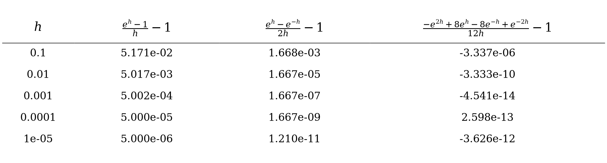

- Forward Difference 的误差随着$h$减小成线性缩小，符合$O(h)$的定义。
- Centered Difference 的误差呈现出二阶精度，即随着$h^{2}$减小，符合$O(h^{2})$的定义。
- 四阶中心差分在截断误差占主导时按 $O(h^4)$ 减小，往往比低阶方法更精确。双精度下继续减小 $h$ 后，舍入误差会限制并可能破坏这种下降趋势。

在函数足够光滑、步长适当且截断误差占主导时，较高阶差分公式可达到更高精度。

在截断误差主导区间，较高阶中心差分的误差随 $h$ 缩小得更快；达到舍入误差主导区间后，总误差不再按该幂次持续下降。

### 4.4 积分与插值求积

#### 积分的标准定义与数值积分求积法则 Definition of Integration and Quadrature Rule

##### 积分的标准定义 Definition of Integration

$$
\int_{a}^{b}\, f(x)dx
$$

这是一个定积分 Definite Integral，其中$f$是一个可积函数 Integrable Function，$\lbrack a,b\rbrack$是一个有限区间 Finite Interval。

##### 数值积分求积法则 Quadrature Rule

$$
\begin{array}{r}
\int_{a}^{b}\, f(x)dx \approx \sum_{j = 0}^{n}\, w_{j}f(x_{j})
\end{array}
$$

数值积分求积公式 Quadrature Rule 用于通过加权求和的方式来近似计算函数在某一区间上的定积分 Definite Integral。其通过选取区间上的节点 Nodes $x_{j}$以及相应的权重 Weights $w_{j}$，将积分转化为这些节点处函数值的加权和 weighted sum of function values at nodes。

插值求积法 Interpolatory Quadrature: 我们使用上章的 Lagrange Interpolation Polynomial，构建出一个通过已知数据点的 Interpolation Polynomial $p_{N}(x)$。我们设真实积分为$I(f)$，我们通过 Interpolation Polynomial 来近似积分

$$
I(f) \approx I(p_{N})
$$

插值多项式的基本公式是

$$
p_{N}(x) = f_{0}\mathcal{l}_{0}(x) + f_{1}\mathcal{l}_{1}(x) + \cdots + f_{N}\mathcal{l}_{N}(x)
$$

在插值求积中，用 $p_N$ 的积分近似 $f$ 的积分。对插值多项式的积分可交换有限求和与积分次序：

$$
\begin{aligned}
\int_{a}^{b}\, f(x)dx \approx \int_{a}^{b}\, p_{N}(x)dx & & = & \int_{a}^{b}\,\sum_{j = 0}^{n}\, f(x_{j})L_{j}(x)dx \\
& & = & \sum_{j = 0}^{n}\, f(x_{j})\int_{a}^{b}\, L_{j}(x)dx
\end{aligned}
$$

交换求和与积分后，每项函数值 $f(x_j)$ 对积分变量 $x$ 为常数，因而可从该项积分提出。剩余的 $\int_a^bL_j(x)\,dx$ 是对应权重 $w_j$，可事先计算。

$$
w_{j} = \int_{a}^{b}\, L_{j}(x)dx
$$

因此，我们有如下式子，被称为 Interpolatory Quadrature

$$
I(f) \approx I(p_{N}) = I(\sum_{i = 0}^{N}\, f(x_{i})\mathcal{l}_{i}(x)) = \sum_{i = 0}^{N}\, I(\mathcal{l}_{i}(x))f(x_{i}) = \sum_{i = 0}^{N}\, w_{i}f(x_{i}) \equiv R(f)
$$

#### 牛顿-科特斯求积法则 Newton-Cotes Rule

牛顿-科特斯求积法则 Newton-Cotes Rule 是特殊的 Interpolatory Quadrature，其通过 Interpolation Polynomial 来近似函数，从而计算定积分。具体来说，其使用在区间$\lbrack a,\ b\rbrack$上选择$N + 1$个等距 Nodes ($x_{0},\ x_{1},\ x_{2},\ldots,\ x_{N}$) 从而构造一个多项式。该多项式在每个 Nodes 处的函数值与原函数$f(x)$相同。我们使用该多项式的积分作为原积分的近似值。Newton-Cotes Rule 可以根据 Nodes 是否包括 Endpoints 分为 Closed Formula 和 Open Formula。

##### 闭合公式 Closed Formula: Nodes 包括 Endpoints $a,b$。

- 2 Points Closed Newton-Cotes Rule: Trapezoidal Rule（使用两个 Nodes，近似的多项式为一阶多项式）

- 3 Points Closed Newton-Cotes Rule: Simpson’s Rule（使用三个 Nodes，近似的多项式为二次多项式）

##### 开放公式 Open Formula: Nodes 不包括 Endpoints $a,b$。

- 1 Point Open Newton-Cotes Rule: Midpoint Rule（使用一个节点，即区间中点处取样近似积分，近似的多项式为 Constant）

### 4.5 中点公式

#### 中点法的推导 Derivation of Midpoint Rule

中点法 Midpoint Rule 是选择一个 Node $x_{0}$为区间的中点，并将整个区间长度$b - a$作为 Weight $w_{0}$。

$$
Quadrature\ Rule:\ \int_{a}^{b}\, f(x)dx \approx \sum_{j = 0}^{n}\, w_{j}f(x_{j})
$$

$$
Node:\ x_{0} = \frac{a + b}{2}
$$

$$
Weight:w_{0} = b - a
$$

$$
Midpoint\ Rule:\int_{a}^{b}\, f(x)dx \approx w_{0} \cdot f(x_{0}) = (b - a) \cdot f\left( \frac{a + b}{2} \right)
$$

#### 中点法的标准形式 Standard Form of the Midpoint Method

$$
I_{f} \approx R(f) = (b - a)f\left( \frac{b + a}{2} \right)
$$

### 4.6 梯形公式

#### 梯形法的推导 Derivation of Trapezoidal Rule

梯形法 Trapezoidal Rule 是选择区间的两个端点$x_{0} = a,\ x_{1} = b$，并且两个端点的权重都为区间长度的一半。

$$
Weight:\ w_{0} = w_{1} = \frac{b - a}{2}
$$

$$
\int_{a}^{b}\, f(x)dx \approx w_{0} \cdot f(x_{0}) + w_{1} \cdot f(x_{1}) = \frac{b - a}{2} \cdot f(a) + \frac{b - a}{2} \cdot f(b)
$$

除此之外，我们也可以使用 Interpolatory Quadrature 推导 Trapezoidal Rule，其是2 Points Closed Newton-Cotes Rule。两个 Lagrange Polynomial 分别是

$$
l_{0}(x) = \frac{x - b}{a - b},\ l_{1}(x) = \frac{x - a}{b - a}
$$

根据 Interpolatory Quadrature Rule Weights Formula

$$
w_{0} = \int_{a}^{b}\, L_{0}(x)dx = \int_{a}^{b}\,\frac{x - b}{a - b}dx = \frac{b - a}{2}
$$

$$
w_{1} = \int_{a}^{b}\, L_{1}(x)dx = \int_{a}^{b}\,\frac{x - a}{b - a}dx = \frac{b - a}{2}
$$

根据 Quadrature Rule，我们可以得到

$$
\int_{a}^{b}\, f(x)dx \approx w_{0} \cdot f(x_{0}) + w_{1} \cdot f(x_{1}) = \frac{b - a}{2} \cdot f(a) + \frac{b - a}{2} \cdot f(b)
$$

#### 梯形法的标准形式 Standard Form of the Trapezoidal Method

$$
I_{f} \approx R(f) = \frac{b - a}{2}\left\lbrack f(a) + f(b) \right\rbrack
$$

### 4.7 复合求积与误差分析

#### 复合求积法的逻辑 Logic of Composite Quadrature Method

我们将区间$\lbrack a,b\rbrack$分为较多较小的子区间，然后在每个子区间上应用某种求积公式，然后将结果加总。

区间划分 Interval Dividing: 将$\lbrack a,b\rbrack$等分为$r$个小区间，每个小区间长度为$h = \frac{b - a}{r}$。其可以表示为$\lbrack x_{i - 1},\ x_{i}\rbrack$，其中$x_{i} = a + ih$。

**累加结果 Cumulative Result**

$$
\int_a^bf(x)\,dx=\sum_{i=1}^{r}\int_{x_{i-1}}^{x_i}f(x)\,dx.
$$

#### 复合中点法 Composite Midpoint Method

如果我们将 Midpoint Method 套入 Composite Quadrature Method，Midpoint Method 中的$b$是$x_{i}$，$a$是$x_{i - 1}$。

$$
\int_{x_{i - 1}}^{x_{i}}\, f(x)dx \approx hf\left( \frac{x_{i - 1} + x_{i}}{2} \right)\ \ \ \ \ \int_{a}^{b}\, f(x)dx \approx h\sum_{i = 1}^{r}\, f(a + (i - 1/2)h)
$$

#### 复合梯形法 Composite Trapezoidal Method

如果我们将 Trapezoidal Method 套入 Composite Quadrature Method，Trapezoidal Method 中的$b$是$x_{i}$，$a$是$x_{i - 1}$。

$$
\begin{aligned}
\int_{x_{i-1}}^{x_i}f(x)\,dx&\approx\frac h2[f(x_{i-1})+f(x_i)],\\
\int_a^bf(x)\,dx&\approx\frac h2\sum_{i=1}^{r}[f(x_{i-1})+f(x_i)]\\
&=h\left[\frac{f(a)}2+\sum_{i=1}^{r-1}f(x_i)+\frac{f(b)}2\right].
\end{aligned}
$$

#### 误差分析 Error Analysis

##### 中点法和梯形法的误差 Error of Midpoint and Trapezoidal Method

统一定义积分误差为 $E(f)=I(f)-R(f)$。以下中点与梯形余项要求 $f\in C^2[a,b]$。

$$
Midpoint\ Error = \frac{f^{''}\left( \xi_{1} \right)}{24}(b - a)^{3}\ \ (DOP = 1)
$$

$$
Trapezoidal\ Error = - \frac{f^{''}\left( \xi_{2} \right)}{12}(b - a)^{3}\ \ (DOP = 1)
$$

$\lVert f\prime\prime\rVert_\infty=\max_{x\in[a,b]}|f\prime\prime(x)|$ 表示二阶导数的最大绝对值；$h$ 为子区间最大长度。复合中点和复合梯形公式的误差界如下：

$$
Error\ of\ Comp\ Trapezoidal\ Method = \left| E(f) \right| \leq \frac{\lVert f''\rVert_{\infty}}{12}(b - a)h^{2}\ \ (DOP = 1)
$$

$$
Error\ of\ Comp\ Midpoint\ Method = \left| E(f) \right| \leq \frac{\lVert f''\rVert_{\infty}}{24}(b - a)h^{2}\ \ (DOP = 1)
$$

复合求积法总误差 Total Error of Composite Quadrature Methods: 过减小子区间长度$h$，可以降低总误差，因为误差随$h^{q}$减小。

### 4.8 待定系数法与代数精度

#### 待定系数法的目的 Purpose of the Method of Undetermined Coefficients

为了求出幂函数 Basis Function 为幂函数 Power Function 的情况下，Quadrature Methods 所需要的 Weight $w_{j}$。

#### 待定系数法的过程 Steps for the Method of Undetermined Coefficients

**步骤 1：** 选择幂函数作为 Basis Function，例如$f(x) = 1,\ x,\ x^{2},\ldots,\ x^{n}$。

**步骤 2：** 将每个幂函数代入求积公式，使其等于该幂函数的实际积分。这将为每个基函数产生一个方程。

**步骤 3：** 通过解这些方程组，可以确定 Weight $w_{j}$的具体值。

#### 案例 Example

What choice of the weights $w_{0},\ w_{1},$ and $w_{2}$ maximizes the DOP of the rule $R(f) = w_{0}f( - 1) + w_{1}f(0) + w_{2}f(1)$used to estimate the integral $I(f) = \int_{- 1}^{1}{f(x)}dx$?

**步骤 1：** 选择$f(x) = 1,\ x,\ x^{2},\ldots,\ x^{n}$作为 Basis Function。

- 0th: $\int_{- 1}^{1}1dx = 2$

- 1st: $\int_{- 1}^{1}xdx = 0$

- 2nd: $\int_{- 1}^{1}x^{2}dx = \frac{2}{3}$

- 3rd: $\int_{- 1}^{1}x^{3}dx = 0$

- 4th: $\int_{- 1}^{1}x^{4}dx = \frac{2}{5}$

- …

**步骤 2、3：** 书写线性方程组，可以确定 Weight $w_{j}$的具体值。由于我们只需要$w_{0},\ w_{1},$ and $w_{2}$，因此我们选择前3个式子构建 SLE 即可。

$$
\int_{- 1}^{1}1dx = 2 = w_{0}(1) + w_{1}(1) + w_{2}(1)
$$

$$
\int_{- 1}^{1}xdx = 0 = w_{0}( - 1) + w_{1}(0) + w_{2}(1)
$$

$$
\int_{- 1}^{1}x^{2}dx = \frac{2}{3} = w_{0}( - 1)^{2} + w_{1}(0)^{2} + w_{2}(1)^{2}
$$

$$
\begin{bmatrix}
1 & 1 & 1 \\
- 1 & 0 & 1 \\
1 & 0 & 1
\end{bmatrix}\begin{bmatrix}
w_{0} \\
w_{1} \\
w_{2}
\end{bmatrix} = \begin{bmatrix}
2 \\
0 \\
\frac{2}{3}
\end{bmatrix}\ \ \ \ \ \ \ \ \begin{bmatrix}
w_{0} \\
w_{1} \\
w_{2}
\end{bmatrix} = \begin{bmatrix}
\frac{1}{3} \\
\frac{4}{3} \\
\frac{1}{3}
\end{bmatrix}\ \ \left( w_{i}\ is\ the\ weights. \right)
$$

$$
R(f) = \frac{1}{3}f( - 1) + \frac{4}{3}f(0) + \frac{1}{3}f(1)
$$

#### 如何通过待定系数法得出其精度 How to Derive the Degree of Precision by the Method of Undetermined Coefficients

方法 Method: 需要找到在第几阶的时候精确值$I(f)$和估计值$R(f)$不等，此时其对应的点$- 1$（即上一个可被精确估计的点）就是 Degree of Precision。

**案例 Example: 对于之前的例子**

$$
\int_{- 1}^{1}1dx = 2 = \frac{1}{3}(1) + \frac{4}{3}(1) + \frac{1}{3}(1)
$$

$$
\int_{- 1}^{1}xdx = 0 = \frac{1}{3}( - 1) + \frac{4}{3}(0) + \frac{1}{3}(1)
$$

$$
\int_{- 1}^{1}x^{2}dx = \frac{2}{3} = \frac{1}{3}( - 1)^{2} + \frac{4}{3}(0)^{2} + \frac{1}{3}(1)^{2}
$$

$$
\int_{- 1}^{1}x^{3}dx = 0 = \frac{1}{3}( - 1)^{3} + \frac{4}{3}(0)^{3} + \frac{1}{3}(1)^{3}
$$

$$
\int_{- 1}^{1}x^{4}dx = \frac{2}{5} \neq \frac{1}{3}( - 1)^{4} + \frac{4}{3}(0)^{4} + \frac{1}{3}(1)^{4}
$$

由于在第四阶的时候，精确值和估计值不等，精确值等于2/5，估计值等于2/3。此时，我们的 Degree of Precision 是3。

### 4.9 Peano 核定理与求积误差

假设现在有一个 Quadrature Methods $R(f) = \sum_{i = 0}^{N}\, w_{i}f(x_{i})$来近似积分$I(f) = \int_{a}^{b}\, f(x)dx$，并且该规则的 Degree of Precision 为$m$。假设被积函数$f(x)$及其前$m + 1$阶导数都在区间$\lbrack a,b\rbrack$上存在且连续。

#### Peano 核函数$K(x)$

在这种情况下，存在一个与被积函数$f(x)$无关的函数$K(x)$，称为 Peano 核。这使得积分误差 Error in Integration 可以表示为

$$
I(f) - R(f) = \int_{a}^{b}\, K(x)f^{(m + 1)}(x)dx
$$

若 Peano 核 $K$ 在积分区间 $[a,b]$ 上不变号，可由积分中值定理进一步写成

$$
I(f) - R(f) = \kappa f^{(m + 1)}(\eta)
$$

其中$\eta \in \lbrack a,b\rbrack$，且$\kappa$是一个与被积函数$f(x)$及其导数无关的常数。

对于梯形法、中点法和辛普森法等常用积分规则（包括高斯和 Lobatto 积分法），我们都可以使用简化版本公式进行计算

$$
I(f) - R(f) = \kappa f^{(m + 1)}(\eta)
$$

计算误差常数时，可选测试函数 $f(x)=x^{m+1}$，使其 $m+1$ 阶导数恒为 $(m+1)!$。由 $\kappa=[I(x^{m+1})-R(x^{m+1})]/(m+1)!$ 求得常数。单点余项的适用性还需不变号核等条件。

##### 案例 Example: Calculate the Peano constant $\kappa$ for Simpson’s rule (DOP = 3)

$$
\begin{array}{r}
R(f) = \frac{1}{3}f( - 1) + \frac{4}{3}f(0) + \frac{1}{3}f(1)
\end{array}
$$

对于这道题，我们需要先求解在$f(x) = x^{4}$时，精确值与估计值的差值

$$
I\left( x^{4} \right) - R\left( x^{4} \right) = \frac{2}{5} - \frac{2}{3} = - \frac{4}{15}
$$

之后，我们求解$f^{(m + 1)}(\eta)$，在本题中$f^{(4)}(x) = 4! = 24$，因此我们可以得到

$$
- \frac{4}{15} = 24\kappa\  \Longrightarrow \ \kappa = - \frac{1}{90}
$$

### 4.10 Gauss–Legendre 求积

#### 高斯法则的基本形式 Basic Form of Gauss Rules

$$
\begin{array}{r}
I(f): = \int_{- 1}^{1}\, f(x)dx \approx \sum_{i = 0}^{N}\, w_{i}f(x_{i}): = R(f)
\end{array}
$$

为最大化给定节点数的多项式代数精度，在 $[-1,1]$、权函数为 $1$ 时，选取勒让德多项式 $P_{N+1}$ 的零点作为 $N+1$ 个节点，并选取对应插值型权重，得到 Gauss–Legendre 公式。

#### 高斯积分规则的特性 Properties of Gauss Rules

- 所有 Weight $w_{i} > 0$。
- 所有 Nodes（高斯点 Gauss Points）都位于区间$( - 1,\  + 1)$。
- 对称性 Symmetry: Nodes $x_{i}$在原点周围对称分布，相应的 Weight $w_{i}$也对称。
- 节点交织：若 $x_1<\cdots<x_n$ 为 $P_n$ 的零点，$\bar x_1<\cdots<\bar x_{n+1}$ 为 $P_{n+1}$ 的零点，则 $-1<\bar x_1<x_1<\bar x_2<x_2<\cdots<\bar x_n<x_n<\bar x_{n+1}<1$。

Gauss Rules 本质上是 Interpolatory Quadrature Rules，这说明在 Nodes 确定后，Weights 可以根据拉格朗日基函数的积分求得。

$$
w_{j} = \int_{- 1}^{1}\, L_{j}(x)dx
$$

但是这种方法在实际中并不方便，我们可以得到更加简便的权重公式 Weighting Formula，具体见下文。

$(N + 1)$点的高斯规则的精度为$2N + 1$。

#### 勒让德多项式 Legendre Polynomials

$$
\phi_{j + 1}(x) = \frac{2j + 1}{j + 1}x\phi_{j}(x) - \frac{j}{j + 1}\phi_{j - 1}(x),\ j \geq 1
$$

这是 Legendre Polynomials 的递推公式。每一个 Legendre Polynomials 都可以通过前两阶的多项式计算出来。

Legendre 多项式由上述递推式定义，在整个实数轴上都有定义；它们在标准区间 $[-1,1]$ 上正交。

基础的 Legendre Polynomials 是$\phi_{0}(x) = 1$和$\phi_{1}(x) = x$。

前几个 Legendre Polynomials 如下

- $\phi_{0}(x) = 1$

- $\phi_{1}(x) = x$

- $\phi_{2}(x) = \frac{1}{2}(3x^{2} - 1)$

- $\phi_{3}(x) = \frac{1}{2}(5x^{3} - 3x)$

- $\phi_{4}(x) = \frac{1}{8}(35x^{4} - 30x^{2} + 3)$

**高斯点 Gauss Points: 勒让德多项式 Legendre Polynomials 的零点。**

两点高斯积分 Two-Point Gauss Rule: Two-Point Gauss Rule 说明积分公式中我们使用2个 Nodes (Gauss Points)。并且我们应该使用2阶 Legendre Polynomial。在这里我们定义一个参数$N$，$N = 2 - 1 = 1$。

三点高斯积分 Three-Point Gauss Rule: Three-Point Gauss Rule 说明积分公式中我们使用3个 Nodes (Gauss Points)，因此需要使用三阶 Legendre Polynomial，而参数$N = 3 - 1 = 2$。

参数 $N$ 的含义：节点编号为 $0,\ldots,N$，总数为 $N+1$；求 Gauss 节点时使用 $N+1$ 次 Legendre 多项式。权重公式中的 $n$ 若作为末编号，则与 $N$ 同义。

**权重公式 Weighting Formula: 对于每个节点$x_{j}$，Gauss Points 的权重$w_{j}$为**

$$
w_{j} = \frac{2\left( 1 - x_{j}^{2} \right)}{\lbrack(n + 1)\phi_{n}(x_{j})\rbrack^{2}},j = 0,1,\ldots,n
$$

#### 误差公式 Corresponding Error

$$
\int_{- 1}^{1}\, f(x)dx - \sum_{j = 0}^{n}\, w_{j}f(x_{j}) = \frac{2^{2n + 3}((n + 1)!)^{4}}{(2n + 3)!((2n + 2)!)^{2}}f^{(2n + 2)}(\xi)
$$

此式使用 $n+1$ 个节点，导数阶数为 $2n+2$，代数精度为 $2n+1$；$f$ 需具有连续的 $2n+2$ 阶导数。用节点总数 $s=n+1$ 表示时，导数阶数为 $2s$，DOP 为 $2s-1$。

#### 如何通过高斯法则近似积分 How to Approximate Integrals by Gauss Rules

**步骤 1：** 若要求 $s$ 点 Gauss–Legendre 公式，选用 $s$ 次勒让德多项式 $P_s$，解出其 $s$ 个零点作为节点。若编号从 $0$ 至 $N$，则 $s=N+1$。

**步骤 2：** 通过公式，计算相应的 Weights（有几个 Gauss Points，就有几个 Weights）。

**步骤 3：** 根据 Quadrature Rule 写出近似积。

#### 案例 Example

假设在区间$\lbrack - 1,1\rbrack$上近似计算积分$\int_{- 1}^{1}{f(x)}dx$，我们选择一个简单的函数$f(x) = x^{2}$，并且我们使用2点高斯积分进行积分，即$N = 1$。

**步骤 1：** 对于2-Point Gauss Rules，我们使用$N + 1 = 2$阶的 Legendre Polynomials

$$
\phi_{2}(x) = \frac{1}{2}\left( 3x^{2} - 1 \right) = \frac{3}{2}x^{2} - \frac{1}{2}
$$

我们通过解$\phi_{2}(x) = 0$找到 Nodes

$$
\frac{3}{2}x^{2} - \frac{1}{2} = 0\  \Longrightarrow \ x^{2} = \frac{1}{3}\  \Longrightarrow x = \pm \frac{\sqrt{3}}{3}
$$

我们可以找到两个高斯点

$$
x_{0} = - \frac{\sqrt{3}}{3},\ x_{1} = \frac{\sqrt{3}}{3}
$$

**步骤 2：** 计算相应的 Weights

$$
w_{j} = \frac{2(1 - x_{j}^{2})}{\lbrack(n + 1)\phi_{n}(x_{j})\rbrack^{2}}
$$

$$
w_{0} = \frac{2(1 - \frac{1}{3})}{\lbrack 2 \cdot ( - \frac{\sqrt{3}}{3})\rbrack^{2}\ } = \frac{2 \cdot \frac{2}{3}}{4 \cdot \frac{1}{3}} = 1
$$

$$
w_{1} = \frac{2(1 - \frac{1}{3})}{\lbrack 2 \cdot \frac{\sqrt{3}}{3}\rbrack^{2}} = \frac{2 \cdot \frac{2}{3}}{4 \cdot \frac{1}{3}} = 1
$$

$$
w_{0} = 1,\ w_{1} = 1
$$

**步骤 3：** 根据 Quadrature Rule 写出近似积

$$
\begin{aligned}
\int_{- 1}^{1}\, f(x)dx &\approx \sum_{j = 0}^{1}\, w_{j}f\left( x_{j} \right) = w_{0}f\left( x_{0} \right) + w_{1}f\left( x_{1} \right)\\
&= 1 \cdot f\left( - \frac{\sqrt{3}}{3} \right) + 1 \cdot f\left( \frac{\sqrt{3}}{3} \right)\\
&= 1 \cdot \left( - \frac{\sqrt{3}}{3} \right)^{2} + 1 \cdot \left( \frac{\sqrt{3}}{3} \right)^{2} = \frac{2}{3}
\end{aligned}
$$

#### 表格《一点至六点高斯积分的权重和高斯点》Table “Weights and Gauss Points for Gauss Rules from One to Six Points

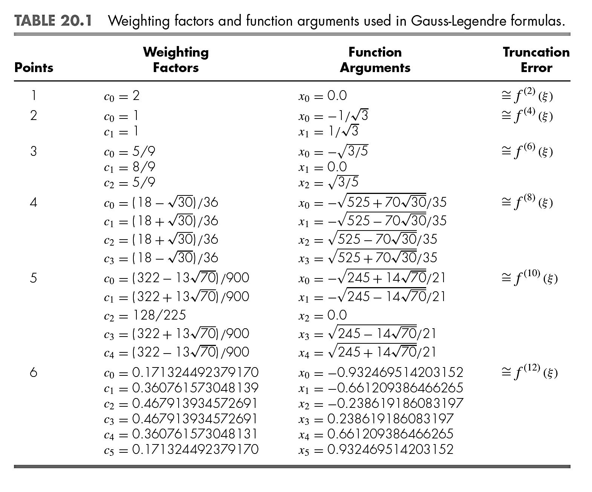

图中末列标记误差所涉及的导数阶数；完整误差还包含前述与节点数有关的常数。

### 4.11 Gauss–Lobatto 求积

#### 洛巴托法则和高斯法则的区别 Difference between Lobatto and Gauss Rules

在 Gauss–Legendre 公式中，节点位于积分区间内部，不包括区间端点。

在 Gauss–Lobatto 公式中，节点还包括端点 $-1$ 和 $1$。两种公式的节点与权重均关于原点对称。

Lobatto 公式若节点编号为 $0,\ldots,N$，共有 $N+1$ 个节点，DOP 为 $2N-1$；以节点总数 $s=N+1$ 表示则为 $2s-3$。

#### 洛巴托法则的基本形式 Basic Form of Lobatto Rules

$$
\begin{array}{r}
I(f): = \int_{- 1}^{1}\, f(x)dx \approx w_{0}f( - 1) + \sum_{i = 1}^{N - 1}\, w_{i}f(x_{i}) + w_{N}f(1): = R(f)
\end{array}
$$

其中，$w_{0}$和$w_{N}$是区间端点 Endpoints -1和1的 Weights。$x_{1},x_{2},\ldots,x_{N - 1}$是区间内部的节点。$w_{1},w_{2},\ldots,w_{N - 1}$是区间内部节点的 Weights。

#### 内部节点的选择 Selection of Internal Nodes

除去 Endpoints 外，Lobatto Rules 区间内部是 Legendre Polynomial 的导数的零点。Legendre Polynomial 的阶数等于 Lobatto Rules 的点数减1。比如对于5点 Lobatto Rules，我们需要使用4阶 Legendre Polynomial 的导数的零点作为 Internal Nodes。如下是前几个 Legendre Polynomial 的导数:

- $\phi_{0}'(x) = 0$
- $\phi_{1}'(x) = 1$
- $\phi_{2}'(x) = 3x$
- $\phi_{3}'(x) = \frac{1}{2}(15x^{2} - 3)$
- $\phi_{4}'(x) = \frac{1}{2}(5x(7x^{2} - 3))$

因此，我们可以得到其零点，从而得到 Lobatto Rules 的 Internal Nodes。

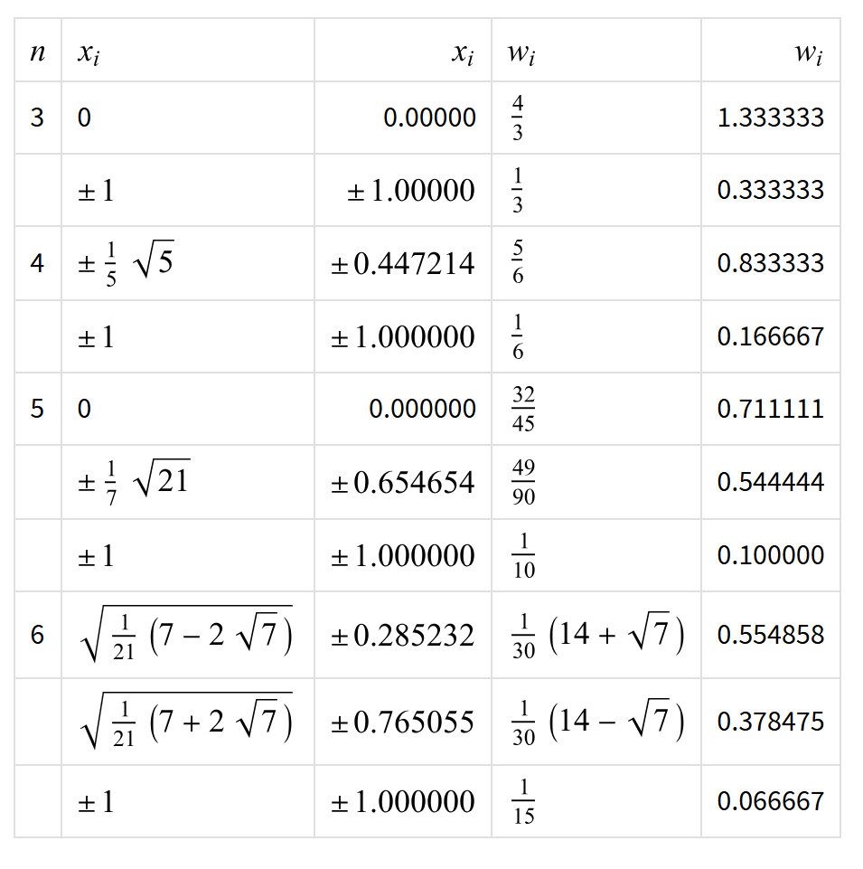

#### 如何确定洛巴托法则的权重 How to Determine the Weights of Lobatto Rules

概述 Overview: 我们使用 Method of Undetermined Coefficients 来寻求 Lobatto Rules 的 Weights，方法步骤和幂函数的 Method of Undetermined Coefficients 保持一致。

##### 案例 Example:

 我们使用3点 Lobatto Rule 来近似计算$\lbrack - 1,1\rbrack$区间上积分$\int_{- 1}^{1}{f(x)}dx$，选择的节点为$- 1,\ 0,\ 1$，请求出节点对应的权重$w_{0},\ w_{1},\ w_{2}$。

**Step 1:** 列出积分近似公式并设置待定系数

$$
\int_{- 1}^{1}\, f(x)dx \approx w_{0}f( - 1) + w_{1}f(0) + w_{2}f(1)
$$

**Step 2:** 代入条件，构建方程组

$$
\int_{- 1}^{1}\, 1dx = 2 = w_{0}(1) + w_{1}(1) + w_{2}(1)
$$

$$
\int_{- 1}^{1}\, xdx = 0 = w_{0}( - 1) + w_{1}(0) + w_{2}(1)
$$

$$
\int_{- 1}^{1}\, x^{2}dx = \frac{2}{3} = w_{0}(1) + w_{1}(0) + w_{2}(1)
$$

$$
\begin{bmatrix}
1 & 1 & 1 \\
- 1 & 0 & 1 \\
1 & 0 & 1
\end{bmatrix}\begin{bmatrix}
w_{0} \\
w_{1} \\
w_{2}
\end{bmatrix} = \begin{bmatrix}
2 \\
0 \\
\frac{2}{3}
\end{bmatrix}\ \ \ \ \ \begin{bmatrix}
w_{0} \\
w_{1} \\
w_{2}
\end{bmatrix} = \begin{bmatrix}
\frac{1}{3} \\
\frac{4}{3} \\
\frac{1}{3}
\end{bmatrix}\ \ \left( w_{i}\ is\ the\ weights. \right)
$$

$$
\int_{- 1}^{1}x^{3}dx = 0 = \frac{1}{3}( - 1)^{3} + \frac{4}{3}(0)^{3} + \frac{1}{3}(1)^{3}
$$

$$
\int_{- 1}^{1}x^{4}dx = \frac{2}{5} \neq \frac{1}{3}( - 1)^{4} + \frac{4}{3}(0)^{4} + \frac{1}{3}(1)^{4}
$$

对三个节点，若编号为 $0,1,2$，有 $N=2$，DOP 为 $2N-1=3$，与逐项检验结果一致。

### 4.12 标准区间变换与精度对照

标准区间 Canonical Interval: 标准区间 Canonical Interval 是数值分析和数值积分中的一个固定的参考区间，通常是$\lbrack - 1,1\rbrack$，这样可以简化计算和分析。在高斯定理 Gauss Rule、洛巴托法则 Lobatto Rules、勒让德多项式 Legendre Polynomials 以及切比雪夫多项式 Chebyshev Polynomials 中，Canonical Interval 是$\lbrack - 1,1\rbrack$。

#### 如何将积分区间转换到标准区间 How to Convert Integral Interval to Canonical Interval

区间转换 Interval Conversion: 如果我们遇到非$\lbrack - 1,1\rbrack$标准区间的情况，而是遇到了一个任意的$\lbrack a,b\rbrack$区间。我们可以使用如下公式将积分的上下限进行改变。

$$
\int_{a}^{b}\, f(x)dx = \int_{- 1}^{1}\, f\left( \frac{b - a}{2}t + \frac{b + a}{2} \right)\frac{b - a}{2}dt
$$

节点转换 Node Conversion: 我们可以将标准区间 Canonical Interval 的 Nodes $x_{j}^{*}$转化为区间$\lbrack a,b\rbrack$上的 Nodes $x_{j}$。

$$
x_{j} = \frac{b - a}{2}x_{j}^{*} + \frac{b + a}{2}
$$

$\frac{b - a}{2}$是缩放因子 Scaling Factor；$\frac{b + a}{2}$是平移因子 Translation Factor。

权重转换 Weight Conversion: 我们可以将标准区间 Canonical Interval 的 Weights $w_{j}^{*}$转化为区间$\lbrack a,b\rbrack$上的 Weights $w_{j}$。

$$
w_{j} = \frac{b - a}{2}w_{j}^{*}
$$

$\frac{b - a}{2}$是缩放因子 Scaling Factor。

#### 精度 Degree of Precision

精度的定义 Definition of Degree of Precision (DOP): 一个数值积分公式能够精确积分的多项式的最高次数。具体而言，如果一个数值积分方法能够精确积分所有次数小于或等于$n$的多项式，但对次数为$n + 1$的多项式则不一定精准，那么这个方法的 DOP 等于$n$。

#### 精度规律总结 Summary of DOP

可先从适用的非退化误差余项中识别可能的代数精度，再按定义检验：所有次数不超过 DOP 的多项式都精确，至少有一个更高一次的多项式不精确。

#### 精度对比 DOP Comparison

| 方法 | 误差或误差界，$E=I-R$ | 导数阶数 | DOP |
| --- | --- | --- | --- |
| Midpoint | $E=(b-a)^3f''(\xi)/24$ | 2 | 1 |
| Trapezoidal | $E=-(b-a)^3f''(\xi)/12$ | 2 | 1 |
| Composite midpoint | $\lvert E\rvert\le(b-a)h^2\lVert f''\rVert_\infty/24$ | 2 | 1 |
| Composite trapezoidal | $\lvert E\rvert\le(b-a)h^2\lVert f''\rVert_\infty/12$ | 2 | 1 |
| Simpson | $E=-(b-a)^5f^{(4)}(\xi)/2880$ | 4 | 3 |
| Gauss–Legendre，$n+1$ 点，$[-1,1]$ | $E=C_{G,n}f^{(2n+2)}(\xi)$，$C_{G,n}>0$ | $2n+2$ | $2n+1$ |
| Gauss–Lobatto，$n+1$ 点，一般区间 | $E=-C_{L,n}((b-a)/2)^{2n+1}f^{(2n)}(\xi)$，$C_{L,n}>0$ | $2n$ | $2n-1$ |

## 第五单元 根的寻找（Root Finding）

### 5.1 非线性方程求根的基本概念

#### 寻找非线性方程根的五种方法 Five Ways to Find Roots of Nonlinear Equations

- 固定点迭代法 Fixed-Point Iteration
- 牛顿迭代法 Newton Iteration
- 割线法 Secant Iteration
- 二分法 Bisection
- 二次反插值法 Quadratic Inverse Interpolation

#### 每种求根法的重要关注点 Important Concerns for Each Rooting Method

#### 收敛速率 Convergence Rate

收敛阶描述误差在迭代后期趋于零的渐近规律，并影响达到期望精度所需的迭代次数。设误差 $e_n=x_n-x^*$，若存在 $p$ 和 $K$ 使

$$
\lim_{n \rightarrow \infty}\frac{\left| e_{n + 1} \right|}{\left| e_{n} \right|^{p}} = K
$$

**其中**

- $e_{n} = x_{n} - x^{*}$是误差。

- $p$是收敛速率 Convergence Rate。

- $K$ 是有限正数；当 $p=1$ 时，线性收敛还要求 $0<K<1$。

**分类 Classification**

- 线性收敛：$p=1$ 且 $0<K<1$，误差渐近按固定比例减小。固定点迭代通常属于此类；二分法的区间长度和误差上界每步减半。

- 超线性收敛指 $|e_{n+1}|/|e_n|\to0$。具有收敛阶 $p>1$ 时属于超线性，其中包括二次收敛；割线法和二次反插值的典型阶数为介于一与二之间的非整数。

- 二次收敛 Quadratic Convergence $p = 2$: 误差平方减少（如 Newton Iteration）。

#### 是否需要导数 Need for Derivatives

定义 Definition: 方法是否需要计算或依赖函数的导数 Derivative of A Function。

**关注点 Concerns**

- 如果导数显式表达式难以获得，或计算代价高，则优先选择不需要导数的方法（如 Secant Iteration、Bisection）。

- 如果导数易得或可以通过自动微分计算，则可以使用 Newton Iteration 等需要导数的方法。

#### 初始条件的选择 Selection of Initial Conditions

定义 Definition: 方法对初始值或初始区间 Initial Value or Initial Interval 的要求。

**关注点 Concerns**

- 二分法 Bisection: 需要初始区间$\lbrack a,b\rbrack$，并要求$f(a)f(b) < 0$。

- 固定点迭代法 Fixed-Point Iteration: 需要选择 Initial Value $x_{0}$足够接近固定点 Fixed Point，否则可能不收敛。

- 牛顿法和割线法 Newton Iteration and Secant Iteration: 对 Initial Value 较敏感，Initial Value 距离 Roots 较远时可能不收敛。

#### 简单根 Simple Root

定义 Definition: 满足如下三个条件被称为 Simple Root

- Condition 1: $f\left( x^{*} \right) = 0$ 函数在$x^{*}$处的值为0，表示$x^{*}$是方程的根。
- Condition 2: $f'(x)$在包含$x^{*}$的某个开区间内存在，保证函数$f(x)$在这一区域是 Continuous and Differentiable。
- Condition 3: $f'\left( x^{*} \right) \neq 0$ 简单根处导数不为0。

几何意义 Geometric Significance: 函数$f(x)$在 Simple Root $x^{*}$处穿过$x$轴。

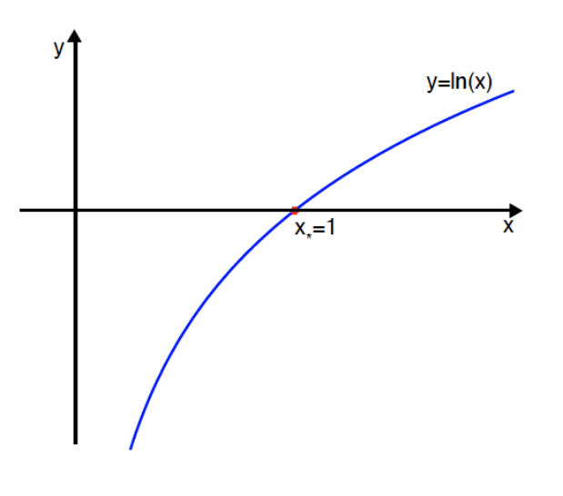

本章讨论的范畴 Scope of the Chapter: 通过本章的方法，我们可以确定 Simple Root。

### 5.2 固定点迭代

#### 根与固定点的关系 Root Finding and Fixed Point

固定点 Fixed Point: 要求解$x^{*} = g\left( x^{*} \right)$，即找到使输入值等于输出值的点$x^{*}$。

根问题 Root Finding: 要求解$f\left( x^{*} \right) = 0$，即找到使函数值为0的点$x^{*}$。

代数变换 Algebraic Transformation: 为了将根问题 Root Finding $f\left( x^{*} \right) = 0$转化为固定点问题 Fixed Point $x^{*} = g\left( x^{*} \right)$，可以代数地重新定义一个函数$g(x)$。

#### 如何将根问题转化为固定点问题 How to Convert the Root Finding Problem into the Fixed Point Problem

**方法与案例 Methods and Examples**

- Method 1: 直接分离变量，例如$f(x) = x^{2} - 3x + 2 = 0$，我们重新排列可以得到$x = \frac{x^{2} + 2}{3}$，这是一个可能的$g(x) = \frac{x^{2} + 2}{3}$。
- Method 2: 通过$x = x - f(x)$构造，例如对于$f(x) = x^{2} - 3x + 2 = 0$，我们可以说$g(x) = x - \left( x^{2} - 3x + 2 \right) = - x^{2} + 4x - 2$。
- Method 3: 通过线性变换调整方程，有时我们可以通过重新排列方程找到更简单的形式，比如直接将$f(x)$的一部分移到等式另一边。例如$f(x) = x^{2} - 3x + 2 = 0$，我们重新排列可以得到$g(x) = \sqrt{3x - 2}$。

##### 遵循的原则 Principles to Be Followed

等价性 Equivalence: 转化后的 Fixed Point Problem $x = g(x)$的 Fixed Point $x^{*}$必须与原先的 Root Finding Problem 的$f(x) = 0$的根一致。也就是说，如果$x^{*}$是$g(x) = x$的解，其必须也是$f(x) = 0$的解，反之亦然。本质上，我们是把$f(x)$与$x$轴交点的寻找问题转化为$g(x)$与$y = x$交点的寻找问题。

收敛性：可通过在根的邻域内建立收缩界来保证局部收敛。常用的充分条件为

$$
\left| g'(x) \right| < 1
$$

连续性 Continuity: $g(x)$不唯一，可以有多种构造形式，但必须在目标根附近连续。

#### 固定点迭代法算法 Fixed-Point Iteration Algorithm

目标 Objective: 通过迭代 Iteration 找到满足$x = g(x)$的 Fixed Point $x^{*}$。

##### 步骤 Steps

- 选择一个函数$g(x)$，使得 Root Finding Problem $f(x) = 0$等价于 Fixed Point Problem $g(x) = x$。
- 猜测一个 Initial Value $x_{0}$。

使用迭代公式 Iteration Formula

$$
x_{k + 1} = g\left( x_{k} \right),\ k = 0,1,\ldots
$$

#### 停止迭代的条件 Conditions for Stopping Iteration

若更新步长达到预设容限，可作为停止指标。若已知统一收缩常数 $q<1$，还能用 $|x_{k+1}-x^*|\le q|x_{k+1}-x_k|/(1-q)$ 判断真实误差。

$$
\left| x_{k + 1} - x_{k} \right| < \epsilon
$$

若达到最大迭代次数而尚未满足收敛判据，则停止并判为未收敛。

#### 案例 Example

给出一个方程$f(x) = x - e^{- x} = 0$，使用 Fixed-Point Iteration 寻找其根。

**步骤 1：** 将 Root Finding Problem 转化为 Fixed Point Problem

$$
x^{*} = g\left( x^{*} \right) = e^{- x^{*}}
$$

**步骤 2：** 判断$g(x)$是否满足 Convergence

$$
g\prime(x)=-e^{-x},\qquad |g\prime(x)|=e^{-x}.
$$

在 $[1/3,1]$ 上，$g$ 将区间映射到自身，且 $|g\prime(x)|\le e^{-1/3}<1$，因此可保证迭代收敛。根也位于 $[0,1]$ 内，但左端点 $x=0$ 的导数绝对值等于 $1$。

**步骤 3：** 选择一个 Initial Value $x_{0} = 0.5$。

**步骤 4：** 使用 Iteration Formula

$$
\left\{ \begin{array}{r}
k=0,\quad x_1=e^{-0.5}\approx0.606530659713\\
k=1,\quad x_2=e^{-0.606530659713\ldots}\approx0.545239211893\\
k=2,\quad x_3=e^{-0.545239211893\ldots}\approx0.579703094878\\
k=3,\quad x_4=e^{-0.579703094878\ldots}\approx0.560064627939
\end{array} \right.
$$

迭代继续进行，其逐渐逼近固定点$x^{*}$，也就是$f(x)$的根。

#### 固定点迭代的收敛性条件 Convergence Conditions for Fixed-Point Iterations

**收敛性条件 Convergence Conditions**

- 固定点条件 Fixed Point Condition: $x^{*} = g(x^{*})$，即$x^{*}$是$g(x)$的 Fixed Point。
- 误差衰减：定义带符号误差 $e_n=x_n-x^*$。若在包含迭代点和固定点的区间内有 $|g\prime(x)|\le q<1$，则 $|e_{n+1}|\le q|e_n|$，误差单调衰减并趋于零。

**误差传播公式 Error Propagation Formula**

$$
e_{n + 1} = x_{n + 1} - x^{*} = g\left( x_{n} \right) - g\left( x^{*} \right) = g'\left( \eta_{n} \right)\left( x_{n} - x^{*} \right) = g'\left( \eta_{n} \right)e_{n}
$$

其中$\eta_{n}$是位于$x_{n}$和$x^{*}$之间的某一点。也就是说，下一步的误差$e_{n + 1}$是由当前误差$e_{n}$和$g'\left( \eta_{n} \right)$的乘积决定的。这也说明如果

$$
\left| g'\left( \eta_{n} \right) \right| < 1
$$

若该不等式可加强为统一的 $|g\prime(\eta_n)|\le q<1$，且迭代点始终位于相应区间内，则误差逐步减小并保证收敛。

#### 根问题转化为固定点问题的收敛性原则 Convergence Principle for the Transformation of Root Finding Problems into Fixed Point Problems

收敛性：可通过在根的邻域内建立收缩界来保证局部收敛。常用的充分条件为

$$
\left| g'\left( \eta_{n} \right) \right| < 1
$$

**如何判断收敛性 How to Determine Convergence**

- 方法一：用当前迭代点附近的导数值作局部诊断。例如以下数值显示导数绝对值较小；严格的收敛保证还需对相关区间建立统一收缩界。

    $$
    g\prime(x_1)=-e^{-x_1}\approx-e^{-0.6065}\approx-0.5452.
    $$

    $$
    |g\prime(x_1)|\approx0.5452<1.
    $$

- 方法二：画出 $|g\prime(x)|$ 帮助选择可能收缩的区间，再验证该区间上的统一上界 $q<1$ 及区间映射不变性。

- 方法三：中值定理给出误差比例与某个中间点导数的关系。若 $g$ 在相关闭区间连续、内部可微，则存在 $\eta_n$ 位于 $x_n$ 与 $x^*$ 之间，使下式成立；严格小于一还需由导数界或具体计算另行判断：

    $$
    \begin{aligned}
    \left| g'\left( \eta_{n} \right) \right| &= \left| \frac{g\left( x_{n} \right) - g\left( x^{*} \right)}{x_{n} - x^{*}} \right|\\
    &= \left| \frac{g\left( x_{n} \right) - x^{*}}{x_{n} - x^{*}} \right| \le q<1
    \end{aligned}
    $$

以我们之前的例子为例，设$x^{*} \approx 0.5671$是固定点，$x_{n} = 0.6065$（即第1次迭代的值），我们可以得到

$$
g'(\eta_{n}) = \frac{g(x_{n}) - x^{*}}{x_{n} - x^{*}} \approx \frac{0.5452 - 0.5671}{0.6065 - 0.5671}
$$

因此可以得到

$$
\left| g'\left( \eta_{n} \right) \right| < 1
$$

#### 固定点的存在性和唯一性 Existence and Uniqueness of Fixed Point

存在性 Existence: 假设$g(x)$是连续的，并且在区间$\lbrack a,b\rbrack$上满足$g(a) > a,\ g(b) < b$，则存在固定点$x^{*}$。

定理证明 Proof of Theorem: 定义函数$\phi(x) = g(x) - x$。当$\phi(a) > 0$且$\phi(b) < 0$时，由连续性和介值定理 Intermediate Value Theorem，必定存在$x^{*} \in (a,b)$，使得$\phi\left( x^{*} \right) = g\left( x^{*} \right) - x^{*} = 0$。这说明$g(x) = x$有解，即存在 Fixed Point $x^{*}$。

结论 Conclusion: 介值定理 Intermediate Value Theorem 保证了在$\lbrack a,b\rbrack$上$g(x)$必定有一个 Fixed Point。

唯一性 Uniqueness: 假设$g(x)$在$\lbrack a,b\rbrack$内可微 Differentiable，并且满足$\left| g'(x) \right| \leq G < 1,\ \forall x \in \lbrack a,b\rbrack$。

定理证明 Proof of Theorem: 如果有两个 Fixed Points $x^{*},\ y^{*}$，即$g\left( x^{*} \right) = x^{*}$且$g\left( y^{*} \right) = y^{*}$，可以使用中值定理 Mean Value Theorem 证明其不可能同时存在。根据 MVT，我们可以得到

$$
\left| x^{*} - y^{*} \right| = \left| g\left( x^{*} \right) - g\left( y^{*} \right) \right| = \left| g'(\xi) \right|\left| x^{*} - y^{*} \right|,\ \xi \in (x^{*},\ y^{*})
$$

由 $|g\prime(\xi)|\le G<1$，有 $|x^*-y^*|\le G|x^*-y^*|$。若假定 $x^*\ne y^*$，则进一步有 $G|x^*-y^*|<|x^*-y^*|$，产生矛盾。等价地，除以正数 $|x^*-y^*|$ 得到 $1\le G<1$，故只能有 $x^*=y^*$。

结论：在固定点存在且导数满足统一界 $|g\prime(x)|\le G<1$ 的条件下，区间内固定点唯一；若 $g$ 还将区间映射到自身，则任意区间内初值均收敛。

#### 固定点迭代的收敛速率 Convergence Rate of the Fixed-Point Iterations

**收敛速率与$g'(x^{*})$的关系 Convergence Rate Versus $g'(x^{*})$**

- 如果$|g'\left( x^{*} \right)|$越小，收敛越快。
- 如果$g'\left( x^{*} \right) = 0$，则其可能达到 Superlinear 或者 Quadratic Convergence。
- 若 $|g\prime(x^*)|<1$ 但接近 $1$，局部线性收敛通常较慢。
- 若 $|g\prime(x^*)|>1$，固定点局部排斥，通常不能从附近收敛；若等于 $1$，一阶判据无法决定，应考察高阶项。例如 $g(x)=x-x^3$ 在零附近可收敛。

#### 单侧收敛与双侧收敛 One-Sided and Two-Sided Convergence

当 $0<g\prime(x^*)<1$ 且迭代点足够接近固定点时，误差保持同号，从同一侧收敛。例如 $g(x)=x/2+1$，固定点为 $2$，误差满足 $e_{k+1}=e_k/2$。

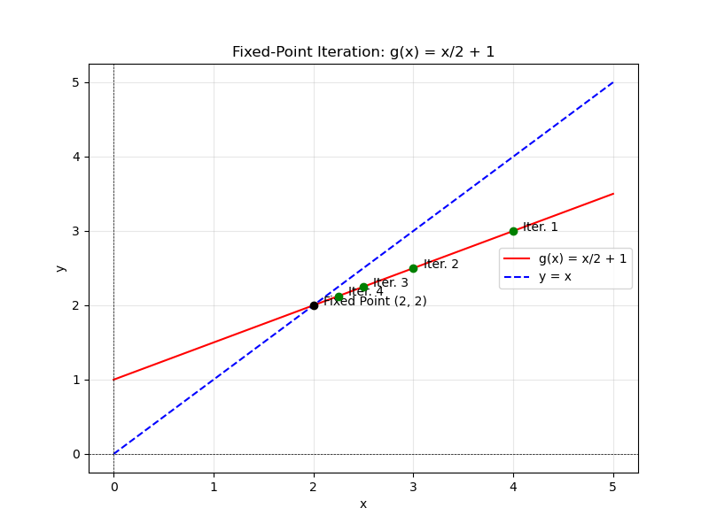

当 $-1<g\prime(x^*)<0$ 且迭代点足够接近时，误差交替变号。例如 $g(x)=2-x/2$，固定点为 $4/3$，误差满足 $e_{k+1}=-e_k/2$，从两侧交替逼近。

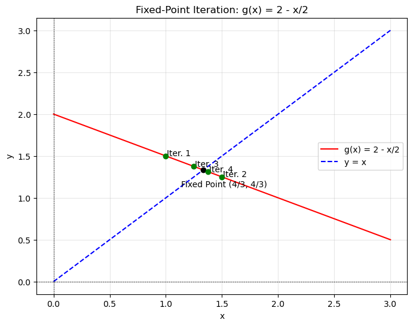

#### 固定点迭代的线性与超线性 Fixed-Point Iteration’s Linearity and Superlinearity

若 $g\prime(x^*)=0$ 且 $g$ 在附近连续可微，则局部收敛通常超线性；若 $g\in C^2$，有二次误差界，若 $g\prime\prime(x^*)\ne0$，通常恰为二次收敛。

若 $0<|g\prime(x^*)|<1$，误差主导项为线性项，局部线性收敛。某些特殊构造具有更高阶收敛，例如简单根附近的牛顿迭代。

### 5.3 牛顿迭代

#### 牛顿迭代法的假设条件 Conditions for the Newton Iteration

- Condition 1: $f \in C^{2}\lbrack a,b\rbrack$，即$f(x)$的一阶和二阶导数存在并连续。
- Condition 2: $f'(x) \neq 0$，避免分母为0的情况。

#### 泰勒定理与牛顿迭代法算法 Taylor’s Theorem and Newton Iteration Algorithm

泰勒定理 Taylor’s Theorem: 通过对函数$f(x)$在点$x_{k}$附近进行泰勒展开

$$
f(x) = f\left( x_{k} \right) + f'\left( x_{k} \right)\left( x - x_{k} \right) + \frac{f^{''}(\xi)\left( x - x_{k} \right)^{2}}{2}
$$

牛顿迭代法算法 Newton Iteration Algorithm: 使用切线方程（线性近似）的方式代替原始函数，求切线与$x$轴的交点。

$$
x_{k + 1} = x_{k} - \frac{f\left( x_{k} \right)}{f'\left( x_{k} \right)}
$$

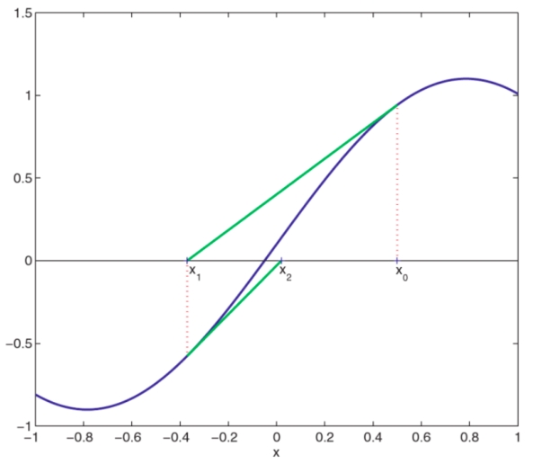

图中紫色曲线代表目标函数$f(x)$，我们需要求解的是$f(x) = 0$。

Initial Value $x_{0}$是 Newton Iteration 的起始点。

绿色线段表示点$x_{0}$处$f(x)$的切线 Tangent Line，该 Tangent Line 的交点$x_{1}$是下一步迭代的结果。

迭代过程重复，将$x_{1}$的 Tangent Line 交点计算为$x_{2}$，逐步逼近根。

#### 案例 Example

求解使用 Newton Iteration 找到$f(x) = x^{2} - 2 = 0$的根。

**步骤 1：** 选择一个 Initial Value $x_{0} = 1$。

**步骤 2：** 求解$f'(x)$，写出相关 Newton Iteration 公式。

$$
f'(x) = 2x
$$

$$
x_{k + 1} = x_{k} - \frac{x_{k}^{2} - 2}{2x_{k}}
$$

**步骤 3：** 迭代计算。

- 第一次迭代

    $$
    x_{1} = 1 - \frac{1^{2} - 2}{2 \times 1} = 1.5
    $$

- 第二次迭代

    $$
    x_2=\frac32-\frac{(3/2)^2-2}{2(3/2)}=\frac{17}{12}\approx1.416666666667.
    $$

- 第三次迭代

    $$
    x_3=\frac{17}{12}-\frac{(17/12)^2-2}{2(17/12)}=\frac{577}{408}\approx1.414215686275.
    $$

迭代继续进行，其逐渐逼近$f(x)$的根。

#### 牛顿迭代法的收敛性与特性 Convergence and Properties of the Newton Iteration

##### 收敛条件 Convergence Conditions

起始点的选择 Selection of Initial Value: Newton Iteration 的 Initial Value $x_{0}$需要足够接近函数根$x^{*}$。

原函数的性质：在简单根附近有 $f\in C^2$、$f\prime(x^*)\ne0$，并选择足够近的初值，以保证迭代分母非零且局部收敛。

收敛速度：在简单根附近，牛顿法具有二次误差界。若 $f\prime\prime(x^*)\ne0$，通常恰为二次收敛，渐近阶段的正确有效数字数目大约每步翻倍，直到受浮点精度限制；二次系数为零时可能更快。

单侧收敛：若渐近误差主项 $e_{k+1}=[f\prime\prime(x^*)/(2f\prime(x^*))]e_k^2+o(e_k^2)$ 的二次系数非零，则充分靠近根后误差通常保持该系数的符号。系数为零时需另作分析。

是否需要导数 Need for Derivatives: 牛顿法 Newton Iteration 需要计算导数。对于一些复杂的函数，计算导数$f'\left( x_{k} \right)$可能是困难的，或者需要额外的计算成本。为了解决该问题，我们使用割线法 Secant Iteration 来近似导数代替牛顿法 Newton Iteration 的精准导数。

### 5.4 割线法

#### 割线法的假设条件 Conditions for the Secant Iteration

- Condition 1: 割线法 Secant Iteration 要求目标函数$f(x)$在定义域内连续，以确保函数值$f\left( x_{k} \right)$和$f\left( x_{k - 1} \right)$有意义。
- Condition 2: 对于每一次迭代，我们要求$f\left( x_{k} \right) - f(x_{k - 1}) \neq 0$，否则分母为0，无法进行迭代。
- Condition 3: 虽然割线法 Secant Iteration 不需要显式地计算导数$f'(x)$，但隐含假设函数$f(x)$在根$x^{*}$附近具有良好的线性近似性 Good Linear Approximability，即$f'(x) \neq 0$且在根附近平滑。

#### 割线法算法 Secant Iteration Algorithm

割线法的迭代公式 Secant Iteration Formula

$$
x_{k + 1} = x_{k} - \frac{f\left( x_{k} \right)\left( x_{k} - x_{k - 1} \right)}{f\left( x_{k} \right) - f\left( x_{k - 1} \right)}
$$

通过最近的两个点$x_{k}$和$x_{k - 1}$的函数值来近似导数$f'\left( x_{k} \right)$，避免直接计算导数。Secant Iteration 需要两个 Initial Values 才能够开始迭代。

#### 案例 Example

求解使用 Secant Iteration 找到$f(x) = x^{2} - 2 = 0$的根。

**步骤 1：** 选择两个 Initial Values $x_{0} = 1,\ x_{1} = 2$。

**步骤 2：** 迭代计算。

- 第一次迭代: 计算$x_{2}$

    $$
    x_2=x_1-\frac{f(x_1)(x_1-x_0)}{f(x_1)-f(x_0)}=2-\frac{2(2-1)}{2-(-1)}=\frac43\approx1.333333333333.
    $$

- 第二次迭代: 计算$x_{3}$

    $$
    x_3=x_2-\frac{f(x_2)(x_2-x_1)}{f(x_2)-f(x_1)}=\frac43-\frac{(-2/9)(4/3-2)}{-2/9-2}=\frac75=1.4.
    $$

- 第三次迭代: 计算$x_{4}$

    $$
    x_4=x_3-\frac{f(x_3)(x_3-x_2)}{f(x_3)-f(x_2)}=\frac75-\frac{(-1/25)(7/5-4/3)}{-1/25-(-2/9)}=\frac{58}{41}\approx1.414634146341.
    $$

迭代继续进行，其逐渐逼近$f(x)$的根。

#### 割线法的收敛性与特性 Convergence and Properties of the Secant Iteration

收敛条件 Convergence Condition: 如果 Initial Values $x_{0}$和$x_{1}$足够接近根$x^{*}$，Secant Iteration 保证收敛到$x^{*}$。

此处假设目标为足够光滑函数的简单根，且迭代中的函数值差不为零；所述收敛保证为局部结论。

收敛速度：在足够光滑、初值足够接近简单根的非退化情形下，割线法通常超线性收敛，阶数为 $p=(1+\sqrt5)/2\approx1.618$，即黄金比例。该典型阶数介于线性与二次之间；特殊问题可能更快或有限步结束。

割线法避免显式计算导数，典型局部收敛阶低于牛顿法，但每步通常只新增一次函数计算。最终精度还取决于问题、停止条件和舍入误差，不能仅由收敛阶比较。

### 5.5 二分法

#### 二分法的假设条件 Conditions for the Bisection Method

介值定理 Intermediate Value Theorem 是二分法 Bisection Method 的理论基础。

- Condition 1: $f(x)$必须在区间$\lbrack x_{l},\ x_{u}\rbrack$上是连续的 Continuous。
- Condition 2: 区间端点的函数值$f\left( x_{l} \right)$和$f\left( x_{u} \right)$的符号必须相反

    $$
    f\left( x_{l} \right)f\left( x_{u} \right) < 0
    $$

这意味着区间内存在至少一个 Real Root。

#### 二分法算法 Bisection Method Algorithm

**二分法算法内容 Bisection Method Algorithm Content**

**步骤 1：** 划分区间。

- 给定一个 Initial Interval $\lbrack x_{l},\ x_{u}\rbrack$，其中$f\left( x_{l} \right)f\left( x_{u} \right) < 0$。

- 将区间对半分，计算中点$x_{m} = \frac{x_{l} + x_{u}}{2}$。

**步骤 2：** 符号变化判断，我们应该评估中点的函数值$f\left( x_{m} \right)$。

- 如果$f\left( x_{m} \right) = 0$，则$x_{m}$是根，迭代结束。

- 如果$f\left( x_{m} \right)f\left( x_{l} \right) < 0$，则根位于$\lbrack x_{l},\ x_{m}\rbrack$，永远取穿过区间作为新的搜索区间 Search Interval。

- 否则，根位于$\lbrack x_{m},\ x_{u}\rbrack$。

案例 Example

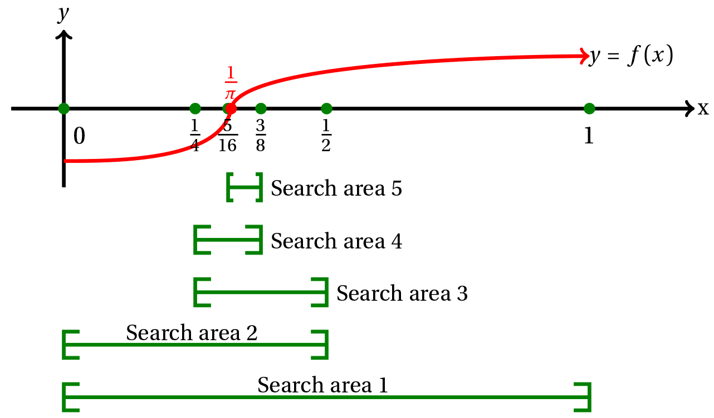

给定区间$\lbrack 0,1\rbrack$之间，取中点$1/2$，发现中点对应函数值为正。穿过区间位于$\lbrack 0,\ 1/2\rbrack$，这是新的搜索区间 Search Interval。

给定区间$\lbrack 0,\ 1/2\rbrack$之间，取中点$1/4$，发现中点对应函数值为负。穿过区间位于$\lbrack 1/4,\ 1/2\rbrack$，这是新的搜索区间 Search Interval。

给定区间$\lbrack 1/4,\ 1/2\rbrack$，取中点$3/8$，发现中点对应函数值为正。穿过区间位于$\lbrack 1/4,\ 3/8\rbrack$，这是新的搜索区间 Search Interval。

给定区间$\lbrack 1/4,\ 3/8\rbrack$，取中点$5/16$，发现中点对应函数值为负。穿过区间位于$\lbrack 5/16,\ 3/8\rbrack$，这是新的搜索区间 Search Interval。

以此类推，真实值为$1/\pi$。

#### 停止迭代的条件 Conditions for Stopping Iteration

##### 真实误差 True Error

$$
\varepsilon_{t} = \left| x_{approx} - x_{true} \right|
$$

$x_{approx}$: 当前近似根。

$x_{true}$: 真实根。

真实误差在实际应用中通常无法直接计算，因为$x_{true}$未知。

##### 近似误差 Approximated Error

$$
\varepsilon_{a} = \left| \frac{x_{r}^{new} - x_{r}^{old}}{x_{r}^{new}} \right| \times 100\%
$$

$x_{r}^{new}$: 最新的中点值。

$x_{r}^{old}$: 上一次的中点值。

近似误差可计算，是终止条件的实际依据。

相邻中点差与误差界：标准二分法中，相邻中点差的绝对值等于当前区间半宽，因而给出当前中点的绝对误差上界。上面以新中点为分母的百分比指标是相对更新量，不是绝对真实误差的上界；新中点为零时该比值没有定义。

#### 根的范围估计 Estimated Range of Roots

近似根 Approximate Root: 当前搜索区间的中点

$$
x_{r} = \frac{x_{l} + x_{u}}{2}
$$

真实根的位置 Location of the True Root: True Root $x^{*}$满足$f\left( x^{*} \right) = 0$，其必然位于$\lbrack x_{l},\ x_{u}\rbrack$内。并且，True Root 与当前中点$x_{r}$（即近似根 Approximate Root）的距离不会超过区间长度$\Delta x$的一半。

$$
Error\ of\ the\ true\ root \leq \frac{\Delta x}{2}
$$

假设我们在第$n$次迭代中，区间长度为$\Delta x = x_{u} - x_{l} = 0.1$，则真实根与当前中点的误差最大值为$\Delta x/2 = 0.05$。

终止条件：使用当前区间半宽小于绝对容限，或按一致量纲设定的其他可计算判据。真实根未知时，真实误差 $\varepsilon_t$ 通常不能直接用于停止。

#### 二分法的整体误差 Overall Error in Bisection Method

若第 $k$ 次迭代表示取第 $k$ 个中点，初始区间为 $[a,b]$，则该中点的误差不超过 $(b-a)/2^k$。据此确定所需迭代次数。

$$
\frac{b - a}{2^{k}} < \epsilon
$$

$k$是迭代次数。该公式可以计算一共需要迭代多少次达到我们的误差容限 Error Tolerance。

#### 二分法的收敛性与特性 Convergence and Properties of the Bisection Method

收敛条件：函数在初始闭区间连续，且端点函数值异号，即可保持夹根并收敛。连续函数即使有振荡，也不因此违反二分法的前提。

收敛速度 Convergence Rate: Bisection 的 Convergence Rate 是 Linear 的。

### 5.6 二次反插值

#### 反函数与根问题 Inverse Function and Root Finding Problem

反函数的概念 Concept of Inverse Function: 如果$f$有反函数 Inverse Function $f^{- 1}$，则$f(x) = y \Longleftrightarrow x = f^{- 1}(y)$。如果我们希望找到$f(x) = 0$的根$x^{*}$，其可以表示为

$$
x^{*} = f^{- 1}(0)
$$

二次反插值的思路：用次数不超过二的多项式 $p_2(y)$ 近似局部反函数 $f^{-1}(y)$，在 $y=0$ 处求值，取 $x_{n+1}=p_2(0)$。这里计算的是插值多项式的值，不是求 $p_2(y)=0$ 的根。

#### 二次反插值法的假设条件 Conditions for the Quadratic Inverse Interpolation

- Condition 1: $f(x)$必须在根附近是连续的 Continuous。
- 条件 2：选择三个点 $(x_{n-2},y_{n-2}),(x_{n-1},y_{n-1}),(x_n,y_n)$，其中 $y_i=f(x_i)$，三个函数值必须两两不同。若其中一个 $y_i=0$，则对应点已经是根。
- 条件 3：初值应足够靠近目标简单根，以适用局部收敛分析。三个函数值不必异号，也不必夹住零点；实际实现可额外维持夹根区间以提高可靠性。
- 条件 4：在目标简单根附近要求足够光滑且 $f\prime(x^*)\ne0$，从而存在可供近似的局部反函数。只在这一邻域内使用局部单调性，无需假定整个全局定义域单调。

#### 二次反插值法算法 Quadratic Inverse Interpolation Algorithm

**算法内容 Algorithm Content**

**步骤 1：** 输入数据，假设给定三个点 Initial Values $x_{n - 2},\ x_{n - 1},\ x_{n}$，以及对应的函数值$f\left( x_{n - 2} \right) = y_{n - 2}$, $f\left( x_{n - 1} \right) = y_{n - 1}$, $f\left( x_{n} \right) = y_{n}$。

**步骤 2：** 寻找反函数。

$$
x_{n - 2} = f^{- 1}\left( y_{n - 2} \right),x_{n - 1} = f^{- 1}\left( y_{n - 1} \right),x_{n} = f^{- 1}\left( y_{n} \right)
$$

**步骤 3：** 构造反插值函数 Inverse Interpolation。我们利用拉格朗日插值法 Lagrange Interpolation，构造一个通过这些点的插值多项式。

$$
p_{2}(y) = \sum_{k = n - 2}^{n}\, L_{k}(y)f^{- 1}\left( y_{k} \right)
$$

$$
L_{k}(y) = \prod_{j \neq k}^{}\,\frac{y - y_{j}}{y_{k} - y_{j}}
$$

对于三个点$(y_{n - 2},x_{n - 2}),(y_{n - 1},x_{n - 1}),(y_{n},x_{n})$，插值函数$p_{2}(y)$展开为

$$
\begin{aligned}
p_{2}(y) &= \frac{(y - y_{n - 1})(y - y_{n - 2})}{(y_{n} - y_{n - 1})(y_{n} - y_{n - 2})}f^{- 1}(y_{n})\\
&+ \frac{(y - y_{n})(y - y_{n - 2})}{(y_{n - 1} - y_{n})(y_{n - 1} - y_{n - 2})}f^{- 1}(y_{n - 1})\\
&+ \frac{(y - y_{n})(y - y_{n - 1})}{(y_{n - 2} - y_{n})(y_{n - 2} - y_{n - 1})}f^{- 1}(y_{n - 2})
\end{aligned}
$$

**步骤 4：** 在反插值多项式中代入 $y=0$，计算 $p_2(0)$，得到原方程根的下一次近似。

$$
\begin{aligned}
x_{n + 1} = p_{2}(0) & = \frac{y_{n - 1}y_{n - 2}}{(y_{n} - y_{n - 1})(y_{n} - y_{n - 2})}x_{n} \\
& + \frac{y_{n}y_{n - 2}}{(y_{n - 1} - y_{n})(y_{n - 1} - y_{n - 2})}x_{n - 1} \\
& + \frac{y_{n}y_{n - 1}}{(y_{n - 2} - y_{n})(y_{n - 2} - y_{n - 1})}x_{n - 2}
\end{aligned}
$$

**步骤 5：** 继续迭代。使用刚刚求出的$x_{n + 1}$和之前的$x_{n},x_{n - 1}$继续迭代。

#### 案例 Example

使用 Quadratic Inverse Interpolation 求解$f(x) = x^{3} - x - 2 = 0$。

**步骤 1：** 三个 Initial Values 假设为$x_{0} = 1,x_{1} = 2,x_{2} = 1.5$，其对应的三个函数值为:

$$
f(x_{0}) = f(1) = - 2,f(x_{1}) = f(2) = 4,f(x_{2}) = f(1.5) = - 0.125
$$

**步骤 2：** 寻找反函数。

$$
x_{0} = f^{- 1}\left( y_{0} \right) \Rightarrow 1 = f^{-1}( - 2)
$$

$$
x_{1} = f^{- 1}\left( y_{1} \right) \Rightarrow 2 = f^{-1}(4)
$$

$$
x_{2} = f^{- 1}\left( y_{2} \right) \Rightarrow 1.5 = f^{-1}( - 0.125)
$$

**步骤 3：** 构造反插值函数 Inverse Interpolation。

$$
\begin{aligned}
p_{2}(y) &= \frac{(y - 4)(y + 0.125)}{( - 2 - 4)( - 2 + 0.125)} \cdot 1 + \frac{(y + 2)(y + 0.125)}{(4 + 2)(4 + 0.125)} \cdot 2\\
&+ \frac{(y + 2)(y - 4)}{(-0.125 + 2)(-0.125 - 4)} \cdot 1.5
\end{aligned}
$$

**步骤 4：** 寻找根。

$$
\begin{aligned}
x_{3} &= p_{2}(0) = \frac{(0 - 4)(0 + 0.125)}{( - 2 - 4)( - 2 + 0.125)} \cdot 1 + \frac{(0 + 2)(0 + 0.125)}{(4 + 2)(4 + 0.125)} \cdot 2\\
&+ \frac{(0 + 2)(0 - 4)}{(-0.125 + 2)(-0.125 - 4)} \cdot 1.5 \approx 1.5273
\end{aligned}
$$

**步骤 5：** 可以选择继续使用$x_{1},\ x_{2},\ x_{3}$继续迭代出$x_{4}$。

二次反插值在足够光滑、初值充分接近简单根且非退化的条件下，典型收敛阶为 $p\approx1.839286755$，是 $p^3=p^2+p+1$ 的大于一的实根。

### 5.7 求根方法对比

#### 五种方法的对比 Comparison of Five Methods

| 方法 | 显式导数 | 典型收敛行为 | 条件 | 初始信息 |
| --- | --- | --- | --- | --- |
| Fixed-point iteration | 否 | 通常线性，$p=1$；特殊构造可更快 | 等价变形、区间不变性与统一收缩界 | 一个初值，位于收缩区间或足够接近固定点 |
| Newton iteration | 一阶导数 | 通常二次，$p=2$ | $f\in C^2$，简单根，迭代分母非零 | 一个足够接近根的初值 |
| Secant method | 否 | 超线性，$p\approx1.618$ | 足够光滑的简单根，函数值差非零 | 两个足够接近根的初值 |
| Bisection | 否 | 区间与误差上界每步减半 | 闭区间连续，端点异号 | 两个端点构成夹根区间 |
| Inverse quadratic interpolation | 否 | 超线性，$p\approx1.839$ | 足够光滑的简单根，函数值两两不同 | 三个足够近的初值；可另加夹根保护 |

#### 如何选择方法 How to Choose A Methodology

- 函数连续但导数不可用:

    如果简单易实现且鲁棒性优先：选择 Bisection Method。

    如果需要更快的收敛速度：选择 Secant Method。

    如果函数的反函数易近似：选择 Quadratic Inverse Interpolation。

- 函数连续且导数可用: 使用 Newton's Iteration。
- 函数行为复杂或初始点远离根: 选择 Bisection Method。
- 若能把方程重写为易算且满足收缩条件的 $x=g(x)$，固定点迭代可提供低成本实现。

## 第六单元 单变量优化（Univariate Minimization）

### 6.1 优化目标与单峰函数

#### 通常的优化目标和本单元讨论的问题 Typical Optimization Objectives and Problems Discussed in this Chapter

优化目标 Typical Optimization Objectives: 优化 Optimization 的通常目标是最大化 Maximize 或者最小化 Minimize 某一数量（比如利润），基于变量（如材料的成本和数量）的选择。但是，优化问题 Optimization Problem 有时也包括约束条件 Constraint（如成本必须为正值）。

#### 本单元讨论的问题 Problems Discussed in this Chapter

单变量函数 Single Variable Function 的无约束最小化问题 Minimization Without Constraints

#### 如何将这些方法适配于最大化问题 Maximization Problems？

#### 全局极值与局部极值 Global Extrema vs. Local Extrema

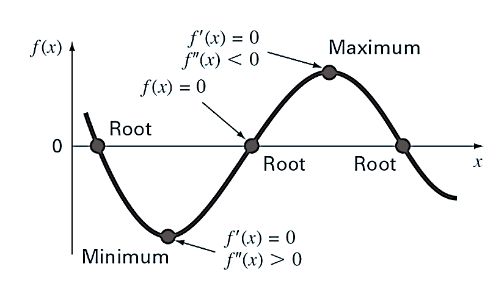

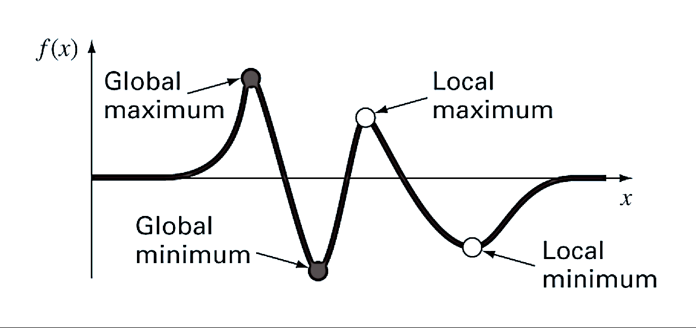

- 全局极值 Global Extrema: 包括全局最大值 Global Maximum 和全局最小值 Global Minimum。其是函数在整个定义域上的最大值或最小值。
- 局部极值 Local Extrema: 包括局部最大值 Local Maximum 和局部最小值 Local Minimum。其是函数在某一局部区间上的最大值或最小值。

研究重点：寻找单变量函数的局部最小点。黄金分割与二次插值只用函数值，牛顿优化和这里的三次 Hermite 搜索还需要导数。

#### 假设条件 Assumption

在本章，我们假设函数$f(x)$为 U-Shaped，即其需要满足

- 在区间$\lbrack a,x_{m})$上严格递减 Strictly Decreasing，在区间$(x_{m},b\rbrack$上严格递增 Strictly Increasing。

- 当函数具有连续的导数 Continuous Derivative 时，如果$f'(x)$在$\lbrack a,x_{m})$上为负，在$(x_{m},b\rbrack$上为正。则$f(x)$为 U-Shaped。

- 当函数具有连续二阶导数，并在区间上满足 $f\prime\prime(x)>0$，且内部存在驻点 $f\prime(x_m)=0$ 时，函数在驻点左侧严格递减、右侧严格递增，因此为严格 U 形。

实际应用中，需依据函数性质或充分的数学分析确定单峰区间。有限采样可提供线索，但通常不足以严格证明全区间单峰。

#### 四种单变量最小化方法（Four methods for univariate minimization）：

- 黄金分割搜索法 Golden Section Search
- 二次插值搜索法 Quadratic Interpolation Search
- 牛顿方法 Newton’s Method
- 三次插值搜索法 Cubic Interpolation Search

### 6.2 黄金分割搜索

#### 黄金分割搜索法算法 Golden Section Search Algorithm

##### 初始设定 Initial Setting

在区间$\lbrack a,b\rbrack$中选择两个中间点$x_{2}$和$x_{1}$。

评估函数值$f\left( x_{2} \right)$和$f\left( x_{1} \right)$以确定新的搜索区间 Search Interval。

##### 更新规则 Updated Rules

**如果$f\left( x_{2} \right) \leq f\left( x_{1} \right)$**

- Local Minimum 位于$\left\lbrack a,x_{1} \right\rbrack$内。

- 更新 Search Interval 位于$\left\lbrack a,x_{1} \right\rbrack$内。

**若 $f(x_2)>f(x_1)$，采用右侧区间更新：**

- Local Minimum 位于$\left\lbrack x_{2},b \right\rbrack$内。

- 更新 Search Interval 位于$\left\lbrack x_{2},b \right\rbrack$内。

#### 如何选择初始设定的$x_{1}$和$x_{2}$ How do I Select the Initial Settings $x_{1}$ and $x_{2}$?

推导过程 Derivation Process: 设整个区间长度为$l_{0}$，分成两部分$l_{1}$和$l_{2}$，满足$l_{0} = l_{1} + l_{2}$。黄金比例的比例要求

$$
\frac{l_{1}}{l_{2}} = \frac{l_{0}}{l_{1}}
$$

##### 计算比例因子$r^{*}$

$$
\rho=\frac{\sqrt5-1}{2},\qquad d=\rho(x_u-x_l).
$$

##### $x_{1}$和$x_{2}$公式 Formula of $x_{1}$ and $x_{2}$

$$
\left\{ \begin{array}{r}
x_{1} = x_{l} + d \\
x_{2} = x_{u} - d
\end{array} \right.
$$

#### 图示解释 Graphical Interpretation

**步骤 1：** 在区间$\lbrack a,b\rbrack$中选择两个中间点$x_{2}$和$x_{1}$。根据黄金比例公式进行计算。并计算两个中间点对应的函数值$f\left( x_{2} \right),\ f(x_{1})$。

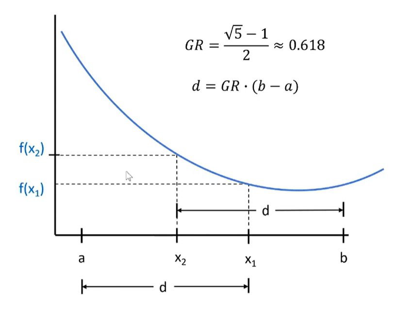

**步骤 2：** 比较 $f(x_2)$ 与 $f(x_1)$。若 $f(x_2)>f(x_1)$，删除所有 $x<x_2$ 的区间，令新左端点为旧 $x_2$，新左内部点为旧 $x_1$，右端点 $b$ 保持不变，并按黄金比例计算新的右内部点。

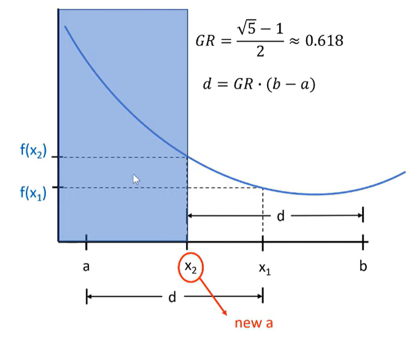

如果$f\left( x_{2} \right) \leq f\left( x_{1} \right)$，我们 eliminate all $x > x_{1}$，这个时候$x_{1}$成为新的$b$，而$x_{2}$成为新的$x_{1}$，$a$不变。

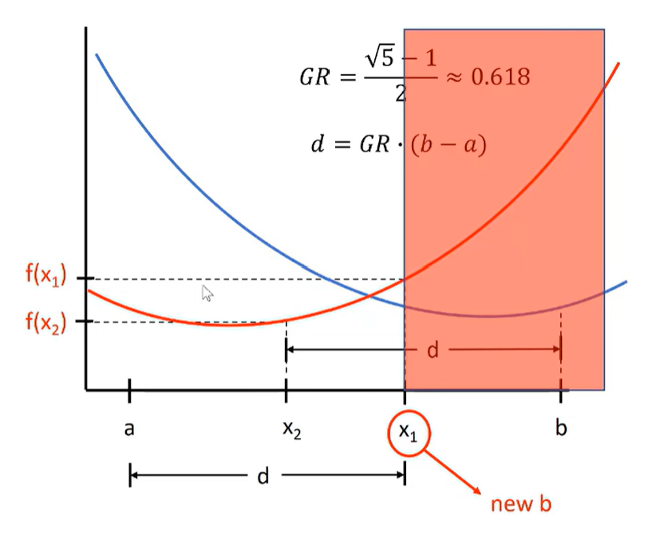

#### 黄金分割算例：

寻找 $f(x)=x^2-6x+15$ 的最小点。先可在 $[0,4]$ 上计算第一步：$x_2\approx1.527864045$、$x_1\approx2.472135955$，保留 $[1.527864045,4]$。以下图组采用初始区间 $[0,10]$，展示完整的多步区间更新。

**步骤 1：** 在区间$\lbrack a,b\rbrack$中选择两个中间点$x_{2}$和$x_{1}$。根据黄金比例公式进行计算。并计算两个中间点对应的函数值$f\left( x_{2} \right),\ f(x_{1})$。

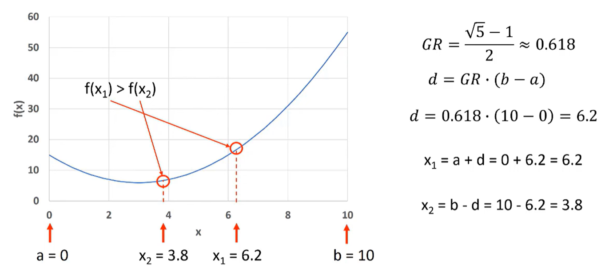

**步骤 2：** 初始区间 $[0,10]$ 的节点为 $x_2\approx3.819660$、$x_1\approx6.180340$。此时 $f(x_2)<f(x_1)$，删除 $x>x_1$ 的部分，保留 $[0,6.180340]$。旧左内部点成为新右内部点。

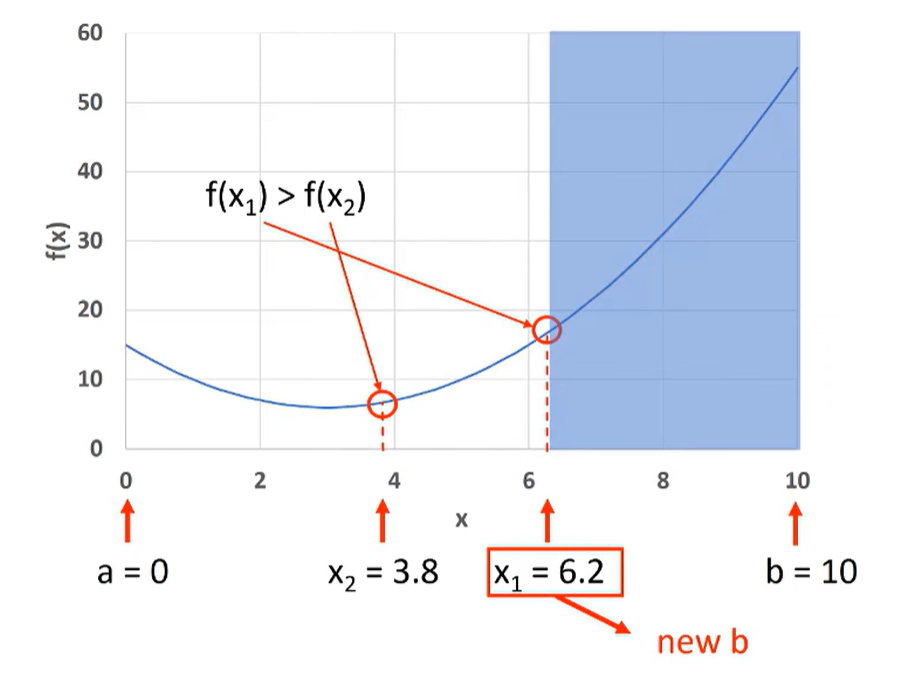

**步骤 3：** 在 $[0,6.180340]$ 上，新节点为 $x_2\approx2.360680$、$x_1\approx3.819660$。因为 $f(x_2)<f(x_1)$，保留 $[0,3.819660]$，旧左内部点继续作为新右内部点。

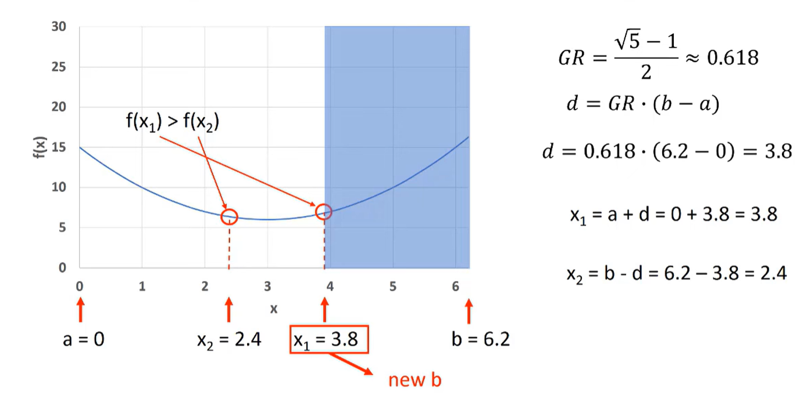

**步骤 4：** 在 $[0,3.819660]$ 上，新节点为 $x_2\approx1.458980$、$x_1\approx2.360680$。因为 $f(x_2)>f(x_1)$，删除左侧部分，保留 $[1.458980,3.819660]$，旧右内部点成为新左内部点。图中显示值作了粗略舍入，计算保留完整精度。

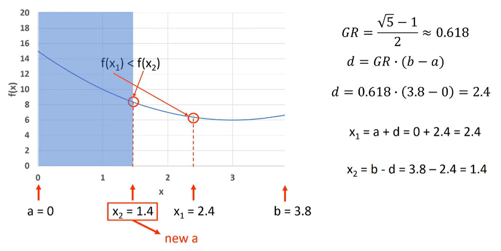

**步骤 5：** 以此类推，不断逼近。

#### 黄金分割搜索法的高效性 Efficiency of the Golden Section Search

- 在每次迭代中，无需重新评估所有点的函数值，只需利用之前的计算结果。
- 每次迭代后，Search Interval 缩小为原区间的$61.8\%$（黄金比例）。

### 6.3 二次插值搜索

#### 抛物线模型与近似函数 Parabolic Models and Approximating Functions

抛物线模型 Parabolic Models: 二次多项式（抛物线）可以很好地近似函数$f(x)$在极值点附近的形状。利用抛物线拟合，可以通过较少的点估计出函数的极值。

抛物线模型方程 Parabolic Model Equation: 使用二次多项式$P_{2}(x)$来近似函数$f(x)$

$$
P_{2}(x) = A(x - c)^{2} + B(x - c) + C
$$

这里 $A,B,C$ 是由三点插值确定的参数，$c$ 是展开所用的参考点。抛物线的对称轴由系数决定。

$$
A = \frac{(f_{a} - f_{c}) \cdot (b - c) - (f_{b} - f_{c}) \cdot (a - c)}{(a - c) \cdot (b - c) \cdot (a - b)}
$$

$$
B = \frac{(f_{a} - f_{c}) \cdot (b - c)^{2} - (f_{b} - f_{c}) \cdot (a - c)^{2}}{(a - c) \cdot (b - c) \cdot (b - a)}
$$

$$
C = f(c)
$$

#### 极值位置计算 Calculation of Extreme Value

$$
d = c - \frac{B}{2A}
$$

#### 二次插值搜索法算法 Quadratic Interpolation Search Algorithm

**步骤 1：** 给定搜索区间 Search Interval $\lbrack a,b\rbrack$，选择中间点$c \in (a,b)$，使得

$$
f(c) < \min{\{ f(a),\ f(b)\}}
$$

一般情况下

$$
c = \frac{1}{2}(a + b)
$$

**步骤 2：** 通过区间左端点$(a,\ f(a))$、中间点$(c,\ f(c))$、以及右端点$(b,\ f(b))$，拟合出抛物线。

**步骤 3：** 计算这条抛物线的极值点（即最小值或最大值）位置$d$。

用于最小化时要求模型曲率 $A>0$，候选点位于 $(a,b)$ 内，且与已有节点可区分。若这些检查失败，采用黄金分割等保护步。

**步骤 4：** 更新 Search Interval 并继续迭代。

若 $d<c$ 且 $f(d)<f(c)$，新三点为 $(a,d,c)$；若 $d>c$ 且 $f(d)<f(c)$，新三点为 $(c,d,b)$。

若 $d<c$ 且 $f(d)\ge f(c)$，新三点为 $(d,c,b)$；若 $d>c$ 且 $f(d)\ge f(c)$，新三点为 $(a,c,d)$。候选须位于区间内部并与已有点可区分。

**步骤 5：** 停止条件，满足其一。

若中间点不再优于端点，夹持条件失效，应重新建立区间或使用黄金分割保护步。不能将这种情况单独作为成功收敛的证据。

当两次候选的距离 $|d\prime-d|<\epsilon$ 时，可以将其作为停止指标，同时结合夹持区间宽度或其他收敛证据，避免把停滞误判为已达到所需位置精度。

#### 二次插值搜索法案例 Example of Quadratic Interpolation Search

使用函数$f(x) = (x - 2)^{2} + 1$，在$\lbrack 0,4\rbrack$区间内目标是找到该函数的最小值。

**步骤 1：** 确定$a,\ b,\ c$以及其函数值。

$$
a = 0,b = 4,c = 2
$$

$$
f(a) = f(0) = (0 - 2)^{2} + 1 = 5
$$

$$
f(b) = f(4) = (4 - 2)^{2} + 1 = 5
$$

$$
f(c) = f(2) = (2 - 2)^{2} + 1 = 1
$$

**步骤 2：** 拟合抛物线。

$$
C = f(c) = 1
$$

$$
A = \frac{(5 - 1)(4 - 2) - (5 - 1)(0 - 2)}{(0 - 2)(4 - 2)(0 - 4)} = 1
$$

$$
B = \frac{(5 - 1)(4 - 2)^{2} - (5 - 1)(0 - 2)^{2}}{(0 - 2)(4 - 2)(4 - 0)} = 0
$$

因此抛物线最终表达式为

$$
P_{2}(x) = (x - 2)^{2} + 1
$$

**步骤 3：** 计算极小值点。

$$
d = c - \frac{B}{2A} = 2 - \frac{0}{2(1)} = 2
$$

**步骤 4：** 得到 $d=c=2$，模型没有产生新的不同节点。本例的目标函数恰为该二次多项式，且 $f\prime(2)=0$、$f\prime\prime(2)=2>0$，所以最小点为 $2$，最小值为 $1$。不构造含重复节点的退化三点组。

### 6.4 用牛顿法最小化

#### 牛顿法算法 Newton’s Method Algorithm

**牛顿法的迭代公式 Iterative Formula for Newton's Method**

**牛顿法的优化公式 Optimization Formula**

$$
x_{k + 1} = x_{k} - \frac{f'\left( x_{k} \right)}{f^{''}\left( x_{k} \right)}
$$

公式推导 Derivation of Formula: 将目标函数$f(x)$在$x_{k}$附近用二次泰勒展开近似

$$
f(x) \approx f\left( x_{k} \right) + f'(x_{k})\left( x - x_{k} \right) + \frac{1}{2}f^{''}\left( x_{k} \right)\left( x - x_{k} \right)^{2}
$$

对$x$求导，得到

$$
f'(x) \approx f'\left( x_{k} \right) + f^{''}\left( x_{k} \right)\left( x - x_{k} \right)
$$

对上述二次函数求最小值点，即对其导数为零

$$
f'\left( x_{k} \right) + f^{''}\left( x_{k} \right)\left( x - x_{k} \right) = 0
$$

解得

$$
x = x_{k} - \frac{f'\left( x_{k} \right)}{f''(x_{k})}
$$

#### 牛顿法算法 Newton’s Method Algorithm

以下更新以 $f\prime\prime(x_k)>0$ 为局部最小化条件；若曲率不合适或分母接近零，应使用阻尼、线搜索或区间保护。达到最大迭代次数而未满足判据时报告未收敛。

**步骤 1：** 设置 Initial Value $x_{0}$。

**步骤 2：** 计算$f'\left( x_{k} \right),\ f^{''}\left( x_{k} \right)$。

**步骤 3：** 使用公式进行计算，得到下一个$x$值。

$$
x_{k + 1} = x_{k} - \frac{f'\left( x_{k} \right)}{f^{''}\left( x_{k} \right)}
$$

**步骤 4：** 检查收敛条件: 如果满足以下条件之一，终止迭代

- $\left| f'\left( x_{k + 1} \right) \right| < \epsilon$ 梯度接近于0

- $|x_{k + 1} - x_{k}| < \epsilon$ 更新步长很小

- 达到最大迭代次数

**步骤 5：** 如果未收敛，设置$x_{k} = x_{k + 1}$，重复 Step 2-4。

#### 案例 Example

寻找函数$f(x) = x^{2} - 4x + 5$，寻找其 Local Minimum。

**步骤 1：** 设置 Initial Value $x_{0} = 0$。

**步骤 2：** 计算$f'\left( x_{k} \right),\ f^{''}\left( x_{k} \right)$。

$$
f'(x) = 2x - 4
$$

$$
f^{''}(x) = 2
$$

**步骤 3：** 牛顿法迭代。

- $k = 0:x_{0} = 0,\ f'\left( x_{0} \right) = 2(0) - 4 = - 4,\ f^{''}\left( x_{0} \right) = 2$

    $$
    x_{1} = 0 - \frac{- 4}{2} = 2
    $$

- $k = 1:x_{1} = 2,\ f'\left( x_{1} \right) = 2(2) - 4 = 0$ 梯度为0，停止迭代。

Result: $x^{*} = 2,\ f\left( x^{*} \right) = 2^{2} - 4(2) + 5 = 1$

### 6.5 三次 Hermite 插值搜索

#### 埃尔米特多项式与近似函数 Hermite Polynomials and Approximating Functions

**三次插值搜索法的背景 Background of Cubic Interpolation Search**

假设函数$f(x)$在区间$\lbrack a,b\rbrack$内是 U-Shaped 的。

在导数左负右正的单峰区间内，可用 $f\prime(a)<0<f\prime(b)$ 夹持最小点。端点导数异号本身不足以证明全区间单峰，严格 U 形函数的端点导数也可能为零。

##### 构造三次插值多项式 Constructing Cubic Interpolation Polynomials

为了逼近$f(x)$的 Local Minimum，需要使用三次 Hermite Polynomial。

**Hermite Polynomial 通过插值满足以下条件**

$$
P_{3}(a) = f(a),P_{3}(b) = f(b),P_{3}'(a) = f'(a),P_{3}'(b) = f'(b)
$$

#### 三次插值搜索法算法 Cubic Interpolation Search Algorithm

##### 埃尔米特多项式 Hermite Polynomials

$$
P_{3}(x) = A(x - c)^{3} + B(x - c)^{2} + C(x - c) + D
$$

这是一个标准的三次 Hermite Polynomial，使用$f(a),\ f(b),\ f'(a),\ f'(b)$插值构造。其中$c$是当前区间$\lbrack a,b\rbrack$的中点；$d$是区间长度的一半。

$$
c = \frac{a + b}{2},\ d = \frac{b - a}{2}
$$

**三次多项式的系数$A,\ B,\ C,\ D$使用函数值和导数值计算**

$$
\begin{array}{r}
A = \frac{d(f'(b) + f'(a)) - (f(b) - f(a))}{4d^{3}} \\
B = \frac{f'(b) - f'(a)}{4d} \\
C = \frac{3(f(b) - f(a)) - d(f'(b) + f'(a))}{4d} \\
D = \frac{f(a) + f(b)}{2} - d\frac{f'(b) - f'(a)}{4}
\end{array}
$$

#### 三次插值搜索法算法内容 Algorithm Content

**步骤 1：** 根据 Hermite Polynomials 的公式，得到由原始区间$\lbrack a,b\rbrack$对应的 Hermite Polynomial $P_{3}(x)$。

**步骤 2：** 对$P_{3}(x)$求导，并求得$P_{3}'(x) = 0$的根（最多2个根）。

$$
x = \frac{a + b}{2} + \frac{- B \pm \sqrt{B^{2} - 3AC}}{3A}
$$

设两个候选为 $u_\pm=c+[-B\pm\sqrt{B^2-3AC}]/(3A)$。当 $A\ne0$ 且判别式为正时，$P_3\prime\prime(u_+)=2\sqrt{B^2-3AC}>0$，选择 $u_+$，并验证其在 $(a,b)$ 内。若 $A=0$ 且 $B>0$，使用二次退化公式 $u=c-C/(2B)$。无有效内部候选时用区间保护步。

**步骤 3：** 记有效候选为 $u$。若 $|f\prime(u)|<\epsilon_g$，并满足所需区间或位置精度，可停止；在单峰假设下，接近零导数的候选逼近局部最小点。

**步骤 4：** 若未满足停止条件，计算真实导数 $f\prime(u)$ 并更新区间。这里 $u$ 是候选，中心 $c=(a+b)/2$ 在每轮重建模型时重新计算。

- 若 $f\prime(u)<0$，更新搜索区间为 $[u,b]$。

- 若 $f\prime(u)>0$，更新搜索区间为 $[a,u]$。

**步骤 5：** 在新夹持区间重建模型并继续迭代；若候选缩区间不足，使用中点等保护步。

#### 案例 Example

计算$f(x) = (x - 2)^{2} + 1$在$\lbrack 1,3\rbrack$区间内的 Local Minimum。

**步骤 1：** 根据 Hermite Polynomials 的公式，得到三次多项式为

$$
p_{3}(x) = (x - 2)^{2} + 1
$$

本例 $c=2,d=1$，端点值 $f(1)=f(3)=2$，端点导数为 $-2,2$。代入系数公式得到 $A=0,B=1,C=0,D=1$，模型退化为二次，采用退化情形的驻点公式。

**步骤 2：** 对$P_{3}(x)$求导，并求得$P_{3}'(x) = 0$的根（最多2个根）。

$$
p_{3}'(x) = 2(x - 2) = 0 \Longrightarrow x = 2
$$

此时$c = 2$是第一次猜测。

**步骤 3：** 更新区间。

$$
f(c) = f(2) = 1
$$

由于候选点 $u=2$ 满足 $f\prime(2)=0$ 且 $f\prime\prime(2)=2>0$，迭代停止。局部最小点为 $2$，最小值为 $1$。
