# 数据科学与统计推断 Introduction to Statistical Inference

## 引言

数据分析需要区分三个问题：数据呈现了什么规律，样本能告诉我们多少总体信息，以及一个处理是否造成了结果变化。描述统计概括数据的位置、离散程度和分布；概率论刻画随机变量、条件关系与抽样波动；统计推断用估计量、标准误和置信区间连接样本与总体。

从分组均值出发，可以逐步理解因果推断和回归分析。随机实验通过处理分配建立因果可比性，条件随机化需要在层内比较后按目标人群汇总。回归则通过限制预测函数，在不同协变量取值之间共享信息，同时引入模型近似误差和假设检查的问题。理解估计目标、抽样机制、处理机制与模型假设的区别，是正确解释数值结果的基础。

## 目录

- [1. 回归分析与描述统计](#section-1)
  - [1.1 回归与数据概括](#section-1-1)
- [2. 概率与随机变量](#section-2)
  - [2.1 随机变量与样本空间](#section-2-1)
  - [2.2 概率分布、期望与条件化](#section-2-2)
  - [2.3 期望的运算法则](#section-2-3)
  - [2.4 方差与协方差](#section-2-4)
- [3. 抽样、估计量与抽样分布](#section-3)
  - [3.1 估计目标、估计量与估计值](#section-3-1)
  - [3.2 总体与抽样](#section-3-2)
  - [3.3 抽样分布](#section-3-3)
- [4. 置信区间的校准](#section-4)
  - [4.1 用估计的抽样分布构造区间](#section-4-1)
- [5. 从概率到统计](#section-5)
  - [5.1 估计量的随机性](#section-5-1)
  - [5.2 估计量的中心与偏差](#section-5-2)
  - [5.3 估计量的离散程度](#section-5-3)
- [6. 子样本均值与线性组合](#section-6)
  - [6.1 粗组均值与细组均值](#section-6-1)
  - [6.2 增量汇总与线性组合](#section-6-2)
  - [6.3 线性组合的期望与无偏性](#section-6-3)
  - [6.4 线性组合的方差](#section-6-4)
  - [6.5 多个协变量](#section-6-5)
- [7. 随机实验与条件随机化实验中的因果推断](#section-7)
  - [7.1 从组间差异到因果问题](#section-7-1)
  - [7.2 潜在结果框架](#section-7-2)
  - [7.3 总体、样本与处理分配](#section-7-3)
  - [7.4 随机分配下 ATE 的识别与估计](#section-7-4)
  - [7.5 完整例题：募捐电话实验](#section-7-5)
  - [7.6 条件随机化实验](#section-7-6)
  - [7.7 条件平均处理效应的识别与估计](#section-7-7)
  - [7.8 CATE 的标准化汇总](#section-7-8)
  - [7.9 忽略条件会发生什么](#section-7-9)
  - [7.10 因果目标、统计工具与公式](#section-7-10)
- [8. 最小二乘回归的预测视角](#section-8)
  - [8.1 回归的优化形式](#section-8-1)
  - [8.2 分组均值的局限与回归的作用](#section-8-2)
  - [8.3 线性模型中的最小二乘回归](#section-8-3)
- [9. 线性回归的关系视角](#section-9)
  - [9.1 线性回归的基本概念](#section-9-1)
  - [9.2 寻找最优回归线](#section-9-2)
  - [9.3 分类预测变量](#section-9-3)
  - [9.4 多元线性回归](#section-9-4)
- [10. 偏差与模型误设](#section-10)
  - [10.1 偏差与估计目标](#section-10-1)
  - [10.2 回归中的估计偏差与模型误设](#section-10-2)
- [11. 线性回归假设、诊断与影响点](#section-11)
  - [11.1 回归诊断的目的](#section-11-1)
  - [11.2 Gauss–Markov 假设与定理](#section-11-2)
  - [11.3 最小二乘估计量的期望与方差](#section-11-3)
  - [11.4 残差诊断与影响点](#section-11-4)

<a id="section-1"></a>

## 1. 回归分析与描述统计

<a id="section-1-1"></a>

### 1.1 回归与数据概括

#### 1.1.1 What Regression Analysis Is

Regression = estimating the relationship between dependent variable y and independent variables x.

**因变量dependent variable y：** 我们想要解释和预测的变量。

**自变量independent variables x：** 用来解释y的变量。

**其中一种方法：** 线性回归Linear Regression

- 最有名的方法之一，但不是唯一方法，而且有缺点。

- 回归 ≠ 一定要拟合直线

#### 1.1.2 Regression 是把 y 分解

**Regression analysis is about breaking y into two parts：**

$$
Y=\underbrace{f(X)}_{\text{systematic part}}+\underbrace{\varepsilon}_{\text{unexplained part}}.
$$

当 $f(X)=E(Y\mid X)$ 且期望存在时，$E(\varepsilon\mid X)=0$。若选择受限制的线性函数近似条件均值，这个零条件均值性质不一定成立。

**也就是：** $Y = f(X) + \varepsilon$.

回归的本质不是画线，而是把y拆成可解释部分 + 随机误差。

#### 1.1.3 Descriptive Statistics的完整框架

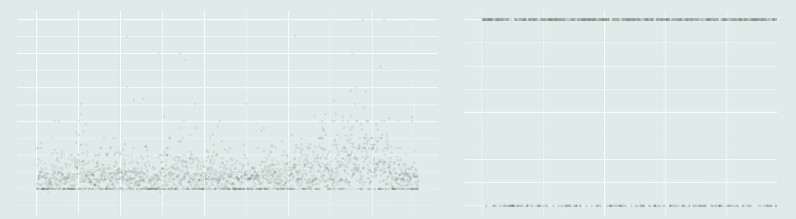

*图 1：连续收入与二元结果的逐个观测散点。*

##### 1.1.3.1 观测点与坐标轴

**一个点：** 一个点 = 一个observation（一个个体）。

- 可以是连续变量（收入），

- 可以是0/1变量（是否投票）。

**坐标轴：** 在 dot plot 中

- Y轴代表变量本身（income或0/1），

- X轴代表任意排序。

##### 1.1.3.2 位置与残差

**Location：** 数据的中心在哪里，我们可以用一个constant来近似所有数据.

**指标一：** Mean

$$
\widehat{\mu} = \frac{1}{n}\sum_{i = 1}^{n}\, Y_{i}.
$$

**指标二：** Median（把数据排序；奇数个观测取中间值，偶数个观测通常取中间两个值的平均）。

**核心理解**

- Mean 是"重心"/ Median 是"最中间"，

- 对于均值存在、关于某个中心对称的分布，该中心是均值且可取为中位数；若还具有唯一的中心众数，三者相同。对称双峰分布不一定满足均值等于众数。

**Residuals：** 当你用一个常数去近似数据时

$$
{\widehat{\varepsilon}}_{i} = Y_{i} - \widehat{\mu}
$$

这叫残差Residuals（当你用一个数字概括数据时，丢失了多少信息）。

##### 1.1.3.3 离散程度

**Spread：** Location告诉你"在哪儿"，Spread 告诉你"散得多开"。

**Standard Deviation**

$$
s_{\mathrm{desc}}=\sqrt{\frac{1}{n}\sum_{i=1}^{n}(Y_i-\overline Y)^2}
$$

与均值搭配，使用平方距离。上式是描述这组数据的标准差；估计总体方差时通常使用 $s^2=\frac{1}{n-1}\sum_{i=1}^n(Y_i-\overline Y)^2$，并令 $s=\sqrt{s^2}$。

**Median Absolute Deviation**

$$
\mathrm{MAD}=\operatorname{median}(|Y_{i} - \widetilde{\mu}|)
$$

其中 $\widetilde\mu=\operatorname{median}(Y_1,\ldots,Y_n)$。MAD 与中位数搭配，对极端观测通常比平方偏差度量更稳健；这里未乘用于正态标准差估计的尺度校正常数。

##### 1.1.3.4 分布形状

**Distribution：** 以直方图为例

**直方图的意义：** x轴是数值区间bins，y轴是频数/比例/密度，每个观测被分配到一个 bin。

**直方图回答的问题：**

- 数据集中在哪里？

- 有没有多个峰？

- 有没有长尾？

**Modality：** 众数是分布中概率质量或密度达到峰值的位置；直方图中最高的等宽 bin 是众数组，其位置会受到分箱方式影响，分布可以是

- Unimodal单峰

- Bimodal双峰

- Multimodal多峰

**Skewness：** 描述分布的不对称性

**Right-skewed：** 右尾较长；常见右偏分布中均值大于中位数，但这不是适用于所有分布的定理。

**Left-skewed：** 左尾较长；常见左偏分布中均值小于中位数，但仅凭均值和中位数的大小关系不能完整判断分布形状。

<a id="section-2"></a>

## 2. 概率与随机变量

<a id="section-2-1"></a>

### 2.1 随机变量与样本空间

#### 2.1.1 Random Variable的正式定义

随机变量是从样本空间到数值空间的函数：每个随机实验结果都按预先指定的映射规则得到一个数。本课程主要讨论实值随机变量；严格定义还要求该函数可测。

**Example 1：** 掷一个 6 面骰子.

**Sample space：** $\Omega = \{ 1,2,3,4,5,6\}$.

**Defining a random variable X：** $X(\omega) = \omega$.

**可能取值（range）：** $\{ 1,2,3,4,5,6\}$.

**Example 2：** 是否是偶数.

**Sample space：** $\Omega = \{ 1,2,3,4,5,6\}$.

Defining a random variable $Y$：

$$
Y(\omega)=\begin{cases}1,&\omega\in\{2,4,6\},\\0,&\omega\in\{1,3,5\}.\end{cases}
$$

**可能取值（range）：** $\{ 0,1\}$.

同一个随机实验，可以定义无数个随机变量，因为可根据问题设计不同的可测函数。

<a id="section-2-2"></a>

### 2.2 概率分布、期望与条件化

#### 2.2.1 Distribution

**核心问题：** 如果随机变量给每个结果一个数，那么某个数出现的概率是多少？也就是$P(X = 1)$。

**Probability and Probability Distribution**

**Example：** 比如对于掷骰子，随机变量是$X(\omega) = \omega$，问$P(X = 5)$。如果骰子公平，那么$P(X = 5) = \frac{1}{6}$. 而distribution就是把所有值的概率列出来

$$
\begin{aligned}
P(X = 1) & = 1/6 \\
P(X = 2) & = 1/6 \\
P(X = 3) & = 1/6 \\
P(X = 4) & = 1/6 \\
P(X = 5) & = 1/6 \\
P(X = 6) & = 1/6
\end{aligned}
$$

这些概率给出了离散分布；$p_X(x)$ 表示把每个可能取值 $x$ 映射到 $P(X=x)$ 的概率质量函数。

**Discrete Random Variable and Probability Mass Function**

**Example：** 对于掷骰子，随机变量是$X(\omega) = \omega$，问$P(X = 5)$。如果骰子公平，那么$P(X = 5) = \frac{1}{6}$。

**Probability Mass Function：** $p_{X}(x) = P(X = x)$. 也就是给我一个 x，我告诉你 X 等于 x 的概率是多少. 比如

$$
\begin{aligned}
p_{X}(1) & = \frac{1}{6} \\
p_{X}(2) & = \frac{1}{6}
\end{aligned}
$$

**Continuous Random Variable and Probability Density Function**

**Example：** 对于身高，假设 $X$ 是取值于 $(1.5,2.0)$ 的绝对连续随机变量。区间中有无数个数，本身并不足以推出分布连续；这里明确假设它具有概率密度。 如果问你$P(X = 1.73) = ?$，答案是$P(X = 1.73) = 0$. 因为在连续区间里，单个点太"细"了，概率必须分布在整个区间上。

**Probability Density Function：** 对于具有概率密度的连续变量，$P(X=x)$ 可以写，但每个单点的概率都是 0；要描述分布并计算区间概率，使用概率密度函数 $f_X(x)$。密度值本身不是单点概率，也可能大于 1。

对于不同分布我们有不同的Density Function，比如

**Uniform：** $f(x)=1/(b-a)$（$a<x<b$），区间外为 0，且 $a<b$。

**Normal：** $f(x)=\frac{1}{\sqrt{2\pi\sigma^2}}\exp\!\left[-\frac{(x-\mu)^2}{2\sigma^2}\right]$，其中 $\sigma>0$。

我们通过Density Function积分计算区间概率

$$
P(a < X < b) = \int_{a}^{b}\, f_{X}(x)dx
$$

#### 2.2.2 Expectation/Expected Value

**Discrete Random Variable**

**定义：**

$$
E(X)=\sum_{x\in\mathcal S_X}x\,p_X(x)
$$

期望是所有可能取值与其概率乘积的总和。离散取值可以是有限或可数无限个；讨论有限期望时要求 $E|X|<\infty$。

**Example：** 对于掷骰子，随机变量是$X(\omega) = \omega$，$P(X = x) = \frac{1}{6}$。

$$
\begin{array}{r}
E(X) = 1 \cdot \frac{1}{6} + 2 \cdot \frac{1}{6} + 3 \cdot \frac{1}{6} + 4 \cdot \frac{1}{6} + 5 \cdot \frac{1}{6} + 6 \cdot \frac{1}{6} \\
= \frac{1 + 2 + 3 + 4 + 5 + 6}{6} \\
= \frac{21}{6} \\
= 3.5
\end{array}
$$

**Continuous Random Variable**

**定义：**

$$
E(X) = \int_{- \infty}^{\infty}\, xf_{X}(x)dx
$$

期望 = 每个 x × 它的"密度"，然后在整个区间上积分。

**Example：** 设 $X \sim Uniform(1.5,2.0)$, $f_{X}(x) = \frac{1}{b - a} = 2$。

$$
\begin{array}{r}
E(X) = \int_{1.5}^{2.0}\, x \cdot 2dx \\
= 2\int_{1.5}^{2.0}\, xdx \\
= 2\left\lbrack \frac{x^{2}}{2} \right\rbrack_{1.5}^{2.0} \\
= \left\lbrack \begin{array}{r}
x^{2}
\end{array} \right\rbrack_{1.5}^{2.0} \\
= 4 - 2.25 \\
= 1.75
\end{array}
$$

在区间 (1.5,2.0) 上均匀分布的平均值正好是中点。

期望可以理解为在重复抽样下的长期平均值。离散情形按各取值的概率求加权平均；连续情形则用密度加权积分。

#### 2.2.3 Independence and Conditioning

**Independence的定义：** 如果知道 X 的值，对 Y 的概率没有任何影响， 那么 X 和 Y 独立。

**Example 1：** X = 掷骰子，Y = 抛硬币. 你掷到 3，硬币正反的概率仍然 1/2. 所以独立。

**Example 2：** X = 抽到的颜色，Y = 抽到的花色. 如果只抽一张牌，知道颜色是红色，那一定是红心或方块，这会改变花色的概率. 所以它们不独立。

离散随机变量的独立性

$$
P(X = x,Y = y) = P(X = x)P(Y = y)
$$

独立性要求上述等式对所有可能的 $x,y$ 成立。一般定义为：对任意可测集合 $A,B$，$P(X\in A,Y\in B)=P(X\in A)P(Y\in B)$。连续变量不能仅用单点概率检验独立性。

Conditional Probability的定义

Conditional Probability is a measure of the probability of an event occurring, given that another event is already known to have occurred.

$$
P(Y = y \mid X = x)
$$

在已经知道 X=x 的情况下，Y=y 的概率。

**Example：** 已知抽到红牌，抽到方块的概率是多少？红牌有：红心、方块，各 13 张. 所以

$$
P(Diamond \mid Red) = \frac{13}{26} = \frac{1}{2}
$$

**Independence and Conditional Probability**

如果 X 和 Y 独立

$$
P(Y = y \mid X = x) = P(Y = y)
$$

意思是条件没有改变概率。

**三者关系**

条件概率定义

$$
P(B\mid A)=\frac{P(A\cap B)}{P(A)},\qquad P(A)>0
$$

如果独立

$$
P(X,Y) = P(X)P(Y)
$$

我们可以得到

$$
P\left( Y\mid X \right) = P(Y)
$$

#### 2.2.4 Conditional Expectation

**Conditional Expectation定义：** $E\left( Y \middle| X \right)$，也就是在已知X 的情况下，Y 的平均值。

离散条件下的计算

**公式：** 如果我们设置一个固定值$X = x$，则

$$
E\left( Y\mid X = x \right) = \sum_i\, y_{i}P\left( Y = y_{i}\mid X = x \right)
$$

把所有可能的Y值，乘以在X = x条件下的概率，再加起来。

**Example 1：** 参加补习班的比例:

$$
\begin{aligned}
P(X = 0) & = 0.4 \\
P(X = 1) & = 0.6
\end{aligned}
$$

考试成绩分布:

| 补习班状态 | 成绩 $Y$ | 条件概率 |
| --- | --- | --- |
| $X=0$ | 60 | 0.5 |
| $X=0$ | 80 | 0.5 |
| $X=1$ | 80 | 0.5 |
| $X=1$ | 100 | 0.5 |

我们计算$E\left( Y\mid X = x \right)$

- $X = 0$: $E\left( Y \middle| X = 0 \right) = 60 \times 0.5 + 80 \times 0.5 = 70$

- $X = 1$: $E\left( Y \middle| X = 1 \right) = 80 \times 0.5 + 100 \times 0.5 = 90$

**条件期望是函数还是随机变量？**令 $g(x)=E(Y\mid X=x)$，则同一个表达式有三个层次：

1. 给定具体的 $x$，$E(Y\mid X=x)=g(x)$ 是一个数。
2. 保留随机的 $X$，$E(Y\mid X)=g(X)$ 是一个随机变量。
3. 把 $x$ 当作自变量时，$g(x)=E(Y\mid X=x)$ 是一个函数。

**Example 2：** 设定和Example 1一样，我们计算$E(Y|X)$

由于$E\left( Y \middle| X = 0 \right) = 70$和$E\left( Y \middle| X = 1 \right) = 90$，可得

$$
g(x) = E\left( Y\mid X = x \right)
$$

$$
g(x)=\begin{cases}70,&x=0,\\90,&x=1.\end{cases}
$$

因此 $E(Y\mid X)=g(X)$，并且

$$
P\{g(X)=70\}=0.4,\qquad P\{g(X)=90\}=0.6.
$$

这是一个随机变量。

离散状态下的Total Expectation $E(Y)$

**定义：**

$$
E(Y) = \sum_x\, E(Y \mid X = x)P(X = x)
$$

总期望 = 各组条件期望 × 该组概率，再加起来。

迭代期望定律Law of Iterated Expectations

$$
E(Y) = E(E(Y|X))
$$

**Example 3：** 设定和Example 1一样，我们计算$E(Y)$

$$
E(Y) = E\left( Y \middle| X = 0 \right) \times P(X = 0) + E\left( Y \middle| X = 1 \right) \times P(X = 1) = 70 \times 0.4 + 90 \times 0.6 = 82
$$

<a id="section-2-3"></a>

### 2.3 期望的运算法则

#### 2.3.1 常数的期望

$$
E\lbrack a\rbrack = a
$$

#### 2.3.2 无关条件变量

Irrelevance of Independent Conditioning Variables: 如果 $X'$ 与随机向量 $(X,Y)$ 联合独立，则把 $X'$ 加入条件不会改变 $E(Y\mid X)$。仅有 $X'$ 分别与 $X$、$Y$ 独立并不足够；更一般的充分条件是 $Y$ 与 $X'$ 在给定 $X$ 后条件独立。

$$
E\lbrack Y \mid X,X'\rbrack = E\lbrack Y \mid X\rbrack
$$

比如Y是某只吉娃娃的体重，X是这只吉娃娃的身高，X'是随机遇到的博美的身高. 若这只博美是独立抽取的，并且其身高与该吉娃娃的身高、体重联合独立，则$E\lbrack Y \mid X,X'\rbrack = E\lbrack Y \mid X\rbrack$。

#### 2.3.3 迭代期望定律

Law of Iterated Expectations: 总期望 = 各组条件期望 × 该组概率，再加起来。

$$
E(Y) = E\left( E\left( Y \middle| X \right) \right) = \sum_x\, E(Y \mid X = x)P(X = x)
$$

#### 2.3.4 Linearity of Expectation

**定义：** 期望对加法是线性的，常数可以提取出来。

$$
E\lbrack X + Y\rbrack = E\lbrack X\rbrack + E\lbrack Y\rbrack
$$

$$
E\lbrack aX\rbrack = aE\lbrack X\rbrack
$$

**Example：** 期中成绩 X，平均 70；期末成绩 Y，平均 80；总成绩 = 0.4X + 0.6Y。

$$
E\lbrack 总成绩\rbrack = 0.4E\lbrack X\rbrack + 0.6E\lbrack Y\rbrack = 76
$$

Proof of $E\lbrack aY + bZ\rbrack = aE\lbrack Y\rbrack + bE\lbrack Z\rbrack$

$$
\begin{aligned}
E(aY+bZ)&=\sum_y\sum_z(ay+bz)P(Y=y,Z=z)\\
&=\sum_y\sum_z ayP(Y=y,Z=z)+\sum_y\sum_z bzP(Y=y,Z=z)\\
&=a\sum_y y\sum_zP(Y=y,Z=z)+b\sum_z z\sum_yP(Y=y,Z=z)\\
&=a\sum_y yP(Y=y)+b\sum_z zP(Z=z)\\
&=aE(Y)+bE(Z).
\end{aligned}
$$

依次使用期望定义、拆分求和、提出常数、对联合概率求边际和。该证明不要求 $Y,Z$ 独立；只需相应期望存在。

#### 2.3.5 条件期望的线性性

$$
E\lbrack a(X)Y + b(X)Z \mid X\rbrack = a(X)E\lbrack Y \mid X\rbrack + b(X)E\lbrack Z \mid X\rbrack
$$

**核心：** 在"已知 X"的情况下， 任何只依赖于 X 的函数都变成了"常数"。

**第 1 步：** 普通的线性 $E\lbrack aY + bZ\rbrack = aE\lbrack Y\rbrack + bE\lbrack Z\rbrack$。

**第 2 步：** 现在的变化是a和b不是常数而是X的函数。

$$
E\lbrack a(X)Y + b(X)Z \mid X\rbrack
$$

**第 3 步：** $a(X)$依旧可以从 $E\lbrack \cdot \mid X\rbrack$里面提出去，因为当我们在算 $E\lbrack \cdot \mid X\rbrack$ 的时候，意思是在 X 固定的情况下求平均。

<a id="section-2-4"></a>

### 2.4 方差与协方差

本节讨论有限方差、协方差及其运算法则时，假设相关变量具有有限二阶矩。独立性蕴含零协方差是在协方差存在的前提下成立的。

#### 2.4.1 Variance的定义

Variance用来衡量分布的离散程度或者扩散程度。

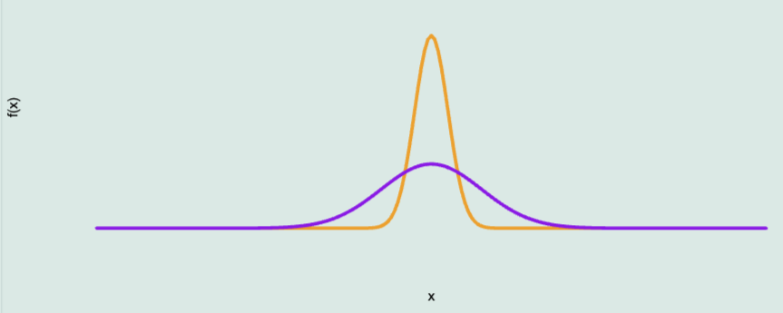

*图 2：相同均值但不同方差的两个正态密度。*

我们图里2条曲线，都是Normal Distribution，mean相同，但是spread不同. 我们需要用一个数来衡量spread：variance。

**Variance的定义**

$$
Var(Y) = \mathbb{E}\lbrack(Y - \mathbb{E}(Y))^{2}\rbrack
$$

**Variance是用来总结spread的：** 回答数据有多分散，距离均值有多远这类的问题。

**Variance是一个expectation：** 我们本质上是

**先算每个值和均值的差：** $Y - E(Y)$；

- 再平方（避免正负抵消）；

- 最后取期望（加权平均）。

**Example：** 随机变量 $X$表示一次4面公平骰子的结果. 骰子可能的取值是$\left\{ 1,2,3,4 \right\}$，因为是公平的 $P(X = x) = \frac{1}{4}$。

**Writing the probability mass function：** 这是一个离散数据，因此我们可以写出PMF

$$
p_{X}(x) = \frac{1}{4},x \in \{ 1,2,3,4\}
$$

**Compute the expected value：** 期望 = 所有可能取值 × 它的概率，然后全部加起来

$$
\begin{array}{r}
E\lbrack X\rbrack = \frac{1}{4}(1) + \frac{1}{4}(2) + \frac{1}{4}(3) + \frac{1}{4}(4) \\
= \frac{1 + 2 + 3 + 4}{4} \\
= \frac{10}{4} = 2.5
\end{array}
$$

**Compute the variance：**

**第一步：** 先算每个值和均值的差: $Y - E(Y)$。

$$
\begin{array}{r}
1 - 2.5 = - 1.5 \\
2 - 2.5 = - 0.5 \\
3 - 2.5 = 0.5 \\
4 - 2.5 = 1.5
\end{array}
$$

**第二步：** 再平方（避免正负抵消）。

$$
\begin{array}{r}
( - 1.5)^{2} = 2.25 \\
( - 0.5)^{2} = 0.25 \\
(0.5)^{2} = 0.25 \\
(1.5)^{2} = 2.25
\end{array}
$$

**第三步：** 最后取期望（加权平均）。

$$
Var(X) = \frac{1}{4}(2.25) + \frac{1}{4}(0.25) + \frac{1}{4}(0.25) + \frac{1}{4}(2.25) = 1.25
$$

**方差的单位：**若 $Y$ 的单位是磅（lb），$\operatorname{Var}(Y)$ 的单位是 $\mathrm{lb}^2$。一般地，方差的单位为原变量单位的平方。取平方根可把尺度还原为原变量的单位，得到标准差：

$$
\text{standard deviation}(Y) = \sqrt{Var(Y)}
$$

单位是$lbs$。

#### 2.4.2 Variance的两种写法

**扩散形式Spread Formulation：** 这是最直观的定义

$$
Var(Y) = \mathbb{E}\lbrack(Y - \mathbb{E}(Y))^{2}\rbrack
$$

超额形式Excess Formulation

$$
Var(X) = E\lbrack X^{2}\rbrack - (E\lbrack X\rbrack)^{2}
$$

**Example for Application of Excess Formulation：** 随机变量 $X$表示一次4面公平骰子的结果. 骰子可能的取值是$\left\{ 1,2,3,4 \right\}$，因为是公平的 $P(X = x) = \frac{1}{4}$。

**第 1 步：** 计算$E\lbrack X^{2}\rbrack$

$$
E\left\lbrack X^{2} \right\rbrack = \frac{1}{4}\left( 1^{2} \right) + \frac{1}{4}\left( 2^{2} \right) + \frac{1}{4}\left( 3^{2} \right) + \frac{1}{4}\left( 4^{2} \right) = 7.5
$$

**第 2 步：** 计算$(E\lbrack X\rbrack)^{2}$

$$
\begin{array}{r}
E\lbrack X\rbrack = \frac{1}{4}(1) + \frac{1}{4}(2) + \frac{1}{4}(3) + \frac{1}{4}(4) \\
= \frac{1 + 2 + 3 + 4}{4} \\
= \frac{10}{4} = 2.5
\end{array}
$$

$$
(E\lbrack X\rbrack)^{2} = 6.25
$$

**第 3 步：** 代入 Excess 公式

$$
\begin{aligned}
Var(X) & = E\lbrack X^{2}\rbrack - (E\lbrack X\rbrack)^{2} \\
& = 7.5 - 6.25 \\
& = 1.25
\end{aligned}
$$

Proof of Excess Formulation

$$
\begin{aligned}
E\{(Y-EY)^2\}
&=E\{Y^2-2Y\,EY+(EY)^2\}\\
&=E(Y^2)-2E(Y)E(Y)+(EY)^2\\
&=E(Y^2)-2(EY)^2+(EY)^2\\
&=E(Y^2)-(EY)^2.
\end{aligned}
$$

先展开平方，再用期望的线性性并将常数 $EY$ 提出。

两种写法的解释

**扩散形式Spread Formulation：** 可以分为3步理解，分别是先找中心，看每个点距离中心多远，把距离平方并平均. 基本上就是在回答"一个典型的样本点，距离均值有多远"，这就是spread。

**超额形式Excess Formulation：** 是分为2步，我们先计算所有点的平方平均，再减去中心的平方. 其在回答"如果不考虑中心偏移，整体平方有多大？"。

#### 2.4.3 Variance Properties

**Basic Properties**

**Non-negative：** $Var(Y) \geq 0$.

**Variance of a constant：** $Var(a) = 0$.

- Linear Combination of Independent Random Variables

- If X and Y are two independent random variables, then

$$
Var(X + Y) = Var(X) + Var(Y)
$$

**理解：** 如果两个变量互不影响（独立），它们的"波动"可以直接相加. 比如X是今天的气温波动，Y是测量误差. 如果两者互不相关，总波动 = 各自波动之和。

**Addition by a Constant：** $Var(X + a) = Var(X)$.

**Multiplication by a Constant：** $\operatorname{Var}(aX)=a^2\operatorname{Var}(X)$. （因为方差本质是平方偏差）

#### 2.4.4 随机变量线性组合的方差

一般情况下，线性组合的方差需要包含协方差；即使变量不独立，协方差也可能为 0，此时方差仍可相加。

$$
Var(aX + bY) = a^{2}Var(X) + b^{2}Var(Y) + 2abCov(X,Y)
$$

$$
Var(aX - bY) = a^{2}Var(X) + b^{2}Var(Y) - 2abCov(X,Y)
$$

我们发现如果不独立，方差多出来一项$2abCov(X,Y)$，这项就是"相互关系"的影响。

Covariance的定义

$$
Cov(X,Y) = E\lbrack(X - E(X))(Y - E(Y))\rbrack
$$

**Covariance的直觉解释：** 其在衡量X 和 Y 是否"同方向"变化

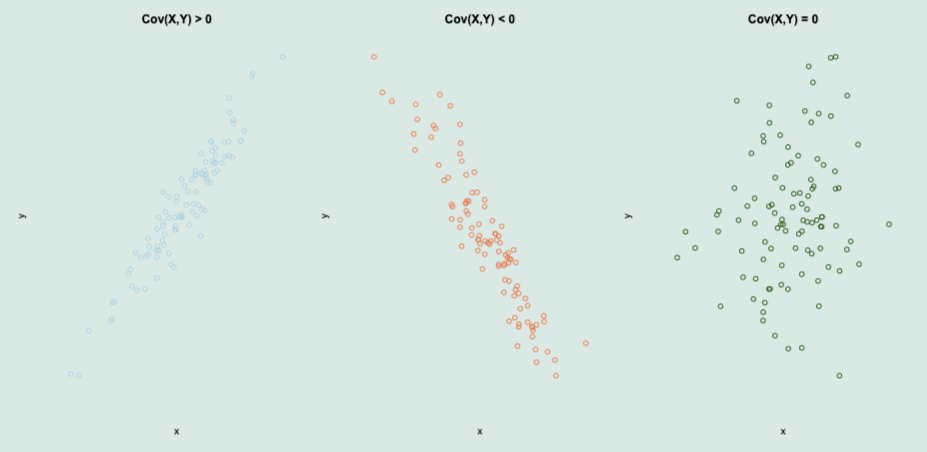

*图 3：正协方差、负协方差与零协方差的散点。*

**Cov(X,Y) > 0：** 正相关

- X 偏高时，Y 也偏高

- X 偏低时，Y 也偏低

**Cov(X,Y) < 0：** 负相关

X 偏高时，Y 偏低

**Cov(X,Y) = 0：** 不相关

X 和 Y 没有线性相关；仍可能存在非线性依赖

**注意：** 独立 ⇒ 协方差为 0；但协方差为 0 ≠ 独立

#### 2.4.5 Conditional Variance

条件方差函数及其在某一点的值

$$
Var(Y \mid X = x)
$$

函数 $v(x)=\operatorname{Var}(Y\mid X=x)$ 描述各组的离散程度；固定 $x$ 后，$v(x)$ 是一个数。

Conditional Variance（是一个随机变量）

$$
Var(Y \mid X) = E\left\lbrack \begin{array}{r}
(Y - E(Y \mid X))^{2} \mid X
\end{array} \right\rbrack
$$

这里 $\operatorname{Var}(Y\mid X)=v(X)$ 是随机变量；它可能随 $X$ 改变，也可能为常数。

**Example：** 参加补习班的比例:

$$
\begin{array}{r}
P(X = 0) = 0.4 \\
P(X = 1) = 0.6
\end{array}
$$

考试成绩分布:

| 补习班状态 | 成绩 $Y$ | 条件概率 |
| --- | --- | --- |
| $X=0$ | 60 | 0.5 |
| $X=0$ | 80 | 0.5 |
| $X=1$ | 80 | 0.5 |
| $X=1$ | 100 | 0.5 |

如何计算Conditional Variance $Var\left( Y \middle| X = 0 \right)$

**第 1 步：** 先算$E\left( Y \middle| X = 0 \right) = 0.5 \times 60 + 0.5 \times 80 = 70$

**第 2 步：** 计算Conditional Variance

$$
Var\left( Y\mid X = 0 \right) = E\left\lbrack \begin{array}{r}
(Y - E(Y \mid X = 0))^{2} \mid X = 0
\end{array} \right\rbrack = E\left\lbrack \begin{array}{r}
(Y - 70)^{2} \mid X = 0
\end{array} \right\rbrack
$$

平方偏差:

$$
(60 - 70)^{2} = 100
$$

$$
(80 - 70)^{2} = 100
$$

期望:

$$
= 0.5(100) + 0.5(100) = 100
$$

如何计算Conditional Variance $Var\left( Y \middle| X = 1 \right)$

**第 1 步：** 先算$E\left( Y \middle| X = 1 \right) = 0.5 \times 80 + 0.5 \times 100 = 90$

**第 2 步：** 计算Conditional Variance

$$
Var\left( Y\mid X = 1 \right) = E\left\lbrack \begin{array}{r}
(Y - E(Y \mid X = 1))^{2} \mid X = 1
\end{array} \right\rbrack = E\left\lbrack \begin{array}{r}
(Y - 90)^{2} \mid X = 1
\end{array} \right\rbrack
$$

平方偏差:

$$
(80 - 90)^{2} = 100
$$

$$
(100 - 90)^{2} = 100
$$

期望:

$$
= 0.5(100) + 0.5(100) = 100
$$

**Law of Total Variance**

$$
Var\lbrack Y\rbrack = E\lbrack Var(Y \mid X)\rbrack + Var\lbrack E(Y \mid X)\rbrack
$$

**第 1 步：** 先算出Conditional Variance

$$
Var(Y \mid X = x) = E\left\lbrack \begin{array}{r}
(Y - E(Y \mid X = x))^{2} \mid X = x
\end{array} \right\rbrack
$$

**第 2 步：** 根据Conditional Variance计算$E\lbrack Var(Y \mid X)\rbrack$

**第 3 步：** 计算$Var\lbrack E(Y \mid X)\rbrack$

计算 $\operatorname{Var}[E(Y\mid X)]$ 时，先求各组条件均值 $E(Y\mid X=x)$，再以 $X$ 的分布加权求总体均值，最后计算这些条件均值的方差。

**Example for Law of Total Variance：** 同上例

**第 1 步：** 我们已知

$$
Var\left( Y\mid X = 0 \right) = 100
$$

$$
Var\left( Y\mid X = 1 \right) = 100
$$

**第 2 步：** 计算$E\lbrack Var(Y \mid X)\rbrack$

$$
E\left\lbrack Var\left( Y\mid X \right) \right\rbrack = 100 \times 0.4 + 100 \times 0.6 = 100
$$

**第 3 步：** 已知

$$
E\left( Y \middle| X = 0 \right) = 70
$$

$$
E\left( Y \middle| X = 1 \right) = 90
$$

$$
E(Y) = 0.4(70) + 0.6(90) = 28 + 54 = 82
$$

计算$Var\lbrack E(Y \mid X)\rbrack$

$$
\begin{array}{r}
Var(E\lbrack Y \mid X\rbrack) = 0.4(70 - 82)^{2} + 0.6(90 - 82)^{2} \\
= 0.4(144) + 0.6(64) \\
= 57.6 + 38.4 = 96
\end{array}
$$

Law of total variance -- Proof

1. 将条件方差与条件均值的方差都写成二阶矩形式。

$$
\begin{aligned}
&E\{\operatorname{Var}(Y\mid X)\}+\operatorname{Var}\{E(Y\mid X)\}\\
&=E[E(Y^2\mid X)-\{E(Y\mid X)\}^2]+E[\{E(Y\mid X)\}^2]-\{E[E(Y\mid X)]\}^2.
\end{aligned}
$$

2. 分配外层期望。

$$
=E[E(Y^2\mid X)]-E[\{E(Y\mid X)\}^2]+E[\{E(Y\mid X)\}^2]-\{E[E(Y\mid X)]\}^2.
$$

3. 中间两项抵消；对剩余项使用迭代期望。

$$
=E(Y^2)-\{E(Y)\}^2=\operatorname{Var}(Y).
$$

本例总体方差还可由全方差公式得到 $100+96=196$。

<a id="section-3"></a>

## 3. 抽样、估计量与抽样分布

<a id="section-3-1"></a>

### 3.1 估计目标、估计量与估计值

#### 3.1.1 三个估计术语

**Estimand：** 我们真正想知道的东西: 它是关于population的某个数量，比如总体均值、总体比例、ATE等等。它是真实存在的但是未知的固定数值。

**Estimator：**由样本产生估计值的规则；在抽样前，它是依赖随机样本的随机变量。常见例子包括：

- 样本均值

- 样本比例

- OLS回归公式等等

**Estimate：** 是Estimator具体算出来的结果。

<a id="section-3-2"></a>

### 3.2 总体与抽样

#### 3.2.1 总体层面的估计目标

**我们的目标：** 我们真正关心的是整个总体，但我们通常无法观测整个总体。

**总体估计目标的例子：**

- GA 所有注册选民的投票比例

- 全世界吉娃娃的平均体重

- 全体美国大学毕业 vs 未毕业的平均收入差

通常不能直接测量这些总体量，因此需要抽样估计。

#### 3.2.2 Sampling Procedures

无放回样本由总体中不同单位组成；有放回样本是一列抽取记录，同一总体单位可以出现多次。

**Random Sampling with Replacement（我们本节课使用的）：** 从Population随机抽一个单位，抽完后放回总体，再抽下一个。

为什么我们要with Replacement

**如果是without Replacement：**

抽样之间有dependence，第一抽影响第二抽。

**Example：** 我们有1/4肥胖狗，1/4偏瘦狗和1/2正常狗。我们随机抽一只 $P(肥胖) = 1/4$ 没有问题。但是如果without Replacement，在已知第一次抽到肥胖狗后，第二次抽到肥胖狗的条件概率变为

$$
\frac{肥胖总数 - 1}{总体总数 - 1}
$$

**我们需要：** Sampled units are independent.

- 本章采用独立同分布（i.i.d.）抽样作为基础模型；统计理论也可以处理无放回抽样、时间序列、聚类样本等依赖数据。

- 数学上真正发生了什么？

**with replacement：** $P\left( X_{2} = x\mid X_{1} = y \right) = P\left( X_{2} = x \right)$

**without replacement：** $P(X_{2} = x \mid X_{1} = y) \neq P(X_{2} = x)$

**最重要的是：** 等概率有放回抽样保证各次抽取独立且具有相同总体分布。等概率无放回抽样中，每次抽取的边际分布也仍是总体分布，但不同次抽取相互依赖。

$$
X_{i}\ \sim\ F
$$

- 现实中我们真的放回吗？

- 通常我们不真的放回，但如果总体远大于样本，without replacement 和 with replacement 几乎一样。

此时有限总体修正对标准误的影响很小。若有限总体大小为 $m$，总体方差按 $\sigma^2=m^{-1}\sum_j(y_j-\mu)^2$ 定义，简单随机无放回抽样满足 $\operatorname{Var}(\overline Y)=\frac{\sigma^2}{n}\frac{m-n}{m-1}$。

#### 3.2.3 Getting an Estimate

**第 1 步：** 我们已经有了随机样本，假设

$$
Y_{1},\ Y_{2},\ldots,Y_{n}
$$

**第 2 步：** 使用 Estimator（Estimator 是一个数学函数 / 算法），比如

$$
\widehat{\mu} = \frac{1}{n}\sum_{i = 1}^{n}Y_{i}
$$

Example: 我们想要估计吉娃娃的总体平均体重 $\mu$，于是我们用

$$
\frac{1}{n}\sum_{i=1}^{n}Y_{i}
$$

这叫sample mean。

**关键思想**

- Estimator 是 $T(Y_{1},\ Y_{2},\ldots,Y_{n})$ 随机变量

- Estimate 是 $T(y_{1},\ y_{2},\ldots,y_{n})$ 具体数值

#### 3.2.4 Sample vs Population Notation

| 概念        | Population     | Sample                              |
| --- | --- | --- |
| Mean        | $\mu$        | $\overline Y$ 或 $\widehat\mu$ |
| Variance    | $\sigma^{2}$ | $s^{2}$                           |
| 总体／样本规模 | $N$          | $n$                               |

- Population Parameters是固定常数；Sample Statistics是随机变量

- Sample是随机抽出来的，所以 $\overline{Y}$ 本身是Random Variable。

**Example：** $\mu = 5$，我们抽样3次

- 第一次sample mean = 4.8

- 第二次sample mean = 5.3

- 第三次sample mean = 4.9

这说明 $\overline{Y}$ 在不同样本下会变化，这叫sampling distribution。

<a id="section-3-3"></a>

### 3.3 抽样分布

#### 3.3.1 Sampling Distribution如何形成

**关键问题：** 有没有哪一次 estimate 恰好等于 estimand？答案是不一定。

我们重复做实验（抽一个样本，计算sample mean，再抽再算，我们得到很多不同的sample mean）

$$
{\overline{Y}}_{1},\ {\overline{Y}}_{2},\ {\overline{Y}}_{3},\ldots
$$

这会形成一个Distribution，这就是Sampling distribution of the estimator，也就是Distribution of $\overline{Y}$。

#### 3.3.2 Why Sampling Distributions Matter

**核心原因：**不同样本产生不同估计值，因此要研究估计量的抽样分布。判断估计量时，主要看它是否围绕目标值以及它的波动大小。

**第一个问题：抽样分布是否以估计目标为中心？**例如，对样本均值检查

$$
E\left\lbrack \overline{Y} \right\rbrack = \mu?
$$

如果成立，则unbiased。

**第二个问题：抽样分布是宽还是窄？**即研究

$$
Var\left( \overline{Y} \right)\ or\ SE(\overline{Y})
$$

如果分布很宽，那么estimate很不稳定；如果很窄，estimate很稳定。

Standard Error $SE\left( \overline{Y} \right)$: Sampling distribution 的标准差叫做 standard error。

$$
SE\left( \overline{Y} \right) = \frac{\sigma}{\sqrt{n}}
$$

#### 3.3.3 选民调查与覆盖概率

问题背景

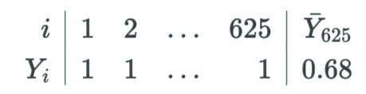

*图 4：625 人二元调查数据与样本比例示例。*

**Population大小：** $m \approx 7.23M$（Georgia 注册选民）；

**Sample大小：** $n = 625$；

每次电话随机选一个人；

**记录是否投票：** $Y_{i} = 1$（会投），0（不会）；

- 假设所有人都接电话，都诚实回答，不改变想法；

- 每个民调员都计算一个sample mean。

**Sampling distribution的形成：** 如果 1,000,000 个民调员做同样的 625 人抽样，我们会得到1,000,000 个sample means。我们可以画一个Histogram

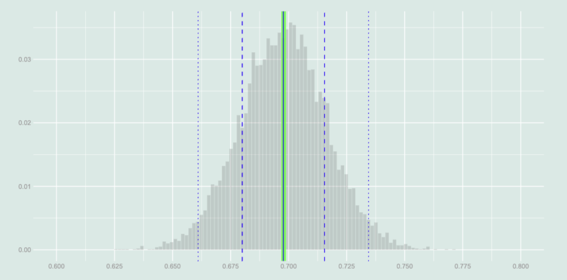

*图 5：选民样本比例的重复抽样分布。*

**横轴：** 不同民调员算出来的sample mean，比如0.68、0.71、0.70、0.69等等；

纵轴表示频数、比例或密度，取决于作图设置；若是密度直方图，区间内概率对应柱子的面积，而非高度本身。

**中间的粗蓝线：** sampling distribution 的均值。

**绿色线：** population mean = 0.70。

**虚线：** ±1 Standard Error。

**点线：** ±2 Standard Error。

**Coverage Probability**

**Coverage Probability：** 如果我给每个sample mean画一个区间，比如±0.01， 那么有多少比例的区间会"包含"population mean呢？

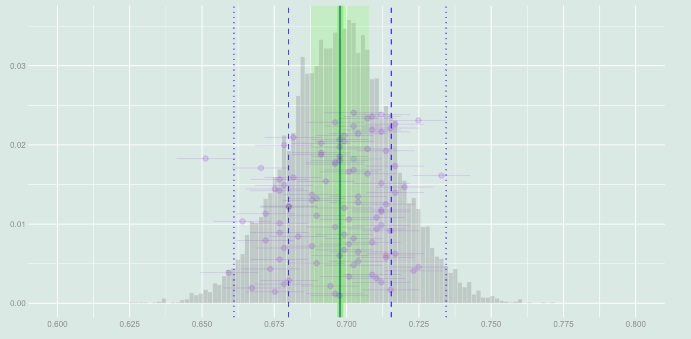

*图 6：固定半宽区间的覆盖率示意。*

这些紫色点就是每一个sample means，其高低错落主要是为了视觉效果。本质上其只对应横轴，高低不影响任何事情。

**从抽样分布计算覆盖率：**原本需要给每个样本均值画一个半宽 0.01、总宽 0.02 的区间，再检查是否包含总体均值。等价而更便于作图的办法是：以总体均值为中心画同样半宽的区间，统计有多少样本均值落在其中。因此，覆盖率就是抽样分布落在图中绿色区域的比例。

**结果：** 在这个示意中，半宽 0.01 的覆盖率约为 40%；若 $Y_i\sim\operatorname{Bernoulli}(0.70)$ 且 $n=625$，二项分布给出的实际覆盖率约为 40%，远低于 95%。我们想要的是95% coverage。这本质是一个选宽度的calibration问题。

**Confidence Interval：** 置信区间是由随机样本决定的区间 $I(Y_1,\ldots,Y_n)$。95% 覆盖率指重复抽样时，约 95% 的这类区间包含固定的总体参数 $\mu$。

对固定半宽 $c$，有

$$
P\{\mu\in[\overline Y-c,\overline Y+c]\}=P\{|\overline Y-\mu|\le c\}.
$$

因而可以借助以 $\mu$ 为中心的抽样分布校准半宽；实际报告的区间则以观测到的 $\overline Y$ 为中心。现实中通常只抽一次样本，只得到一个 $\overline Y_{625}$，也不知道真实 $\mu$ 或完整抽样分布，所以需要估计标准误或抽样分布，再选择适当的区间构造方法。

<a id="section-4"></a>

## 4. 置信区间的校准

<a id="section-4-1"></a>

### 4.1 用估计的抽样分布构造区间

#### 4.1.1 现实问题：不知道Population Mean

**现实问题：** 现实中我们不知道$\ \mu$ 和$\ \sigma$，怎么校准 95% 区间？

**解决方案：** 我们不用真实Sampling Distribution了，改用估计的Sampling Distribution。

估计的Sampling Distribution以sample mean $\overline{Y}$ 为中心，而不是以真实的 $\mu$ 为中心。对近似无偏、近似对称的估计量，中心平移通常不妨碍用其估计宽度；偏差、偏斜和区间构造方式仍会影响覆盖率。

#### 4.1.2 Calibration Comparison

- 校准需要选择适当半宽；在近似无偏、对称分布的示意中，可以通过平移估计抽样分布来研究宽度。对偏差明显或偏斜的分布，还必须考虑中心与构造方法。

- 当估计量近似无偏、标准误估计合理且参考分布近似适用时，以 $\overline Y$ 为中心并使用相应临界值，可得到近似目标覆盖率。仅有区间宽度合适并不能补偿严重偏差。

- 下图绿色区域与红色区域（在这里的近似无偏、相似形状示意中）

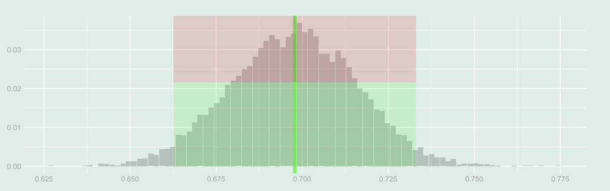

*图 7：真实与估计抽样分布的区间宽度校准。*

- 绿色 = 真抽样分布校准的区间

- 红色 = 估计抽样分布校准的区间

- 结果几乎一样

**Estimating Sampling Distributions**

**真实抽样分布：**反复从总体抽样并计算估计量，可得到估计量的标准误，以及目标覆盖率（如 95%）所需的区间宽度。

**估计的抽样分布：**由样本近似上述分布，可得到估计标准误和近似校准的区间宽度。下面介绍 Bootstrap 与代入法两种构造方式。

#### 4.1.3 方法一: Bootstrap

**核心思想：** 把samples当作population模拟抽样。

**具体步骤：** 设原始sample size n = 625；原始样本数据 $Y_1,\ldots,Y_{625}$

**第 1 步：** 有放回的抽样（bootstrap sample）

- 从这625个观测值中随机抽625个，允许重复。

- 有些人可能不出现，有些人出现2次，有些人出现5次。次数是随机的。

**第 2 步：** 算统计量并重复很多次

- 我们针对这个bootstrap sample算 ${\overline{Y}}^{*}$。这是一个bootstrap estimate。

- 我们重复10,000次

$$
{\overline{Y}}_{1}^{*},\ {\overline{Y}}_{2}^{*},\ldots,\ {\overline{Y}}_{10000}^{*}
$$

**第 3 步：** 这10,000个数的分布就是bootstrap estimated sampling distribution。

**Example：** 假设我们抽到3个人

$$
Y = \{ 2,4,6\}
$$

我们先算original sample mean。

$$
\overline{Y} = \frac{2 + 4 + 6}{3} = 4
$$

**开始 Bootstrap：** 我们现在"假装"这 3 个数就是总体，从 $\left\{ 2,4,6 \right\}$中 有放回抽 3 个数。

**第一次：** 2,2,4

$$
{\overline{Y}}_{1}^{*} = \frac{2 + 2 + 4}{3} = 2.67
$$

**第二次：** 6,6,4

$$
{\overline{Y}}_{2}^{*} = \frac{6 + 6 + 4}{3} = 5.33
$$

**第三次：** 2,4,6

$$
{\overline{Y}}_{3}^{*} = \frac{2 + 4 + 6}{3} = 4
$$

**第四次：** 4,4,4（${\overline{Y}}_{4}^{*} = 4$）

**第五次：** 2,6,6（${\overline{Y}}_{5}^{*} = 4.67$）

**第六次：** 2,2,2（${\overline{Y}}_{6}^{*} = 2$）

我们得到的 bootstrap means

$$
\{ 2.67,\ 5.33,\ 4,\ 4,\ 4.67,\ 2\}
$$

这六个值只是 Bootstrap 分布的少量模拟值；实际计算通常需要更多重复。用未四舍五入的均值 $(8/3,16/3,4,4,14/3,2)$ 计算，Bootstrap 均值为 $34/9\approx3.778$。

估计Standard Error

$$
{\overline{Y}}_{boot} = \frac{2.67 + 5.33 + 4 + 4 + 4.67 + 2}{6} \approx 3.78
$$

$$
\widehat{SE}_{\mathrm{boot}}=\sqrt{\frac{1}{B-1}\sum_{b=1}^{B}(\overline Y_b^*-\overline Y_{\mathrm{boot}})^2}\approx1.2413\quad(B=6)
$$

计算正态近似区间（演示运算）

$$
4\pm1.96\times1.2413\approx(1.567,\ 6.433)
$$

#### 4.1.4 方法二: Plug-in Principle

**核心思想：** 我们知道样本均值的抽样分布在大样本下近似

$$
\overline{Y}\sim N(\mu,\ \sigma^{2}/n\ )
$$

但是我们不知道$\mu$和$\sigma$，因此我们可以用"估计值"代替"未知参数"，即

$$
\mu \approx \overline{Y},\ \sigma \approx s
$$

**Sampling Distribution 的中心在哪里：** 我们用sample mean作为 $\mu$ 的估计，因此用下面的分布估计未知的抽样分布；这不是说同一个随机变量以自身为分布参数：

$$
\widehat F_{\overline Y}\approx N(\overline Y,s^2/n)
$$

**Sampling Distribution 的方差是多少：** 我们现在关心的是$Var(\overline{Y})$，而不是$Var(Y)$，关键公式是:

$$
Var\left( \overline{Y} \right) = \frac{\sigma^{2}}{n}\  \rightarrow SE\left( \overline{Y} \right) = \frac{\sigma}{\sqrt{n}}
$$

但是我们不知道$\sigma$，于是用sample标准差$s$代替:

$$
\widehat{SE} = \frac{s}{\sqrt{n}}
$$

**怎么得到 95% 置信区间：** 如果 sampling distribution 是正态，那么95%在 ±1.96 个标准差内，所以

$$
I_{0.95}=\left[\overline Y-1.96\frac{s}{\sqrt n},\ \overline Y+1.96\frac{s}{\sqrt n}\right]
$$

**Example：** 假设我们抽到3个人

$$
Y = \{ 2,4,6\}
$$

我们先算original sample mean。

$$
\overline{Y} = \frac{2 + 4 + 6}{3} = 4
$$

算sample standard deviation

$$
s^{2} = \frac{(2 - 4)^{2} + (4 - 4)^{2} + (6 - 4)^{2}}{3 - 1} = 4,\ s = 2
$$

Plug-in 标准误

$$
\widehat{SE} = \frac{s}{\sqrt{n}} = \frac{2}{\sqrt{3}} \approx 1.155
$$

Plug-in 正态近似区间（小样本演示）

$$
\overline{Y} \pm 1.96\frac{s}{\sqrt{n}} = (1.737,\ 6.263)
$$

样本 $\{2,4,6\}$ 只有三个观测，上述正态区间和六次 Bootstrap 仅用于演示计算，不能据此宣称具有可靠的 95% 覆盖率。如果总体正态，均值的精确小样本区间为

$$
\overline Y\pm t_{n-1,0.975}\frac{s}{\sqrt n}.
$$

本例 $n=3$、$t_{2,0.975}\approx4.303$，得到约 $[-0.968,8.968]$。若总体不正态且样本极小，通常无法仅凭这三个数得到通用、可靠的均值区间。

#### 4.1.5 Bootstrap 与代入法的比较

**代入法（正态近似）：**对于样本均值，在中心极限定理的适用条件下，代入法计算简便，有明确的大样本理论依据，样本量足够大时通常近似准确。

中位数、比率等估计量在适当条件下也可能渐近正态，并可用密度估计或 Delta method 构造代入标准误。Bootstrap 能减少解析推导，但其可靠性仍取决于样本量、估计量的正则性和抽样结构；对极值、稀疏子组或分母接近 0 的比率可能失效。

#### 4.1.6 95% 置信区间的含义

我们现在有一个 95% CI，不意味着观察到该区间后，固定参数 $\mu$ 有 95% 的频率学派概率落在其中。因为$\mu$ 是一个固定常数，不是随机变量。它要么在区间里，要么不在，没有概率。

**95%意味着：** 如果我们重复抽样很多次，用同样方法构造区间，约 95% 的区间会包含 $\mu$。

<a id="section-5"></a>

## 5. 从概率到统计

<a id="section-5-1"></a>

### 5.1 估计量的随机性

#### 5.1.1 问题一: 为什么同一个 estimator 会给出不同的 estimate？

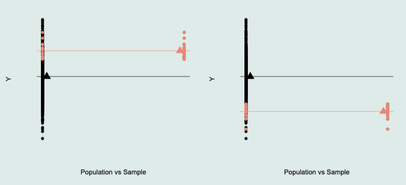

*图 8：同一总体中两次抽样得到不同样本均值。*

- 图中同一个population，两次sample不同，同一个estimator，不同的estimate。

- 因为sample是random的，因此 $\widehat{\mu} = f(Y_{1},\ \ldots,\ Y_{n})$ 是random variable。

#### 5.1.2 问题二: Non-representative sample（如果样本太极端，比如只抽到特别胖的 Chihuahua）

随机样本也可能恰好抽到大量体重特别高的吉娃娃。此时一次置信区间可能没有覆盖真值；置信区间的标称覆盖率描述的是重复抽样性质，不保证每次成功。抽样设计必须与推断方法的假设一致，极端样本的概率由该设计决定。

#### 5.1.3 问题三: Are our estimators good?

估计量是随机变量，评价它时可分别考察抽样分布的位置（是否围绕估计目标）和精度（分布有多分散）。

#### 5.1.4 有限总体中的吉娃娃体重例题

| 个体编号j     | 1   | 2   | 3   | 4   | 5   |
| --- | --- | --- | --- | --- | --- |
| 体重$y_{j}$ | 2   | 3   | 5   | 6   | 9   |

**随机抽1个：** 如果完全随机

$$
P(Roll = j) = \frac{1}{m} = \frac{1}{5}
$$

**随机抽2个（with replacement）：** 每次抽的概率都一样 $P(Roll = j) = \frac{1}{m}$。并且$Roll_{1}$与$Roll_{2}$是iid的（independent identically distributed）。

**随机抽n个（with replacement）：**

$$
(Roll_{1},\ Roll_{2},\ldots,\ Roll_{n})
$$

"抽样"在概率语言里就是：生成一个长度为n的 iid 随机向量。

#### 5.1.5 Sampling: binary case

**情况：** 有时候你不关心"体重/收入"这种数值，而只关心某个二元特征，比如有狗（$y = 1$）还是没狗（$y = 0$），我们定义 $Y_{01}$，表示"抽到的那个人的0/1"。该随机变量的取值集合为 $\{0,1\}$，所以是一个discrete random variable。

- Expectation = Population Mean

- 设$N_{1}$为population有多少$y = 1$；设$N_{0}$为population有多少$y = 0$，显然$N_{0} + N_{1} = m$。

- 因此

$$
P\left( Y_{01} = 1 \right) = \frac{N_{1}}{m};\ P\left( Y_{01} = 0 \right) = \frac{N_{0}}{m}
$$

**期望：**

$$
E\left( Y_{01} \right) = 0 \times P\left( Y_{01} = 0 \right) + 1 \times P\left( Y_{01} = 1 \right) = P\left( Y_{01} = 1 \right) = \frac{N_{1}}{m}
$$

**重要结论：** Expectation = Population Mean = Population中1的比例 $E\left( Y_{01} \right) = \mu$。

对 binary 变量来说，population mean恰好等于proportion。

$$
E\lbrack X\rbrack = \mu_{X} = p
$$

**问题：** 理论上期望=总体均值，但现实中你不知道总体，所以需要"统计"。

#### 5.1.6 Conditioning as two-stage sampling

条件概率/条件期望可以理解成"先抽类别，再在类别里抽个体"。比如蓝色（X = 1）有$m_{blue}$个人，红色（X = 0）有$m - m_{blue}$个人。对于一个具体的蓝色个体$j$:

$$
P(抽到j) = P(X = 1) \times P(在蓝色里抽到j\ |\ X = 1) = \frac{m_{blue}}{m} \times \frac{1}{m_{blue}} = \frac{1}{m}
$$

- 在你已经知道这个个体属于组 $x$的前提下，$Y_{i}$ 的平均值是多少？

- $E\lbrack Y_{i} \mid X_{i} = 1\rbrack$：在"female"的人里，体重平均是多少？

$$
E\left\lbrack Y_{i}\mid X_{i} = 1 \right\rbrack = \mu(1)
$$

$E\left\lbrack Y_{i}\mid X_{i} = 0 \right\rbrack$：在"male"的人里，体重平均是多少？

$$
E\left\lbrack Y_{i}\mid X_{i} = 0 \right\rbrack = \mu(0)
$$

条件期望 $E\lbrack Y \mid X = x\rbrack$就是"子总体 $X = x$那一群人的平均值"。

<a id="section-5-2"></a>

### 5.2 估计量的中心与偏差

#### 5.2.1 Location of Our Estimators and Bias

**Center of sampling distribution：** 估计量 $\widehat{\theta}$每次抽样都会变（因为样本随机），所以 $\widehat{\theta}$本身是随机变量。如果你反复抽很多次样本、每次算一个 $\widehat{\theta}$，这些 $\widehat{\theta}$会形成一个sampling distribution。location就是这个sampling distribution的中心在哪里？

- 比如你要估计"班级真实平均身高" $\theta$。

- 你每次随机抽 10 个人算平均身高 $\widehat{\theta}$。

**如果你抽样方式公平：** $\widehat{\theta}$ 有时偏高、有时偏低，但"总体上围绕真值上下波动"。

**如果你总去篮球队抽：** $\widehat{\theta}$ 几乎每次都偏高，抽样分布整体右移。

Bias

**定义：** $bias\left( \widehat{\theta} \right)=E\left\lbrack \widehat{\theta} \right\rbrack - \theta$

- $\theta$: 真值（固定常数，不随机）

- $\widehat{\theta}$: 估计量（随机变量）

- $\mathbb{E}\lbrack\widehat{\theta}\rbrack$: 重复抽样无数次后的平均估计值（抽样分布的均值）

**Bias = 0意味着什么：** $\mathbb{E}\left\lbrack \widehat{\theta} \right\rbrack = \theta$

- 抽样分布"居中"在真值上。

- 这就是 unbiased estimator。

- Unbiased为什么重要

- 你做置信区间时，通常是围绕 $\widehat{\theta}$来做的；如果 $\widehat{\theta}$的中心都偏了，那区间就算"校准得很好"，也可能覆盖不了真值。

- 比如假设真值 $\theta = 0$。

**无偏情况：** $\widehat{\theta}$ 分布中心在 0。你做一个"95%区间"大概率能盖住 0。

**有偏情况：** $\widehat{\theta}$ 分布中心在 3，你做的"95%区间"会围绕 3。绝大多数区间都在 \[2,4\] 一带。0 根本不在里面。

#### 5.2.2 The Sample Mean（样本均值是无偏的）

**重要命题：** Sample mean $\widehat{\mu}$ is the unbiased estimator of population mean $\mu$.

$$
\mathbb{E}\left\lbrack \widehat{\mu} \right\rbrack = \mu.
$$

**Proof：** Consider $\widehat{\mu} = \frac{1}{n}\sum_{i = 1}^{n}Y_{i}$.

**第 1 步：** 期望的linearity。

$$
\mathbb{E}\left\lbrack \frac{1}{n}\sum_{i = 1}^{n}Y_{i} \right\rbrack = \frac{1}{n}\sum_{i = 1}^{n}{\mathbb{E}\lbrack Y_{i}\rbrack}
$$

**第 2 步：** Equal-probability sampling，每个 $Y_{i}$都是"从总体里随机抽一个人的值"，所以它的期望就是总体平均 $\mu$。

$$
\mathbb{E}\left\lbrack \frac{1}{n}\sum_{i = 1}^{n}Y_{i} \right\rbrack = \frac{1}{n}\sum_{i = 1}^{n}{\mathbb{E}\lbrack Y_{i}\rbrack} = \frac{1}{n}\sum_{i = 1}^{n}\mu = \frac{1}{n} \bullet n\mu = \mu
$$

#### 5.2.3 A Subsample Mean（非空子样本均值的无偏性）

**重要命题：** 对 i.i.d. 样本，在目标子组非空的条件下，子样本均值对相应子总体均值无偏。令 $N_x=\sum_i\mathbf1\{X_i=x\}$；当 $N_x=0$ 时子样本均值未定义。以下涉及随机子组计数的期望与方差均在所需子组非空的事件上计算；若设计固定各组正样本量，则无需另加这一条件。

$$
\mathbb{E}\left\lbrack \widehat{\mu}(1) \right\rbrack = \mu(1).
$$

**Proof**

- 我们先设置一个dummy variable $X_{i}$

- $X_{i} = 1$意味着i-th sampled element belongs to our group of interest（比如是female）。

- $X_{i} = 0$意味着i-th sampled element does NOT belongs to our group of interest（比如不是female）。

**目标：**

$$
\mathbb{E}\lbrack\widehat{\mu}(1)\rbrack = \mathbb{E}\left\lbrack \frac{\sum_{i = 1}^{n}\, X_{i}Y_{i}}{\sum_{i = 1}^{n}\, X_{i}} \right\rbrack
$$

**第 1 步：** Law of Iterated Expectations

$$
\mathbb{E}\left\lbrack \frac{\sum X_{i}Y_{i}}{\sum X_{i}} \right\rbrack = \mathbb{E}\left\lbrack \mathbb{E}\left\lbrack \frac{\sum X_{i}Y_{i}}{\sum X_{i}} \mid X_{1},\ldots,X_{n} \right\rbrack \right\rbrack
$$

**第 2 步：** 线性性（把条件期望推进求和里）

$$
\mathbb{E}\left\lbrack \mathbb{E}\left\lbrack \frac{\sum X_{i}Y_{i}}{\sum X_{i}} \mid X_{1},\ldots,X_{n} \right\rbrack \right\rbrack = \mathbb{E}\left\lbrack \frac{\sum_{i = 1}^{n}\,\mathbb{E}\lbrack X_{i}Y_{i} \mid X_{1},\ldots,X_{n}\rbrack}{\sum_{i = 1}^{n}\, X_{i}} \right\rbrack
$$

- 为什么分母可以拿进去？在条件 $X_{1},\ldots,X_{n}$给定时，$\sum X_{i}$ 是一个constant（因为X都固定了）。

- 为什么可以把期望作用到每一项？因为条件期望也有线性性

$$
\mathbb{E}\left\lbrack \sum_i\, Z_{i} \mid W \right\rbrack = \sum_i\,\mathbb{E}\lbrack Z_{i} \mid W\rbrack.
$$

**第 3 步：** 把 $X_{i}$当常数提出去（因为$\mathbb{E}\lbrack X_{i}Y_{i} \mid X_{1},\ldots,X_{n}\rbrack = X_{i}\mathbb{E}\lbrack Y_{i} \mid X_{1},\ldots,X_{n}\rbrack$）

$$
\mathbb{E}\left\lbrack \frac{\sum_{i = 1}^{n}\, X_{i}E\lbrack Y_{i} \mid X_{1},\ldots,X_{n}\rbrack}{\sum_{i = 1}^{n}\, X_{i}} \right\rbrack
$$

这是因为$\mathbb{E}\lbrack c \cdot Z \mid W\rbrack = c \cdot \mathbb{E}\lbrack Z \mid W\rbrack.$

**第 4 步：** Irrelevance of independent conditioning（"其他 $X$" 对 $Y_{i}$ 没用）

$$
\mathbb{E}\lbrack Y_{i} \mid X_{1},\ldots,X_{n}\rbrack = \mathbb{E}\lbrack Y_{i} \mid X_{i}\rbrack
$$

$$
\mathbb{E}\left\lbrack \frac{\sum_{i = 1}^{n}\, X_{i}E\lbrack Y_{i} \mid X_{i}\rbrack}{\sum_{i = 1}^{n}\, X_{i}} \right\rbrack
$$

**第 5 步：** 把 $\mathbb{E}\lbrack Y_{i} \mid X_{i}\rbrack$记成 $\mu\left( X_{i} \right)$（定义$\mu(x) = \mathbb{E}\lbrack Y \mid X = x\rbrack$）

$$
\mathbb{E}\lbrack Y_{i} \mid X_{i}\rbrack = \mu(X_{i})
$$

$$
\mathbb{E}\left\lbrack \frac{\sum_{i = 1}^{n}\, X_{i}\mu(X_{i})}{\sum_{i = 1}^{n}\, X_{i}} \right\rbrack
$$

**第 6 步：** Indicator trick（最关键的一步）: 由于 $X_{i} \in \{ 0,1\}$，我们看 $X_{i}\mu(X_{i})$

- 如果 $X_{i} = 1$: $\mu(X_{i}) = \mu(1)$，所以 $X_{i}\mu(X_{i}) = 1 \cdot \mu(1) = \mu(1)$。

- 如果 $X_{i} = 0$: $X_{i}\mu(X_{i}) = 0 \cdot \mu(0) = 0$。

所以无论哪种情况（因为当 $X_{i} = 0$时两边都是 0；当 $X_{i} = 1$时两边都是 $\mu(1)$）

$$
X_{i}\mu\left( X_{i} \right) = X_{i}\mu(1)
$$

因此:

$$
\mathbb{E}\left\lbrack \frac{\sum_{i = 1}^{n}\, X_{i}\mu(1)}{\sum_{i = 1}^{n}\, X_{i}} \right\rbrack
$$

**第 7 步：** 分子分母抵消（只剩 $\mu(1)$）

$$
\mathbb{E}\lbrack\widehat{\mu}(1)\rbrack = \mu(1).
$$

#### 5.2.4 Differences in Subsample Means（组间差的无偏性）

**重要命题：** The difference in subsample means is unbiased for the difference in subpopulation means.

$$
\mathbb{E}\lbrack\widehat{\mu}(1) - \widehat{\mu}(0)\rbrack = \mu(1) - \mu(0)
$$

**原因：** 期望的线性性

$$
\mathbb{E}\lbrack A - B\rbrack=E\lbrack A\rbrack-E\lbrack B\rbrack
$$

<a id="section-5-3"></a>

### 5.3 估计量的离散程度

#### 5.3.1 Spread of our estimators

**我们之前讨论的 location：** sampling distribution 是否 centered at target（是否无偏）。但哪怕无偏，如果 sampling distribution 很"胖"（方差大），你的估计每次抽样都可能差很多 → 置信区间就会很宽。

CI 的"宽度"来源于 estimator 的 spread（标准误/方差）。

#### 5.3.2 Random Variables and spread -- binary case

**重要命题：** $Var(Y) = \sigma^{2}$。

**Proof**

$$
\begin{aligned}
\operatorname{Var}(Y_i)&=E\{(Y_i-\mu)^2\}\\
&=\sum_y(y-\mu)^2P(Y_i=y)\\
&=\frac1m\sum_{j=1}^{m}(y_j-\mu)^2=\sigma^2.
\end{aligned}
$$

等概率抽取的是总体单位 $j$。若多个单位具有相同 $y$ 值，该数值的概率为对应单位数除以 $m$，不能把每个不同数值的概率都写成 $1/m$。

- Binary特例

- If $Y \in \{ 0,1\}$ and $p=P(Y = 1),\ P(Y = 0) = 1 - p$

- We know $\mathbb{E}\lbrack Y\rbrack = p,\ Var(Y) = p(1 - p)$

#### 5.3.3 Variance of the Sample Mean

**重要命题：**

$$
Var(\widehat{\mu}) = \frac{\sigma^{2}}{n},\operatorname{sd}(\widehat{\mu}) = \frac{\sigma}{\sqrt{n}}
$$

**Proof**

$$
\begin{aligned}
\operatorname{Var}\!\left(\frac1n\sum_{i=1}^nY_i\right)
&=\frac1{n^2}\sum_{i=1}^{n}\operatorname{Var}(Y_i)\\
&=\frac1{n^2}\sum_{i=1}^{n}\sigma^2
=\frac{n\sigma^2}{n^2}=\frac{\sigma^2}{n}.
\end{aligned}
$$

第一步使用独立观测间协方差为 0；若观测相关，必须加上协方差项。

#### 5.3.4 Variance of the sub-sample mean

重要结论：在 $N_1>0$ 的条件下，

$$
\operatorname{Var}\{\widehat\mu(1)\mid N_1>0\}=\sigma^2(1)E\!\left(\frac1{N_1}\,\middle|\,N_1>0\right).
$$

这是“子总体方差乘以组内样本量倒数的期望”。一般来说，$E(1/N_1\mid N_1>0)$ 不等于 $1/E(N_1\mid N_1>0)$。

**例题：白棋子上的数值**

1. 抽样 $n=100$ 次，每次抽到白棋子的概率为 $p=0.3$；定义

$$
X_i=\begin{cases}1,&\text{white},\\0,&\text{black},\end{cases}
\qquad N_1=\sum_{i=1}^{100}X_i.
$$

2. 白棋子上数值 $Y$ 的子总体均值为 $\mu(1)=50$，方差为 $\sigma^2(1)=100$。
3. 在独立抽样下 $N_1\sim\operatorname{Binomial}(100,0.3)$，且 $E(N_1)=np=30$。
4. 精确条件方差为

$$
100\sum_{k=1}^{100}\frac1k\frac{\binom{100}{k}0.3^k0.7^{100-k}}{1-0.7^{100}}\approx3.4159.
$$

5. 当 $N_1$ 集中于 $np$ 附近且空组概率可忽略时，可用大样本近似

$$
\operatorname{Var}\{\widehat\mu(1)\}\approx\frac{\sigma^2(1)}{np}=\frac{100}{100\times0.3}=\frac{100}{30}\approx3.3333.
$$

**证明：从全方差公式到倒数的期望**

以下所有运算都在 $N_1>0$ 上进行。记 $\mathbf X=(X_1,\ldots,X_n)$。

**Step 1：全方差分解与定义。** 对任意方差存在的随机变量 $A$，

$$
\operatorname{Var}(A)=E\{\operatorname{Var}(A\mid\mathbf X)\}+\operatorname{Var}\{E(A\mid\mathbf X)\}.
$$

其中

$$
\operatorname{Var}(A\mid\mathbf X)=E[\{A-E(A\mid\mathbf X)\}^2\mid\mathbf X],
$$

$$
\operatorname{Var}\{E(A\mid\mathbf X)\}=E[\{E(A\mid\mathbf X)-E(A)\}^2].
$$

取 $A=\widehat\mu(1)=\sum_iX_iY_i/N_1$，由不同观测之间独立以及指示变量性质，

$$
\begin{aligned}
E\{\widehat\mu(1)\mid\mathbf X\}
&=\frac1{N_1}\sum_i X_i E(Y_i\mid\mathbf X)\\
&=\frac1{N_1}\sum_i X_i\mu(X_i)
=\frac1{N_1}\sum_i X_i\mu(1)=\mu(1).
\end{aligned}
$$

这里没有假设 $X_i$ 与 $Y_i$ 独立；只有其他观测的组别不会改变给定 $X_i$ 后的 $Y_i$ 分布。

**Step 2：化简全方差分解。** 条件均值为常数，故

$$
\operatorname{Var}\{E[\widehat\mu(1)\mid\mathbf X]\}=\operatorname{Var}\{\mu(1)\}=0.
$$

因此

$$
\operatorname{Var}\{\widehat\mu(1)\}=E\!\left[E\!\left(\{\widehat\mu(1)-\mu(1)\}^2\mid\mathbf X\right)\right].
$$

**Step 3：把中心化均值写成和。**

$$
\begin{aligned}
\widehat\mu(1)-\mu(1)
&=\frac{\sum_iX_iY_i}{N_1}-\frac{\mu(1)\sum_iX_i}{N_1}\\
&=\frac{\sum_iX_i\{Y_i-\mu(1)\}}{N_1}.
\end{aligned}
$$

令 $Z_i=X_i\{Y_i-\mu(1)\}=X_i\{Y_i-\mu(X_i)\}$。给定 $\mathbf X$ 后，分母固定，故

$$
\operatorname{Var}\{\widehat\mu(1)\}=E\!\left[\frac{E\{(\sum_iZ_i)^2\mid\mathbf X\}}{N_1^2}\right].
$$

**Step 4：展开平方和。** 类比 $(a+b+c)^2=a^2+b^2+c^2+2ab+2ac+2bc$，

$$
\left(\sum_iZ_i\right)^2=\sum_i\sum_j Z_iZ_j.
$$

由期望的线性性及不同观测对的独立性，

$$
\begin{aligned}
\operatorname{Var}\{\widehat\mu(1)\}
&=E\!\left[\frac{\sum_i\sum_j E(Z_iZ_j\mid\mathbf X)}{N_1^2}\right]\\
&=E\!\left[\frac{\sum_i\sum_j E(Z_iZ_j\mid X_i,X_j)}{N_1^2}\right].
\end{aligned}
$$

**Step 5：交叉项为 0。** 当 $i\ne j$ 时，给定各自组别后两个观测仍独立，而且

$$
E(Z_i\mid X_i)=X_iE\{Y_i-\mu(X_i)\mid X_i\}=0.
$$

也可以逐层使用迭代期望：

$$
\begin{aligned}
E(Z_iZ_j\mid X_i,X_j)
&=E[Z_iE(Z_j\mid Z_i,X_i,X_j)\mid X_i,X_j]\\
&=E[Z_iE(Z_j\mid X_j)\mid X_i,X_j]=0.
\end{aligned}
$$

**Step 6：计算对角项并约去计数。** 因为 $X_i^2=X_i$，

$$
\begin{aligned}
E(Z_i^2\mid X_i)
&=X_iE[\{Y_i-\mu(X_i)\}^2\mid X_i]\\
&=X_i\sigma^2(X_i)=X_i\sigma^2(1).
\end{aligned}
$$

因此

$$
\begin{aligned}
\operatorname{Var}\{\widehat\mu(1)\}
&=E\!\left[\frac{\sum_i X_i\sigma^2(1)}{N_1^2}\right]\\
&=E\!\left[\frac{\sigma^2(1)N_1}{N_1^2}\right]
=\sigma^2(1)E\!\left(\frac1{N_1}\right).
\end{aligned}
$$

末式的期望仍以 $N_1>0$ 为条件；固定组样本量时直接得到 $\sigma^2(1)/N_1$。

#### 5.3.5 The Variance of Differences in Means

**重要命题：** 在 i.i.d. 抽样、两个组均非空的条件下，给定分组后的两个组均值相互独立，且条件均值为常数。因此均值差的方差为两项组均值方差之和。若采用有限总体随机分配等其他设计，则应按相应设计处理协方差。

$$
Var(\widehat{\mu}(1) - \widehat{\mu}(0)) = E\left\lbrack \frac{\sigma^{2}(1)}{N_{1}} + \frac{\sigma^{2}(0)}{N_{0}} \right\rbrack
$$

<a id="section-6"></a>

## 6. 子样本均值与线性组合

<a id="section-6-1"></a>

### 6.1 粗组均值与细组均值

#### 6.1.1 粗组均值 = 细组均值的加权平均

$$
\widehat{\mu}(x) = \frac{1}{N_{x}}\sum_{i:X_{i} = x}^{}\, Y_{i}\ \ \ \ where\ \ \ \ \ N_{x} = \sum_{i:X_{i} = x}^{}\, 1
$$

**Example：** 假设把教育年限不超过 12 年（$X\leq12$）定义为粗组，这个组包括8年、9年、10年、11年、12年，那么

$$
\widehat\mu(X\leq12) = \frac{N_{8}\widehat{\mu}(8) + N_{9}\widehat{\mu}(9) + \cdots + N_{12}\widehat{\mu}(12)}{N_{8} + N_{9} + \cdots + N_{12}}
$$

**Example 2：**

**Setting：** 现在3个education level

- X = 10（3个人，收入是20，30，40）

- X = 12（2个人，收入是30，50）

- X = 16（3个人，收入是60，80，100）

- 我们先算Fine Group Means

$$
\widehat{\mu}(10) = \frac{20 + 30 + 40}{3} = 30
$$

$$
\widehat{\mu}(12) = \frac{30 + 50}{2} = 40
$$

$$
\widehat{\mu}(16) = \frac{60 + 80 + 100}{3} = 80
$$

**算 Coarse Group Means：** 教育年限不超过 12 年的组（$X\leq12$），数据是20、30、40、30、50

$$
mean = \frac{170}{5} = 34
$$

**验证：**

$$
\widehat\mu(X\leq12) = \frac{N_{10}\widehat{\mu}(10) + N_{12}\widehat{\mu}(12)}{N_{10} + N_{12}} = \frac{3 \times 30 + 2 \times 40}{3 + 2} = 34
$$

<a id="section-6-2"></a>

### 6.2 增量汇总与线性组合

#### 6.2.1 教育年限与收入增量的三种汇总

| 教育年限 | 人数$N_{x}$ | $\widehat{\mu}(x)$ |
| --- | --- | --- |
| 8年      | 100人         | 20                   |
| 9年      | 50人          | 30                   |
| 10年     | 10人          | 80                   |

**方法一：** Average over years

$$
\frac{\left\lbrack \widehat{\mu}(9) - \widehat{\mu}(8) \right\rbrack + \left\lbrack \widehat{\mu}(10) - \widehat{\mu}(9) \right\rbrack}{2} = \frac{10 + 50}{2} = 30
$$

**方法二：** Average over people

**问题：** 不同年份的人数不一样，所以我们应该weight。

**如何weight：** 这是我们的选择

Weight = 该 transition 的人数÷所有 relevant 人数

**Weight by those who stayed（继续上学的人）：** 用较高教育年限组的人数给相邻组均值差加权。

**Weight by those who dropped（辍学的人）：** 用较低教育年限组的人数给相邻组均值差加权。

Average over people（stayers）

**Weights**

$$
\begin{aligned}
P_{9} & = \frac{50}{50 + 10} = \frac{50}{60} \\
P_{10} & = \frac{10}{60}
\end{aligned}
$$

**计算：**

$$
\begin{array}{r}
= \frac{50}{60} \cdot 10 + \frac{10}{60} \cdot 50 \\
= \frac{500 + 500}{60} = \frac{1000}{60} \approx 16.67
\end{array}
$$

含义: 以较高教育组的人数加权的平均收入差为多少？横截面数据中的这些人数不是同一队列的实际升学记录，描述性差异也不自动等于教育的因果收益。

Average over people（leavers）

**Weights**

$$
\begin{aligned}
P_{9} & = \frac{100}{100 + 50} = \frac{100}{150} \\
P_{10} & = \frac{50}{150}
\end{aligned}
$$

**计算：**

$$
\begin{array}{r}
= \frac{100}{150} \cdot 10 + \frac{50}{150} \cdot 50 \\
= \frac{1000 + 2500}{150} = \frac{3500}{150} \approx 23.33
\end{array}
$$

#### 6.2.2 三种权重对应的描述目标

- Average over years

- Average over people（stayers）

- Average over people（leavers）

三者回答的是不同的 research question，反映不同的故事。本例三种结果分别为 30、16.67 和 23.33，已经有明显差异。权重的选择取决于要描述的目标人群或教育阶段；若要解释为升学或退学的因果影响，还需要额外的因果识别条件。

#### 6.2.3 Linear Combinations

- 还是刚才的例子

- Average over years

$$
\frac{1}{2}\sum_{x = 9}^{10}\,\left\{ \widehat{\mu}(x) - \widehat{\mu}(x - 1) \right\} = \frac{1}{2}\left\lbrack \left( \widehat{\mu}(9) - \widehat{\mu}(8) \right) + \left( \widehat{\mu}(10) - \widehat{\mu}(9) \right) \right\rbrack = \frac{1}{2}\left\lbrack \widehat{\mu}(10) - \widehat{\mu}(8) \right\rbrack = \sum_x\,\alpha(x)\widehat{\mu}(x)
$$

其中

$$
\alpha(x) = \begin{cases}\frac{1}{2}\, & x = 10 \\ - \frac{1}{2}\, & x = 8 \\ 0\, & otherwise\end{cases}
$$

Average over people（stayers）

$$
\sum_{x = 9}^{10}\, P_{x}\left\{ \widehat{\mu}(x) - \widehat{\mu}(x - 1) \right\} = P_{9}\left( \widehat{\mu}(9) - \widehat{\mu}(8) \right) + P_{10}\left( \widehat{\mu}(10) - \widehat{\mu}(9) \right) = - P_{9}\widehat{\mu}(8) + \left( P_{9} - P_{10} \right)\widehat{\mu}(9) + P_{10}\widehat{\mu}(10) = \sum_x\,\widehat{\alpha}(x)\widehat{\mu}(x)
$$

其中

$$
\widehat{\alpha}(x) = \begin{cases}P_{10}\, & x = 10 \\ P_{9} - P_{10}\, & x = 9 \\ - P_{9}\, & x = 8 \\ 0\, & otherwise\end{cases}
$$

**总的来说：** 把所有 incremental summary estimator 统一写成一个通用形式，这样做一次 inference proof 就能覆盖所有情形。

$$
\widehat{\theta} = \sum_x\,\alpha(x) \cdot \widehat{\mu}(x)
$$

<a id="section-6-3"></a>

### 6.3 线性组合的期望与无偏性

#### 6.3.1 子样本均值的无偏性

之前的关键结论: sub-sample mean 是 sub-population mean 的 unbiased estimator。

#### 6.3.2 固定系数与随机系数

Unbiasedness: 固定权重的线性组合继承组均值的无偏性。若权重仅依赖组别向量，且所需组均非空，则可通过给定组别后的无偏性处理随机权重；若权重依赖结果变量，下面的分解一般不成立。

$$
E\left\lbrack \sum_x\alpha(x)\widehat{\mu}(x) \right\rbrack = \sum_x\alpha(x)\mu(x)\quad\left( \text{fixed coefficients} \right)
$$

$$
E\left\lbrack \sum_x\widehat{\alpha}(x)\widehat{\mu}(x) \right\rbrack = \sum_xE\left\lbrack \widehat{\alpha}(x) \right\rbrack \cdot \mu(x)\quad\left( \text{random coefficients} \right)
$$

- Fixed coefficients

- 我们有固定的权重，比如over years → $\frac{1}{2}, - \frac{1}{2}$，或者slope。这都是我们定好的。

**Proof**

**线性性：**

$$
E\left\lbrack \sum_x\,\alpha(x)\widehat{\mu}(x) \right\rbrack = \sum_x\,\alpha(x)E\left\lbrack \widehat{\mu}(x) \right\rbrack
$$

**Unbiased：**

$$
E\lbrack\widehat{\mu}(x)\rbrack = \mu(x)
$$

- Random coefficients

- 权重本身是从 sample 里算出来的，比如

$$
P_{9} = \frac{50}{60},P_{10} = \frac{10}{60}
$$

**Proof：** Because $\widehat{\alpha}(x)$depends only on group assignment (X) and not on outcomes (Y), we can apply the law of iterated expectations

$$
E\lbrack\widehat{\alpha}(x)\widehat{\mu}(x)\rbrack = E\lbrack\widehat{\alpha}(x)E\lbrack\widehat{\mu}(x) \mid \widehat{\alpha}(x)\rbrack\rbrack = E\lbrack\widehat{\alpha}(x)\mu(x)\rbrack = E\lbrack\widehat{\alpha}(x)\rbrack\mu(x)
$$

<a id="section-6-4"></a>

### 6.4 线性组合的方差

#### 6.4.1 Variance完整公式

$$
\operatorname{Var}(\widehat\theta)
=\underbrace{\sum_x\sigma^2(x)E\!\left[\frac{\widehat\alpha(x)^2}{N_x}\right]}_{\text{within-group outcome variation}}
+\underbrace{\operatorname{Var}\!\left[\sum_x\mu(x)\widehat\alpha(x)\right]}_{\text{variation of group composition}}.
$$

此式使用全方差公式，要求权重仅依赖组别，且各个需要用到的子组非空。给定全部组别后，组均值的条件方差为 $\sigma^2(x)/N_x$，不同组的条件协方差为 0。固定权重时第二项为 0；随机权重时，直接代入观测计数得到的第一项只是条件于组别的方差估计，通常还不是完整的无条件方差。

其中 $\sigma^{2}(x) = V\lbrack Y_{i} \mid X_{i} = x\rbrack$，即每个 sub-group 内部的 variance。

**第一项：** 因为 sub-sample means $\widehat{\mu}(x)$本身是随机的（每次抽样不同），这一项捕捉的是这个随机性带来的误差。

**第二项：** 因为 coefficients $\widehat{\alpha}(x)$也可能是随机的（依赖数据），这一项捕捉的是 coefficients 自身的随机性。

#### 6.4.2 Example 1: Fixed coefficients（可以忽略第二项）

| 教育年限 | 人数$N_{x}$ | ${\widehat{\sigma}}^{2}(x)$（组内 variance） |
| --- | --- | --- |
| 10年     | 4人           | 8                                              |
| 11年     | 10人          | 5                                              |
| 12年     | 20人          | 12                                             |

**第 1 步：** 写出 estimator 并找 coefficients（Average over years: 从 $x = 10$到 $x = 12$，跨两步）

$$
\widehat{\theta} = \frac{1}{2}\left\lbrack \left( \widehat{\mu}(11) - \widehat{\mu}(10)) + (\widehat{\mu}(12) - \widehat{\mu}(11) \right) \right\rbrack = \frac{\widehat{\mu}(12) - \widehat{\mu}(10)}{2}
$$

改写成 $\sum_x{\alpha(x)}\widehat{\mu}(x)$的形式，coefficients 为

$$
\alpha(x) = \begin{cases}+ \frac{1}{2}\, & x = 12 \\ 0\, & x = 11 \\ - \frac{1}{2}\, & x = 10\end{cases}
$$

**第 2 步：** 算每个 $\alpha(x)^{2}$

| $x$ | $\alpha(x)$ | $\alpha(x)^{2}$ |
| --- | --- | --- |
| 10    | -1/2          | 0.25              |
| 11    | 0             | 0                 |
| 12    | +1/2          | 0.25              |

**第 3 步：** 带入公式

$$
\begin{array}{r}
\widehat{Var(\widehat{\theta})} = \frac{{\widehat{\sigma}}^{2}(10) \cdot \alpha(10)^{2}}{N_{10}} + \frac{{\widehat{\sigma}}^{2}(11) \cdot \alpha(11)^{2}}{N_{11}} + \frac{{\widehat{\sigma}}^{2}(12) \cdot \alpha(12)^{2}}{N_{12}} \\
= \frac{8 \times 0.25}{4} + \frac{5 \times 0}{10} + \frac{12 \times 0.25}{20} \\
= \frac{2}{4} + 0 + \frac{3}{20} \\
= 0.5 + 0 + 0.15 = \boxed{0.65}
\end{array}
$$

#### 6.4.3 Example 2: Random coefficients

| 教育年限 | 人数$N_{x}$ | ${\widehat{\sigma}}^{2}(x)$（组内 variance） |
| --- | --- | --- |
| 10年     | 5人           | 4                                              |
| 11年     | 5人           | 6                                              |
| 12年     | 10人          | 8                                              |

**第 1 步：** 写出estimator

$$
\widehat{\theta} = P_{11}\lbrack\widehat{\mu}(11) - \widehat{\mu}(10)\rbrack + P_{12}\lbrack\widehat{\mu}(12) - \widehat{\mu}(11)\rbrack
$$

其中 stayers 的权重 $P_{x} = \frac{N_{x}}{N_{11} + N_{12}}$，注意分母只加 stayers 那两组（$x = 10$ 是"起点"，不算 stayer）

$$
P_{11} = \frac{5}{5 + 10} = \frac{1}{3},P_{12} = \frac{10}{5 + 10} = \frac{2}{3}
$$

**第 2 步：** 展开成 linear combination 形式

$$
\begin{array}{r}
\widehat{\theta} = P_{11}\widehat{\mu}(11) - P_{11}\widehat{\mu}(10) + P_{12}\widehat{\mu}(12) - P_{12}\widehat{\mu}(11) \\
= P_{12}\widehat{\mu}(12) + (P_{11} - P_{12})\widehat{\mu}(11) + ( - P_{11})\widehat{\mu}(10)
\end{array}
$$

所以coefficients为

$$
\widehat{\alpha}(x) = \begin{cases}P_{12} = + \frac{2}{3}\, & x = 12 \\ P_{11} - P_{12} = \frac{1}{3} - \frac{2}{3} = - \frac{1}{3}\, & x = 11 \\ - P_{11} = - \frac{1}{3}\, & x = 10\end{cases}
$$

**第 3 步：** 算每个 $\alpha(x)^{2}$

| $x$ | $\alpha(x)$ | $\alpha(x)^{2}$ |
| --- | --- | --- |
| 10    | -1/3          | 1/9               |
| 11 | -1/3 | 1/9 |
| 12    | +2/3          | 4/9               |

**第 4 步：** 带入公式（第一项）

$$
\begin{array}{r}
\widehat{Var(\widehat{\theta})} = \sum_x\,\frac{{\widehat{\sigma}}^{2}(x) \cdot \widehat{\alpha}(x)^{2}}{N_{x}} \\
= \frac{4 \times \frac{1}{9}}{5} + \frac{6 \times \frac{1}{9}}{5} + \frac{8 \times \frac{4}{9}}{10} \\
= \frac{\frac{4}{9}}{5} + \frac{\frac{6}{9}}{5} + \frac{\frac{32}{9}}{10} \\
= \frac{4}{45} + \frac{6}{45} + \frac{32}{90} \\
= \frac{8}{90} + \frac{12}{90} + \frac{32}{90} = \frac{52}{90} \approx \boxed{0.578}
\end{array}
$$

这里的 $0.578$ 是给定观测分组及权重后的条件方差代入估计，仅对应全方差分解的第一项。随机权重的无条件方差还包括组别构成变动项；现有表格没有给出完整总体分布与各组均值，不能只凭这三列数值算出第二项。

#### 6.4.4 用 Bootstrap 估计线性组合的不确定性

随机权重的方差推导比固定权重复杂；可以利用前面的全方差分解，也可以用 Bootstrap 同时反映组均值和权重的波动。

**第 1 步：** 有放回地抽样（Bootstrap sample）

从原始 sample（比如 2271 个加州居民）中，有放回地随机抽 2271 个人。有些人不出现，有些人出现多次。

**第 2 步：** 算 estimator，重复很多次

针对这个 bootstrap sample，不是算 ${\overline{Y}}^{*}$，而是算你关心的那个 linear combination estimator，比如 average over people

$$
{\widehat{\theta}}^{*} = \sum_x\,{\widehat{\alpha}}^{*}(x){\widehat{\mu}}^{*}(x)
$$

注意 ${\widehat{\mu}}^{*}(x)$和 ${\widehat{\alpha}}^{*}(x)$（即 $P_{x}^{*}$）都是基于这次 bootstrap sample 重新算的，两个随机性来源都被自动捕获了。

重复 10,000 次，得到

$$
{\widehat{\theta}}_{1}^{*},{\widehat{\theta}}_{2}^{*},\ldots,{\widehat{\theta}}_{10000}^{*}
$$

**第 3 步：** 这 10,000 个数的分布就是 bootstrap estimated sampling distribution

**估计 standard error：** 算这 10,000 个数的 standard deviation

**构建 95% CI：** 可用第 2.5 和第 97.5 百分位数构造 percentile Bootstrap 区间；也可以采用正态近似、basic 或 BCa 区间。percentile 区间并不自动具有精确 95% 覆盖率，尤其要检查小组重抽后为空的情况

<a id="section-6-5"></a>

### 6.5 多个协变量

#### 6.5.1 用多个协变量定义子组

Multiple Covariates: 之前的 sub-sample mean 只按一个 covariate（教育年数 $x$）分组。现在同时用两个 covariates: sex（$w$）和 education（$x$）来定义更细的 sub-group。

**Population层面**

$$
\mu(w,x)=\frac1{m_{w,x}}\sum_{j:w_j=w,\ x_j=x}y_j=E(Y\mid W=w,X=x),\qquad m_{w,x}>0.
$$

**Sample层面**

$$
\widehat\mu(w,x)=\frac1{N_{w,x}}\sum_{i:W_i=w,\ X_i=x}Y_i,
\qquad N_{w,x}=\sum_i\mathbf1\{W_i=w,X_i=x\}>0.
$$

#### 6.5.2 多维子组均值的期望

在 i.i.d. 抽样且相应联合子组非空时，联合子组均值同样对对应子总体均值无偏；$X$ 不必是二元变量。连续协变量的精确取值组通常没有足够重复观测，需要分箱、平滑或回归。

$$
E\lbrack\widehat{\mu}(w,x)\rbrack = \mu(w,x)
$$

<a id="section-7"></a>

## 7. 随机实验与条件随机化实验中的因果推断

<a id="section-7-1"></a>

### 7.1 从组间差异到因果问题

前面的组均值方法用于估计子总体均值之差，并通过抽样分布、标准误和置信区间描述不确定性。因果推断进一步追问：一个处理究竟使结果改变了多少？

观察到喝咖啡的人睡得少，说明二者存在关联；要判断咖啡是否导致睡眠减少，需要比较同类个体在不同处理状态下本来会出现的结果。工作安排、健康状况等共同原因都可能影响观察到的关系。

<a id="section-7-2"></a>

### 7.2 潜在结果框架

#### 7.2.1 变量与潜在结果

| 符号 | 含义 |
| --- | --- |
| $Y_i$ | 个体 $i$ 的观测结果，如捐款金额 |
| $W_i$ | 二元处理变量，接受处理为 1，未接受处理为 0 |
| $Y_i(1)$ | 个体 $i$ 接受处理时的潜在结果 |
| $Y_i(0)$ | 个体 $i$ 不接受处理时的潜在结果 |

在处理定义清楚、没有个体间干扰且满足一致性时，观测结果满足

$$
Y_i=W_iY_i(1)+(1-W_i)Y_i(0).
$$

一致性指实际接受处理 $w$ 的个体，其观测结果就是对应的 $Y_i(w)$。没有干扰指一个人的结果不依赖其他人的处理分配；如果存在同伴影响或多种不同版本的处理，需要扩展潜在结果定义。

#### 7.2.2 个体处理效应与因果推断的基本问题

个体处理效应（individual treatment effect）为

$$
\tau_i=Y_i(1)-Y_i(0).
$$

同一个人在同一研究条件下只能接受一种处理，因此只能观测两个潜在结果中的一个，无法仅凭该次观测直接计算其个体效应。这称为因果推断的基本问题。

例如，小明接到募捐电话后捐了 800 元。假设他没有接到电话时会捐 400 元，则电话对他的个体效应为 $800-400=400$ 元。但是 400 元这一反事实结果不能在同一次实验中同时观测。

#### 7.2.3 反事实

- 若 $W_i=1$，观测 $Y_i(1)$，未观测的 $Y_i(0)$ 是反事实结果。
- 若 $W_i=0$，观测 $Y_i(0)$，未观测的 $Y_i(1)$ 是反事实结果。

反事实描述不同处理条件下本来会发生的结果。因果推断不必恢复每个人的两个潜在结果；借助研究设计与识别假设，仍可能识别总体或子组的平均效应。

<a id="section-7-3"></a>

### 7.3 总体、样本与处理分配

#### 7.3.1 抽样和随机分配的不同作用

可以把研究分为三个步骤：

1. 从目标总体抽取样本。
2. 将样本个体随机分配到处理组和对照组。
3. 观测结果，用适当估计量估计处理效应。

随机抽样决定样本如何代表目标总体；随机分配决定处理组和对照组之间能否进行因果比较。随机分配本身不保证样本能代表总体。

有放回抽样是方便的独立抽样模型，但实际实验通常不把同一个人重复分配到相互冲突的处理状态。可先无放回地抽取不同个体，再进行随机分配。当抽样比例 $n/m$ 很小时，常可忽略有限总体修正并采用 i.i.d. 近似；若抽样比例较大，则应使用相应的无放回抽样方差。这里的近似依据是抽样比例，而不是笼统地认为“大总体中绝不会重复抽到人”。

#### 7.3.2 总体与样本平均处理效应

有限总体有 $m$ 个个体，其总体平均处理效应（population ATE）为

$$
\tau_{\mathrm{pop}}=\frac1m\sum_{j=1}^{m}\{y_j(1)-y_j(0)\}.
$$

它是研究目标 estimand。若均匀随机抽取一个总体个体，也可写为

$$
\tau_{\mathrm{pop}}=E\{Y(1)-Y(0)\}.
$$

给定一个含 $n$ 人的实验样本，其样本平均处理效应为

$$
\tau_S=\frac1n\sum_{i=1}^{n}\{Y_i(1)-Y_i(0)\}.
$$

随机分配可以使估计量对固定实验样本的 $\tau_S$ 无偏；若还要推断总体 ATE，需要代表性抽样或可支持总体推广的其他条件。真实数据通常不能同时观测两个潜在结果，因此不能直接从观测结果表算出这两个平均效应。

<a id="section-7-4"></a>

### 7.4 随机分配下 ATE 的识别与估计

#### 7.4.1 因果识别

在简单随机分配下，单个个体的处理状态与其潜在结果独立：

$$
W_i\perp\!\!\!\perp\{Y_i(1),Y_i(0)\},\qquad0<P(W_i=1)<1.
$$

结合一致性，逐步得到

$$
\begin{aligned}
E\{Y_i(1)-Y_i(0)\}
&=E\{Y_i(1)\}-E\{Y_i(0)\}\\
&=E\{Y_i(1)\mid W_i=1\}-E\{Y_i(0)\mid W_i=0\}\\
&=E(Y_i\mid W_i=1)-E(Y_i\mid W_i=0).
\end{aligned}
$$

第一步是期望的线性性；第二步来自随机分配产生的独立性；第三步来自一致性。这个过程把潜在结果定义的因果目标写成观测数据分布的函数，称为因果识别。

为什么 $E\{Y_i(1)\mid W_i=1\}=E\{Y_i(1)\}$？因为随机分配不会系统地把潜在结果较高的人挑进处理组。它保证的是随机化分布下的可比性，并不保证每一次实际分配后的两组所有特征都完全相等。

#### 7.4.2 估计量及无偏性

令 $n_1=\sum_iW_i$、$n_0=\sum_i(1-W_i)$。当两组均非空时，均值差估计量为

$$
\widehat\tau=\frac{\sum_{i=1}^{n}Y_iW_i}{n_1}-\frac{\sum_{i=1}^{n}Y_i(1-W_i)}{n_0}
=\widehat\mu(1)-\widehat\mu(0).
$$

论证链可以分为三个层面：

1. 两个组的样本均值估计对应的观测条件均值。
2. 在随机分配与一致性下，观测条件均值之差等于平均因果效应。
3. 若样本为目标总体的简单随机样本，样本平均效应在抽样平均意义上等于总体平均效应。

固定正组样本量的完全随机实验满足

$$
E_W(\widehat\tau\mid S)=\tau_S.
$$

若再对简单随机抽样取期望，则 $E_{S,W}(\widehat\tau)=\tau_{\mathrm{pop}}$。无偏性不要求大样本；大样本通常用于改善精度或支持区间的近似校准。如果采用独立 Bernoulli 分配，可能出现空处理组或空对照组，必须明确相应条件或使用适合该设计的其他估计量。

<a id="section-7-5"></a>

### 7.5 完整例题：募捐电话实验

研究问题：在密歇根州的目标合格捐款人群中，募捐电话对捐款金额有什么影响？以下用六人构造例子，金额按元记。

这里假设每个被分配打电话的人都实际接到相同方式的电话，因此可以把 $W=1$ 定义为接受电话处理。现实中若存在未接通、不依从等情况，随机分配的是“安排拨打电话”，直接均值差对应分配的意向处理效应，不能自动解释为实际接通电话的效应。

#### 7.5.1 完整潜在结果表

| $i$ | $Y_i(1)$ | $Y_i(0)$ | $\tau_i$ |
| --- | --- | --- | --- |
| 1 | 700 | 700 | 0 |
| 2 | 800 | 400 | 400 |
| 3 | 200 | 0 | 200 |
| 4 | 600 | 200 | 400 |
| 5 | 0 | 0 | 0 |
| 6 | 400 | 400 | 0 |

在分配前 $W_i$ 和观测结果 $Y_i$ 尚未确定。完整潜在结果表用于说明目标与估计量的区别；实际研究只能看到其中一列潜在结果中的部分条目。

这六人的平均处理效应为

$$
\tau_S=\frac{0+400+200+400+0+0}{6}=\frac{1000}{6}\approx166.67.
$$

如果六人就是整个目标总体，它也等于总体 ATE；如果六人只是样本，它是这六人的样本平均效应。

#### 7.5.2 一次随机分配与可观测结果

假设一次分配把第 1、2 人安排到处理组，其余四人安排到对照组。

| $i$ | $W_i$ | 观测 $Y_i$ | $Y_i(1)$ 的状态 | $Y_i(0)$ 的状态 | 真实 $\tau_i$ |
| --- | --- | --- | --- | --- | --- |
| 1 | 1 | 700 | 700，可观测 | 700，反事实 | 0 |
| 2 | 1 | 800 | 800，可观测 | 400，反事实 | 400 |
| 3 | 0 | 0 | 200，反事实 | 0，可观测 | 200 |
| 4 | 0 | 200 | 600，反事实 | 200，可观测 | 400 |
| 5 | 0 | 0 | 0，反事实 | 0，可观测 | 0 |
| 6 | 0 | 400 | 400，反事实 | 400，可观测 | 0 |

最后一列可由构造的完整潜在结果表计算，但在实际观测数据中不能直接观测。

#### 7.5.3 逐步计算均值差

1. 处理组均值：

$$
\widehat\mu(1)=\frac{700+800}{2}=750.
$$

2. 对照组均值：

$$
\widehat\mu(0)=\frac{0+200+0+400}{4}=150.
$$

3. 均值差估计：

$$
\widehat\tau=750-150=600.
$$

这一次估计 600 与六人真实平均效应约 166.67 相差较大，反映了随机分配导致的抽样波动；若六人还来自总体抽样，则还存在抽样变动。无偏是对所有可能分配或抽样取平均后的性质，不要求某一次估计恰好等于真值。样本增大通常能提高精度，但不能保证每一次估计都更接近真值。

<a id="section-7-6"></a>

### 7.6 条件随机化实验

#### 7.6.1 定义与例子

简单的边际随机分配可以让每个人具有相同处理概率，如 $P(W_i=1)=0.5$。条件随机化则根据处理前协变量 $X_i$，在每个层内随机分配处理。

例如，$X=1$ 为老年组，$X=0$ 为年轻组，研究者设置

$$
P(W_i=1\mid X_i=1)=0.8,\qquad P(W_i=1\mid X_i=0)=0.3.
$$

这些概率是设计选择。可以基于资源安排或对子组的研究需求设置不同概率，但不能仅凭年龄就断定某组真实处理效应更大。条件随机化并不要求各层概率一定不同；分层随机实验也可以在每层都采用 50% 分配。

#### 7.6.2 采用条件随机化的原因

1. **子组分析**：希望各年龄层内都有足够的处理和对照个体，可以采用分组或分层随机化，控制层内样本量。
2. **资源分配**：可在满足研究目标与可比性的前提下，对不同层采用不同处理比例。比例极端时，某一组均值的估计可能很不精确。
3. **观察性研究中的条件可交换性**：历史数据没有实验随机分配，但研究者有时假设，在给定一组充分的处理前协变量后，处理与潜在结果条件独立。这是识别假设，不能因为调整了年龄、收入等变量就认为它自动成立；观察性研究也不是由研究者实施的条件随机化实验。

#### 7.6.3 倾向得分

$$
\pi(x)=P(W_i=1\mid X_i=x).
$$

- 实验中 $\pi(x)$ 通常由设计设定并已知。
- 观察性研究中通常需要从数据估计 $\pi(x)$，但估计倾向得分不等于消除所有未测量混杂。
- 要比较该层的处理与对照结果，需要重叠性 $0<\pi(x)<1$。

<a id="section-7-7"></a>

### 7.7 条件平均处理效应的识别与估计

#### 7.7.1 CATE 的定义

$$
\tau(x)=E\{Y(1)-Y(0)\mid X=x\}.
$$

有限总体中，令 $m_x$ 为 $x_j=x$ 的个体数，则

$$
\mathrm{CATE}_x=\frac1{m_x}\sum_{j:x_j=x}\{y_j(1)-y_j(0)\},\qquad m_x>0.
$$

它描述特定子组内的平均处理效应。

#### 7.7.2 识别条件与逐步推导

条件可交换性要求

$$
\{Y_i(1),Y_i(0)\}\perp\!\!\!\perp W_i\mid X_i.
$$

与重叠性 $0<\pi(X_i)<1$ 一起，这通常称为强可忽视性（strong ignorability）。再结合一致性与恰当的无干扰假设，有

$$
\begin{aligned}
\tau(x)
&=E\{Y_i(1)-Y_i(0)\mid X_i=x\}\\
&=E\{Y_i(1)\mid X_i=x\}-E\{Y_i(0)\mid X_i=x\}\\
&=E\{Y_i(1)\mid W_i=1,X_i=x\}-E\{Y_i(0)\mid W_i=0,X_i=x\}\\
&=E(Y_i\mid W_i=1,X_i=x)-E(Y_i\mid W_i=0,X_i=x).
\end{aligned}
$$

在每个层内随机分配时，给定 $X=x$ 后，处理不会再根据潜在结果选择个体。例如，

$$
E\{Y_i(1)\mid X_i=x\}
=E\{Y_i(1)\mid W_i=1,X_i=x\}
=E\{Y_i(1)\mid W_i=0,X_i=x\}.
$$

如果处理概率随 $X$ 变化，忽略 $X$ 的边际均值差一般既不等于特定层的 CATE，也不等于总体 ATE，因为处理组和对照组可能具有不同的年龄组成。

#### 7.7.3 估计量

定义 $n_{wx}=\sum_i\mathbf1\{W_i=w,X_i=x\}$。当该层的两种处理状态均有观测时，

$$
\begin{aligned}
\widehat\tau(x)
&=\frac{\sum_{i:X_i=x}Y_iW_i}{\sum_{i:X_i=x}W_i}-\frac{\sum_{i:X_i=x}Y_i(1-W_i)}{\sum_{i:X_i=x}(1-W_i)}\\
&=\widehat\mu(1,x)-\widehat\mu(0,x).
\end{aligned}
$$

固定层内正组样本量并随机分配时，该均值差对该层样本平均处理效应随机化无偏；在代表性抽样条件下，可进一步推断子总体 CATE。随机单元格计数时应明确非空条件，空单元格不能靠直接相除处理。

#### 7.7.4 六人例题中的条件效应估计

加入年龄组 $X_i$：

| $i$ | $X_i$ | $W_i$ | $Y_i$ | $Y_i(1)$ | $Y_i(0)$ | $\tau_i$ |
| --- | --- | --- | --- | --- | --- | --- |
| 1 | 0 | 1 | 700 | 700 | 700 | 0 |
| 2 | 1 | 1 | 800 | 800 | 400 | 400 |
| 3 | 0 | 0 | 0 | 200 | 0 | 200 |
| 4 | 1 | 0 | 200 | 600 | 200 | 400 |
| 5 | 0 | 0 | 0 | 0 | 0 | 0 |
| 6 | 0 | 0 | 400 | 400 | 400 | 0 |

该表完整潜在结果用于演示；每个人未接受状态下的潜在结果和个体效应在实际研究中仍不可观测。

年轻组 $X=0$ 包含第 1、3、5、6 人：

1. 处理组只有第 1 人，结果为 700。
2. 对照组为第 3、5、6 人，结果分别为 0、0、400。
3. 条件效应估计为

$$
\widehat\tau(0)=\frac{700}{1}-\frac{0+0+400}{3}=700-\frac{400}{3}=\frac{1700}{3}\approx566.67.
$$

老年组 $X=1$ 包含第 2、4 人：

1. 处理组为第 2 人，结果为 800。
2. 对照组为第 4 人，结果为 200。
3. 条件效应估计为

$$
\widehat\tau(1)=\frac{800}{1}-\frac{200}{1}=600.
$$

完整潜在结果表中的真实组平均效应分别为年轻组 $200/4=50$、老年组 $800/2=400$。因此 566.67 和 600 都只是本次分配得到的估计，不能当作已知的真实条件效应。

<a id="section-7-8"></a>

### 7.8 CATE 的标准化汇总

#### 7.8.1 为什么要加权

如果需要一个总体平均效应，应按目标总体的协变量分布汇总各组 CATE。年轻组和老年组人数不同时，简单各取一半通常对应另一个目标人群。

#### 7.8.2 逐步推导

利用迭代期望定律，

$$
\begin{aligned}
\tau
&=E\{Y(1)-Y(0)\}\\
&=E\!\left[E\{Y(1)-Y(0)\mid X\}\right]\\
&=\sum_x E\{Y(1)-Y(0)\mid X=x\}P(X=x)\\
&=\sum_x\{E(Y\mid W=1,X=x)-E(Y\mid W=0,X=x)\}P(X=x).
\end{aligned}
$$

第三步适用于离散 $X$；连续协变量时，用相对于目标总体 $X$ 分布的积分替代求和。

#### 7.8.3 标准化估计量

令 $N_x=\sum_i\mathbf1\{X_i=x\}$，样本比例为 $\widehat P_x=N_x/n$，则

$$
\widehat\tau_{\mathrm{std}}=\sum_x\widehat P_x\,\widehat\tau(x)
=\sum_x\widehat P_x\{\widehat\mu(1,x)-\widehat\mu(0,x)\}.
$$

用样本比例代表总体比例，需要样本能够代表目标总体；若总体比例已知，可直接采用总体权重。复杂抽样需要相应设计权重。如果每层采用固定正处理和对照人数，则给定样本后，上式对样本平均效应随机化无偏；其他分配或抽样机制下应单独检查估计量性质。

#### 7.8.4 六人例题的计算

1. 老年组 $N_1=2$，年轻组 $N_0=4$，总人数 $n=6$。
2. 标准化权重：

$$
\widehat P_1=\frac26=\frac13,\qquad\widehat P_0=\frac46=\frac23.
$$

3. 代入各组估计：

$$
\begin{aligned}
\widehat\tau_{\mathrm{std}}
&=\frac13\times600+\frac23\times\frac{1700}{3}\\
&=200+\frac{3400}{9}=\frac{5200}{9}\approx577.78.
\end{aligned}
$$

这是按六人的年龄分布汇总得到的整体效应估计；在相应推广条件下，可估计同样年龄分布目标人群中“全部接受处理”和“全部不接受处理”的平均结果之差。577.78 仍然是有随机波动的估计，并非真实 ATE；这个构造样本的真实平均效应仍是 166.67。

<a id="section-7-9"></a>

### 7.9 忽略条件会发生什么

直接忽略年龄，会得到

$$
\widehat\mu(1)=\frac{700+800}{2}=750,\qquad
\widehat\mu(0)=\frac{0+200+0+400}{4}=150,
$$

$$
\widehat\mu(1)-\widehat\mu(0)=600.
$$

在条件随机化设计中，处理概率不同使两个处理组的年龄组成一般不同；若年龄还与潜在结果有关，边际均值差就混合了处理效应和组别构成差异。就本次分配而言，老年人在处理组占 $1/2$，在对照组占 $1/4$，两组组成确有差异。

但是不能仅凭本次 600 与标准化结果 577.78 不同，就证明某个估计量“有偏”。偏差是估计量在重复抽样或分配中的期望与目标之差，需要结合分配机制判断。这个例子同时存在很大的随机化误差，不能把 600 与真实值 166.67 的全部差异都归因于年龄混杂。

一般地，原始均值差为

$$
\sum_xE\{Y(1)\mid X=x\}P(X=x\mid W=1)
-\sum_xE\{Y(0)\mid X=x\}P(X=x\mid W=0),
$$

而总体 ATE 的两项都按同一个目标分布 $P(X=x)$ 加权。不同权重正是两者一般不相等的原因。

例如，一所学校若把原本成绩更好的学生更频繁安排进小班，小班平均分较高可能同时反映教学效果和生源差异。分层比较再标准化的目的，是把两种处理状态放到同一个目标人群组成下比较。

<a id="section-7-10"></a>

### 7.10 因果目标、统计工具与公式

#### 7.10.1 因果分析中的核心概念

| 概念 | 含义 |
| --- | --- |
| Causal estimand | 描述处理引起的结果变化；ATE 涉及目标人群中每个人的两个潜在结果 |
| Counterfactual | 实际未接受的处理状态下本来会出现的结果 |
| Treatment randomization | 明确处理如何随机分配，建立可比性 |
| Strong ignorability | 条件可交换性与重叠性；仍需一致性等条件 |
| Standardization | 以目标人群的协变量分布加权汇总 CATE |

#### 7.10.2 继续使用的统计工具

****组均值差**：** 随机分配下估计 ATE，条件随机化下先在层内估计 CATE。
****Bootstrap**：** 近似估计量的抽样分布，但重抽单位和分层方式须匹配抽样及实验设计。固定各层或各处理组样本量时，不能不加区分地用普通逐行 Bootstrap 代替设计分析。
****95% 置信区间**：** 在合适假设或大样本近似下构造，并保持重复抽样覆盖率解释。

完全随机分配、固定实验样本时，令 $S_w^2$ 为样本中潜在结果 $Y_i(w)$ 的有限样本方差（分母 $n-1$），$S_\tau^2$ 为个体效应的有限样本方差，则

$$
\operatorname{Var}_W(\widehat\tau\mid S)
=\frac{S_1^2}{n_1}+\frac{S_0^2}{n_0}-\frac{S_\tau^2}{n}.
$$

个体效应方差通常无法从观测数据直接估计。用观测组方差计算 $s_1^2/n_1+s_0^2/n_0$，可得到常用的保守方差估计，其保守性指随机化期望意义，不保证每次都高于真实方差。若组内观测数少于 2，组方差无法按通常公式估计。前面的六人分层例子有多个单元格只有一人，适合演示点估计，不适合机械构造常规组内方差区间。

#### 7.10.3 从目标到估计值

1. 先明确总体 ATE、样本 ATE 或特定子组 CATE。
2. 根据抽样方式确定能推广到哪个人群。
3. 根据处理分配机制与识别条件，把因果目标写成观测条件均值之差。
4. 用样本均值或分层均值计算估计量，必要时按目标人群分布标准化。
5. 用匹配设计的方差、随机化分析或重抽样方法描述不确定性。

#### 7.10.4 关键公式

| 对象 | 公式 |
| --- | --- |
| 个体处理效应 | $\tau_i=Y_i(1)-Y_i(0)$ |
| 有限总体 ATE | $\tau_{\mathrm{pop}}=m^{-1}\sum_j\{y_j(1)-y_j(0)\}$ |
| 随机分配的均值差 | $\widehat\tau=\widehat\mu(1)-\widehat\mu(0)$ |
| 有限总体 CATE | $\mathrm{CATE}_x=m_x^{-1}\sum_{j:x_j=x}\{y_j(1)-y_j(0)\}$ |
| 层内效应估计 | $\widehat\tau(x)=\widehat\mu(1,x)-\widehat\mu(0,x)$ |
| 标准化估计 | $\widehat\tau_{\mathrm{std}}=\sum_x\widehat P_x\widehat\tau(x)$ |

<a id="section-8"></a>

## 8. 最小二乘回归的预测视角

<a id="section-8-1"></a>

### 8.1 回归的优化形式

#### 8.1.1 最小二乘回归的定义

$$
\widehat{m} = \underset{m\in\mathcal{M}}{\operatorname{argmin}}{\sum_{i = 1}^{n}\left( Y_{i} - m\left( X_{i} \right) \right)^{2}}
$$

- $X_{i}$: 输入 covariates

- $Y_{i}$: 输出 outcome

- $m$: 你要找的函数（预测规则）

- $\mathcal{M}$ 允许的函数集合（model）

**目标：** 让预测误差平方和最小（我们选择的criterion是the sum of squared residuals）

#### 8.1.2 Residuals and the Sum of Squared Residuals (RSS)

**Residuals**

**最核心的定义：** Residuals = 实际值 − 拟合值

$$
{\widehat{\varepsilon}}_{i} = Y_{i} - {\widehat{Y}}_{i}
$$

我们现在的核心目的是用变量 $X$去预测变量 $Y$，并且我们用 $m$ 的函数值来表示我们的预测值，因此。

$$
e_i=Y_i-\widehat m(X_i)
$$

对常数预测 $m$，$\mathrm{RSS}(m)=\sum_i(Y_i-m)^2$；最小二乘估计量为：

$$
\widehat{\mu} = \operatorname*{argmin}_{m\in\mathbb R}{\sum_{i = 1}^{n}\left( Y_{i} - m \right)^{2}}
$$

这是我们的最小二乘估计量；代入样本得到的具体数值才是 estimate。

**我们选择the sum of squared residuals的原因：**

**Good reason：** squaring penalizes large residuals more than absolute value

$$
error = 1 \rightarrow 1^{2} = 1;error = 10 \rightarrow 10^{2} = 100
$$

大误差被放大了。

**Bad reason：** function is easier to do calculus with

#### 8.1.3 预测与关系描述的两种视角

"Modern" = Prediction perspective（预测视角）

**我们关心：** 我能不能预测得准？

- 我们关注在accuracy（误差小不小）

- "Traditional" = Relationship perspective（关系/解释视角）

**我们关心：** X 和 Y 到底是什么关系？

我们关注在interpretation，比如coefficient（β）

<a id="section-8-2"></a>

### 8.2 分组均值的局限与回归的作用

#### 8.2.1 小样本组与空组

**根本原因：** 因为按子组直接求平均（subsample averages）是一个很脆弱、很容易失效的方法。

**Subsample averages是如何操作的：** 把总体按某个分类变量拆成小组，然后每组求平均。比如：

- 8年教育的人平均收入

- 12年教育的人平均收入

- 16年教育的人平均收入

这就是按 education 分组后做 group mean。

**第一层问题：** 有些组不是没有人，而是人太少。

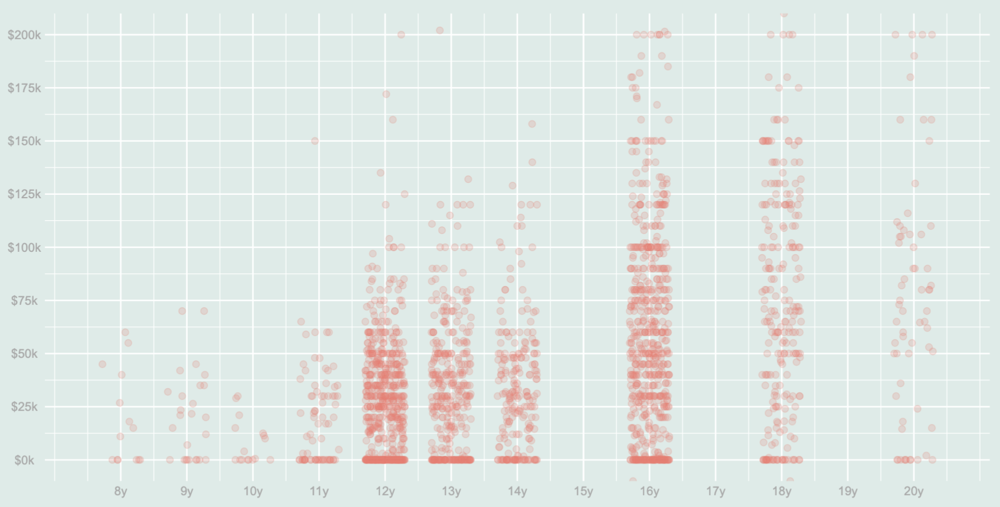

*图 9：不同教育年限的收入分布与样本疏密。*

图上可以看出来：

- 12年、13年、14年、16年、18年这些教育年限的人很多

- 8年、9年、10年的人很少

- 11年以下总体都比较少

因为某个组样本很少，比如8 年教育只有十几个人，那组均值 ${\overline{Y}}_{8}$ 就会特别容易被个别人影响。假设 8 年教育组只有 5 个人，收入分别是10K、15K、20K、22K、100K，平均值就会被那个100K拖得很高。

**第一层问题的总结：** Sensitivity

因为均值本质上是

$$
\overline{Y} = \frac{1}{n}\sum_{i = 1}^{n}Y_{i}
$$

每个人的权重都是 $1/n$，所以 $n$ 越小，每个观测的权重越大；$n$ 越大，单个观测的权重越小。

- 比如下面的图

- 8 年教育组的样本量大约只有 14 个左右，所以每一个人权重都很大。

- 12 年教育组样本量很大，大概 605 人左右，因此去掉某一个人几乎没什么影响。

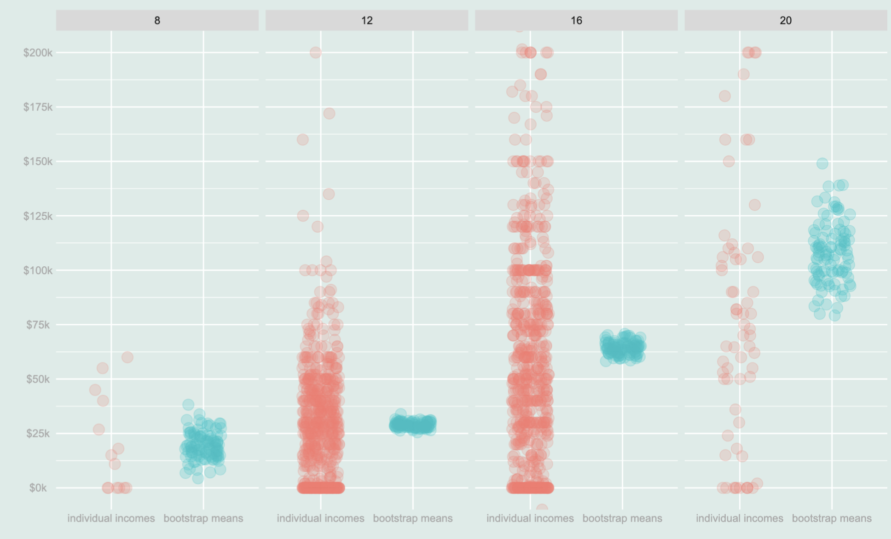

*图 10：不同组样本量对组均值稳定性的影响。*

**第二层问题：** 不是"人太少"，而是"根本没人"。

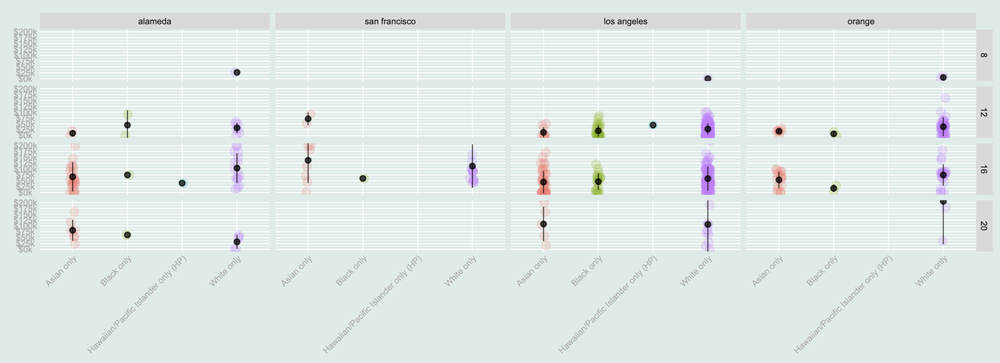

*图 11：按教育、族群与地区细分后的稀疏单元格。*

当我们在多个维度上细分时，会有很多 empty categories。仅仅用了 3 个维度：race, county, education：就已经很多空格了。有些 population summaries 根本无法估计，即任何涉及"某个完全没抽到的组的均值"的东西，我们没法直接估计。所以我们需要一种方法，对没有数据的组也能做 prediction。

#### 8.2.2 对于该问题的部分的解决方案: Coarsening

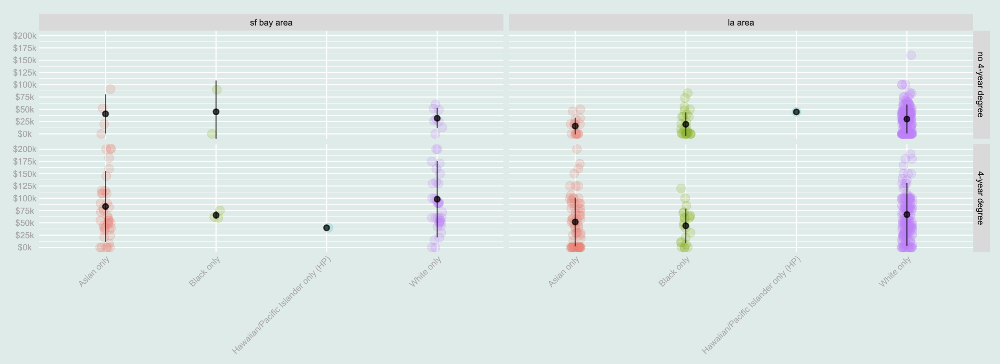

*图 12：合并教育和地区类别后的组均值。*

- Coarsening = 把分类变量合并，减少组的数量，本质上是从"很多细小组" → "少量大组"。

- Coarsening只是partial solution

**问题 1：** 还是会有 empty groups。我们没有本质解决该问题。

**问题2：** 你改变了 estimand。你本来想问12年教育的人收入是多少，结果变成了没有本科的人平均收入是多少。

**Curse of dimensionality：** 维度一增加，数据会变得极度稀疏。如果每个变量有 $k$个取值，维度是 $d$，我们有 $k^{d}$ 个组，但样本量 $n$ 通常是固定的。

$$
\frac{n}{k^{d}} \rightarrow 0
$$

每个组的平均样本数趋近于 0。

#### 8.2.3 Subsample averages本质上是一个特殊的regression

**实例一：** A Least Squares Interpretation of Means

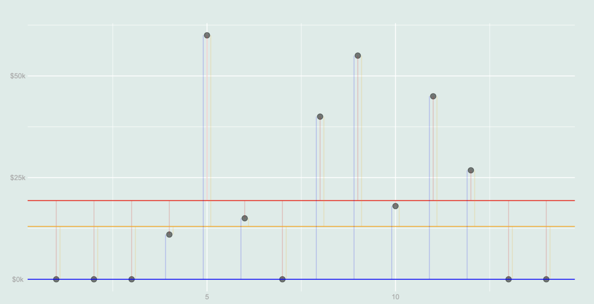

*图 13：以众数、中位数与均值概括收入的比较。*

现在我们有一组数据点，我希望找到一条最好的横线（一个best summary）来概括这个数据。图中蓝色表示众数位置、橙色表示中位数、红色表示均值；哪个概括量最好取决于损失函数。平方损失对应均值，绝对损失对应中位数。

如何知道mode、median和mean哪个是最好的？这本质上是一个特殊的regression，这里的最好就是

$$
\widehat{\mu} = \operatorname*{argmin}_{m\in\mathbb R}{\sum_{i = 1}^{n}\left( Y_{i} - m \right)^{2}}
$$

而regression的定义是

$$
\widehat{m} = \underset{m\in\mathcal{M}}{\operatorname{argmin}}{\sum_{i = 1}^{n}\left( Y_{i} - m\left( X_{i} \right) \right)^{2}}
$$

因此，这就是当 $m\left( X_{i} \right)$ 没有 covariates，只有outcome的情况。这是只有截距的回归，既可以概括样本中心，也可以作为不使用协变量的常数预测规则。

**求得best summary：** 我们针对 $\sum_{i = 1}^{n}\left( Y_{i} - m \right)^{2}$ 求导，让其等于0。

$$
\frac{\partial}{\partial m}\sum(Y_{i} - m)^{2} = 0
$$

求导可得

$$
\frac{\partial}{\partial m}(Y_{i} - m)^{2} = - 2(Y_{i} - m)
$$

所以

$$
\frac{\partial}{\partial m}\sum(Y_{i} - m)^{2} = \sum - 2(Y_{i} - m)
$$

设为0

$$
\sum - 2(Y_{i} - m) = 0
$$

$$
\sum Y_{i} - \sum m = 0
$$

因为 $\sum m = n \cdot m$

$$
\sum Y_{i} - nm = 0
$$

$$
m = \frac{1}{n}\sum Y_{i}
$$

这就是mean。我们算出来了mean = least squares solution。

**实例二：** Two Locations: Adding a Covariate

- 之前我只有 Y（income），我们找一个summary来总结Y。现在我多了一个变量 X（education），我希望预测：找一个函数 $m(x)$，输入 x（教育年限），输出一个预测收入。

- 我们假设X只有2个值，分别是8年教育和12年教育。

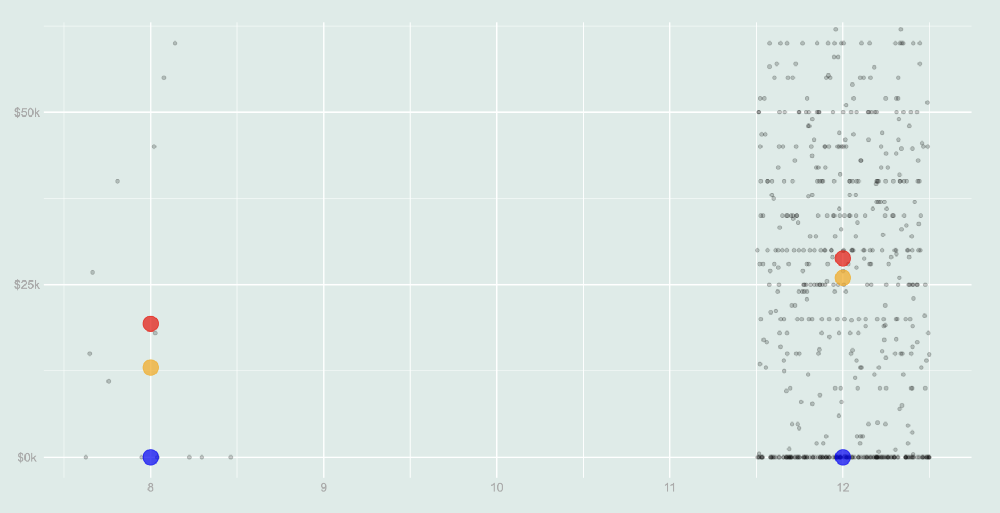

*图 14：两个教育年限组的独立均值拟合。*

我们的目标还是

$$
\widehat{\mu} = \operatorname*{argmin}_{m\in\mathbb R}{\sum_{i = 1}^{n}\left( Y_{i} - m \right)^{2}}
$$

只不过现在 $m(x)$ 是一个函数。也就变成了

$$
\widehat m = \underset{m\in\mathcal M_{\mathrm{group}}}{\operatorname{argmin}}{\sum_{i = 1}^{n}\left( Y_{i} - m\left( X_{i} \right) \right)^{2}}
$$

这本质上就是regression。但是这个时候，我们的函数在样本中只需要确定两个值 $m(8)$ 和 $m(12)$。原问题变成

$$
\sum_{X_{i} = 8}^{}\,(Y_{i} - m(8))^{2} + \sum_{X_{i} = 12}^{}\,(Y_{i} - m(12))^{2}
$$

这变成了2个完全独立的问题，第一项只和 $m(8)$ 有关，第二项只和 $m(12)$ 有关。

**结论：** 最优函数 m(x) = 每个 x 对应的子样本均值。也就是之前是一条水平线（一个 mean），现在是两条水平线

- x = 8 → 一条线（mean of group 8）

- x = 12 → 一条线（mean of group 12）

**实例二的推广：** 如果我们推广到many locations。

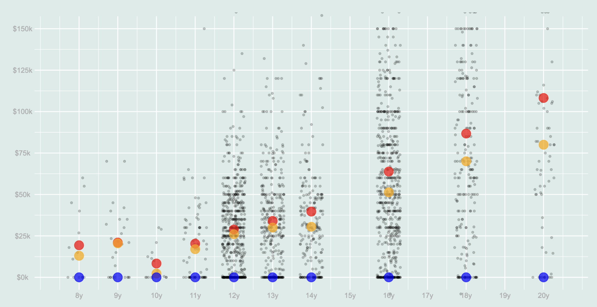

*图 15：多个教育年限组各自的均值拟合。*

本质上还是一样的，每个 x 的问题是独立的。

- $m(8)$ 只影响 x = 8这一组

- $m(9)$ 只影响 x = 9这一组

- ...

subsample mean = least squares 的解（在"每个 x 一个值"的函数空间里）

- 你会发现，subsample averages本质上是一个特殊的regression

- 他们的目标函数完全一致，如果我们都用the sum of squared residuals

$$
\widehat m = \underset{m\in\mathcal M_{\mathrm{group}}}{\operatorname{argmin}}{\sum_{i = 1}^{n}\left( Y_{i} - m\left( X_{i} \right) \right)^{2}}
$$

$$
\widehat{m} = \underset{m\in\mathcal{M}}{\operatorname{argmin}}{\sum_{i = 1}^{n}\left( Y_{i} - m\left( X_{i} \right) \right)^{2}}
$$

- 对样本中出现过的离散 $x$，若函数在各个 $x$ 上可自由取值，最小二乘解就是按组取平均；对未出现的 $x$，损失函数没有提供约束，预测值并未被唯一确定。这也就是我们之前提到的问题：Sensitivity和空组。

- least squares + 完全自由函数 = 分组平均（subsample mean）

**总结一下：**

**情况一：** 我们只有一组数据 $Y_{1},Y_{2},...,Y_{n}$。我们要找一个数 $m$，来代表这些数据。

$$
min\sum(Y_{i} - m)^{2}
$$

最优解是 mean。

**情况二：** 加入一个 covariate $X$。我们要做找一个函数 $m(x)$，用 x 来预测 y。我们用同一个标准

$$
min\sum(Y_{i} - m(X_{i}))^{2}
$$

现在 $X$ 可以有很多取值（很多 groups），所以函数 $m(x)$变成

$$
m(8),\ m(9),\ \ldots
$$

每个 group 的最优预测值 = 该 group 的 mean。对有序离散教育年限，可把预测画成阶梯状；一般分类变量不一定存在自然的区间或顺序。

**问题：** 我们不能这么自由，这样会overfitting，会有Sensitivity和空组的问题。我们需要限制m。

**有一个和之前提过的折中方案：** Coarsening。

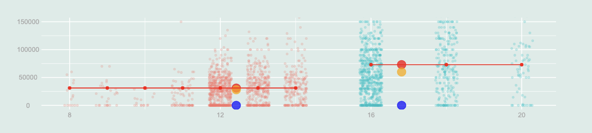

*图 16：合并教育类别后的常数预测。*

问题也和之前一样。

**问题 1：** 还是会有 empty groups。我们没有本质解决该问题。

**问题2：** 你改变了 estimand。你本来想问12年教育的人收入是多少，结果变成了没有本科的人平均收入是多少。

<a id="section-8-3"></a>

### 8.3 线性模型中的最小二乘回归

#### 8.3.1 跨组共享信息

Why does this solve the sensitivity and empty group problems?

Depending on the set of functions we consider, $\mathcal{M}$, we can use data from other groups to make our predictions.

我们不再"每组单独算"，而是用"所有数据一起决定函数"。

#### 8.3.2 Least Squares Regression

**定义：** Regression, generally, is choosing a function of covariates $X_{i}$ to predict outcomes $Y_{i}$. We choose from a set of functions $\mathcal{M}$ that we call a regression model.

Least Squares Linear Model

$$
\widehat{m} = \underset{m\in\mathcal{M}}{\operatorname{argmin}}{\sum_{i = 1}^{n}\left( Y_{i} - m\left( X_{i} \right) \right)^{2}}
$$

$$
(\widehat a,\widehat b)=\operatorname*{argmin}_{a,b}\sum_{i=1}^{n}\{Y_i-(a+bX_i)\}^2,\qquad \widehat m(x)=\widehat a+\widehat b x
$$

通过求导可得

$$
\widehat b=\frac{\sum_i(X_i-\overline X)(Y_i-\overline Y)}{\sum_i(X_i-\overline X)^2},\qquad\widehat a=\overline Y-\widehat b\overline X,\quad\sum_i(X_i-\overline X)^2>0.
$$

**Multivariate Regression Models：** 加入更多协变量可能改善预测，但也可能增加方差或过拟合，需要验证集或交叉验证评估

$$
\widehat m=\operatorname*{argmin}_{m\in\mathcal M}\sum_{i=1}^{n}\{Y_i-m(X_i,W_i)\}^2
$$

我们有3个常见模型

Parallel lines

$$
m(x,w) = a(w) + bx
$$

Not necessarily parallel lines

$$
m(x,w) = a(w) + b(w)x
$$

Additive model

$$
m(x,w) = m_{0}(w) + m_{1}(x)
$$

加性模型限制不同变量的贡献相加，未必要求每个分量是直线；若采用固定基函数展开，则仍可得到对系数线性的模型。函数 $a(w)$、$b(w)$ 在分类 $w$ 的各个水平上分别取不同的参数。

<a id="section-9"></a>

## 9. 线性回归的关系视角

<a id="section-9-1"></a>

### 9.1 线性回归的基本概念

#### 9.1.1 回归目标与函数空间

Recall Regression的定义: 用变量 $X$去预测变量 $Y$，通过选择一个函数来描述它们的关系。这本质是一个优化问题

$$
\widehat{m} = \underset{m\in\mathcal{M}}{\operatorname{argmin}}{\sum_{i = 1}^{n}\left( Y_{i} - m\left( X_{i} \right) \right)^{2}}
$$

- $X_{i}$: 输入 covariates

- $Y_{i}$: 输出 outcome

- $m$: 你要找的函数（预测规则）

- $\mathcal{M}$ 允许的函数集合（model）

**目标：** 让预测误差平方和最小（我们选择的criterion是the sum of squared residuals）

#### 9.1.2 预测变量

也就是我们的independent variable、covariate或者叫feature。

**比如：**

- 我们用 gender 描述和预测 avg_score 的组间差异，predictor就是female/male；

- 我们用 dept 描述和预测 avg_score 的组间差异，predictor就是dept A/B/C。

#### 9.1.3 线性回归模型

**定义：** $Y_i=a+b_1X_{i1}+\cdots+b_pX_{ip}+\varepsilon_i$，其中 $Y_i$ 是第 $i$ 个观测的结果变量，$X_{i1},\ldots,X_{ip}$ 是它的 $p$ 个预测变量值。

**均值函数与误差：** $m(X_i)=a+b_1X_{i1}+\cdots+b_pX_{ip}$ 表示总体模型给出的预测均值，实际结果满足 $Y_i=m(X_i)+\varepsilon_i$。相对于总体函数 $m$ 的差为真实误差 $\varepsilon_i$；拟合后使用 $\widehat m$ 计算的则是样本残差 $e_i=Y_i-\widehat m(X_i)$，两者应区分。

#### 9.1.4 简单线性回归

Simple Linear Regression（Linear Regression的单变量版本/最简单版本）

**定义：** $Y_i=a+bX_i+\varepsilon_i$。这里 $Y_i$ 是第 $i$ 个观测的结果，$X_i$ 是其唯一的预测变量值。简单线性回归用一条直线描述两个变量之间的关系，例如：

- child height \~ parents height: 用父母身高预测孩子身高

- dog height \~ weight: 用体重预测身高

#### 9.1.5 参数模型与非参数模型

**Parametric model：** 我们规定了函数形式 $m(X_{i})$，需要学习少量参数，比如linear regression $m(X_{i}) = a + bX_{i}$，我们需要学习a和b。

**Non-parametric Model：** 不把模型限制在一个固定有限维的参数族中；仍需带宽、平滑度、树深等结构约束，灵活程度也受样本量限制。

非参数回归允许使用更灵活的函数族，但仍需对函数的复杂度作适当限制。

**Regression的m是linear regression：** parametric

#### 9.1.6 相关系数与回归斜率

Correlation在衡量X 和 Y 有没有"线性关系"。

$$
\rho_{X,Y} = \frac{Cov(X,Y)}{\sigma_{X}\sigma_{Y}}\ \ \ \ if\sigma_{X}\sigma_{Y} > 0
$$

其中 $Cov(X,Y) = E\lbrack(X - E(X))(Y - E(Y))\rbrack$。

Linear Regression在找具体是哪一条线。

<a id="section-9-2"></a>

### 9.2 寻找最优回归线

#### 9.2.1 什么是Best Line

Recall Regression的定义

$$
\widehat{m} = \underset{m\in\mathcal{M}}{\operatorname{argmin}}{\sum_{i = 1}^{n}\left( Y_{i} - m\left( X_{i} \right) \right)^{2}}
$$

我们把linear regression代入 $m\left( X_{i} \right)$，可以得到

$$
(a,b)=\operatorname*{argmin}_{u,v}\sum_{i=1}^{n}\{Y_i-(u+vX_i)\}^2,\qquad\widehat m(x)=a+bx
$$

Best Line不是随便定义的，和之前一样，我们通过RSS定义

$$
\min_{a,b}\,\sum(Y_{i} - (a + bX_{i}))^{2}
$$

我们得到Least Squares Linear model，本质上是一个optimization problem。

#### 9.2.2 Finding the Best Line --- Naive Strategy

**Naive Strategy做了什么：** 我们随机生成很多线（随机选择a和b），然后用RSS评估哪些线误差小。

**问题在于：** not really efficient and quite stochastic。

#### 9.2.3 Finding the Best Line --- Systematic Approach

**第 1 步：** 我们画出一个grid of slope and intercept。

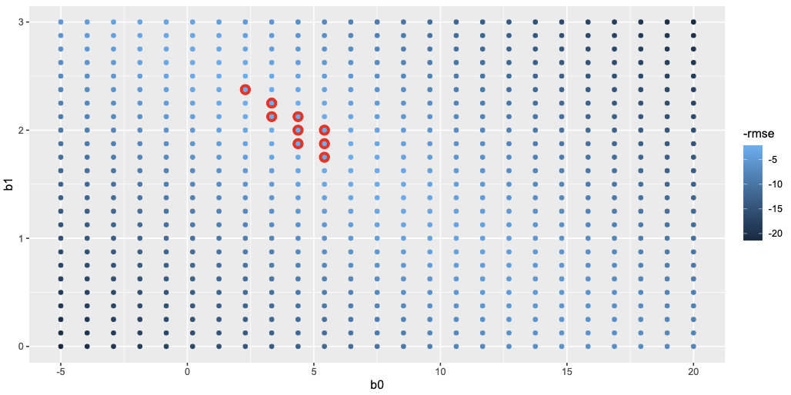

*图 17：截距与斜率参数网格及负 RMSE。*

这里，横轴是intercept，纵轴是slope，每个点就代表一个模型。比如

$$
b_{0} = 2,\ b_{1} = 1.5
$$

代表着$y = 2 + 1.5x$。

这里的颜色在表示误差（通常是RMSE或者RSS），图例标为 $-\mathrm{RMSE}$，颜色越浅、值越接近 0，代表 RMSE 越小；读图时应以图例的实际方向为准。

**第 2 步：** 我们把最好的几条线画在数据上

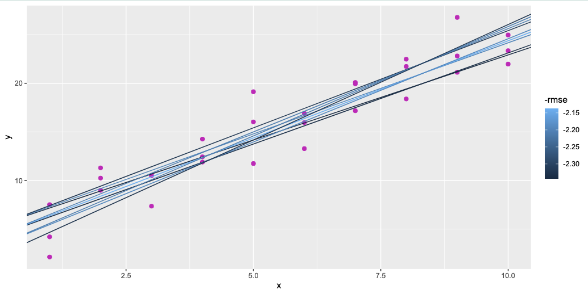

*图 18：参数网格中误差较小的候选回归线。*

这说明：网格搜索能找到已检查网格点中误差最小的候选；网格越密，通常越接近连续优化问题的解。

这本质上是一个暴力解法。

#### 9.2.4 Finding the Best Line --- Searching Algorithms

**含义：** Finding the best line = solving an optimization problem, and we can do it using search algorithms like gradient descent.

**有两种常见的方法：** Gradient Descent（梯度下降）、Newton-Raphson（牛顿法），这些都是optimization algorithms。

通用逻辑

**第 1 步：** 选择一个starting point（在这儿就是a和b）。

**第 2 步：** 看哪个方向变好（下降最快），也就是如果我稍微改一下 $a,b$，RSS 会不会更小？

**第 3 步：** 往那个方向走一点。

**第 4 步：** 重复。

**第 5 步：** 当你已经找不到更低的 RSS，就停下来。

不过对于simple linear regression，我们不需要这么复杂，因为我们可以直接用微积分判断最优的a和b（也就是我们有 closed-form 解）。

#### 9.2.5 使用 R 拟合最小二乘回归

**lm() 函数：** 可以自动帮我们最小化RSS，找到最优的a和b，也就是解决

$$
\min_{a,b}\,\sum(Y_{i} - (a + bX_{i}))^{2}
$$

例题：

```r
weight <- c(2, 4, 6, 8, 10, 12, 14, 16)
height <- c(19, 18, 21, 20, 21, 18, 21, 20)
df <- data.frame(weight = weight, height = height)
model <- lm(height ~ weight, data = df)
coef(model)
summary(model)
confint(model)
```

截距为 19，斜率约为 0.08333。

**Uncertainty：** 我们如何知道R估计的结果是否准确？

**方法1：** 通过bootstrapping，看波动。

**方法2：** 使用R的另一个函数summary()，我们可以得到很多信息。

#### 9.2.6 解读 summary 输出

`summary()` 的输出可按残差分布、回归系数和整体拟合指标三类阅读。

##### 9.2.6.1 残差

**残差的定义：** $e_i=Y_i-\widehat m(X_i)$，即每个点的实际值减去拟合值，用于观察拟合线与样本数据之间的偏离。

`summary()` 按最小值（Min）、第一四分位数（1st Quartile）、中位数（Median）、第三四分位数（3rd Quartile）和最大值（Max）概括残差分布。

**如何使用：**观察残差是否大致围绕 0、是否明显不对称，以及是否存在极端残差。若某个子组的残差整体偏正，模型可能低估该子组；若整体偏负，模型可能高估该子组。含截距的 OLS 模型在训练样本上的残差和为 0，不会出现所有残差严格同号的情形。

##### 9.2.6.2 回归系数

**Coefficients：** 我们有2个coefficients，分别是intercept和slope。在这里，summary()会给出intercept和slope的

**Estimate：** the estimated values of the coefficients。

**Std. Error：** Standard error of each estimate。

**t value：** the t-statistic for each predictor。

**`Pr(>|t|)`：** the p-value, which tests whether each coefficient is significantly different from zero。

**Example**

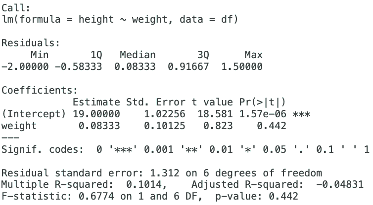

*图 19：身高对体重回归的 R summary 输出。*

**Estimate：** 系数估计描述模型中的条件关联：保持其他预测变量不变时，某个预测变量的变化对应多大拟合均值差异。没有因果识别条件时，不能直接称为因果效应。

**Intercept Estimate：** $a = 19$。当 $X = 0$的时候，模型预测 $Y = 19$，在这里就是当weight为0，height为19。这个值有时候现实里不一定特别有意义，因为狗不可能体重 0，但它在数学上定义了这条线从哪里开始。

**Slope Estimate：** $b = 0.08333$。体重每增加 1 个单位，拟合的身高增加约 0.0833 个单位；这描述线性关联。

这些都是估计值，真正的population里，也许有一个"真实斜率"，我们不知道，我们用sample估计它。

##### 9.2.6.3 标准误与置信区间

**Std. Error：** The standard error shows the "uncertainty" of the estimate.

**Std. Error 小：** 说明这个 estimate 比较稳定

**Std. Error 大：** 说明这个 estimate 很不稳定

**Confidence Interval：** 由抽样程序构造的参数区间，覆盖率描述重复抽样性质。不能把观测到的区间解释为固定系数的概率分布。

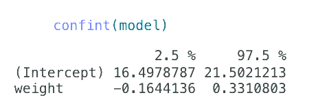

*图 20：身高对体重回归系数的置信区间。*

斜率的 95% 置信区间约为 $[-0.164,0.331]$，包含 0；按对应的双侧检验，在 5% 水平上不能拒绝零斜率假设。

为什么 confidence interval 和 Std. Error 有关？

$$
CI = \widehat{\beta} \pm t^{*} \cdot SE(\widehat{\beta})
$$

- Std. Error 越小，区间通常越窄

- Std. Error 越大，区间通常越宽

##### 9.2.6.4 t 检验与 p 值

**t value and `Pr(>|t|)`：** Standard errors can also be used to perform hypothesis tests on the estimates.

- t value 和`Pr(>|t|)`本质上都是在报告下面的hypothesis test

- 原假设 $H_0$：被检验的系数为 0（对单变量斜率检验即 $b=0$）；零斜率不等于两个变量之间完全没有关系

- 备择假设 $H_1$：被检验的系数不为 0

- t value

$$
t = \frac{\widehat{b} - 0}{SE\left( \widehat{b} \right)}
$$

含义: 估计值离 0 有多远（用标准误做单位）

**t-distribution：** 观测到的 $t$ 是一个数；在正确指定、满列秩、条件正态且同方差不相关误差的线性模型下，零假设中的检验统计量 $T$ 服从 t 分布，自由度是

$$
n - p - 1
$$

**$p$ 值的定义：**在 $H_0:b=0$ 及检验所需模型条件成立时，观察到当前这样极端或更极端的 $t$ 统计量的概率。它衡量数据与该零假设的相容程度，单凭 $p$ 值无法判断效应有多大、关系有多重要，或整个模型是否正确。

**p-value如何计算：** 在t-distribution中做two-sided test

$$
p - value = P(|T| \geq |t_{obs}|)
$$

本质上就是，在 t 分布下，随机变量 $T$取到比你现在这个 t 更"极端"的概率。也就是说，假设你算出来$t = 2$，那p-value就是$T\geq2$ 或 $T\leq-2$ 的概率。

p-value的决策规则

**小于预先选定的显著性水平（如 0.05）：** 拒绝 $H_0$，有证据支持该系数非零

- 大: 不拒绝 → 没证据

- p-value和 confidence interval 的关系

**采用同一模型、标准误和双侧检验时：** 95% CI 不包含 0 ⇔ $p<0.05$（边界按检验约定处理）

相应的 95% CI 包含 0 时，在 5% 水平上不显著；这不证明系数恰好等于 0

##### 9.2.6.5 标准误的模型假设

**Assumptions：** summary() 里给出来的 standard error，不是"无条件永远正确"的。

**Independence：** 经典模型通常要求不同观测的真实误差条件不相关；条件独立是更强的充分条件。拟合后的残差通常彼此相关，不能把它们当成独立误差。 这意味着第一个点偏高一点，不应该自动导致第二个点也偏高一点。

**Homoscedasticity：** 给定设计矩阵后，真实误差的条件方差恒为 $\sigma^2$；残差图用于间接检查这一结构。

如果 assumptions 不满足，会怎样？

如果 independence 和 homoscedasticity 不成立，那么 summary() 默认给你的 standard errors 可能不能直接信。这是 standard error 出问题，不一定是 coefficient estimate 本身立刻没了。也就是你算出来的slope还是0.0833，但是uncertainty 计算可能不对。

新工具

**`sandwich` 包可以计算稳健协方差：** 异方差采用 HC 标准误，聚类或序列相关分别需要相应的聚类稳健或 HAC 方法。方法须匹配依赖结构；它们通常不改变系数估计。

**使用与数据结构匹配的 Bootstrap：** 独立观测可成对重抽，聚类数据按簇重抽，时间序列可使用分块方法。普通逐行重抽不能自动修复相关性。

##### 9.2.6.6 拟合指标

**Residual Standard Error：** 误差标准差的估计 $\widehat\sigma=\sqrt{\mathrm{RSS}/(n-p-1)}$，其中 $p$ 为非截距系数数目

- RSE 较大表示残差尺度较大，解释需结合结果变量的单位与基准模型

- RSE 较小表示训练样本上的残差较小，不能单独保证模型正确或样本外预测准确

- $R^{2}$: 模型解释了多少比例的 variation

$$
R^{2} = 1 - \frac{SS_{res}}{SS_{tot}} = 1 - \frac{\sum_{i = 1}^{n}\,(Y_{i} - m(X_{i}))^{2}}{\sum_{i = 1}^{n}\,(Y_{i} - \overline{Y})^{2}}
$$

本质上就是

$$
R^{2} = 1 - \frac{\text{没解释的}}{\text{总的}}
$$

**In-sample remark：** RSE 和 $R^2$ 都是 in-sample metrics（只看训练数据），也就是在同一数据、含截距且嵌套的 OLS 模型中，加变量使 $R^2$ 不下降、RSS 不上升；可能保持不变，RSE 则不一定下降。因此不能只用RSE和$R^{2}$评估模型。

<a id="section-9-3"></a>

### 9.3 分类预测变量

#### 9.3.1 Dummy Variable

**问题：** 当自变量 X 不是数值，而是categorical时，怎么用线性回归？

**解决方案：** Dummy Variable

**Example：** Y = avg_score（数值）；X = gender（类别：Male / Female）

我们使用dummy variable，定义

$$
X = \begin{cases}0\, & Female \\ 1\, & Male\end{cases}
$$

把"类别"转成"数值"

#### 9.3.2 Categorical Predictor with Only Two Levels

**Example：** 和之前example一致，我们代入 $Y = a + bX + \varepsilon$

**情况 1：** Female（X = 0）

$$
\widehat Y=\widehat a+\widehat b\cdot0=\widehat a
$$

a = Female的平均值，这叫baseline。

**情况2：** Male（X = 1）

$$
\widehat Y=\widehat a+\widehat b\cdot1=\widehat a+\widehat b
$$

Male 的平均值 = Female 的平均值 + b。

本质上，拟合系数 $\widehat b=\overline Y_{\mathrm{Male}}-\overline Y_{\mathrm{Female}}$ 是两组样本均值差；总体参数对应总体均值差。用 dummy variable 后，linear regression 不再是"线"，而是mean difference。

在图中这样表示

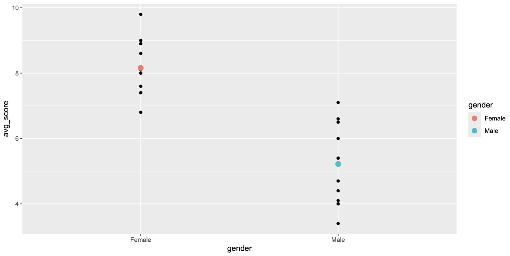

*图 21：二元类别的观测分布与拟合组均值。*

#### 9.3.3 Predictor with More Than Two Levels

**Example：** Suppose that we wish to investigate differences in the average score avg_score between the different depts of our company.

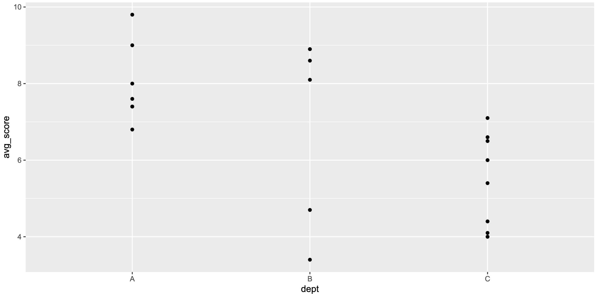

*图 22：三个部门的评分分布。*

In this case dept is still a categorical variable but it counts 3 levels instead of 2 (A, B, and C).

**设dummy variable：** 在含截距且各类别均有观测的模型中，K 个类别用 K−1 个 dummy variables；若用 K 个 dummy，则需去掉截距，以避免完全共线。

以 A 部门为基准，定义两个虚拟变量：

- $x_{B} = 1$，如果是B，否则0

- $x_{C} = 1$，如果是C，否则0

**模型写出来**

$$
\widehat Y=\widehat a+\widehat b_Bx_B+\widehat b_Cx_C
$$

分别代入三种情况

**Dept A：** our baseline（$x_{B} = 0,\ x_{C} = 0$）

$$
\widehat Y = \widehat a
$$

我们的baseline，A的平均值 = a。

**Dept B：** $x_{B} = 1,\ x_{C} = 0$

$$
\widehat Y = \widehat a + \widehat b_{B}
$$

**Dept C：** $x_{B} = 0,\ x_{C} = 1$

$$
\widehat Y = \widehat a + \widehat b_{C}
$$

和之前的例子一样，本质上所有都是和baseline A的比较。这说明了用 dummy variable 后，linear regression 不再是"线"，而是mean difference。

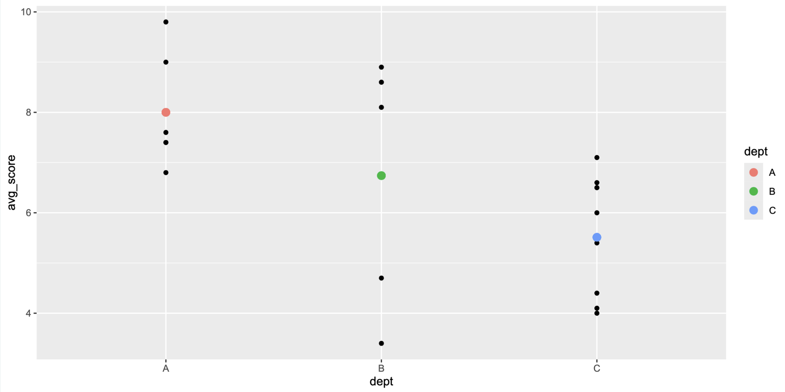

*图 23：三个部门的拟合评分均值。*

这是multiple linear regression（多元线性回归），因为模型实际上是多个 predictors。

<a id="section-9-4"></a>

### 9.4 多元线性回归

#### 9.4.1 多元线性回归与矩阵表示

**定义：** When we have more than one predictor (X), we talk about multiple linear regression. Here is the model applied to the n observations:

$$
\begin{aligned}
& \mathbf{Y}_{1} & & = a + b_{1}X_{11} + \cdots + b_{p}X_{1p} + \varepsilon_{1} \\
& \mathbf{Y}_{2} & & = a + b_{1}X_{21} + \cdots + b_{p}X_{2p} + \varepsilon_{2} \\
& ... \\
& \mathbf{Y}_{n} & & = a + b_{1}X_{n1} + \cdots + b_{p}X_{np} + \varepsilon_{n}
\end{aligned}
$$

Here is a more concise formulation:

$$
\begin{aligned}
\mathbf{Y}_{i} & = a + b_{1}X_{i1} + \cdots + b_{p}X_{ip} + \varepsilon_{i} \\
& = a + \sum_{j = 1}^{p}\, b_{j}X_{ij} + \varepsilon_{i}
\end{aligned}
$$

这里的 $Y$ 是定量结果变量。预测变量 $X_j$ 可以来自以下几类：

- 原始数值变量，如年龄和体重；
- 变量变换，如对数、平方根及 $X^2$；
- 交互项，如 $X_1X_2$；
- 经虚拟变量编码的分类变量。

我们之前用的gender/dept（通过 dummy），本质就是 $X_{j}$ 的一种特殊形式。

**什么叫 linear：** 在这里linear不是说这是一条直线，而是指对参数$b_{j}$是线性的。比如 $Y = a + b_{1}X + b_{2}X^{2}$，这依然是linear model，虽然对X是非线性的。换句话说，we keep the **linearity of the coefficients**。

**Matrix Formulation：** 对于

$$
\begin{aligned}
& \mathbf{Y}_{1} & & = a + b_{1}X_{11} + \cdots + b_{p}X_{1p} + \varepsilon_{1} \\
& \mathbf{Y}_{2} & & = a + b_{1}X_{21} + \cdots + b_{p}X_{2p} + \varepsilon_{2} \\
& ... \\
& \mathbf{Y}_{n} & & = a + b_{1}X_{n1} + \cdots + b_{p}X_{np} + \varepsilon_{n}
\end{aligned}
$$

我们可以写成矩阵形式

$$
\mathbf{Y} = \mathbf{Xb} + \varepsilon
$$

其中:

$\mathbf{Y}$ is the n-long vector of responses 结果向量

$$
Y = \left\lbrack \begin{array}{r}
Y_{1} \\
Y_{2} \\
\vdots \\
Y_{n}
\end{array} \right\rbrack
$$

$\mathbf{b}$ is the p+1-long vector of coefficients 参数向量

$$
b = \left\lbrack \begin{array}{r}
a \\
b_{1} \\
b_{2} \\
\vdots \\
b_{p}
\end{array} \right\rbrack
$$

$\mathbf{X}$ is the $n \times (p + 1)$ matrix of predictors values 设计矩阵

$$
X = \begin{bmatrix}
1 & X_{11} & X_{12} & \ldots & X_{1p} \\
1 & X_{21} & X_{22} & \ldots & X_{2p} \\
\vdots & \vdots & \vdots & \ddots & \vdots \\
1 & X_{n1} & X_{n2} & \ldots & X_{np}
\end{bmatrix}
$$

每一行是一个样本，每一列是一个变量，第一列全是1。

**Example：** 还是之前的Predictor with More Than Two Levels的例子，总体模型为 $Y=a+b_Bx_B+b_Cx_C+\varepsilon$，其中baseline是A。假设数据如下

| i   | dept | avg_score |
| --- | --- | --- |
| 1   | A    | 7.6       |
| 2   | A    | 9         |
| 3   | B    | 8.9       |
| 4   | C    | 4         |
| 5   | B    | 8.1       |

**第 1 步：** 做dummy编码，我们定义

- $x_{B} = 1$如果是B，否则0。

- $x_{C} = 1$如果是C，否则0。

| i   | dept | x_B | x_C | Y   |
| --- | --- | --- | --- | --- |
| 1   | A    | 0   | 0   | 7.6 |
| 2   | A    | 0   | 0   | 9   |
| 3   | B    | 1   | 0   | 8.9 |
| 4   | C    | 0   | 1   | 4   |
| 5   | B    | 1   | 0   | 8.1 |

**第 2 步：** 写成矩阵形式

$$
Y = \left\lbrack \begin{array}{r}
7.6 \\
9 \\
8.9 \\
4 \\
8.1
\end{array} \right\rbrack,\ X = \begin{bmatrix}
1 & 0 & 0 \\
1 & 0 & 0 \\
1 & 1 & 0 \\
1 & 0 & 1 \\
1 & 1 & 0
\end{bmatrix},\ b = \left\lbrack \begin{array}{r}
a \\
b_{B} \\
b_{C}
\end{array} \right\rbrack
$$

#### 9.4.2 Finding the Best Line of Multiple Linear Regression

**Hyper-plane：** 当我们有不止一个 regressor时，我们要用多维的方式思考；原来的一条 line，会变成一个 hyper-plane。

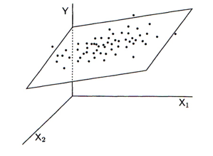

*图 24：两个预测变量下的回归平面。*

比如模型变成$Y_{i} = a + b_{1}X_{i1} + b_{2}X_{i2} + \varepsilon_{i}$，我们2个输入变量$X_{1}$和$X_{2}$，输出是$Y$。我们的坐标就变成三维了，分别有3个轴（$X_{1},\ X_{2},\ Y$）。

**Least squares method：** 和之前一样，我们使用RSS求解。对于simple linear regression，我们已经学过

$$
RSS = \sum_{i = 1}^{n}\,(Y_{i} - (a + bX_{i}))^{2}
$$

对于multiple linear regression，本质就是修改$m(X_{i})$，变成

$$
RSS = \sum_{i = 1}^{n}\,\left\lbrack Y_{i} - \left( a + \sum_{j = 1}^{p}\, b_{j}X_{ij} \right) \right\rbrack^{2}
$$

**RSS的矩阵形式：** 之前我们multiple linear regression的矩阵形式是 $\mathbf{Y} = \mathbf{Xb} + \varepsilon$，其中第 $i$ 个预测值为 $m(X_i)=\mathbf x_i^T\mathbf b$，全部预测值组成的向量为 $\mathbf X\mathbf b$。因此RSS的矩阵形式可以写为

$$
\mathrm{RSS}=\|\mathbf Y-\mathbf X\mathbf b\|_2^2
$$

根据矩阵平方的标准写法，就是

$$
RSS = \left( \mathbf{Y - Xb} \right)^{T}(\mathbf{Y - Xb})
$$

**最小化RSS：** 我们想找一组系数 $b$，让RSS最小。因此我们进行求导，我们需要计算 $\frac{\partial RSS}{\partial b}$。

$$
\begin{aligned}
\frac{\partial RSS}{\partial\mathbf{b}} & = \frac{\partial\|\mathbf Y-\mathbf X\mathbf b\|_2^2}{\partial\mathbf b} \\
& = \frac{\partial(\mathbf{Y} - \mathbf{Xb})^{T}(\mathbf{Y} - \mathbf{Xb})}{\partial\mathbf{b}} \\
& = \frac{\partial(\mathbf{Y}^{T}\mathbf{Y} - \mathbf{Y}^{T}\mathbf{Xb} - \mathbf{b}^{T}\mathbf{X}^{T}\mathbf{Y} + \mathbf{b}^{T}\mathbf{X}^{T}\mathbf{Xb})}{\partial\mathbf{b}} \\
& = - 2\mathbf{X}^{T}(\mathbf{Y} - \mathbf{Xb})
\end{aligned}
$$

然后我们设$\frac{\partial RSS}{\partial b} = 0$

$$
2\mathbf{X}^{T}\left( \mathbf{Y} - \mathbf{Xb} \right) = 0
$$

$$
\mathbf{X}^{T}\mathbf{Xb} = \mathbf{X}^{T}\mathbf{Y}
$$

因此，

$$
\widehat{\mathbf{b}} = (\mathbf{X}^{T}\mathbf{X})^{- 1}\mathbf{X}^{T}\mathbf{Y}
$$

这是 $\mathbf X$ 满列秩时的闭式解；若不满列秩，系数可能不唯一，可通过 QR、SVD 或广义逆求得最小二乘拟合。数值计算通常避免直接显式求逆。

**帽子矩阵Hat Matrix：** 根据刚才的推导我们得知，

$$
\begin{aligned}
\widehat{Y} & = \mathbf{X}\widehat{\mathbf{b}} \\
& = \mathbf{X}(\mathbf{X}^{T}\mathbf{X})^{- 1}\mathbf{X}^{T}\mathbf{Y}
\end{aligned}
$$

我们可以设$\mathbf{X}(\mathbf{X}^{T}\mathbf{X})^{- 1}\mathbf{X}^{T} = \mathbf{H}$，而H就是hat matrix或者叫projection matrix，因为预测值 $\widehat{Y}$是通过对原始 $Y$做一个"线性变换"得到的，而这个变换就是H。

$$
Y\overset{\phantom{H}}{\rightarrow}\widehat{Y}
$$

#### 9.4.3 整体 F 检验

F-statistic: 这是multiple linear regression的评价指标之一。其可以回答这个模型整体有没有用？（不是某一个变量，是"所有变量一起"）。

**原假设：** 给定模型中全部非截距系数均为 0，即其条件均值退化为常数。

$$
H_{0}:\beta_{1} = \beta_{2} = \cdots = \beta_{p} = 0
$$

**备择假设：** $H_{1}:\text{至少有一个 }\beta_{j} \neq 0$

- 和t-test对比

- 单个系数的 t 检验考察该系数是否为 0；多水平分类变量的整体检验可能涉及多个系数。

- 整体 F 检验联合考察全部非截距系数是否为 0；也可用部分 F 检验比较嵌套模型。

**指标**

F-statistic 越大，表明相对于残差波动，加入预测变量带来的拟合改善越大；它是检验统计量，不能直接作为样本外预测好坏的评分。

**p-value：** p-value 很小 → 拒绝 $H_{0}$。

#### 9.4.4 工作年限与性别的回归例题

**设定：** 有一份数据有如下变量

**avg_score：** 员工表现评分，这是输出变量/response/outcome/Y

**yrs_service：** 工作年限，这是一个数值型 predictor

**gender：** 性别，这是一个categorical predictor

**dept：** 部门，这里这个 example 暂时先不重点用它

问题是我们能不能用 yrs_service 和 gender 来预测 avg_score，也就是

$$
avg\_ score \approx f(yrs\_ service,\ gender)
$$

看图建立直觉

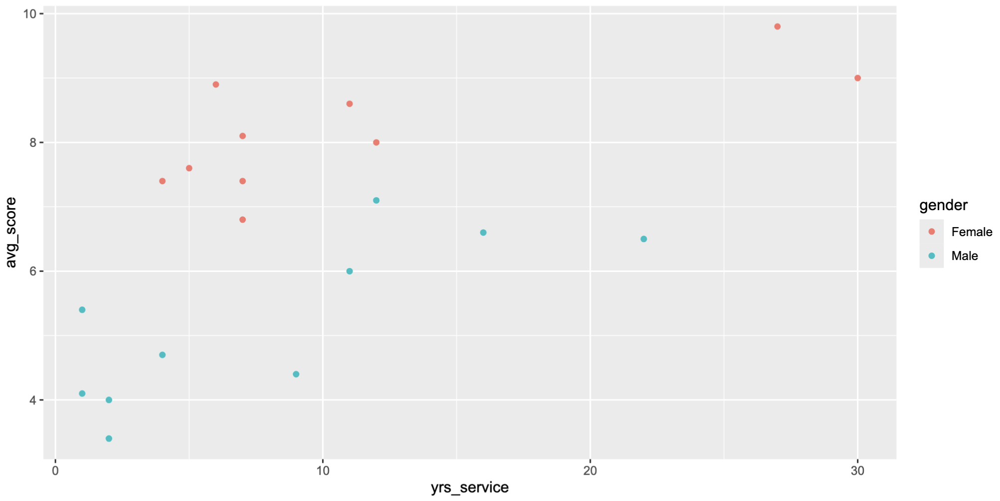

*图 25：工作年限、评分与性别的散点。*

这幅图里横轴是yrs_service，纵轴是avg_score，不同颜色代表不同gender。我们发现

**工作年限和评分之间好像有正关系：** 大体上看，yrs_service 越大，avg_score 往往越高。

**男女两组整体位置不同：** 图上 Female 的点整体比 Male 的点更高一点。

**建立普通的multiple linear regression：** 根据我们的公式

$$
\mathbf{Y}_{i} = a + b_{1}X_{i1} + \cdots + b_{p}X_{ip} + \varepsilon_{i}
$$

在这种情况下，我们的模型是

$$
avg\ score = a + b_{yrs} \bullet yrs\ service + b_{gender} \bullet x_{gender} + \varepsilon
$$

也就是我们有2个predictor，分别是yrs_service和gender。我们把gender dummy化，可以得到

$$
x_{gender} = \begin{cases}0,\, & Female \\ 1,\, & Male\end{cases}
$$

我们代入2种情况

**情况A：** Female，我们得到

$$
avg\ score = a + b_{yrs} \cdot yrs\ service + \varepsilon
$$

如果不看误差，我们知道

$$
\widehat{avg\ score} = a + b_{yrs} \cdot yrs\ service
$$

这是一条线。

**情况B：** Male

$$
avg\ score = (a + b_{gender}) + b_{yrs} \cdot yrs\ service + \varepsilon
$$

$$
\widehat{avg\ score} = (a + b_{gender}) + b_{yrs} \cdot yrs\ service
$$

这是另一条线。

**我们的发现：** 这两条线本质上是平行的，因为slope都是$b_{yrs}$，只是intercept不一样，一个是 $a$ ，一个是 $a + b_{gender}$ 。

**R的结果**

- Intercept ≈ 7.035 = a

- yrs_service ≈ 0.09695 = $b_{yrs}$

- genderMale ≈ -2.59099 = $b_{gender}$

所以我们得到

Female

$$
\widehat{avg\ score} = 7.035 + 0.09695 \cdot yrs\ service
$$

Male

$$
\widehat{avg\ score} = (7.035 - 2.59099) + 0.09695 \cdot yrs\ service = 4.444 + 0.09695 \cdot yrs\ service
$$

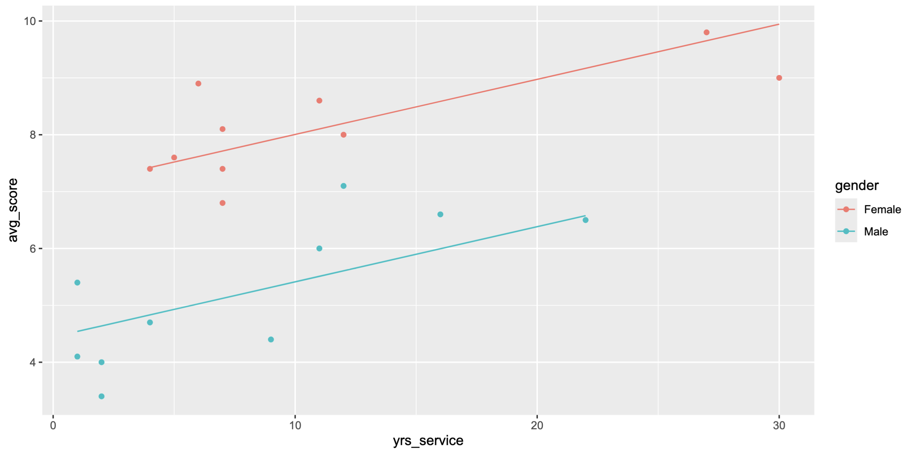

*图 26：不含交互项的平行回归线。*

可以很清晰的看出，这是平行的2条线。

**统计结论**

**Coefficients**

| 系数 | Estimate | Std. Error | t value | p-value |
| --- | --- | --- | --- | --- |
| Intercept | 7.03542 | 0.35862 | 19.618 | 4.10e-13 |
| yrs_service | 0.09695 | 0.02228 | 4.351 | 0.000435 |
| genderMale | -2.59099 | 0.36058 | -7.186 | 1.52e-06 |

这些 p 值在相应模型假设下提供了系数非零的统计证据；它们说明条件关联，不证明工作年限或性别造成了评分变化。

**Residual standard error：** 0.7861 on 17 degrees of freedom

这表示误差标准差估计约为 0.7861 分；它不是平均绝对误差，也不是保证每次预测误差落在 ±0.8 内的界限。

**Multiple R-squared：** 0.8394; Adjusted R-squared: 0.8205

这说明模型解释了 83.94% 的 avg_score 变化，很高。Adjusted R-squared是考虑变量数量后的拟合优度，对参数数量进行惩罚，但不能保证避免过拟合，仍需样本外评估。

**F-statistic：** 44.44 on 2 and 17 DF, p-value: 1.771e-07

因为p-value很小，说明至少有一个变量是有用的，有证据拒绝所有非截距系数同时为 0 的原假设；这不保证模型正确或样本外预测有效。

**结论：** 这个模型在当前样本上有较高拟合优度，系数检验也较显著；还需要检查残差、影响点与样本外表现。但是这个模型有一个隐含假设，就是男女的斜率一样。但是我们合理怀疑男女性别不仅仅是整体水平不同，可能连增长趋势都不同。因此我们需要interaction。

#### 9.4.5 加入交互项

**建立有interaction的multiple linear regression：**

$$
avg\ score = a + b_{yrs} \bullet yrs\ service + b_{gender} \bullet x_{gender} + b_{gender:yrs} \bullet x_{gender} \bullet yrs\ service + \varepsilon
$$

也就是现在的模型多了$b_{gender:yrs} \bullet x_{gender} \bullet yrs\ service$。

分别代入2种情况

**情况A：** Female，我们得到

$$
\widehat{avg\ score} = a + b_{yrs} \cdot yrs\ service
$$

Female 组的公式结构不变；加入交互项并重新拟合后，系数数值通常会变化。

**情况B：** Male，我们得到

$$
\widehat{avg\ score} = \left( a + b_{gender} \right) + \left( b_{yrs} + b_{gender:yrs} \right) \cdot yrs\ service
$$

发现斜率变成$\left( b_{yrs} + b_{gender:yrs} \right)$，截距变成$\left( a + b_{gender} \right)$。

这个时候不再是平行线，两条线既可以截距不同，也可以斜率不同。

**R的结果**

- Intercept ≈ 7.32289 = a

- yrs_service ≈ 0.07216 = $b_{yrs}$

- genderMale ≈ -3.20289 = $b_{gender}$

**yrs_service：** genderMale ≈ 0.06534 = $b_{gender:yrs}$

所以我们得到

Female

$$
\widehat{avg\ score} = 7.32289 + 0.07216 \cdot yrs\ service
$$

Male

$$
\widehat{avg\ score} = (7.32289 - 3.20289) + (0.07216 + 0.06534) \cdot yrs\ service = 4.12 + 0.1375 \cdot yrs\ service
$$

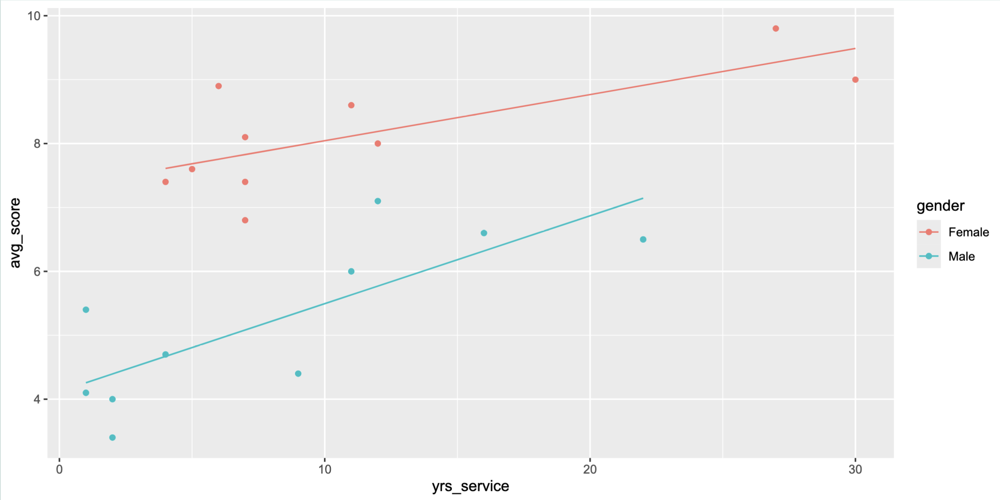

*图 27：含工作年限与性别交互项的回归线。*

#### 9.4.6 平行线与不同斜率的比较

当数值变量 $x$ 与二元分类变量 $d$ 一同进入模型时，可以比较两种结构：

1. **没有交互项：** $\widehat Y=a+b_1x+b_2d$。虚拟变量改变截距，两组拟合线的斜率都是 $b_1$，因此相互平行。
2. **包含交互项：** $\widehat Y=a+b_1x+b_2d+b_3xd$。交互项允许两组斜率不同：$d=0$ 组的斜率为 $b_1$，$d=1$ 组的斜率为 $b_1+b_3$。

<a id="section-10"></a>

## 10. 偏差与模型误设

<a id="section-10-1"></a>

### 10.1 偏差与估计目标

#### 10.1.1 偏差的定义

**数学定义：** $\operatorname{Bias}(\widehat\theta;\theta)=E(\widehat\theta)-\theta$。$\widehat\theta$ 是依赖样本的估计量，$\theta$ 是要估计的固定目标。偏差衡量重复抽样下估计误差的平均值；方差则衡量估计量的随机波动。有偏不意味着每次估计都落在真值的同一侧。

**图像理解：**

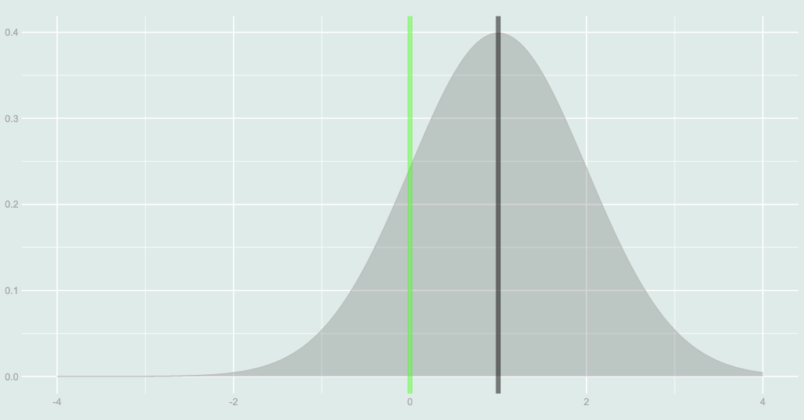

*图 28：估计量抽样分布中心与目标值的偏差。*

在这里，bias = 黑线 -- 绿线。换句话说，bias = 估计量的"中心"偏离真实值的距离。

#### 10.1.2 如何计算bias

Bias depends on the estimand，也就是说你有没有 bias，取决于你"想估计什么"。

**Example**

**问题1：** sample mean → population mean 是unbiased。

**问题2：** 样本均值用于估计总体中位数时，一般不无偏；若总体均值与中位数相等，也可能无偏。

<a id="section-10-2"></a>

### 10.2 回归中的估计偏差与模型误设

#### 10.2.1 两种估计目标

Least Squares Regression的两个作用: prediction vs relationship

**Relationship时的estimand：** population linear regression slope（换句话说，就是总体里的 least squares line）。

**Prediction时的estimand：** $\mu(x) = E\lbrack Y|X = x\rbrack$，也就是在 $X = x$的人群中，$Y$ 的真实平均值。比如教育年限 = 8 的人，平均收入是多少。

#### 10.2.2 真实均值、总体投影与样本拟合

**真实世界：** $\mu(x) = E\lbrack Y|X = x\rbrack$，这是真实关系

**模型世界：** 最好的线population least squares line，这是我们要估计的

**数据世界：** sample least squares line，这是我们算出来的

#### 10.2.3 偏差分解

$$
E\{\widehat\mu(x)\}-\mu(x)
=\underbrace{E\{\widehat\mu(x)\}-\widetilde\mu(x)}_{\text{estimation bias}}
+\underbrace{\widetilde\mu(x)-\mu(x)}_{\text{model approximation error}}.
$$

式中有三个对象：

- $\widehat\mu(x)$：样本拟合线在 $x$ 处的预测值；
- $\widetilde\mu(x)$：总体最佳线性投影在 $x$ 处的值；
- $\mu(x)=E(Y\mid X=x)$：真实条件均值。

**Estimator Error：** 我的 sample least squares line，平均来说，能不能恢复 population least squares line？

- 若 $E(Y\mid X)$ 正好属于所拟合的线性模型，且样本设计满列秩、相关期望存在，这一项等于 0；随机设计且模型误设时，一般不能断言有限样本中这一项为 0

- 正确指定的零条件均值模型下，样本拟合线对总体线无偏；误设下，在适当大样本条件下通常收敛到总体最小二乘投影。

**Modeling Error：** 即使我拿到了"正确的那条线"，它是不是我真正想要的？

**结论：** 不一定，我们用的是linear model，但是现实世界千变万化，有可能是nonlinear pattern。

modeling error = misspecification bias

#### 10.2.4 关系描述中的最小二乘估计

我们在sample里做什么？

$$
(a,b)=\operatorname*{argmin}_{u,v}\sum_{i=1}^{n}\{Y_i-(u+vX_i)\}^2,\qquad\widehat\mu(x)=a+bx
$$

这就是我们熟悉的least squares，本质上就是在 sample 里找一条"最贴数据"的线。但是，我们这么做的目的，是为了estimate the least squares line in the population。

**Estimand：** $\widetilde{\mu} = population\ least\ squares\ line$。也就是说，我们要估计的目标，不是"真实函数"，而是"总体中最好的线"。

什么是总体里的 least squares line？

$$
(\alpha,\beta)=\operatorname*{argmin}_{u,v}\frac1m\sum_{j=1}^{m}\{y_j-(u+vx_j)\}^2,\qquad\widetilde\mu(x)=\alpha+\beta x
$$

这是在 population 上做 least squares。其中

- $\alpha$: population intercept

- $\beta$: population slope

- Bias for the Relationship Version

**我们要证明：** $E(b) = \beta$

- $b$: sample里的slope（我们算出来的）

- $\beta:$ population里的slope（我们真正想要的）

**结论：** 若模型正确指定，即 $E(Y\mid X)=\alpha+\beta X$，则 OLS 在满秩和可积条件下对 $\alpha,\beta$ 无偏。若目标只是非线性总体关系的最佳线性投影，OLS 通常具有大样本一致性，但不一定有限样本无偏。

**证明的重要假设：** 误差的条件均值为 0

$$
E(\epsilon_i\mid\mathbf X)=0
$$

**含义：** 在给定 $X$的条件下，误差项 $\epsilon_{i}$的条件期望是 0。也就是说，当你把 $X$固定住以后，误差的平均值不能系统性偏正，也不能系统性偏负。

$\epsilon_{i}$到底是什么

$$
\epsilon_{i} = Y_{i} - (\alpha + \beta X_{i})
$$

这条线没解释掉的部分，表示真实的 $Y_{i}$比线上的值多出来或少出来多少。

**假设到底在说什么：** 误差的条件均值不能随 $X$ 系统变化。这比误差和 $X$ 不相关更强，也不要求误差与 $X$ 独立。

- 当 $X$ 大的时候，误差不能总是偏大

- 当 $X$ 小的时候，误差不能总是偏小

**证明全过程：** 我们想要证明

$$
E\left\lbrack \widehat{\mu}(8) \right\rbrack = \widetilde{\mu}(8)
$$

Step 1: 证明$E\lbrack b\rbrack = \beta$

$$
\begin{aligned}
b&=\frac{\sum_i(X_i-\overline X)(Y_i-\overline Y)}{\sum_i(X_i-\overline X)^2}\\
&=\frac{\sum_i(X_i-\overline X)Y_i-\overline Y\sum_i(X_i-\overline X)}{\sum_i(X_i-\overline X)^2}\\
&=\frac{\sum_i(X_i-\overline X)Y_i}{\sum_i(X_i-\overline X)^2},
\qquad\sum_i(X_i-\overline X)=0.
\end{aligned}
$$

$$
\begin{aligned}
Y_i&=\alpha+\beta X_i+\epsilon_i,\\
b&=\frac{\sum_i(X_i-\overline X)(\alpha+\beta X_i+\epsilon_i)}{\sum_i(X_i-\overline X)^2}\\
&=\frac{\alpha\sum_i(X_i-\overline X)+\beta\sum_i(X_i-\overline X)X_i+\sum_i(X_i-\overline X)\epsilon_i}{\sum_i(X_i-\overline X)^2}.
\end{aligned}
$$

第一项为 0，因为 $\alpha$ 是常数，且中心化自变量之和为 0。

$$
\begin{aligned}
\sum_i(X_i-\overline X)X_i
&=\sum_i(X_i-\overline X)\{(X_i-\overline X)+\overline X\}\\
&=\sum_i(X_i-\overline X)^2+\overline X\sum_i(X_i-\overline X)\\
&=\sum_i(X_i-\overline X)^2.
\end{aligned}
$$

于是

$$
b=\beta+\frac{\sum_i(X_i-\overline X)\epsilon_i}{\sum_i(X_i-\overline X)^2}.
$$

$$
\begin{aligned}
E(b)&=\beta+E\!\left[\frac{\sum_i(X_i-\overline X)\epsilon_i}{\sum_i(X_i-\overline X)^2}\right]\\
&=\beta+E\!\left[E\!\left\{\frac{\sum_i(X_i-\overline X)\epsilon_i}{\sum_i(X_i-\overline X)^2}\,\middle|\,\mathbf X\right\}\right].
\end{aligned}
$$

Use law of iterated expectations

$$
\begin{aligned}
E(b)&=\beta+E\!\left[\frac1{\sum_i(X_i-\overline X)^2}E\!\left\{\sum_i(X_i-\overline X)\epsilon_i\,\middle|\,\mathbf X\right\}\right]\\
&=\beta+E\!\left[\frac{\sum_i(X_i-\overline X)E(\epsilon_i\mid\mathbf X)}{\sum_i(X_i-\overline X)^2}\right].
\end{aligned}
$$

$$
E(\epsilon_i\mid\mathbf X)=0\quad\Longrightarrow\quad E(b\mid\mathbf X)=\beta\quad\Longrightarrow\quad E(b)=\beta.
$$

该推导要求样本自变量有变异，并且相关期望存在。

Step 2: 证明$E\lbrack a\rbrack = \alpha$

$$
\begin{aligned}
a&=\overline Y-b\overline X\\
&=\alpha+\beta\overline X+\overline\epsilon-b\overline X\\
&=\alpha+\overline X(\beta-b)+\overline\epsilon.
\end{aligned}
$$

给定整个设计矩阵后取期望：

$$
\begin{aligned}
E(a\mid\mathbf X)&=\alpha+\overline X\{\beta-E(b\mid\mathbf X)\}+E(\overline\epsilon\mid\mathbf X)\\
&=\alpha+\overline X(\beta-\beta)+0=\alpha.
\end{aligned}
$$

这里必须使用 $E(b\mid\mathbf X)=\beta$，不能在无条件期望中把随机的 $\overline X$ 当常数提出。

$$
E(a)=E\{E(a\mid\mathbf X)\}=E(\alpha)=\alpha.
$$

Step 3: 证明$E\lbrack b*8 + a\rbrack = \beta*8 + \alpha$

$$
\begin{aligned}
E(8b+a)&=8E(b)+E(a)\\
&=8\beta+\alpha=\widetilde\mu(8).
\end{aligned}
$$

这是在零条件均值线性模型下对固定预测点 $x=8$ 的结论。

#### 10.2.5 预测偏差与一致性

可视化看到Biased Least Squares Estimator

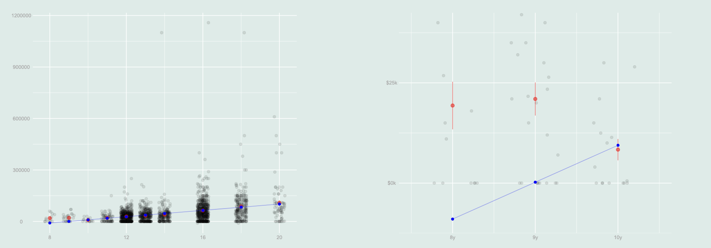

*图 29：收入条件均值与线性拟合的差异。*

**图示说明：** 这里黑点是真实数据，红点是每个x的平均，蓝点是OLS拟合的线。

**发现：** 在$x = 8$，蓝线预测是负的（甚至不合理），但红点（真实均值）是正的。

**错误来源：** 若真实条件均值非线性，总体投影 $\widetilde\mu(8)$ 可能与 $\mu(8)$ 不同，这是模型近似误差；此时此前用于有限样本无偏性证明的零条件均值假设一般不成立，不能直接沿用该无偏性结论。最小二乘目标对每个观测赋予相同权重，因此数据密集区域对总损失的贡献较大，稀疏边缘可能拟合较差；这是一种可能出现的情形，并非所有数据都如此。

**Consistency**

- 无偏性描述期望是否等于目标；一致性描述估计量是否随着样本增大而集中到目标。二者不是优劣排序，也不相互蕴含。
- 一致性的定义是对任意 $\epsilon>0$，

$$
P(|\widehat\theta_n-\theta|>\epsilon)\longrightarrow0,
\qquad\widehat\theta_n\xrightarrow{p}\theta.
$$

- 偏差趋于 0 本身不足以保证一致性；还要控制随机波动。例如，偏差与方差都趋于 0 是均方一致、从而依概率一致的充分条件。
- 若估计量收敛到与目标不同的固定数，则它对该目标不一致。

**Example：** 比如对于$\widetilde{Y} = \frac{1}{n - 2}\sum_{i = 1}^{n}\, Y_{i}$

**它为什么有 bias：** 因为

$$
E\left\lbrack \sum_{i = 1}^{n}\, Y_{i} \right\rbrack = n\mu
$$

所以

$$
E\lbrack\widetilde{Y}\rbrack = E\left\lbrack \frac{1}{n - 2}\sum_{i = 1}^{n}\, Y_{i} \right\rbrack = \frac{n}{n - 2}\mu
$$

因此bias是

$$
E\lbrack\widetilde{Y}\rbrack - \mu = \frac{n}{n - 2}\mu - \mu = \frac{2\mu}{n - 2}
$$

但是这个bias是依赖于n的，而且当 $n \rightarrow \infty$时

$$
\frac{2\mu}{n - 2} \rightarrow 0
$$

当 $n>2$ 且 $\mu\ne0$ 时，该估计量有偏，且偏差趋于 0。进一步由大数定律，$\widetilde Y=\frac{n}{n-2}\overline Y\xrightarrow{p}\mu$；若方差有限，也可见 $\operatorname{Var}(\widetilde Y)=n\sigma^2/(n-2)^2\to0$。因此它是一致的。

图示解释

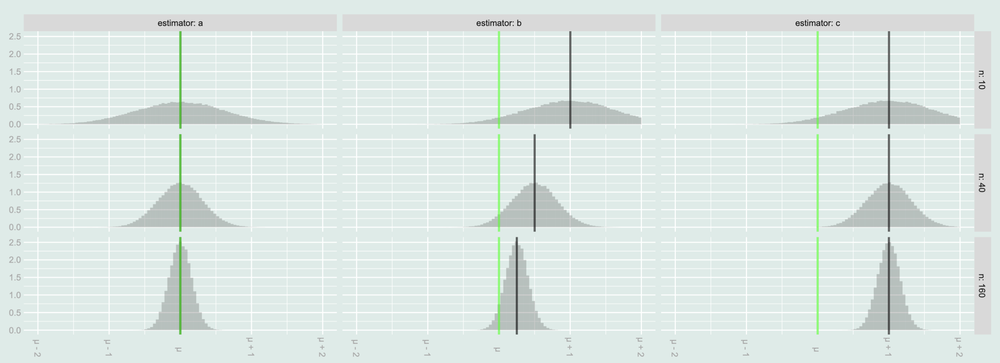

*图 30：三种估计量随样本量增加的偏差与离散程度。*

**estimator a：** 无偏，而且 consistent

**estimator b：** 偏差趋于 0，图中随机波动也随样本量收缩，因此图示估计量 consistent

**estimator c：** 有 bias，而且 bias 不变，所以 inconsistent

**但是：** 当你的 estimand 是 $\mu(x)$（真实条件均值），但你用的是linear regression时，若真实条件均值不属于线性模型，且在所讨论点有 $\widetilde\mu(x)\ne\mu(x)$，OLS 预测一般对 $\mu(x)$ 有模型偏差并不一致。若真实均值线性，或在特定点两者相同，则不能作此断言。

- This bias doesn't go away with more data. Bias不会消失。

- 不会消失是因为你收敛到了 $\widetilde{\mu}(x)$，但它本来就 ≠ $\mu(x)$。

**数据越多，more precisely wrong：** 就算CI变窄、distribution 变窄，但中心本身就是错的。

<a id="section-11"></a>

## 11. 线性回归假设、诊断与影响点

<a id="section-11-1"></a>

### 11.1 回归诊断的目的

#### 11.1.1 诊断与统计推断

`lm()` 拟合回归模型，`summary()` 等函数可报告系数估计值、标准误、$t$ 值和 $p$ 值；置信区间可用相应方法计算。这些输出的抽样解释依赖模型假设，以及误差项 $\varepsilon_i$ 与设计矩阵满足相应条件。

#### 11.1.2 真实误差与样本残差

**Error：** 在linear regression中

$$
Y_{i} = \beta_{0} + \beta_{1}X_{i} + \varepsilon_{i}
$$

这里的 $\varepsilon_{i}$是真实误差，表示"真实 $Y_{i}$"和"population regression line"之间的偏差。但这个 $\varepsilon_{i}$我们永远看不到，因为我们不知道真正的总体回归线。

**Residual：** 所以实际中我们只能看

$$
e_{i} = Y_{i} - {\widehat{Y}}_{i}
$$

这叫residual。

我们不是直接检验 error assumptions，而是用 residual 去近似检查 error assumptions。

#### 11.1.3 误差相关性与同方差性

**Independence：** 经典模型通常要求不同观测的真实误差条件不相关；条件独立是更强的充分条件。拟合后的残差通常彼此相关，不能把它们当成独立误差。 这意味着第一个点偏高一点，不应该自动导致第二个点也偏高一点。

**Homoscedasticity：** 真实误差在不同 $X$ 位置的条件方差相同；残差的条件方差还受杠杆值影响。

#### 11.1.4 基本假设与正态性附加假设

Gauss–Markov 定理使用线性均值结构、满列秩、零条件均值以及同方差不相关误差。正态性是精确小样本 t/F 推断常用的额外假设，不是 Gauss–Markov 定理的必要条件。

<a id="section-11-2"></a>

### 11.2 Gauss–Markov 假设与定理

#### 11.2.1 主要假设

##### 11.2.1.1 线性均值结构

模型写作 $Y=Xb+\varepsilon$。这里的“线性”指对系数 $b$ 线性；预测变量中可以包含已知的非线性变换，因此 $Y$ 与原始 $X$ 的散点图不必呈一条直线。在零条件均值假设下，模型的条件均值为 $E(Y\mid X)=Xb$。

##### 11.2.1.2 设计矩阵满列秩

$X$ 是 $n\times(p+1)$ 的设计矩阵：

$$
X = \begin{bmatrix}
1 & X_{11} & X_{12} & \ldots & X_{1p} \\
1 & X_{21} & X_{22} & \ldots & X_{2p} \\
\vdots & \vdots & \vdots & \ddots & \vdots \\
1 & X_{n1} & X_{n2} & \ldots & X_{np}
\end{bmatrix}
$$

每一行对应一个样本，每一列对应一个变量；第一列全是 1，表示截距。满列秩要求列与列之间没有完全线性依赖。

**例子：**若模型同时包含身高的厘米值 $X_2$ 和米值 $X_3$，则 $X_3=X_2/100$。两列包含完全重复的信息，$X$ 因而不满列秩。

**满列秩的作用：**最小二乘估计的显式公式是

$$
\widehat{b} = (X^{T}X)^{- 1}X^{T}Y
$$

需要可逆的是 $X^TX$；当 $X$ 满列秩时，$X^TX$ 可逆。$X$ 通常不是方阵，也无需 $X^{-1}$ 存在。

##### 11.2.1.3 误差的零条件均值

$$
E(\varepsilon\mid X)=0.
$$

这一条件要求：给定 $X$ 后，误差项没有系统性偏离。模型遗漏的因素在每个 $X$ 水平上的平均作用必须为 0；只要求无条件平均误差为 0 不够。

**例子：**用学习时间 $X$ 预测考试分数 $Y$。如果每个学习时间水平上遗漏因素的平均作用都是 0，则

- 学 2 小时的人，误差平均不偏正也不偏负

- 学 5 小时的人，误差平均也不偏正也不偏负

**推导条件均值：**

1. 从模型 $Y=Xb+\varepsilon$ 出发。
2. 两边对 $X$ 取条件期望，得到 $E(Y\mid X)=E(Xb+\varepsilon\mid X)$。
3. 给定 $X$ 后 $Xb$ 是常量，所以 $E(Y\mid X)=Xb+E(\varepsilon\mid X)$。
4. 利用 $E(\varepsilon\mid X)=0$，得到 $E(Y\mid X)=Xb$。

因此，在每个给定的 $X$ 下，$Y$ 的平均值等于线性均值函数。结合满列秩等条件，这也是 OLS 系数无偏性的关键。

##### 11.2.1.4 同方差与误差不相关

在零条件均值的基础上，条件协方差矩阵假设为

$$
Var(\varepsilon|X) = E\lbrack\varepsilon\varepsilon^{T}|\mathbf{X}\rbrack = \sigma^{2}I
$$

这包含两个层次：

1. **同方差：**每个观测的条件误差方差都等于 $\sigma^2$，即 $\operatorname{Var}(\varepsilon_i\mid X)=\sigma^2$。如果低收入群体的误差波动较小、高收入群体的误差波动较大，就出现异方差。
2. **不同观测误差不相关：**当 $i\ne j$ 时，$\operatorname{Cov}(\varepsilon_i,\varepsilon_j\mid X)=0$。第 $i$ 个样本的误差不应与第 $j$ 个样本的误差系统性同步变化。例如，用学习时间预测考试分数时，观察到学生 A 高于预测值 5 分、学生 B 低于预测值 3 分；这两个数值本身不能证明误差不相关，判断还需要观察跨样本的联合变化。

条件独立会推出条件不相关（在方差存在时），反过来一般不成立：不相关只排除线性依赖，仍可能存在非线性依赖。

##### 11.2.1.5 固定设计与条件于设计的推断

推导时可以把设计矩阵 $X$ 当作固定量，也可以在随机 $X$ 的模型中对观测到的 $X$ 条件化。此时关注的是给定这一组 $X$ 后 $Y$ 如何波动。实际数据中的年龄、收入和学习时间通常也是随机变量；对 $X$ 条件化并不意味着这些变量在抽样前一定固定。

#### 11.2.2 正态性附加假设

若进一步假定

$$
\varepsilon\mid X\sim N(0,\sigma^2I),
$$

则给定 $X$ 时，误差向量服从均值为 0、协方差矩阵为 $\sigma^2I$ 的多元正态分布；每个 $\varepsilon_i\mid X\sim N(0,\sigma^2)$。连同前述满列秩等条件，这给出以下有限样本结果：

1. 系数估计量 $\widehat b\mid X$ 服从正态分布。
2. 对正确构造的系数检验，零假设下的 $t$ 统计量服从相应的 $t$ 分布，$F$ 统计量服从相应的 $F$ 分布。
3. 由这些参考分布计算的经典 $t/F$ 检验 $p$ 值具有精确的模型条件解释，相应的经典 $t$ 置信区间具有精确的条件覆盖率。

正态性是这些经典有限样本分布结果的附加条件，OLS 的计算、零条件均值下的无偏性和 Gauss–Markov 定理都不需要它。在适当大样本条件下，即使没有误差正态性，也可使用渐近推断，并按误差结构选用相应标准误。

#### 11.2.3 均值结构、误差结构与设计矩阵

要从 $Y=Xb+\varepsilon$ 得到可解释的估计和推断结果，需要分别说明均值、误差和设计矩阵的条件：

1. **均值结构：** $Xb$ 描述 $Y$ 的条件均值。
2. **误差中心：** $E(\varepsilon\mid X)=0$。
3. **误差波动：** 经典 Gauss–Markov 条件要求同方差和不同观测误差不相关。
4. **设计矩阵：** $X$ 满列秩。
5. **经典有限样本检验：** 再加入条件正态性，可使用精确的 $t/F$ 参考分布。

#### 11.2.4 Gauss–Markov 定理

在上述线性均值结构、零条件均值、满列秩及同方差不相关误差条件下，OLS 是系数 $b$ 的最佳线性无偏估计量（Best Linear Unbiased Estimator，BLUE）。这里的“最佳”指在线性无偏估计量类中，给定 $X$ 后具有最小的协方差矩阵：

$$
\operatorname{Var}(\widetilde{\mathbf b}\mid X)-\operatorname{Var}(\widehat{\mathbf b}_{\mathrm{OLS}}\mid X)\succeq0
$$

对所有给定 $X$ 后关于 $Y$ 线性、且对 $b$ 条件无偏的估计量成立。矩阵不等式表示差为半正定矩阵，即任意固定线性组合的方差均不小于 OLS 的相应方差。

BLUE 的四个词分别表示：

1. **Best：** 协方差矩阵在上述意义下最小。
2. **Linear：** 估计量是 $Y$ 的线性组合。
3. **Unbiased：** $E(\widehat b\mid X)=b$，条件于 $X$ 不系统性高估或低估真实系数。
4. **Estimator：** 用于估计未知系数 $b$ 的统计量。

**含义：** OLS 的方差最小性限定在线性无偏估计量类中。在这一类中，MSE 等于方差，因此也具有对应的 MSE 最优性；如果允许有偏或非线性估计量，则不保证 OLS 的 MSE 最小。

**关键点：** Least Squares estimator BLUE语境下的estimand是 b，也就是在population层面，使平方误差最小的那条线的系数（包括 slope 和 intercept）。经典 BLUE 结论以正确指定的条件均值 $E(Y\mid X)=Xb$ 为前提。若只把 $b$ 定义为任意非线性总体关系的线性投影系数，零条件均值可能不成立，不能直接援用 Gauss–Markov 定理。

<a id="section-11-3"></a>

### 11.3 最小二乘估计量的期望与方差

#### 11.3.1 最小二乘估计公式

**公式：** 之前已经推导过，我们estimated $\widehat{b}$ with Least Squares (by minimizing the RSS).

$$
\widehat{b} = (X^{T}X)^{- 1}X^{T}Y
$$

和所有 estimator 一样，我们关心它的 expected value 和 variance。

#### 11.3.2 最小二乘估计量的期望

Expected Value: $E\left\lbrack \widehat{b} \right\rbrack = b$

**核心结论：** OLS estimator $\widehat{b}$ is unbiased, which means that $\widehat{b}$ is an unbiased estimator of b.

**Proof**

$$
\begin{aligned}
\widehat{\mathbf{b}} & = (\mathbf{X}^{T}\mathbf{X})^{- 1}\mathbf{X}^{T}\mathbf{Y} \\
& = (\mathbf{X}^{T}\mathbf{X})^{- 1}\mathbf{X}^{T}(\mathbf{Xb} + \varepsilon) \\
& = (\mathbf{X}^{T}\mathbf{X})^{- 1}\mathbf{X}^{T}\mathbf{Xb} + (\mathbf{X}^{T}\mathbf{X})^{- 1}\mathbf{X}^{T}\varepsilon \\
& = \mathbf{b} + (\mathbf{X}^{T}\mathbf{X})^{- 1}\mathbf{X}^{T}\varepsilon
\end{aligned}
$$

Now let's compute the expected value conditioned by **X** using assumption 5 about fixed X and 3 about mean of the errors.

$$
\begin{aligned}
E\lbrack\widehat{\mathbf{b}}|\mathbf{X}\rbrack & = E\lbrack\mathbf{b}|\mathbf{X}\rbrack + E\lbrack(\mathbf{X}^{T}\mathbf{X})^{- 1}\mathbf{X}^{T}\varepsilon|\mathbf{X}\rbrack \\
& = \mathbf{b} + (\mathbf{X}^{T}\mathbf{X})^{- 1}\mathbf{X}^{T}E\lbrack\varepsilon|\mathbf{X}\rbrack \\
& = \mathbf{b}
\end{aligned}
$$

By Iterated expectations:

$$
\begin{aligned}
E\lbrack\widehat{\mathbf{b}}\rbrack & = E\lbrack E(\widehat{\mathbf{b}}|\mathbf{X})\rbrack \\
& = E(\mathbf{b}) \\
& = \mathbf{b}
\end{aligned}
$$

**我们用到的假设**

**Mean 0 errors：** $E\lbrack\varepsilon \mid X\rbrack = 0$.

可固定 $X$，也可对随机设计矩阵条件化；无条件结论再由迭代期望得到。

#### 11.3.3 最小二乘估计量的条件方差

Variance: $\operatorname{Var}(\widehat{\mathbf b}\mid X)=\sigma^2(X^TX)^{-1}$

**核心结论：** $\operatorname{Var}(\widehat{\mathbf b}\mid X)=\sigma^2(X^TX)^{-1}$，这一步就是 Gauss--Markov 里 B = Best（方差最小）的基础。

**Proof**

令 $A=(X^TX)^{-1}X^T$，则 $\widehat b-b=A\varepsilon$。条件于 $X$，

$$
\begin{aligned}
\operatorname{Var}(\widehat b\mid X)
&=E[(\widehat b-b)(\widehat b-b)^T\mid X]\\
&=E[(A\varepsilon)(A\varepsilon)^T\mid X]\\
&=A\,E(\varepsilon\varepsilon^T\mid X)\,A^T\\
&=(X^TX)^{-1}X^T(\sigma^2I)X(X^TX)^{-1}\\
&=\sigma^2(X^TX)^{-1}.
\end{aligned}
$$

使用了 $(AB)^T=B^TA^T$、$X^TX$ 的对称性，以及误差的条件同方差不相关结构。随机设计下的无条件方差为 $\sigma^2E\{(X^TX)^{-1}\}$（若存在），不能遗漏外层期望。

条件方差公式显示两个来源：

1. **误差噪声 $\sigma^2$：**误差方差越大，系数估计的条件方差越大。
2. **设计矩阵 $X^TX$：**在误差方差与模型结构相同的条件下，增加有效观测通常减小系数方差；列之间接近线性依赖（多重共线性）则会增大相应系数的方差。

**我们用到的假设**

- 满列秩与 $E(\varepsilon\mid X)=0$（本证明按中心化误差展开）

- 误差满足 $\operatorname{Var}(\varepsilon\mid X)=\sigma^2I$，即条件同方差且不相关

<a id="section-11-4"></a>

### 11.4 残差诊断与影响点

#### 11.4.1 残差能检查什么

Diagnostics: 诊断使用残差寻找模型假设可能失效的迹象，不能仅凭残差图证明所有假设成立。特别是外生性和未测量混杂需要设计及领域知识支持。检查重点包括

- 条件均值结构是否合理，以及按时间、空间或簇排列后是否存在相关模式。

- 误差的条件方差是否近似恒定；标准化残差有助于考虑杠杆值差异。

- 若采用精确小样本正态模型推断，再检查误差分布是否明显偏离正态。

#### 11.4.2 正态性诊断

**Example：** 我们有一个basic simple linear model。

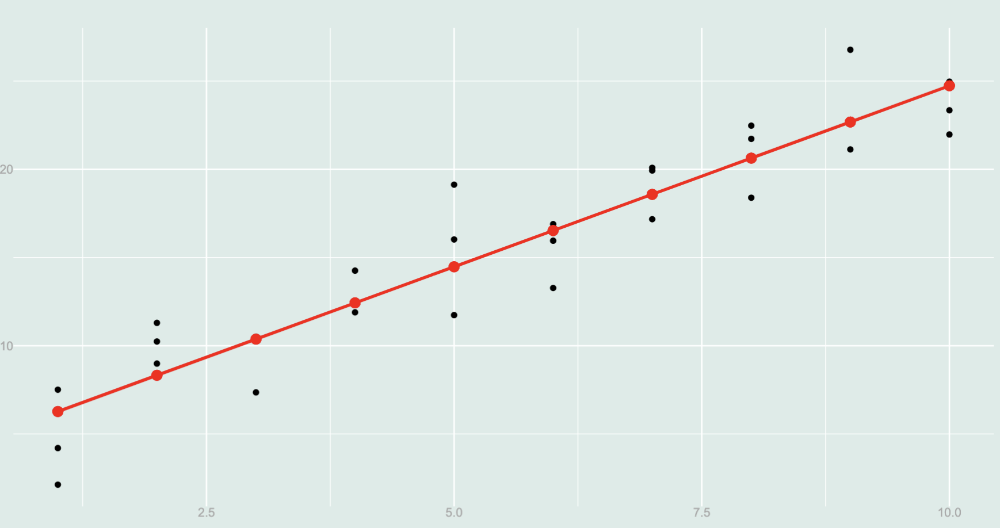

*图 31：用于残差诊断的简单线性拟合。*

##### 11.4.2.1 正态 Q-Q 图

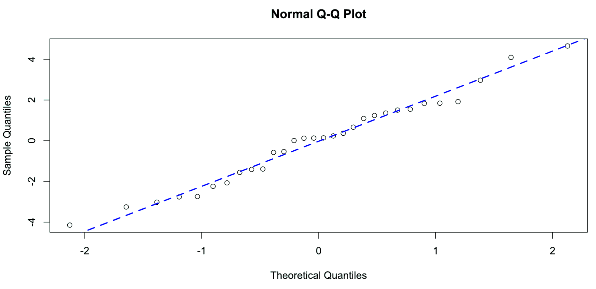

*图 32：残差的正态 Q-Q 图。*

Q-Q 图按相同分位水平比较两个分布。这里先将残差排序，再把它们的样本分位数与理论正态分位数一一对应：横轴是理论分位数，纵轴是样本残差分位数。若残差分布接近正态，点大致沿参考直线排列。

图形接近直线支持近似正态的判断，但不能证明误差正态；尤其要检查两端尾部是否明显偏离参考线。实际检验中还须考虑残差并非独立同分布的真实误差。

##### 11.4.2.2 残差直方图与密度曲线

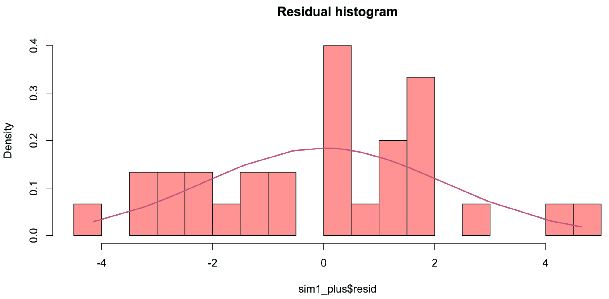

*图 33：残差密度直方图与正态参考曲线。*

**残差直方图：**把残差分入数值区间，显示各区间中的观测数量或密度，以观察分布的整体形状。

**正态参考密度曲线：**使用当前残差的样本均值和样本标准差，画出相应正态分布的理论密度。

曲线的绘制分为三步：

**第 1 步：** 先取 residual 的样本均值，再取 residual 的样本标准差。

**第 2 步：** 用这两个参数生成一条对应正态分布的理论density line。

**第 3 步：** 叠加在 histogram 上。

##### 11.4.2.3 Shapiro–Wilk 正态性检验

Q-Q 图和直方图提供直观判断；Shapiro–Wilk 检验提供形式化统计检验。对满足该检验抽样条件的观测，假设为：

- **原假设 $H_0$：**观测来自正态总体。
- **备择假设 $H_1$：**观测不来自正态总体。

$p$ 值很小（例如小于 0.05）时拒绝 $H_0$；$p$ 值较大时只能说未发现足够证据拒绝 $H_0$，不能据此证明正态性。样本较小时，检验能力可能有限。

计算 Shapiro–Wilk 检验 $p$ 值时，先构造统计量 $W$：

**第 1 步：** 计算一个统计量 $W$，本质上是"你的数据像不像正态"的一个量化指标

$$
W = \frac{\left( \sum a_{i}x_{(i)} \right)^{2}}{\sum(x_{i} - \overline{x})^{2}}
$$

其中，$x_{(i)}$ 是排序后的观测值（在这里为残差），$a_i$ 是由正态次序统计量确定的权重。分母为离差平方和 $(n-1)s^2$，不是除以自由度后的样本方差。

**第 2 步：** 看这个 $W$在"正态分布假设下"有多极端，也就是在 $H_{0}$（正态）成立时，$W$ 有一个分布（很复杂，没有简单公式）。

**第 3 步：** 计算p-value

$$
p=P_{H_0}(W\le W_{\mathrm{obs}})
$$

#### 11.4.3 均值结构、方差结构与系数区间

##### 11.4.3.1 残差与拟合值图

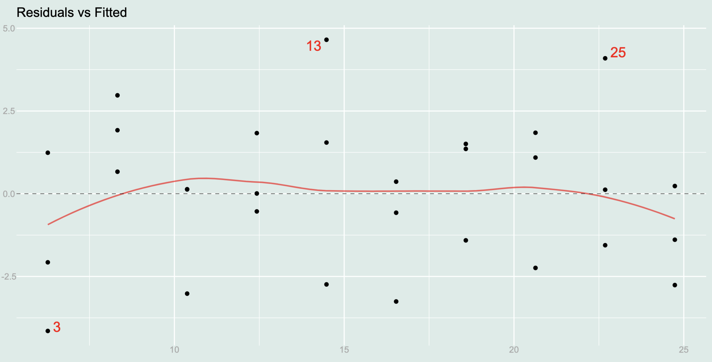

*图 34：残差与拟合值关系图。*

横轴为拟合值 $\widehat Y_i$，纵轴为残差 $e_i=Y_i-\widehat Y_i$；每个点对应一个观测。此图用于寻找条件均值结构不合理、非线性或误差波动改变的迹象。

若点在 0 两侧散开、没有明显形状，且平滑趋势线大致水平，图形没有显示明显的均值结构问题。不过，残差图不能证明零条件均值成立。

##### 11.4.3.2 Scale–Location 图

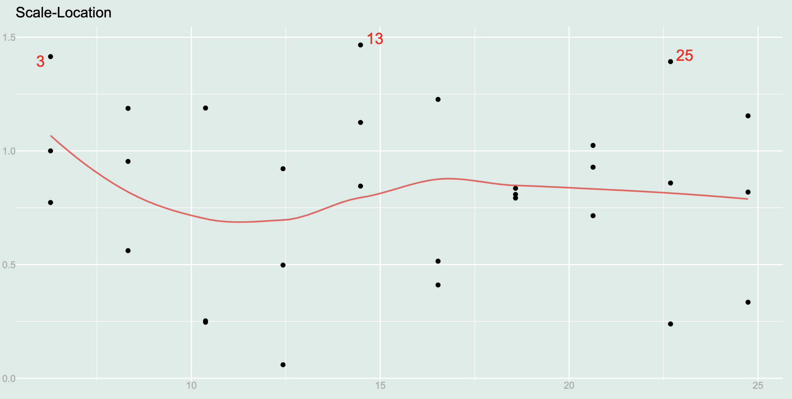

*图 35：标准化残差的 Scale-Location 图。*

横轴为拟合值 $\widehat Y_i$，纵轴为标准化残差绝对值的平方根 $\sqrt{|r_i|}$，其中 $r_i=e_i/(\widehat\sigma\sqrt{1-h_{ii}})$。此图关注误差大小而不关注正负，用于寻找异方差迹象。

若不同拟合值附近的残差尺度大致稳定，平滑趋势线通常接近水平。各处点的数量可以不同；诊断重点是纵向散布和趋势，而不是点在横轴上的均匀程度。

##### 11.4.3.3 系数的 95% 置信区间

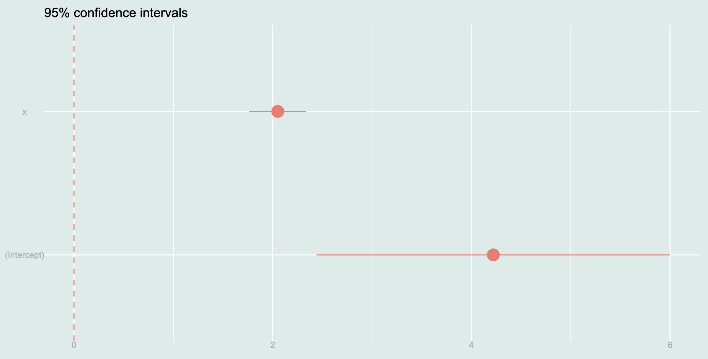

*图 36：回归系数的 95% 置信区间。*

图中展示各回归系数的 95% 置信区间。对于与同一模型和标准误对应的双侧 5% 检验，可检查区间是否包含 0：若包含 0，则在该水平上不显著；若不包含 0，则显著。端点恰好等于 0 时，按所用检验的边界约定处理。

#### 11.4.4 异常值、杠杆值与影响点

**Outlier：** 相对于误差尺度具有较大绝对残差的点；通常查看标准化或学生化残差。

$$
|e_i|=|Y_i-\widehat Y_i|\text{ is large relative to the residual scale}
$$

本质上就是模型预测和真实值差很多。

**Leverage point：** $x_{i}$ 距离均值 $\overline{x}$ 很远。也就是在横轴上很极端。不一定影响回归线。

**Influential point：** 删掉这个点，回归线会明显改变，对模型有影响。

简单线性回归含截距时，杠杆值为

$$
h_{ii}=\frac1n+\frac{(X_i-\overline X)^2}{\sum_j(X_j-\overline X)^2}.
$$

多元回归中 $h_{ii}$ 是帽子矩阵 $H=X(X^TX)^{-1}X^T$ 的对角元素，衡量观测在整个协变量空间中的特殊程度。高杠杆并不必然意味着大残差或强影响。

Cook's distance 同时考虑残差与杠杆，可写为

$$
D_i=\frac{e_i^2}{q\widehat\sigma^2}\frac{h_{ii}}{(1-h_{ii})^2},\qquad q=p+1.
$$

可以比较保留和移除该点后的系数、预测及结论，判断敏感性。发现异常点后，应先检查录入错误、单位和测量过程，再根据研究问题判断如何处理，不能仅因统计指标偏大就自动删除。

残差不是误差的独立复制品。经典模型下 $\mathbf e=(I-H)\varepsilon$，因此

$$
E(\mathbf e\mid X)=0,\qquad\operatorname{Var}(\mathbf e\mid X)=\sigma^2(I-H).
$$

所以 $\operatorname{Var}(e_i\mid X)=\sigma^2(1-h_{ii})$，且不同残差通常相关。含截距 OLS 还满足 $\sum_i e_i=0$，这个机械性质不能证明 $E(\varepsilon\mid X)=0$。

将残差直接输入 `shapiro.test()` 可以作为辅助诊断，但经典 Shapiro–Wilk 检验以独立同分布观测为基础，残差的相关性与不同杠杆值会影响其标称分布。应结合标准化残差 Q-Q 图、样本量和研究设计解释，必要时使用按拟合模型模拟并重新拟合的诊断校准。
